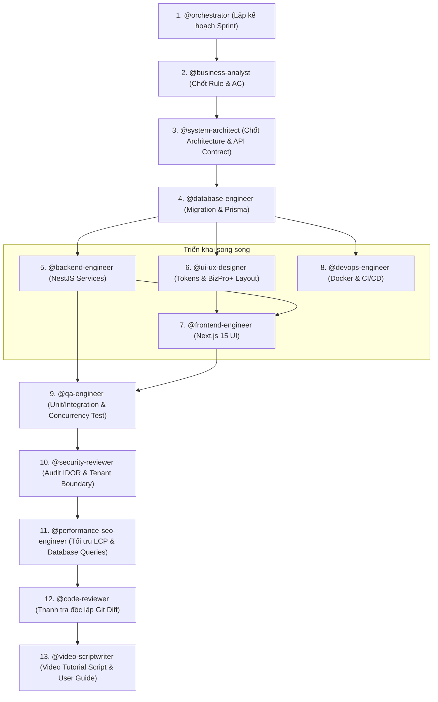

# MULTI-AGENT DEVELOPMENT PLAN & COLLABORATION PROTOCOL
## BUSINESS MANAGEMENT SYSTEM (CRM + INVENTORY + HRM + SALES ORDER)
**Phiên bản:** 2.0 (Cập nhật chuẩn hóa toàn diện 13 Custom Agents theo hình mẫu BizPro+)  
**Phương pháp:** Modular Monolith Architecture, Domain-Driven Design Lite, Strict Quality Gates  

---

## 1. BẢNG PHÂN BỔ TRÁCH NHIỆM 13 CUSTOM AGENTS CHO DỰ ÁN

Hệ thống điều phối chính xác 13 Custom Agents trong dự án Business Management System như sau:

| STT | Custom Agent | Chuyên môn cốt lõi trong dự án | Nhiệm vụ chính & Deliverables |
| :---: | :--- | :--- | :--- |
| 1 | **`@orchestrator`** | Tổng thầu điều phối toàn bộ đội ngũ | Lập kế hoạch từng Phase/Sprint, phân chia User Story, điều phối dependency, kích hoạt bàn giao (Handoff) và quản lý tiến độ chung. |
| 2 | **`@system-architect`** | Kiến trúc sư hệ thống Modular Monolith | Định nghĩa Bounded Contexts (Auth, CRM, Inventory, Sales, HRM), Event Bus (Domain Events), quy chuẩn RESTful API và thiết kế State Machine. |
| 3 | **`@business-analyst`** | Phân tích nghiệp vụ & Quy tắc cốt lõi | Chốt quy tắc bất biến: Zero Negative Stock, Available = OnHand - Reserved, luồng chuyển đổi Lead $\rightarrow$ Customer, chính sách phê duyệt đơn nghỉ phép. |
| 4 | **`@database-engineer`** | Kỹ sư CSDL (PostgreSQL & Prisma) | Quản lý 50 bảng trong `prisma/schema.prisma`, chạy database migrations, tối ưu chỉ mục (Composite Indexes, Full-text GIN) và Pessimistic Locking (`SELECT FOR UPDATE`). |
| 5 | **`@backend-engineer`** | Kỹ sư Backend (NestJS / Node.js) | Lập trình các Module NestJS, Multi-tenancy Context Interceptor, RBAC + Data Scope Engine, Service xử lý Database Transactions và Idempotency. |
| 6 | **`@frontend-engineer`** | Kỹ sư Frontend (Next.js 15 App Router) | Lập trình Web Responsive với React 19, App Router, TanStack Query, Zustand, tích hợp REST API, tối ưu Client/Server Components. |
| 7 | **`@ui-ux-designer`** | Chuyên viên UI/UX & Design System | Hiện thực hóa 100% phong cách thiết kế **BizPro+**: Thẻ KPI 4 màu có mini Sparkline, Biểu đồ so sánh 2 đường, Donut chart, Sales Funnel, Cảnh báo tồn kho. |
| 8 | **`@qa-engineer`** | Kỹ sư QA & Kiểm thử tự động | Viết Unit Test logic nghiệp vụ, Integration Test với CSDL thật, đặc biệt là **Concurrency Stress Test** kiểm thử 20+ request tranh chấp tồn kho đồng thời. |
| 9 | **`@security-reviewer`** | Chuyên gia an ninh mạng & Bảo mật | Kiểm toán chống IDOR, kiểm tra cô lập dữ liệu tổ chức (Multi-tenant Leak Test), kiểm toán mã băm mật khẩu Argon2id, ngăn chặn leo thang đặc quyền. |
| 10 | **`@performance-seo-engineer`** | Kỹ sư tối ưu hiệu năng hệ thống | Tối ưu Core Web Vitals (LCP < 1.2s, INP < 50ms), SSR Caching với Next.js Cache, tối ưu hóa câu truy vấn Prisma tránh n+1 query. |
| 11 | **`@devops-engineer`** | Kỹ sư DevOps & Môi trường | Đóng gói Docker Multi-stage, viết `docker-compose.yml` gồm PostgreSQL 16, Redis 7, MinIO, NestJS API và Next.js Frontend, cấu hình biến môi trường `.env`. |
| 12 | **`@code-reviewer`** | Thanh tra độc lập kiểm soát chất lượng | Rà soát 100% Git Diff của mọi Pull Request, loại bỏ triệt để mock/stub rỗng, kiểm tra quy chuẩn coding standards và cấp chứng nhận xuất xưởng (Sign-off). |
| 13 | **`@video-scriptwriter`** | Chuyên viên nội dung & Đào tạo sản phẩm | Biên soạn kịch bản video hướng dẫn sử dụng (User Onboarding Walkthrough), tài liệu chuyển giao vận hành trực quan cho khách hàng doanh nghiệp. |

---

## 2. QUY TRÌNH PHỐI HỢP LIÊN AGENT (MULTI-AGENT HANDOFF PROTOCOL)

---

## 3. CÁC CỔNG KIỂM SOÁT NGHIỆM THU (QUALITY GATES)

Trước khi chuyển giao code giữa các Subagent:
1. **Gate 1 (DB Ready):** `@database-engineer` hoàn tất migration, seed dữ liệu mẫu, không lỗi khóa ngoại.
2. **Gate 2 (API Sealed):** `@backend-engineer` có DTO validation, RBAC Guard, đã pass toàn bộ Unit Test.
3. **Gate 3 (UI Pixel Perfect):** `@frontend-engineer` và `@ui-ux-designer` hoàn thiện màn hình đúng 100% layout BizPro+, không vỡ layout khi responsive.
4. **Gate 4 (Concurrency Proof):** `@qa-engineer` chứng minh kịch bản nhiều người cùng tranh mua không gây tồn âm.
5. **Gate 5 (Security Cleared):** `@security-reviewer` xác nhận không có lỗ hổng IDOR hoặc lộ dữ liệu đa tenant.
6. **Gate 6 (Shipment Certified):** `@code-reviewer` cấp chứng chỉ xuất xưởng, không còn file TODO hay mock tạm bợ.
