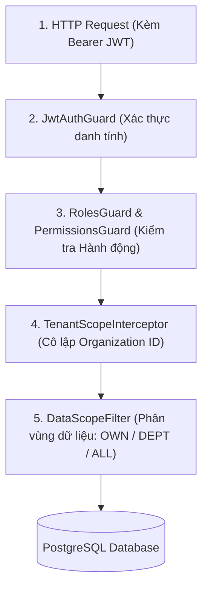

# ARCHITECTURE ASSESSMENT & DETAILED TECHNICAL DESIGN: BIZPRO+
**ĐÁNH GIÁ KIẾN TRÚC, KIỂM TOÁN 50 PRISMA MODELS, BẢO MẬT 2 LỚP & THIẾT KẾ GIAO DỊCH KHO**

* **Phiên bản:** 2.0 (Cập nhật chuẩn hóa theo phản biện kiến trúc của Tech Lead)
* **Tác giả:** Principal Software Architect & Lead Database Engineer
* **Mục tiêu:** Cung cấp tài liệu thiết kế kỹ thuật chính xác tuyệt đối làm nền tảng cho việc khởi tạo Backend và Database, không suy đoán.

---

## 1. SO SÁNH KIẾN TRÚC THỰC TẾ & MỤC TIÊU CHUYỂN ĐỔI

### 1.1. Hiện trạng thực tế trong Repository
* **Frontend:** Next.js 15.1.0 App Router, React 19, Tailwind CSS. Gồm 17 trang giao diện tĩnh, hoạt động dựa trên 1 React Context duy nhất ([AppContext.tsx](file:///e:/dự%20án/frontend/src/context/AppContext.tsx)). Dữ liệu lưu trong RAM, không bền vững (F5 là mất).
* **Backend:** Chưa có thư mục `/backend`, chưa có API RESTful.
* **Database:** Chưa có PostgreSQL engine hoạt động; đã có file thiết kế [schema.prisma](file:///e:/dự%20án/prisma/schema.prisma) (50 models, 14 enums).

### 1.2. Kiến trúc mục tiêu (Clean Modular Monolith)
Phân tách thành 2 thư mục độc lập hoàn toàn (`/frontend` và `/backend`):
* **`/frontend` (Port 3000):** Next.js 15 Client & Server Components, dùng TanStack Query (React Query) kết nối REST API, quản lý token trong HttpOnly Cookie / Memory.
* **`/backend` (Port 4000):** NestJS Modular Monolith kết nối PostgreSQL 16 qua Prisma ORM. Độc quyền thực thi quy tắc bất biến, phân quyền RBAC + Data Scope và Database Transactions (`SELECT ... FOR UPDATE`).
* **Vị trí của Redis:** Redis là dịch vụ phụ trợ (caching, background queue), **KHÔNG PHẢI DEPENDENCY BẮT BUỘC** trong giai đoạn MVP. Mọi bài toán khóa giao dịch kho và lưu trữ session đều do PostgreSQL 16 đảm nhiệm trực tiếp.

---

## 2. KIỂM TOÁN CHUYÊN SÂU 50 PRISMA MODELS (`prisma/schema.prisma`)

Sau khi rà soát chi tiết 1,277 dòng mã trong `prisma/schema.prisma`, dưới đây là kết quả kiểm toán 10 khía cạnh cốt lõi:

### 2.1. Phân định rõ 3 thực thể cốt lõi trong Quản lý Kho
Cần phân biệt rõ trách nhiệm của 3 bảng để tránh nhầm lẫn nghiệp vụ:
1. **`inventory_balances` (Số dư hiện tại):**
   * Lưu trữ số lượng tồn thực tế (`quantity_on_hand`) và số lượng đang giữ (`quantity_reserved`) tại một kho cụ thể cho một sản phẩm.
   * Đây là bảng bị đọc và ghi nhiều nhất, phải áp dụng khóa dòng khi giao dịch.
2. **`inventory_transactions` (Sổ cái kho bất biến - Immutable Stock Ledger):**
   * Ghi nhận lịch sử mọi lần biến động: `RECEIPT` (+), `ISSUE` (-), `TRANSFER_OUT` (-), `TRANSFER_IN` (+), `ADJUST_INCREASE` (+), `ADJUST_DECREASE` (-).
   * **Nguyên tắc vàng:** Cập nhật `inventory_balances` và ghi dòng vào `inventory_transactions` **BẮT BUỘC PHẢI NẰM TRONG CÙNG 1 DATABASE TRANSACTION**. Không bao giờ được phép tách rời.
3. **`inventory_reservations` (Lịch sử giữ và giải phóng hàng):**
   * Ghi nhận việc đơn bán hàng cụ thể nào (`sales_order_id`) đang giữ bao nhiêu hàng (`quantity`), trạng thái `ACTIVE` (đang giữ), `FULFILLED` (đã xuất) hay `RELEASED` (đã giải phóng khi hủy đơn).

### 2.2. Kiểm tra Khóa chính, Khóa ngoại & Composite Indexes
* **Khóa chính:** 100% 50 bảng đều sử dụng UUID chuẩn (`@id @default(dbgenerated("gen_random_uuid()")) @db.Uuid`).
* **Khóa ngoại & Quan hệ:** Đã thiết lập đầy đủ quan hệ giữa các Bounded Contexts.
* **Phát hiện lỗi thiếu Composite Indexes (Critical Performance Gap):**
  * PostgreSQL **không tự động tạo index cho foreign key trên bảng con**.
  * Các bảng chi tiết đang thiếu index nghiêm trọng:
    * `sales_order_items`: Thiếu `@@index([salesOrderId])` và `@@index([productId])`.
    * `stock_receipt_items`: Thiếu `@@index([receiptId])` và `@@index([productId])`.
    * `stock_issue_items`: Thiếu `@@index([issueId])` và `@@index([productId])`.
    * `stock_transfer_items`: Thiếu `@@index([transferId])`.
    * `stock_adjustment_items`: Thiếu `@@index([adjustmentId])`.
    * `stocktake_items`: Thiếu `@@index([stocktakeId])`.
    * `inventory_balances`: Đã có `@@unique([organizationId, warehouseId, productId])`, nhưng khi truy vấn tổng tồn khả dụng của 1 sản phẩm trên toàn công ty (`WHERE organization_id = ? AND product_id = ?`) sẽ bị chậm. Cần bổ sung `@@index([organizationId, productId])`.
  * *Hành động khắc phục:* Bổ sung toàn bộ các chỉ mục này vào `schema.prisma` trước khi tạo migration.

### 2.3. Kiểm tra Độ chính xác số học (Decimal Precision)
* Tiền tệ: `Decimal(15, 2)` trên `cost_price`, `selling_price`, `subtotal`, `discount_amount`, `tax_amount`, `total_amount`, `salary_amount`. Đảm bảo tính toán tài chính chính xác đến từng đồng lẻ, không bị lỗi float.
* Số lượng hàng hóa: `Decimal(12, 3)` trên `quantity`, `quantity_on_hand`, `quantity_reserved`, `quantity_change`, `min_stock_level`. Hỗ trợ chính xác đến 3 chữ số thập phân (ví dụ: `1.250 kg`, `0.750 mét`).
* Số ngày phép: `Decimal(5, 1)` trên `annual_quota`, `entitled_days`, `used_days`, `pending_days`, `total_days`. Hỗ trợ nửa ngày phép (`0.5` ngày).

### 2.4. Kiểm tra Trường thiếu cho Nghiệp vụ thực tế (Missing Business Fields)
1. **Thiếu trường trong `SalesOrder`:**
   * **Thiếu `paymentStatus`:** Hiện tại `SalesOrderStatus` chỉ có trạng thái giao vận/kho (`DRAFT`, `CONFIRMED`, `PARTIALLY_FULFILLED`, `FULFILLED`, `CANCELLED`). Cần bổ sung enum `PaymentStatus` (`UNPAID`, `PARTIALLY_PAID`, `PAID`, `REFUNDED`) để tách bạch giữa trạng thái kho và trạng thái thanh toán.
   * **Thiếu `shippingAddress`:** Đơn hàng cần có trường địa chỉ giao hàng riêng biệt vì khách hàng doanh nghiệp có thể yêu cầu giao tới chi nhánh khác ngoài trụ sở chính (`Customer.address`).
2. **Hành vi Xóa (Delete Behavior & Soft Delete):**
   * Trong ERP, các bảng lõi như `Product`, `Customer`, `SalesOrder`, `Warehouse` tuyệt đối không được xóa cứng (Hard Delete) nếu đã phát sinh giao dịch.
   * Cần chuẩn hóa cờ trạng thái `CommonStatus` (`ACTIVE`, `INACTIVE`, `ARCHIVED`) hoặc `deletedAt: DateTime?` để bảo đảm tính toàn vẹn dữ liệu kế toán và kiểm toán.

---

## 3. THIẾT KẾ BẢO MẬT 2 LỚP: RBAC & MULTI-TENANCY DATA SCOPE

Quy trình bảo vệ luồng dữ liệu tuân thủ đường ống 4 bước:
$$\text{Authentication} \longrightarrow \text{Authorization (RBAC)} \longrightarrow \text{Tenant Isolation} \longrightarrow \text{Data Scope}$$



### 3.1. Lớp 1: RBAC (Quyền hành động)
* Cấu trúc mã quyền: `<module>.<resource>.<action>` (Đã chuẩn hóa 66 mã quyền trong `05-permission-matrix-physical.md`).
* Ví dụ:
  * `sales.orders.create`, `sales.orders.confirm`, `sales.orders.fulfill`, `sales.orders.cancel`
  * `inventory.products.read`, `inventory.stock.issue`, `inventory.stock.adjust`
  * `hrm.leave.request`, `hrm.leave.approve`

### 3.2. Lớp 2: Data Scope (Phạm vi bản ghi được xem/thao tác)
Một nhân viên có quyền `sales.orders.read`, nhưng không có nghĩa là được xem toàn bộ đơn của công ty. Data Scope quyết định điều kiện `WHERE` được tự động chèn vào câu truy vấn:

| Cấp độ Scope | Ý nghĩa nghiệp vụ | Điều kiện truy vấn áp dụng (Prisma Where Clause) |
|---|---|---|
| **`OWN`** | Chỉ thao tác trên bản ghi do chính mình phụ trách | `where: { assignedTo: currentUser.id }` hoặc `where: { createdBy: currentUser.id }` |
| **`DEPARTMENT`** | Thao tác trên bản ghi của toàn bộ phòng ban mình trực thuộc | `where: { employee: { departmentId: currentUser.departmentId } }` |
| **`ALL`** | Toàn quyền trên toàn bộ dữ liệu của tổ chức | Không lọc thêm điều kiện người tạo (chỉ lọc theo `organizationId`) |

### 3.3. Ma trận Vai trò & Phạm vi thực tế (Role-to-Scope Matrix)
| Vai trò (Role) | Module chính | Quyền hành động tiêu biểu | Data Scope mặc định |
|---|---|---|:---:|
| **Super Admin** | Toàn hệ thống | Quản trị nền tảng, kích hoạt tổ chức, cấu hình hệ thống | `ALL` |
| **Organization Admin** | Doanh nghiệp | Toàn quyền cấu hình, quản lý người dùng, phân vai trò, xem báo cáo | `ALL` |
| **Sales Manager** | CRM & Bán hàng | Duyệt báo giá, quản lý chỉ tiêu, xem toàn bộ đơn hàng và khách hàng | `ALL` (Phân hệ Sales & CRM) |
| **Sales Staff** | CRM & Bán hàng | Tạo Lead, tạo Deal, lập đơn hàng nháp | `OWN` (Chỉ xem Lead/Deal/Đơn do mình phụ trách) |
| **Warehouse Manager** | Kho hàng | Duyệt phiếu nhập, xuất kho, phê duyệt kết quả kiểm kê cân bằng | `ALL` (Phân hệ Kho) |
| **Warehouse Staff** | Kho hàng | Lập phiếu nhập kho, soạn hàng xuất kho, đếm kiểm kê | `DEPARTMENT` / Kho được phân công |
| **HR Manager** | Nhân sự (HRM) | Duyệt nghỉ phép, quản lý bảng lương, điều chỉnh chấm công | `ALL` (Phân hệ HRM) |
| **Employee** | Nhân sự (HRM) | Chấm công cá nhân, nộp đơn xin nghỉ phép, xem ngày phép còn lại | `OWN` (Chỉ dữ liệu của bản thân) |

### 3.4. Phòng thủ theo chiều sâu (Defense-in-Depth cho Multi-tenancy)
* **Không phụ thuộc duy nhất vào Prisma Extension:**
  1. **Tầng Request/Controller:** `TenantInterceptor` trích xuất `orgId` từ JWT đã verify chữ ký và gán vào Request Context.
  2. **Tầng Service:** Các Service method nhận `orgId` từ context làm tham số bắt buộc.
  3. **Tầng Prisma Extension:** Tự động chèn `where: { organizationId }` cho các truy vấn ORM chuẩn.
  4. **Tầng Raw SQL / Trực tiếp:** Với các câu truy vấn phức tạp hoặc lệnh khóa dòng `$queryRaw`, luôn bắt buộc tham số hóa tường minh `organization_id = ${orgId}::uuid`.
  5. **Tầng Kiểm thử tự động:** Bộ test `tenant-isolation.spec.ts` bắt buộc thử nghiệm các truy vấn chéo (Cross-Tenant Attack) để chứng minh User Org A không bao giờ đọc được dữ liệu của Org B.

---

## 4. CHIẾN LƯỢC GIAO DỊCH & KHÓA KHO (INVENTORY TRANSACTION STRATEGY)

Trong quản lý kho, công thức bất biến:
$$\text{Available Stock} = \text{OnHand Stock} - \text{Reserved Stock}$$

### 4.1. Quy tắc bất biến bắt buộc (Core Invariants)
1. **Không giữ hàng vượt tồn khả dụng:** `requestedQty <= (on_hand - reserved)`. Nếu không đủ, transaction lập tức rollback.
2. **Không trừ kho hai lần:** Một đơn hàng chỉ có thể chuyển sang `FULFILLED` một lần duy nhất từ trạng thái `CONFIRMED`.
3. **Không giải phóng reservation hai lần:** Chỉ giải phóng khi đơn hàng hủy từ trạng thái `CONFIRMED`.
4. **Không fulfillment đơn đã hủy; Không hủy đơn đã xuất kho theo luồng thường:** Đơn đã `FULFILLED` muốn trả hàng phải đi qua quy trình Nhập trả hàng (Goods Return), không được đổi status sang `CANCELLED`.
5. **Cập nhật số dư và Ghi sổ cái là một khối nguyên tử (Atomicity):** Không bao giờ có chuyện tăng/giảm số dư mà không sinh bản ghi trong `inventory_transactions`.

### 4.2. Thiết kế Interactive Transaction với `SELECT ... FOR UPDATE`

```
Timeline: Hai nhân viên cùng bán sản phẩm cuối cùng (OnHand = 1, Reserved = 0)

Transaction A (Nhân viên 1)                  Transaction B (Nhân viên 2)
---------------------------------             ---------------------------------
BẮT ĐẦU $transaction                          BẮT ĐẦU $transaction
SELECT ... FOR UPDATE (Khóa dòng id=1)        SELECT ... FOR UPDATE (Chờ khóa...)
-> Đọc được: OnHand=1, Reserved=0             [BỊ CHẶN Ở TẦNG POSTGRESQL]
-> Tồn khả dụng = 1 - 0 = 1 >= 1 (HỢP LỆ)      ...
-> Cập nhật: Reserved = 0 + 1 = 1             ...
-> Tạo InventoryReservation                   ...
-> Đổi status đơn A: CONFIRMED                ...
COMMIT TRANSACTION (Giải phóng khóa dòng)     ...
                                              -> HẾT CHẶN: Đọc được số dư mới:
                                              -> OnHand=1, Reserved=1
                                              -> Tồn khả dụng = 1 - 1 = 0 < 1
                                              -> NÉM LỖI: INSUFFICIENT_STOCK!
                                              ROLLBACK TRANSACTION (Thất bại an toàn)
```

### 4.3. Ràng buộc toàn vẹn ở tầng Cơ sở dữ liệu (Database Check Constraints)
Khi tạo migration PostgreSQL thật, ta bổ sung câu lệnh ràng buộc vật lý:
```sql
ALTER TABLE "inventory_balances"
  ADD CONSTRAINT "chk_inventory_balances_positive_on_hand" CHECK ("quantity_on_hand" >= 0),
  ADD CONSTRAINT "chk_inventory_balances_positive_reserved" CHECK ("quantity_reserved" >= 0),
  ADD CONSTRAINT "chk_inventory_balances_valid_available" CHECK ("quantity_on_hand" >= "quantity_reserved");
```
Ràng buộc này là tấm lá chắn thép cuối cùng: ngay cả khi code backend có lỗi logic, PostgreSQL cũng sẽ từ chối commit nếu số dư làm cho `quantity_on_hand < quantity_reserved`.
