# BÁO CÁO PHÂN TÍCH & LỰA CHỌN CHIẾN LƯỢC TRIỂN KHAI HỆ THỐNG BIZPRO+
**Mã tài liệu:** `docs/BIZPRO_IMPLEMENTATION_STRATEGY.md`  
**Ngày lập:** 05/11/2026  
**Chuyên gia thẩm định:** Tech Lead & Independent System Architect  
**Mục tiêu:** So sánh toàn diện 2 chiến lược triển khai phần mềm cho hệ sinh thái BizPro+, đưa ra khuyến nghị chiến lược tối ưu và kế hoạch giảm thiểu rủi ro.

---

## 1. TỔNG QUAN HAI CHIẾN LƯỢC TRIỂN KHAI

Hệ thống BizPro+ là một nền tảng quản trị doanh nghiệp hợp nhất (ERP/CRM/HRM) đa người thuê (Multi-tenant SaaS) với 51 bảng cơ sở dữ liệu quan hệ, yêu cầu nghiêm ngặt về phân quyền (RBAC), cách ly dữ liệu tầng động cơ (PostgreSQL Row-Level Security), và an toàn tài chính (Audit Log, Double-entry/Ledger, Atomic Stock Reservation).

Đứng trước giai đoạn hiện thực hóa mã nguồn (Implementation Phase), có hai trường phái tiếp cận kỹ thuật:

```mermaid
flowchart TD
    subgraph STRAT_A["Chiến lược A: Nền tảng trước, Nghiệp vụ sau (Foundation-First)"]
        A1["Phase 1: Security & Auth\n(Session, Token Rotation, CSRF)"] --> A2["Phase 2: Core Platform & RLS\n(Multi-tenant, Audit, RBAC, DTO Pipes)"]
        A2 --> A3["Phase 3: Master Data & Identity\n(Organizations, Users, Employees)"]
        A3 --> A4["Phase 4: Domain Modules\n(CRM -> Inventory -> Sales Orders -> HRM)"]
        A4 --> A5["Phase 5: Cross-Module Integration\n(Pipeline chốt đơn -> Giữ hàng -> Kế toán)"]
    end

    subgraph STRAT_B["Chiến lược B: Nghiệp vụ trước, Chuẩn hóa sau (Module-First / Spike-Driven)"]
        B1["Phase 1: Độc lập Module CRM\n(CRUD Lead, Customer, Mock Auth)"] --> B2["Phase 2: Độc lập Kho & Bán hàng\n(Tạo Đơn, Nhập Xuất Kho đơn lẻ)"]
        B2 --> B3["Phase 3: Độc lập HRM\n(Chấm công, Nghỉ phép độc lập)"]
        B3 --> B4["Phase 4: Tái cấu trúc & Gắn Auth\n(Đưa JWT, RLS vào từng API đã viết)"]
        B4 --> B5["Phase 5: Tích hợp RLS & Fix Bugs\n(Sửa lỗi rò rỉ dữ liệu, xung đột migration)"]
    end
```

- **Chiến lược A (System Foundation First $\to$ Business Modules):**  
  Thiết lập bộ khung hạ tầng không thể phá vỡ trước: Dual-Token Auth, Token Family, PostgreSQL RLS Engine, Dynamic RBAC Guard, Audit Logging Interceptor, Global Exception Filter, và Data Validation Pipe. Sau khi nền tảng vững như bàn thạch, từng module nghiệp vụ sẽ được gắn vào một cách tự nhiên và kế thừa 100% tính bảo mật và chuẩn hóa API.
- **Chiến lược B (Business Modules First $\to$ Consolidate):**  
  Tập trung triển khai nhanh từng màn hình chức năng cụ thể (Vertical Slice) từ Frontend xuống Backend và DB cho một module nghiệp vụ đơn lẻ (ví dụ: làm trọn gói CRM), sử dụng Auth giả lập hoặc bỏ qua RLS/Audit. Sau khi hoàn thành hết các module nghiệp vụ thì mới quay lại "bọc" nền tảng bảo mật, RLS và chuẩn hóa kiến trúc.

---

## 2. MA TRẬN SO SÁNH CHI TIẾT THEO 12 TIÊU CHÍ KỸ THUẬT

| STT | Tiêu chí đánh giá | Chiến lược A (Foundation First) | Chiến lược B (Module First) | Kết luận & Trọng số |
| :---: | :--- | :--- | :--- | :---: |
| **01** | **Tính đúng đắn kiến trúc (Architecture Soundness)** | **Xuất sắc (9.5/10):** Tuân thủ tuyệt đối Clean Architecture & DDD. Các domain service phụ thuộc vào core contracts, không vi phạm Dependency Inversion. | **Kém (4.0/10):** Các module tự biên tự diễn, sinh ra các quy ước API, schema naming và error handling riêng biệt, phá vỡ tính nhất quán. | **Chiến lược A thắng áp đảo** (Trọng số 10%) |
| **02** | **Quản lý phụ thuộc & Vòng lặp (Circular Dependency)** | **Tuyệt đối an toàn (9.0/10):** Phụ thuộc 1 chiều: Domain $\to$ Core Foundation. Không có nguy cơ module CRM phụ thuộc ngược Sales hay Inventory. | **Rủi ro rất cao (3.5/10):** Khi làm module riêng lẻ, dev thường gọi chéo service (CRM gọi Sales, Sales gọi Inventory) tạo cyclic dependency runtime. | **Chiến lược A thắng áp đảo** (Trọng số 8%) |
| **03** | **Tính nhất quán DB & Rủi ro Migration** | **Bảo đảm toàn vẹn (9.5/10):** Schema core (Organizations, Users, Roles, Audit) cố định trước. Migration diễn ra tuần tự, không bị conflict DDL/DML. | **Khủng hoảng migration (4.0/10):** Mỗi module tự tạo bảng và sửa bảng dùng chung. Khi tích hợp sẽ nảy sinh xung đột Foreign Key, phải drop column hoặc rollback. | **Chiến lược A thắng áp đảo** (Trọng số 10%) |
| **04** | **Tái sử dụng mã nguồn (Code Reusability & DRY)** | **Tối đa hóa (9.0/10):** Toàn bộ Response Envelope, Validation Pipe, Tenant Context Runner, Audit Logger được viết 1 lần và dùng cho mọi module. | **Lãng phí & Trùng lặp (4.5/10):** Mỗi module tự viết xử lý session, tự format response, tự validate dẫn đến trùng lặp mã (Copy-Paste programming). | **Chiến lược A thắng áp đảo** (Trọng số 7%) |
| **05** | **Bảo mật & Cách ly Multi-tenant (RLS Guarantee)** | **Tuyệt đối an toàn (10/10):** RLS Policy được kích hoạt ngay từ đầu ở mức PostgreSQL engine. Không một API nào có thể đọc dữ liệu ngoài tenant. | **Cực kỳ nguy hiểm (2.0/10):** Viết API không có RLS trước sẽ tạo thói quen `where: { ... }` thiếu `org_id`. Khi bật RLS sau cùng sẽ làm gãy 80% truy vấn. | **Chiến lược A thắng áp đảo** (Trọng số 12%) |
| **06** | **Độ phức tạp tích hợp (Integration Complexity)** | **Thấp & Tuyến tính (8.5/10):** Mỗi module khi hoàn thành đã sẵn sàng cắm vào hệ sinh thái vì chung một Tenant Context và RBAC Guard. | **Phi tuyến tính & Bùng nổ (3.0/10):** Tốn gấp 3 lần thời gian ở giai đoạn cuối để "hàn gắn" các module bất đồng bộ vào khung Auth chung. | **Chiến lược A thắng áp đảo** (Trọng số 10%) |
| **07** | **Tốc độ thấy sản phẩm (Perceived vs Actual Velocity)** | **Tốc độ ảo ban đầu thấp, tốc độ thật về sau cực nhanh (8.0/10):** Tuần đầu không thấy màn hình mới, nhưng từ tuần 2 trở đi các module xong vùn vụt. | **Thấy kết quả ngay lập tức nhưng đình trệ về sau (6.5/10):** 1 tuần đầu thấy màn hình chạy mock rất thích, nhưng 2 tháng sau sa lầy vào sửa lỗi bảo mật. | **Chiến lược B thắng ngắn hạn, A thắng dài hạn** (Trọng số 8%) |
| **08** | **Rủi ro đập đi làm lại (Rework Risk & Tech Debt)** | **Cực thấp (< 5%) (9.5/10):** Nền móng vững chắc loại bỏ nguy cơ refactor lớn. Mọi dòng code viết ra đều được giữ lại phục vụ production. | **Cực cao (> 60%) (2.5/10):** Gần như phải viết lại 50-70% code backend để chèn Tenant Session, Audit Context và sửa đổi DTO validation. | **Chiến lược A thắng áp đảo** (Trọng số 10%) |
| **09** | **Khả thi kiểm thử tự động (Testability)** | **Thuận lợi tối đa (9.0/10):** Mock core services dễ dàng, viết Integration Test với RLS mock session cực kỳ chuẩn xác và ổn định. | **Rất khó kiểm thử (4.0/10):** Test viết cho code không có Auth/RLS sẽ vô giá trị khi đưa Auth thật vào, buộc phải viết lại toàn bộ test suite. | **Chiến lược A thắng áp đảo** (Trọng số 7%) |
| **10** | **Khả năng song song hóa đội ngũ (Team Parallelization)** | **Tối ưu vượt trội (9.0/10):** Sau khi Phase Foundation đóng gói, 4 kỹ sư có thể làm song song 4 module (CRM, Kho, Sales, HRM) mà không giẫm chân nhau. | **Xung đột thường xuyên (5.0/10):** Các kỹ sư liên tục sửa đổi file dùng chung (`AppContext.tsx`, `schema.prisma`), tạo ra merge conflict triền miên. | **Chiến lược A thắng áp đảo** (Trọng số 6%) |
| **11** | **Khả năng bảo trì & Mở rộng (Maintainability)** | **Dễ dàng mở rộng (9.5/10):** Thêm module mới (ví dụ: Sản xuất, Dự án) chỉ cần implement đúng Core Contract và kế thừa RLS tự động. | **Bẫy nợ kỹ thuật (3.5/10):** Mỗi lần thêm tính năng mới là một lần lo sợ phá vỡ các chắp vá cũ. Chi phí bảo trì tăng theo cấp số nhân. | **Chiến lược A thắng áp đảo** (Trọng số 6%) |
| **12** | **Phù hợp với đặc thù BizPro+ (ERP Enterprise)** | **Hoàn toàn tương thích (10/10):** BizPro+ là phần mềm quản trị doanh nghiệp khắt khe về tiền bạc, tồn kho và danh tính người dùng. Không được phép sai sót. | **Không phù hợp (2.0/10):** Chiến lược B chỉ phù hợp với ứng dụng landing page, MVP marketing dùng một lần, tuyệt đối không phù hợp ERP. | **Chiến lược A thắng tuyệt đối** (Trọng số 6%) |

---

## 3. ĐIỂM SỐ TỔNG HỢP & PHÂN TÍCH CHUYÊN SÂU

### Bảng tổng kết điểm quy đổi (Thang điểm 100):

$$\text{Điểm Chiến lược A} = \sum (\text{Điểm}_i \times \text{Trọng số}_i) = \mathbf{92.8} / 100$$

$$\text{Điểm Chiến lược B} = \sum (\text{Điểm}_i \times \text{Trọng số}_i) = \mathbf{36.8} / 100$$

### Tại sao Chiến lược B là "Cái bẫy chết người" đối với hệ thống ERP?

1. **Hiệu ứng "Bê tông chưa khô đã xây tầng thượng":**  
   Trong các ứng dụng ERP, mọi hành vi nghiệp vụ đều gắn chặt với định danh: *Ai làm? Thuộc tổ chức nào? Có quyền gì? Ghi log vào đâu?*. Nếu làm màn hình CRM hay Kho trước mà dùng ID người dùng hardcoded (`user_id = 1`), khi đưa Multi-tenant RLS vào, toàn bộ mệnh đề SQL, Prisma query, quan hệ bảng và DTO request sẽ phải viết lại từ đầu.
2. **Hiện tượng "Bán hàng ảo" (False Sense of Progress):**  
   Hình ảnh chụp màn hình thực tế của người dùng đã chỉ rõ: Người dùng gõ mã số thuế là chữ "đá", gõ số điện thoại thiếu số, bấm lưu không thấy toast, bấm duyệt đơn chỉ thay đổi state trong RAM. Nếu tiếp tục theo Chiến lược B (chắp vá giao diện cho xong mắt), hệ thống sẽ là một "vỏ ốc rỗng ruột", không thể vận hành thực tế trong doanh nghiệp.
3. **Thảm họa rò rỉ dữ liệu (Cross-tenant Data Leakage):**  
   Khi không có RLS Fail-Closed ngay từ đầu, chỉ cần một lập trình viên sơ suất quên mệnh đề `where: { organization_id }` trong một câu lệnh Prisma, công ty A sẽ nhìn thấy toàn bộ khách hàng, công nợ và giá vốn của công ty B. Đây là lỗi bảo mật cấp độ Thảm họa (Critical Severity) đối với giải pháp SaaS B2B.

---

## 4. KHUYẾN NGHỊ CHIẾN LƯỢC: "FOUNDATION-FIRST WITH RAPID VERTICAL RECOVERY"

Hội đồng Kiến trúc quyết định lựa chọn: **CHIẾN LƯỢC A (FOUNDATION FIRST)** với phương pháp triển khai tăng tốc:

### 4.1. Nguyên tắc cốt lõi của Chiến lược A được chọn:
- **Nguyên tắc 1 — Khóa chết hạ tầng bảo mật trước:** Triển khai Phase 1D (Auth, Dual-Token, Token Family, RLS, Dynamic RBAC, Audit Logging) thành hiện thực mã nguồn. Kiểm thử bằng Unit Test & Security Test đạt 100%.
- **Nguyên tắc 2 — Master Data làm gốc:** Xây dựng Organization, User, Employee, Department trước tiên. Đây là nguồn dữ liệu mẹ (Master Data) nuôi sống mọi giao dịch nghiệp vụ phía sau.
- **Nguyên tắc 3 — Triển khai tuần tự theo chuỗi cung ứng:**  
  $$\text{Inventory (Hàng hóa, Kho, Đơn vị)} \longrightarrow \text{CRM (Khách hàng, Báo giá)} \longrightarrow \text{Sales Orders (Đơn bán, Giữ hàng, Xuất kho)} \longrightarrow \text{HRM (Chấm công, Lương)}$$
- **Nguyên tắc 4 — Không chấp nhận Mock Context:** Mọi thao tác trên UI phải gọi API thật qua HTTP, có Validation Pipe chặn đứng ký tự sai, có Toast Notification phản hồi trực quan ngay lập tức, và lưu bền vững vào PostgreSQL.

### 4.2. Kế hoạch giảm thiểu rủi ro (Risk Mitigation Strategy) cho Chiến lược A:
- **Rủi ro "Sốt ruột vì chưa thấy màn hình nghiệp vụ mới":**  
  *Giải pháp:* Giao diện người dùng đã có sẵn bộ khung Next.js rất đẹp. Ngay khi mỗi API Foundation và API nghiệp vụ được hoàn thành ở Backend, Frontend sẽ được kết nối trực tiếp (Wire-up) từng trang một, thay thế hoàn toàn mock state bằng Server State thông qua React Query / SWR kèm Toast thông báo real-time.
- **Rủi ro "Quá tải việc cấu hình RLS ban đầu":**  
  *Giải pháp:* Sử dụng transaction runner chuẩn hóa `tx.$queryRaw` với `is_local = true` như đã kiểm chứng tại `PHASE_1D_POST_SYNCHRONIZATION_CLEANUP_REPORT.md`. Mọi câu truy vấn nghiệp vụ của lập trình viên sẽ tự động thừa hưởng cơ chế an toàn fail-closed mà không cần viết lại SQL thủ công.
