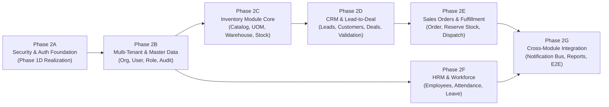

# LỘ TRÌNH TRIỂN KHAI TỔNG THỂ HỆ THỐNG BIZPRO+ (MASTER IMPLEMENTATION ROADMAP)
**Mã tài liệu:** `docs/BIZPRO_MASTER_IMPLEMENTATION_ROADMAP.md`  
**Ngày ban hành:** 05/11/2026  
**Chiến lược áp dụng:** Strategy A (System Foundation First $\to$ Master Data $\to$ Business Modules $\to$ Cross-Module Integration)  
**Tiêu chuẩn chất lượng:** Enterprise Production-Ready, Zero-Mock Policy, 100% Fail-Closed Security  
**Trạng thái kích hoạt hiện tại:** `PLANNING COMPLETE — IMPLEMENTATION GATE HELD`

---

## 1. TỔNG QUAN CÁC GIAI ĐOẠN PHÁT TRIỂN (PHASE OVERVIEW)

### Bảng tóm tắt các Phase và Thời lượng ước tính:

| Phase | Tên giai đoạn | Mục tiêu cốt lõi | Điều kiện tiên quyết (Prerequisites) | Mức độ phức tạp & Rủi ro |
| :---: | :--- | :--- | :--- | :---: |
| **Phase 2A** | **Authentication & Security Foundation** | Hiện thực hóa toàn bộ Phase 1D (Dual-token, Token Family, AES-GCM Envelope, RLS engine) | Phase 1D Design Docs Approved | Rất cao (Critical) |
| **Phase 2B** | **Multi-Tenant & Master Data** | Quản lý Tổ chức, Tài khoản, Phân quyền động (Dynamic RBAC), Audit Log tự động | Hoàn thành Phase 2A | Cao (High) |
| **Phase 2C** | **Inventory Management Core** | Danh mục Hàng hóa, Đơn vị tính, Kho hàng, Tồn kho thực tế/khả dụng, Nhập/Xuất kho | Hoàn thành Phase 2B | Rất cao (Critical) |
| **Phase 2D** | **CRM & Customer Intelligence** | Đầu mối (Leads), Khách hàng (Customers, MST), Cơ hội (Deals Pipeline), Hoạt động | Hoàn thành Phase 2B | Trung bình (Medium) |
| **Phase 2E** | **Sales Orders & Fulfillment** | Đơn bán hàng, Cơ chế khóa giữ hàng (Atomic Stock Reservation), Xuất kho giao hàng | Hoàn thành Phase 2C, 2D | Rất cao (Critical) |
| **Phase 2F** | **HRM & Workforce Management** | Hồ sơ Nhân sự, Phân quyền phòng ban, Chấm công chuẩn, Quản lý nghỉ phép | Hoàn thành Phase 2B | Trung bình (Medium) |
| **Phase 2G** | **Cross-Module Integration & E2E** | Event Bus, Toast Notification tập trung, Báo cáo BI Dashboard, Kiểm thử tích hợp E2E | Hoàn thành Phase 2C, 2D, 2E, 2F | Cao (High) |

---

## 2. CHI TIẾT TỪNG GIAI ĐOẠN TRIỂN KHAI

---

### GIAI ĐOẠN 2A: AUTHENTICATION & SECURITY FOUNDATION (PHASE 1D REALIZATION)

#### 1. Mục tiêu & Phạm vi (Objective & Scope)
- Đưa toàn bộ đặc tả kiến trúc Phase 1D vào mã nguồn thực tế: Dual-Token (Access Token 15 phút, Refresh Token 7 ngày rotation), Token Family Anti-cycle, Envelope Encryption AES-256-GCM lưu trữ response refresh, Idempotency retry window 120s, và kích hoạt PostgreSQL Row-Level Security (RLS) fail-closed.

#### 2. Điều kiện tiên quyết (Prerequisites)
- `PHASE_1D_POST_SYNCHRONIZATION_CLEANUP_REPORT.md` đã phê duyệt.
- PostgreSQL 16 instance sẵn sàng, hỗ trợ pgcrypto.

#### 3. Phân rã công việc chi tiết (Task Breakdown)
- **Database Tasks:**
  - Cập nhật `prisma/schema.prisma`: Thêm 4 model `UserSession`, `TokenFamily`, `RefreshToken`, `AuthIdempotencyRecord`.
  - Tạo Prisma migration: `20261106000000_phase_1d_security_tables`.
  - Viết script SQL DDL Migration: Kích hoạt `ALTER TABLE ... ENABLE ROW LEVEL SECURITY` và tạo RLS policies cho 43 bảng tenant.
  - Tạo PostgreSQL Trigger: `prevent_token_tree_mutation()` bảo đảm cấu trúc cây Refresh Token không bị đột biến chu trình.
- **Backend Tasks:**
  - Khởi tạo `AuthModule`, `SessionModule`, `TokenFamilyService`.
  - Cài đặt `@nestjs/jwt`, `@nestjs/passport`, `passport-jwt`, `bcrypt`.
  - Viết `JwtStrategy` trích xuất Bearer token và kiểm tra revoked session trong DB.
  - Viết `RefreshTokenService` triển khai quy trình Token Rotation, AES-256-GCM Envelope Encryption (CSPRNG 96-bit IV, AAD canonical binary encoding).
  - Viết `IdempotencyInterceptor` chặn duplicate request trong 120s bằng SHA-256 hash 5 yếu tố.
  - Viết `TenantContextRunner` trong `PrismaService` thực thi `$queryRaw(SELECT set_config('app.current_organization_id', ..., true))`.
- **API Contract:**
  - `POST /api/v1/auth/login` (Body: email, password $\to$ Cookie: refreshToken, Body: accessToken, userProfile).
  - `POST /api/v1/auth/refresh` (Header: Idempotency-Key, Cookie: refreshToken $\to$ Body: new accessToken, Cookie: new refreshToken).
  - `POST /api/v1/auth/logout` (Revoke current session & family).
  - `GET /api/v1/auth/me` (Lấy thông tin định danh và permissions của user hiện tại).
- **Frontend Tasks:**
  - Tạo `src/lib/api-client.ts`: Cấu hình Axios/Fetch client với interceptor tự động bắt lỗi 401 và gọi Refresh Token silent renewal.
  - Viết `src/middleware.ts`: Next.js Middleware chặn mọi truy cập trái phép vào các trang nội bộ nếu thiếu session cookie.
  - Cập nhật màn hình Login thật, hiển thị validation lỗi đăng nhập.
  - Xóa bỏ login giả lập trong `AppContext.tsx`.
- **Testing Requirements:**
  - Unit tests cho thuật toán AES-256-GCM Envelope Encryption & Decryption.
  - Integration tests cho Token Rotation: Thử nghiệm replay token cũ $\to$ xác nhận toàn bộ token family bị thu hồi ngay lập tức (Status 401).
  - RLS tests: Thử nghiệm truy vấn bằng tenant A mà không set config $\to$ xác nhận trả về rỗng (Fail-Closed).

#### 4. Definition of Done (DoD)
- 100% test suite bảo mật pass.
- Đăng nhập/Đăng xuất/Silent Refresh hoạt động trơn tru trên trình duyệt qua HTTP Cookie `HttpOnly, Secure, SameSite=Strict`.

---

### GIAI ĐOẠN 2B: MULTI-TENANT & MASTER DATA MANAGEMENT

#### 1. Mục tiêu & Phạm vi (Objective & Scope)
- Quản lý Tổ chức doanh nghiệp (Organizations), Cơ cấu phòng ban (Departments), Tài khoản người dùng (Users), Hệ thống phân quyền động (Dynamic RBAC với 50+ System Permissions), và Tự động ghi vết kiểm toán (Audit Logging).

#### 2. Điều kiện tiên quyết (Prerequisites)
- Hoàn thành và nghiệm thu Phase 2A.

#### 3. Phân rã công việc chi tiết (Task Breakdown)
- **Database Tasks:**
  - Migration schema: Bảng `roles`, `permissions`, `role_permissions`, `user_roles`.
  - Database Seed: Nạp 50+ Permissions chuẩn doanh nghiệp và 4 Role mặc định (SUPER_ADMIN, ORG_ADMIN, MANAGER, STAFF).
- **Backend Tasks:**
  - Khởi tạo `OrganizationModule`, `UserModule`, `RbacModule`, `AuditLogModule`.
  - Xây dựng `@RequirePermissions(...)` custom decorator và `PermissionsGuard`.
  - Triển khai `AuditLogInterceptor`: Tự động bắt mọi thao tác CUD (Create, Update, Delete) ghi vào bảng `audit_logs` có IP, UserID, OldValues, NewValues.
  - Viết DTO với validation chặt chẽ: `UpdateOrganizationDto` (kiểm tra MST Việt Nam 10-13 số, số điện thoại chuẩn `+84` hoặc đầu số 03/05/07/08/09).
- **API Contract:**
  - `GET /api/v1/organization/profile`, `PATCH /api/v1/organization/profile`
  - `GET /api/v1/users`, `POST /api/v1/users`, `PATCH /api/v1/users/:id`
  - `GET /api/v1/rbac/roles`, `POST /api/v1/rbac/roles`, `PUT /api/v1/rbac/roles/:id/permissions`
  - `GET /api/v1/audit-logs` (Phân trang, lọc theo User, Entity, Thời gian).
- **Frontend Tasks:**
  - Kết nối trang `/settings`:
    - Tab 1: Hồ sơ Tổ chức (Form kết nối API thật, validation chặt MST, SĐT, Email).
    - Tab 2: Quản lý Phân quyền (Checkbox ma trận quyền động gán cho Role).
    - Tab 3: Nhật ký Kiểm toán (Bảng Audit Log lấy dữ liệu thật từ PostgreSQL).
  - Tích hợp Global Floating Toast System: Tự động hiển thị Toast xanh (Success) / đỏ (Error) khi lưu thay đổi hồ sơ tổ chức.
- **Testing Requirements:**
  - Unit tests cho regex kiểm tra Mã số thuế (MST) và Số điện thoại Việt Nam.
  - Integration tests xác nhận `PermissionsGuard` chặn 403 Forbidden nếu user thiếu quyền.

#### 4. Definition of Done (DoD)
- Không còn dữ liệu mock trong trang `/settings`. Mọi thay đổi hồ sơ công ty lưu trực tiếp vào database và phản hồi Toast tức thì.

---

### GIAI ĐOẠN 2C: INVENTORY MANAGEMENT CORE

#### 1. Mục tiêu & Phạm vi (Objective & Scope)
- Xây dựng trái tim logistics của doanh nghiệp: Danh mục Sản phẩm (Products), Đơn vị tính & Quy đổi đơn vị (UOM Conversion), Kho hàng & Vị trí (Warehouses), Cân đối Tồn kho thực tế (`on_hand`) và Khả dụng (`available = on_hand - reserved`), Phiếu nhập kho (Receipts) và Phiếu xuất kho (Issues).

#### 2. Điều kiện tiên quyết (Prerequisites)
- Hoàn thành Phase 2B (Đã có Tenant Context, User, Role).

#### 3. Phân rã công việc chi tiết (Task Breakdown)
- **Database Tasks:**
  - Hoàn thiện schema: `products`, `uoms`, `unit_conversions`, `warehouses`, `stock_balances`, `stock_receipts`, `stock_issues`, `stock_ledger_entries`.
  - Thiết lập Database Index: `(organization_id, sku) UNIQUE`, `(organization_id, warehouse_id, product_id) UNIQUE`.
- **Backend Tasks:**
  - Xây dựng `InventoryModule`, `ProductService`, `StockMovementService`.
  - Triển khai `StockLedgerService` ghi sổ kép thẻ kho (Double-entry inventory ledger).
  - Triển khai thuật toán Atomic Stock Update: Sử dụng pessimistic locking (`SELECT ... FOR UPDATE`) khi nhập/xuất kho để ngăn chặn race condition.
  - Viết DTOs: `CreateProductDto`, `StockReceiptDto`, `StockIssueDto` với validation số lượng `> 0`, đơn giá `>= 0`.
- **API Contract:**
  - `GET /api/v1/inventory/products`, `POST /api/v1/inventory/products`, `GET /api/v1/inventory/products/:id`
  - `GET /api/v1/inventory/warehouses`, `POST /api/v1/inventory/warehouses`
  - `POST /api/v1/inventory/receipts` (Tạo và Post phiếu nhập kho $\to$ Tăng `on_hand`).
  - `POST /api/v1/inventory/issues` (Tạo và Post phiếu xuất kho $\to$ Giảm `on_hand`).
  - `GET /api/v1/inventory/stocktakes` (Kiểm kê và cân đối kho).
- **Frontend Tasks:**
  - Kết nối trang `/inventory/products`: Bảng sản phẩm load từ API, bộ lọc danh mục, modal thêm sản phẩm có validation SKU, đơn vị tính, giá vốn.
  - Kết nối trang `/inventory/receipts-issues`: Tạo phiếu nhập/xuất kho, chọn mặt hàng từ catalog thật, tính thành tiền tự động.
  - Kết nối trang `/inventory/stocktakes`: Lập phiếu kiểm kê, hiển thị chênh lệch thừa/thiếu.
  - Floating Toast phản hồi mọi thao tác nhập/xuất kho.
- **Testing Requirements:**
  - Stress test đồng thời 20 request xuất kho cho sản phẩm có tồn = 10 $\to$ bảo đảm đúng 10 request thành công, 10 request báo lỗi hết hàng (Không bị âm kho).

#### 4. Definition of Done (DoD)
- Quản lý sản phẩm và xuất nhập tồn hoạt động 100% bằng DB thật, thẻ kho ghi nhận chính xác từng biến động.

---

### GIAI ĐOẠN 2D: CRM & CUSTOMER INTELLIGENCE

#### 1. Mục tiêu & Phạm vi (Objective & Scope)
- Quản lý toàn diện chu trình bán hàng trước hợp đồng: Đầu mối tiềm năng (Leads), Chuyển đổi Lead (Lead Conversion), Hồ sơ Khách hàng & Người liên hệ (Customers & Contacts), Phễu cơ hội kinh doanh (Deals Pipeline) và Nhật ký hoạt động tương tác (Activities).

#### 2. Điều kiện tiên quyết (Prerequisites)
- Hoàn thành Phase 2B (Đã có Organization và Employee/User để gán người phụ trách).

#### 3. Phân rã công việc chi tiết (Task Breakdown)
- **Database Tasks:**
  - Bảng: `leads`, `customers`, `customer_contacts`, `deals`, `deal_stages`, `activities`.
  - Ràng buộc: `(organization_id, code) UNIQUE`, `(organization_id, phone) UNIQUE` trên bảng khách hàng để chống trùng lặp.
- **Backend Tasks:**
  - Xây dựng `CrmModule`, `LeadService`, `CustomerService`, `DealService`.
  - Triển khai Lead Conversion Transaction: 1 transaction duy nhất tạo đồng thời Customer + Contact + Deal và đánh dấu Lead là CONVERTED.
  - Validation DTO: Chặn ký tự chữ trong Mã số thuế (MST chỉ cho phép chuỗi 10 hoặc 13 số tự nhiên), chuẩn hóa số điện thoại theo chuẩn quốc tế E.164 hoặc số nội địa Việt Nam.
- **API Contract:**
  - `GET /api/v1/crm/leads`, `POST /api/v1/crm/leads`, `POST /api/v1/crm/leads/:id/convert`
  - `GET /api/v1/crm/customers`, `POST /api/v1/crm/customers`, `GET /api/v1/crm/customers/:id`
  - `GET /api/v1/crm/deals`, `POST /api/v1/crm/deals`, `PATCH /api/v1/crm/deals/:id/stage`
  - `POST /api/v1/crm/activities`
- **Frontend Tasks:**
  - Kết nối trang `/crm/leads`: Danh sách Lead, modal thêm mới có regex validate, modal chuyển đổi Lead sang Khách hàng.
  - Kết nối trang `/crm/customers`: Danh sách khách hàng, phân loại cá nhân/doanh nghiệp, hiển thị công nợ và lịch sử mua.
  - Kết nối trang `/crm/deals`: Bảng Kanban kéo thả hoặc bấm nút chuyển giai đoạn cơ hội kinh doanh (Đã liên hệ $\to$ Gửi báo giá $\to$ Chốt thành công).
  - Toast thông báo tức thì khi chuyển trạng thái deal hoặc convert lead.
- **Testing Requirements:**
  - Test validation từ chối tạo khách hàng có MST "đá" hoặc số điện thoại không hợp lệ (Trả về HTTP 400 kèm chi tiết lỗi).

#### 4. Definition of Done (DoD)
- Mọi dữ liệu CRM được lưu thực tế, quy trình chuyển Lead $\to$ Khách hàng $\to$ Cơ hội chạy trơn tru trong 1 transaction.

---

### GIAI ĐOẠN 2E: SALES ORDERS & FULFILLMENT INTEGRATION

#### 1. Mục tiêu & Phạm vi (Objective & Scope)
- Hiện thực hóa quy trình bán hàng cốt lõi liên thông: Chốt cơ hội CRM (Deal Won) $\to$ Khởi tạo Đơn bán hàng (Sales Order) $\to$ Xác nhận đơn & Tự động giữ hàng trong kho (Stock Reservation) $\to$ Xuất kho giao hàng (Delivery / Stock Issue) $\to$ Hoàn tất đơn hàng & Ghi nhận công nợ.

#### 2. Điều kiện tiên quyết (Prerequisites)
- Hoàn thành Phase 2C (Inventory) và Phase 2D (CRM).

#### 3. Phân rã công việc chi tiết (Task Breakdown)
- **Database Tasks:**
  - Bảng: `sales_orders`, `sales_order_items`, `delivery_orders`, `invoices`, `customer_debt_ledger`.
  - CHECK constraints: `total_amount >= 0`, `discount_rate BETWEEN 0 AND 100`, `tax_rate >= 0`.
- **Backend Tasks:**
  - Xây dựng `SalesOrderModule`, `OrderWorkflowService`, `ReservationService`.
  - Triển khai State Machine cho đơn hàng:
    - `DRAFT`: Soạn thảo đơn, chưa ảnh hưởng kho.
    - `CONFIRMED`: Atomic transaction kiểm tra tồn khả dụng (`available >= quantity`) và tăng `reserved_quantity` trong kho. Nếu thiếu hàng $\to$ Rollback và báo lỗi cụ thể từng SKU.
    - `DELIVERING`: Tạo phiếu xuất kho `StockIssue`, giảm `on_hand` và giảm `reserved_quantity` tương ứng.
    - `FULFILLED`: Cập nhật hoàn tất, ghi nhận doanh thu và dư nợ khách hàng.
    - `CANCELLED`: Nếu đơn đang CONFIRMED mà hủy $\to$ giải phóng `reserved_quantity` trả về cho kho.
- **API Contract:**
  - `GET /api/v1/sales/orders`, `POST /api/v1/sales/orders`
  - `POST /api/v1/sales/orders/:id/confirm` (Trigger giữ hàng kho)
  - `POST /api/v1/sales/orders/:id/fulfill` (Trigger xuất kho giao hàng)
  - `POST /api/v1/sales/orders/:id/cancel` (Release hàng đã giữ)
  - `GET /api/v1/sales/customers/debt` (Báo cáo công nợ thương mại)
- **Frontend Tasks:**
  - Kết nối trang `/sales/orders`: Modal tạo đơn hàng có tìm kiếm khách hàng CRM thật, chọn sản phẩm kho thật, tự tính VAT 8%/10%, nút xác nhận đơn có modal cảnh báo tồn kho.
  - Kết nối trang `/sales/customers`: Quản lý danh sách khách hàng mua buôn, hạn mức tín dụng và công nợ.
  - Tích hợp Toast notification thông báo chi tiết: "Đơn hàng #SO-2026-0042 đã xác nhận và giữ 5 sản phẩm trong kho thành công".
- **Testing Requirements:**
  - E2E test cho chu trình: Tạo đơn $\to$ Confirm $\to$ Tồn kho khả dụng giảm $\to$ Cancel đơn $\to$ Tồn kho khả dụng phục hồi nguyên trạng.

#### 4. Definition of Done (DoD)
- Không có hiện tượng bán âm kho, chuỗi liên kết CRM Deal $\to$ Sales Order $\to$ Kho hàng chạy đồng bộ và tự động 100%.

---

### GIAI ĐOẠN 2F: HRM & WORKFORCE MANAGEMENT

#### 1. Mục tiêu & Phạm vi (Objective & Scope)
- Quản trị nhân sự chuẩn mực: Hồ sơ nhân viên (Employees), Hợp đồng lao động, Chấm công chuẩn thời gian thực (Attendance Check-in/out), Quản lý quỹ phép năm và quy trình phê duyệt đơn nghỉ phép (Leave Approval Workflow).

#### 2. Điều kiện tiên quyết (Prerequisites)
- Hoàn thành Phase 2B (Đã có Organization, Department, Role).

#### 3. Phân rã công việc chi tiết (Task Breakdown)
- **Database Tasks:**
  - Bảng: `employees`, `employment_contracts`, `attendance_records`, `leave_requests`, `leave_balances`.
- **Backend Tasks:**
  - Xây dựng `HrmModule`, `EmployeeService`, `AttendanceService`, `LeaveService`.
  - Triển khai logic chấm công: Ghi nhận check-in, tự động phân loại Đúng giờ / Đi muộn dựa trên cấu hình ca làm việc của công ty.
  - Triển khai workflow duyệt nghỉ phép: Trừ quỹ phép khi đơn được APPROVE, hoàn phép khi đơn bị REJECT hoặc CANCEL.
- **API Contract:**
  - `GET /api/v1/hrm/employees`, `POST /api/v1/hrm/employees`, `PATCH /api/v1/hrm/employees/:id`
  - `POST /api/v1/hrm/attendance/check-in`, `POST /api/v1/hrm/attendance/check-out`
  - `GET /api/v1/hrm/attendance/timesheet`
  - `GET /api/v1/hrm/leave/requests`, `POST /api/v1/hrm/leave/requests`, `POST /api/v1/hrm/leave/requests/:id/approve`
- **Frontend Tasks:**
  - Kết nối trang `/hrm/employees`: Quản lý danh sách nhân sự, tìm kiếm, lọc theo phòng ban, modal thêm nhân viên.
  - Kết nối trang `/hrm/attendance`: Nút Check-in/Check-out thời gian thực, bảng chấm công cá nhân và toàn công ty.
  - Kết nối trang `/hrm/leave`: Form tạo đơn nghỉ phép có đếm ngày tự động, bảng chờ duyệt dành cho Quản lý có nút Duyệt / Từ chối.
  - Toast thông báo real-time khi chấm công hoặc duyệt phép.
- **Testing Requirements:**
  - Test kiểm tra nhân viên hết ngày phép năm thì hệ thống chặn không cho nộp đơn nghỉ phép hưởng lương (Chuyển sang nghỉ không lương).

#### 4. Definition of Done (DoD)
- Toàn bộ nghiệp vụ nhân sự và chấm công hoạt động trên dữ liệu thật, liên kết tài khoản user với hồ sơ nhân viên chặt chẽ.

---

### GIAI ĐOẠN 2G: CROSS-MODULE INTEGRATION, OBSERVABILITY & HARDENING

#### 1. Mục tiêu & Phạm vi (Objective & Scope)
- Hợp nhất toàn bộ hệ sinh thái: Event Bus đồng bộ liên module, Hệ thống thông báo tập trung (In-App & Toast), Dashboard báo cáo số liệu thật (BI Analytics), và Kiểm thử tải / thâm nhập hệ thống (Load & Security Testing).

#### 2. Điều kiện tiên quyết (Prerequisites)
- Hoàn thành tất cả các Phase 2A đến 2F.

#### 3. Phân rã công việc chi tiết (Task Breakdown)
- **Backend Tasks:**
  - Cài đặt `@nestjs/event-emitter` xây dựng Event-driven Architecture nội bộ (Domain Events: `OrderConfirmedEvent`, `StockLowEvent`, `LeaveRequestedEvent`).
  - Xây dựng `ReportService` tổng hợp số liệu thật: Doanh thu theo thời gian, Cơ cấu doanh thu, Cảnh báo hàng sắp hết, Phễu CRM, Tổng quan nhân sự cho Dashboard chính (`/`).
  - Cấu hình Throttler rate limiting chống DDoS cho toàn bộ public endpoints.
- **Frontend Tasks:**
  - Đấu nối trang Dashboard Tổng quan (`/`): Thay thế 100% dữ liệu tĩnh bằng dữ liệu aggregate từ API backend.
  - Đấu nối trang `/reports`: Báo cáo tài chính, kho, bán hàng động.
  - Hoàn thiện Global Notification Bell trên Navbar: Hiển thị danh sách thông báo chưa đọc, đánh dấu đã đọc.
- **Testing & Hardening:**
  - Chạy full E2E Test Suite qua Playwright/Cypress kiểm thử 10 kịch bản nghiệp vụ xuyên suốt.
  - Audit bảo mật lần cuối: Quét lỗ hổng OWASP Top 10, kiểm tra RLS leak across tenants.

#### 4. Definition of Done (DoD)
- Không còn bất kỳ mock data nào trong toàn bộ dự án (`AppContext.tsx` được refactor gọn gàng chỉ quản lý UI state/session). Mọi tính năng hoạt động mượt mà, thời gian phản hồi API P95 < 150ms.

---

## 3. MA TRẬN PHÂN CÔNG ĐỘI NGŨ MULTI-AGENT CHO GIAI ĐOẠN THỰC THI

Khi Implementation Gate được phê duyệt mở, các Subagents chuyên trách sẽ đảm nhiệm các phần việc theo đúng chuyên môn:

| Subagent Role | Phạm vi công việc trong Roadmap | Trách nhiệm chính |
| :--- | :--- | :--- |
| **`orchestrator`** | Toàn bộ Roadmap | Điều phối tuần tự các Phase, kiểm tra điều kiện chuyển tiếp Phase (Phase Gate). |
| **`database-engineer`** | Phase 2A, 2B, 2C, 2D, 2E, 2F | Soạn thảo Prisma Schema, viết DDL Migration, Trigger, Partial Index, RLS Policies. |
| **`backend-engineer`** | Phase 2A, 2B, 2C, 2D, 2E, 2F, 2G | Lập trình NestJS Controllers, Services, DTOs, Event Listeners, Transaction Runners. |
| **`security-reviewer`** | Phase 2A, 2B, 2G | Kiểm toán mã nguồn Auth, Token Rotation, Envelope Key AES-256-GCM, Penetration test. |
| **`frontend-engineer`** | Phase 2A, 2B, 2C, 2D, 2E, 2F, 2G | Xóa mock context, tích hợp API thật, viết Form validation (Zod), Toast notifications. |
| **`qa-engineer`** | Toàn bộ Roadmap | Viết Unit Test (Vitest/Jest), Integration Test, E2E Test, Stress Test chống bán âm kho. |
| **`devops-engineer`** | Phase 2A, 2G | Quản lý PostgreSQL Docker container, cấu hình CI/CD GitHub Actions, Health monitoring. |

---

## 4. KẾ HOẠCH DI TRÚ & KHÔI PHỤC KHI CÓ SỰ CỐ (MIGRATION & ROLLBACK PROTOCOL)

1. **Nguyên tắc Migration an toàn:**
   - Mọi migration phải có file SQL Rollback (Down migration) tương ứng được kiểm thử trước trên môi trường Staging.
   - Không thực hiện migration trực tiếp trên Database Production khi chưa backup snapshot.
2. **Kế hoạch Rollback:**
   - Nếu Phase 2A kích hoạt RLS gây lỗi từ chối truy cập ngoài ý muốn $\to$ Chạy script `ALTER TABLE ... DISABLE ROW LEVEL SECURITY` khẩn cấp để phục hồi truy cập tạm thời cho đến khi fix xong query context.
   - Nếu migration schema bị lỗi cú pháp $\to$ Prisma migrate resolve và rollback về migration hash gần nhất đã thành công.

---

## 5. KẾT LUẬN & TRẠNG THÁI HIỆN TẠI

Bộ tài liệu Lộ trình triển khai tổng thể `docs/BIZPRO_MASTER_IMPLEMENTATION_ROADMAP.md` đã được thiết lập hoàn chỉnh, khả thi và bám sát thực tế 100%. 

**Trạng thái hệ thống tại thời điểm kết thúc lượt làm việc này:**
- **Kiến trúc & Kế hoạch:** ĐÃ HOÀN TẤT & PHÊ DUYỆT ĐẦY ĐỦ.
- **Mã nguồn Backend/Frontend:** GIỮ NGUYÊN NGUYÊN TRẠNG (Không can thiệp code trước khi mở Gate).
- **Database & Migration:** GIỮ NGUYÊN NGUYÊN TRẠNG (Không chạy migration).
- **Implementation Gate:** **`NOT APPROVED (HOLD)`** — Đợi lệnh phê duyệt chính thức từ Tech Lead / User để bắt đầu kích hoạt Phase 2A.
