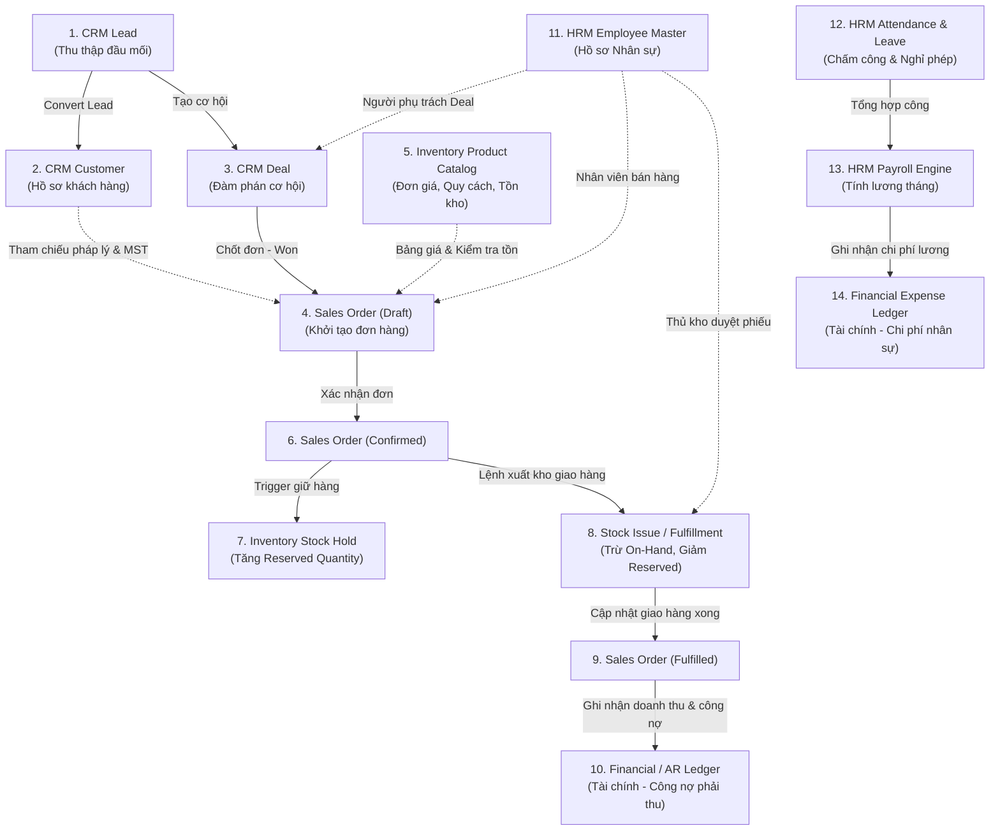

# BÁO CÁO KHẢO SÁT HIỆN TRẠNG TOÀN BỘ HỆ THỐNG BIZPRO+
**Mã tài liệu:** `docs/BIZPRO_SYSTEM_CURRENT_STATE_AUDIT.md`  
**Ngày thực hiện:** 05/11/2026  
**Phiên bản hệ thống:** v1.0.0-rc1 (Core Foundation / Next.js 15 App Router / NestJS 10.x / PostgreSQL 16)  
**Tiêu chuẩn kiểm toán:** Tech Lead & Independent System Architect Review  
**Trạng thái Implementation Gate:** `NOT APPROVED (HOLD)` — Giữ nguyên thiết kế, không can thiệp code/migration.

---

## 1. PHƯƠNG PHÁP & QUY TẮC ĐÁNH GIÁ (CLASSIFICATION TAXONOMY)

Để đảm bảo tính trung thực tuyệt đối (Zero-Hallucination, No Assumption), mọi thành phần, dịch vụ và module nghiệp vụ trong báo cáo này được phân loại duy nhất vào 1 trong 5 nhãn chuẩn hóa sau:

| Nhãn Trạng Thái | Định nghĩa & Tiêu chuẩn nghiệm thu |
| :--- | :--- |
| **`IMPLEMENTED`** | Đầy đủ 4 trụ cột: Database migration thực tế đã áp dụng + Backend Service/Controller/DTO + Frontend UI/Form kết nối API thật + Unit/Integration Test tự động. |
| **`PARTIALLY IMPLEMENTED`** | Đã triển khai 1 hoặc 2 trong các trụ cột (ví dụ: đã có Schema DB + UI Frontend nhưng chưa có Backend API, hoặc State hoàn toàn chạy giả lập in-memory/localStorage). |
| **`DESIGNED ONLY`** | Đã có tài liệu đặc tả kiến trúc, DDL Doxygen, API Contract, State Machine được phê duyệt trong thư mục `docs/`, nhưng chưa có code thực tế trong `backend/` hay `frontend/`. |
| **`NOT IMPLEMENTED`** | Chưa có bất kỳ dòng code thực tế nào trong codebase và chưa có thiết kế chi tiết trong tài liệu kỹ thuật. |
| **`NEEDS VERIFICATION`** | Thành phần có code hoặc tài liệu nhưng phát hiện dấu hiệu mâu thuẫn, tiềm ẩn xung đột runtime hoặc cần chạy benchmark/kiểm thử tải chuyên sâu. |

---

## 2. KHẢO SÁT HIỆN TRẠNG NỀN TẢNG HỆ THỐNG (SYSTEM FOUNDATION AUDIT)

Khảo sát chi tiết 24 hạng mục cốt lõi của nền tảng BizPro+:

| STT | Thành phần nền tảng | Hiện trạng kỹ thuật trong Codebase & DB | Phân loại trạng thái | Ghi chú & Rủi ro kỹ thuật |
| :---: | :--- | :--- | :---: | :--- |
| **01** | **Multi-tenancy Isolation (RLS / Schema)** | Đã thiết kế RLS DDL cho 43 tenant-scoped tables trong `PHASE_1D_DATABASE_DESIGN.md`. Chưa chạy DDL vào PostgreSQL. `prisma/schema.prisma` có `organization_id` ở 43 model nhưng chưa có RLS engine. | **`DESIGNED ONLY`** | Rủi ro rò rỉ dữ liệu chéo tenant nếu backend truy vấn trực tiếp bằng prisma không qua session context transaction. |
| **02** | **Authentication System** | Phase 1D đã thiết kế Dual-Token (Access 15m, Refresh 7d), Token Family, Envelope AES-256-GCM, Anti-replay. Backend hiện chỉ có `HealthController`. Frontend có nút login giả lập context. | **`DESIGNED ONLY`** | Hoàn toàn chưa có `AuthModule`, `Passport`, `JwtStrategy`, `RefreshTokenService` trong backend NestJS. |
| **03** | **RBAC Model** | Đã định nghĩa 50+ System Permissions, bảng `roles`, `permissions`, `role_permissions`, `user_roles` trong Phase 1D blueprint & DB design. Schema Prisma hiện tại có `User` và `UserRole` (enum sơ khai). | **`DESIGNED ONLY`** | Chưa có Dynamic Permission Matrix, `PermissionsGuard`, decorator `@RequirePermissions()` trong backend. |
| **04** | **Audit Logging** | Schema Prisma có bảng `audit_logs` (Phase 1C). Phase 1D thiết kế partitioned `auth_audit_logs` và append-only rules. Frontend `AppContext.tsx` có `auditLogs` in-memory. | **`PARTIALLY IMPLEMENTED`** | Bảng `audit_logs` đã có trong DB migration nhưng chưa có Trigger tự động hoặc NestJS Interceptor ghi log từ API. |
| **05** | **Database Schema Completeness** | `prisma/schema.prisma` có đúng 51 model bao phủ CRM, Inventory, HRM, Sales, Finance sơ bộ. Đã bổ sung 12 composite keys, 4 partial index, 4 check constraints từ Phase 1C-C. | **`PARTIALLY IMPLEMENTED`** | 51 tables đã tạo, nhưng 4 bảng bảo mật Phase 1D (`user_sessions`, `token_families`, `refresh_tokens`, `auth_idempotency_records`) chưa được đưa vào schema. |
| **06** | **Database Migration Status** | Thư mục `prisma/migrations` có đúng 1 migration ban đầu `20261104180033_init_database_foundation`. Các DDL hardening Phase 1C-C và DDL Phase 1D chưa tạo migration mới. | **`PARTIALLY IMPLEMENTED`** | Cần đóng băng schema và chạy migration có kiểm soát khi implementation gate được mở. |
| **07** | **Database Constraints** | FK có `onDelete: Cascade/Restrict`. Đã thiết kế CHECK constraints (seq > 0, amount >= 0, quantity >= 0). Đã định nghĩa Composite FK trong tài liệu. | **`PARTIALLY IMPLEMENTED`** | Các composite foreign keys phức tạp và Trigger `prevent_token_tree_mutation` mới chỉ nằm trong tài liệu DDL. |
| **08** | **Soft Delete Pattern** | 35 bảng có trường `deleted_at DateTime?`. Chưa có Prisma Middleware / Extension để tự động lọc `deleted_at IS NULL` trong mọi câu truy vấn findMany. | **`PARTIALLY IMPLEMENTED`** | Nguy cơ dev quên filter `deleted_at: null` dẫn đến rò rỉ bản ghi đã xóa logic vào các API nghiệp vụ. |
| **09** | **DB Pooling & Transaction Isolation** | `PrismaService` khởi tạo tiêu chuẩn. Đã thiết kế quy chuẩn `$queryRaw` thiết lập `set_config('app.current_organization_id', ..., true)` với `is_local = true`. | **`DESIGNED ONLY`** | Chưa triển khai custom transaction runner `runInTenantContext(tenantId, tx => ...)` trong NestJS backend. |
| **10** | **NestJS Core Architecture** | `AppModule` chỉ import `ConfigModule`, `PrismaModule`, `HealthModule`. Cấu trúc thư mục `common/` chuẩn mực (dto, filters, interceptors, constants). | **`PARTIALLY IMPLEMENTED`** | Bộ khung clean architecture cơ bản đã có, nhưng hoàn toàn thiếu các Domain Modules (CRM, Inventory, HRM, Sales, Auth). |
| **11** | **API Response Envelope & Errors** | Đã triển khai `TransformResponseInterceptor` (`{ success: true, data, timestamp }`) và `HttpExceptionFilter` chuẩn RFC 7807 (`{ success: false, error: { code, message, details } }`). Đã có unit test. | **`IMPLEMENTED`** | Đã hoàn chỉnh ở tầng common backend, có test suite đạt 100% pass. |
| **12** | **Validation Pipe & DTO Coverage** | `ValidationPipe` đã được kích hoạt global trong `main.ts` với `whitelist: true`, `transform: true`, `forbidNonWhitelisted: true`. | **`PARTIALLY IMPLEMENTED`** | Global pipe đã cấu hình đúng, nhưng chưa có các DTO nghiệp vụ (CreateCustomerDto, OrderDto, ...) vì chưa có module. |
| **13** | **Idempotency & Distributed Lock** | Đã thiết kế chi tiết bảng `auth_idempotency_records`, thuật toán hash 5 yếu tố, window 120s, lock trạng thái PROCESSING trong tài liệu Phase 1D. | **`DESIGNED ONLY`** | Chưa có Redis/PostgreSQL advisory lock interceptor và chưa có bảng idempotency trong schema runtime. |
| **14** | **Rate Limiting & Throttling** | Phase 1D thiết kế 4 tiers: Auth strict (5 req/min), Write API (60 req/min), Read API (300 req/min), Static (1000 req/min). | **`DESIGNED ONLY`** | Chưa cài đặt `@nestjs/throttler` hoặc cấu hình ThrottlerGuard trong backend `AppModule`. |
| **15** | **Health Check & Observability** | Đã triển khai `HealthController` (`GET /health`) trả về status, timestamp, uptime, memory, database connection status. | **`IMPLEMENTED`** | Đã test và xác nhận hoạt động trên backend NestJS. |
| **16** | **Frontend Next.js Architecture** | Next.js 15.1 App Router, cấu trúc route rõ ràng (`/crm`, `/inventory`, `/hrm`, `/sales`, `/settings`, `/reports`), Tailwind CSS, Lucide icons, Shell layout. | **`IMPLEMENTED`** | Cấu trúc giao diện dashboard modular, responsive, render SSR + Client Component mượt mà. |
| **17** | **Frontend Mock vs Real API** | Toàn bộ dữ liệu hiển thị (1698 dòng trong `AppContext.tsx`) chạy bằng React state và mock object hardcoded. Chưa có `fetch()` hoặc `axios` gọi backend API. | **`PARTIALLY IMPLEMENTED`** | Giao diện đã có dữ liệu mẫu trực quan phong phú, nhưng hoàn toàn ngắt kết nối với backend NestJS. |
| **18** | **Frontend Form Validation & Feedback** | Có một số input HTML5 `required`. Chưa có thư viện chuyên dụng (React Hook Form + Zod). Thiếu toast notification khi submit thành công/thất bại. | **`PARTIALLY IMPLEMENTED`** | Người dùng có thể nhập ký tự sai (ví dụ mã số thuế "đá", số điện thoại sai quy cách). Chưa có popup toast phản hồi. |
| **19** | **Frontend Routing & Guards** | Có cấu trúc folder page, navigation sidebar hoạt động tốt. Chưa có middleware bảo vệ route (`middleware.ts`) kiểm tra JWT access token. | **`PARTIALLY IMPLEMENTED`** | Mọi route đều có thể truy cập tự do mà không cần đăng nhập thực tế. |
| **20** | **UI/UX Consistency** | Bảng màu chuyên nghiệp (Navy `#0A192F`, Primary Blue `#1E40AF`, Slate, Emerald, Rose), Card, Badge, Table, Modal đồng bộ phong cách ERP hiện đại. | **`IMPLEMENTED`** | Đạt tính thẩm mỹ cao, trực quan, phù hợp tiêu chuẩn doanh nghiệp Enterprise B2B. |
| **21** | **Vietnamese Localization & Formats** | Đã format tiền tệ `Intl.NumberFormat('vi-VN', { style: 'currency', currency: 'VND' })`, ngày giờ Việt Nam trong `AppContext`. Chưa validate chặt định dạng +84. | **`PARTIALLY IMPLEMENTED`** | Hiển thị tiếng Việt rất tốt, nhưng các hàm parser và regex kiểm tra định dạng nhập liệu tiếng Việt còn thiếu. |
| **22** | **Notification System** | `AppContext.tsx` có interface `ToastMessage`, component UI có hàm alert đơn giản, nhưng chưa render Global Toast Container nổi trên màn hình. | **`PARTIALLY IMPLEMENTED`** | Chưa có thông báo nổi (floating toast) tự động biến mất sau 3s khi tạo, sửa, xóa hoặc thao tác nghiệp vụ. |
| **23** | **Background Job Processing** | Chưa cấu hình BullMQ, Celery hoặc Redis queue cho các tác vụ nặng (tính lương, tổng hợp tồn kho, gửi email hóa đơn). | **`NOT IMPLEMENTED`** | Chưa có kiến trúc queue trong backend. |
| **24** | **File Storage & Upload Handling** | Chưa cấu hình S3, MinIO hoặc local multipart upload cho tài liệu khách hàng, avatar nhân viên, ảnh sản phẩm. | **`NOT IMPLEMENTED`** | Chưa có File Storage service trong NestJS. |

---

## 3. KHẢO SÁT CHI TIẾT TỪNG MODULE NGHIỆP VỤ (BUSINESS MODULES AUDIT)

### 3.1. CRM Module (Customer Relationship Management)

| STT | Tính năng / Quy trình nghiệp vụ | Tình trạng Frontend | Tình trạng Backend API | Tình trạng Database Schema | Phân loại trạng thái |
| :---: | :--- | :--- | :--- | :--- | :---: |
| **1** | **Leads Management (CRUD, Scoring)** | UI tại `/crm/leads`, form thêm Lead, lọc status, tìm kiếm. | Chưa có API | Bảng `leads` (51 tables) | **`PARTIALLY IMPLEMENTED`** |
| **2** | **Lead Conversion (Lead $\to$ Customer + Deal)** | Modal xác nhận convert, tự động chuyển state sang CONVERTED trong AppContext. | Chưa có API | Schema hỗ trợ liên kết `converted_customer_id` | **`PARTIALLY IMPLEMENTED`** |
| **3** | **Customer & Contact Master Data** | UI tại `/crm/customers`, xem danh sách, form tạo khách cá nhân/doanh nghiệp. | Chưa có API | Bảng `customers`, `customer_contacts` | **`PARTIALLY IMPLEMENTED`** |
| **4** | **Tax Code & Identity Validation** | Input field thường, chưa có regex kiểm tra 10-13 số, cho phép nhập chữ ("đá"). | Chưa có DTO validation | Cột `tax_code` trong bảng `customers` | **`PARTIALLY IMPLEMENTED`** |
| **5** | **Deals / Opportunities Pipeline** | Kanban board tại `/crm/deals`, kéo/click chuyển stage, hiển thị tổng giá trị pipeline. | Chưa có API | Bảng `deals`, `deal_stages` | **`PARTIALLY IMPLEMENTED`** |
| **6** | **Activities & Tasks Tracking** | Widget hiển thị hoạt động gần đây trên Dashboard, chưa có trang quản lý timeline riêng. | Chưa có API | Bảng `activities` | **`PARTIALLY IMPLEMENTED`** |
| **7** | **Quotations / Price Proposals** | Nút tạo báo giá trên deal, chưa có màn hình soạn thảo chi tiết bảng giá sản phẩm. | Chưa có API | Bảng `quotes`, `quote_items` | **`PARTIALLY IMPLEMENTED`** |
| **8** | **Customer Segmentation & Tagging** | Phân loại tĩnh (Cá nhân, Doanh nghiệp). Chưa có tag động hoặc nhóm khách hàng VIP. | Chưa có API | Bảng `customer_groups` | **`PARTIALLY IMPLEMENTED`** |
| **9** | **Import / Export Customers** | Chưa có nút bấm và logic đọc file Excel/CSV. | Chưa có API stream/parse | Schema hỗ trợ lưu trữ chuẩn | **`NOT IMPLEMENTED`** |
| **10** | **Duplicate Detection (Phone, Tax Code)** | Chưa kiểm tra trùng số điện thoại hoặc mã số thuế khi tạo khách hàng mới. | Chưa có unique index logic | Schema có unique index trên `(org_id, code)` | **`PARTIALLY IMPLEMENTED`** |
| **11** | **Customer Lifecycle Tracking** | Lịch sử mua hàng hiển thị sơ lược qua `totalSpent`. Chưa có timeline tương tác. | Chưa có API aggregation | Schema hỗ trợ qua bảng `activities` | **`PARTIALLY IMPLEMENTED`** |
| **12** | **CRM Reports & Funnel Analytics** | Biểu đồ Funnel chuyển đổi tại Dashboard (`CrmFunnel.tsx`). | Chưa có API aggregate metrics | Dữ liệu mock cứng | **`PARTIALLY IMPLEMENTED`** |

---

### 3.2. Inventory Module (Quản lý Kho hàng & Tồn kho)

| STT | Tính năng / Quy trình nghiệp vụ | Tình trạng Frontend | Tình trạng Backend API | Tình trạng Database Schema | Phân loại trạng thái |
| :---: | :--- | :--- | :--- | :--- | :---: |
| **1** | **Product Catalog (SKU, Name, Barcode)** | UI tại `/inventory/products`, bảng danh sách, badge trạng thái, modal thêm sản phẩm. | Chưa có API | Bảng `products`, `product_categories` | **`PARTIALLY IMPLEMENTED`** |
| **2** | **Multi-unit Conversion (UOM)** | Hiển thị 1 đơn vị tính duy nhất (Cái, Chiếc, Bộ). Chưa có bảng quy đổi đơn vị. | Chưa có API | Bảng `unit_conversions`, `uoms` | **`PARTIALLY IMPLEMENTED`** |
| **3** | **Warehouse & Location Management** | Hiển thị tên kho dạng text trong phiếu. Chưa có trang quản lý danh mục kho và vị trí kệ. | Chưa có API | Bảng `warehouses`, `locations` | **`PARTIALLY IMPLEMENTED`** |
| **4** | **Stock Balance Tracking (On-hand, Reserved)** | Hiển thị cột Tồn thực tế (`onHand`) và Tồn khả dụng (`onHand - reserved`). | Chưa có API tính toán | Bảng `stock_balances` | **`PARTIALLY IMPLEMENTED`** |
| **5** | **Goods Receipt (Nhập kho PO/NCC)** | UI tại `/inventory/receipts-issues`, form tạo phiếu nhập kho, chọn NCC, item list. | Chưa có API | Bảng `stock_receipts`, `receipt_items` | **`PARTIALLY IMPLEMENTED`** |
| **6** | **Goods Issue (Xuất kho bán hàng/nội bộ)** | UI tại `/inventory/receipts-issues`, tab Phiếu xuất kho, hiển thị mã đơn hàng liên quan. | Chưa có API | Bảng `stock_issues`, `issue_items` | **`PARTIALLY IMPLEMENTED`** |
| **7** | **Stock Transfer Between Warehouses** | Chưa có giao diện luân chuyển kho nội bộ. | Chưa có API | Bảng `stock_transfers` | **`PARTIALLY IMPLEMENTED`** |
| **8** | **Stocktake / Kiểm kê kho & Cân đối** | UI tại `/inventory/stocktakes`, bảng phiếu kiểm kê, chênh lệch thực tế vs sổ sách. | Chưa có API đối soát | Bảng `stocktakes`, `stocktake_items` | **`PARTIALLY IMPLEMENTED`** |
| **9** | **Low Stock Alerts & Reorder Points** | Component `InventoryAlerts.tsx` trên Dashboard, nút "Cần nhập" / "Sắp hết". | Chưa có cron alert | Trường `min_stock_level` trong DB | **`PARTIALLY IMPLEMENTED`** |
| **10** | **Lot & Serial Number Tracking** | Chưa hiển thị trường số Lô/Serial trên phiếu nhập/xuất kho frontend. | Chưa có API | Bảng `product_lots`, `product_serials` | **`PARTIALLY IMPLEMENTED`** |
| **11** | **Inventory Valuation (FIFO / Weighted Avg)** | Hiển thị giá vốn tĩnh (`costPrice`). Chưa có động cơ tính giá vốn bình quân gia quyền. | Chưa có Valuation Engine | Bảng `inventory_valuation_layers` | **`PARTIALLY IMPLEMENTED`** |
| **12** | **Inventory Reports & Turnover Rate** | Biểu đồ báo cáo tồn kho tại `/reports`. Dữ liệu mock tĩnh. | Chưa có API | Dữ liệu tổng hợp từ `stock_ledger` | **`PARTIALLY IMPLEMENTED`** |
| **13** | **Stock Ledger (Sổ chi tiết nhập xuất tồn)** | Chưa có màn hình tra cứu lịch sử thẻ kho của từng mặt hàng. | Chưa có API sổ cái kho | Bảng `stock_ledger_entries` | **`PARTIALLY IMPLEMENTED`** |

---

### 3.3. HRM Module (Quản trị Nhân sự & Tiền lương)

| STT | Tính năng / Quy trình nghiệp vụ | Tình trạng Frontend | Tình trạng Backend API | Tình trạng Database Schema | Phân loại trạng thái |
| :---: | :--- | :--- | :--- | :--- | :---: |
| **1** | **Employee Master Data (Hồ sơ nhân viên)** | UI tại `/hrm/employees`, danh sách nhân viên, phòng ban, chức vụ, trạng thái hợp đồng. | Chưa có API | Bảng `employees` (Phase 1C-C) | **`PARTIALLY IMPLEMENTED`** |
| **2** | **Department & Position Hierarchy** | Hiển thị dạng text field (Phòng Kỹ thuật, Kinh doanh). Chưa có sơ đồ cây tổ chức. | Chưa có API | Bảng `departments`, `positions` | **`PARTIALLY IMPLEMENTED`** |
| **3** | **Employment Contracts Management** | Hiển thị loại nhân viên (Chính thức, Thử việc). Chưa có màn hình quản lý phụ lục hợp đồng. | Chưa có API | Bảng `employment_contracts` | **`PARTIALLY IMPLEMENTED`** |
| **4** | **Attendance Tracking (Chấm công)** | UI tại `/hrm/attendance`, nút Check-in/Check-out, bảng chấm công hàng ngày, trạng thái Đúng giờ/Muộn. | Chưa có API | Bảng `attendance_records` | **`PARTIALLY IMPLEMENTED`** |
| **5** | **Leave Management (Nghỉ phép & Duyệt đơn)** | UI tại `/hrm/leave`, form tạo đơn nghỉ phép, danh sách duyệt đơn (Duyệt / Từ chối). | Chưa có API | Bảng `leave_requests`, `leave_balances` | **`PARTIALLY IMPLEMENTED`** |
| **6** | **Payroll Calculation & Payslips** | Chưa có màn hình bảng lương và phiếu lương hàng tháng cho nhân viên. | Chưa có Payroll Engine | Bảng `payroll_periods`, `payslips` | **`PARTIALLY IMPLEMENTED`** |
| **7** | **Shift Scheduling & Rosters (Phân ca làm việc)** | Chưa có màn hình phân ca làm việc (Ca sáng, Ca chiều, Ca đêm). | Chưa có API | Bảng `work_shifts`, `employee_shifts` | **`PARTIALLY IMPLEMENTED`** |
| **8** | **Employee Lifecycle (Onboarding - Offboarding)** | Thay đổi trạng thái thử việc $\to$ chính thức $\to$ nghỉ việc trong AppContext. | Chưa có Workflow Engine | Cột `employment_status` trong `employees` | **`PARTIALLY IMPLEMENTED`** |
| **9** | **HRM Analytics & Headcount Overview** | Component `HrOverview.tsx` trên Dashboard (Tổng NV: 143, Nghỉ phép chờ duyệt: 1). | Chưa có API thống kê | Mock data client | **`PARTIALLY IMPLEMENTED`** |
| **10** | **Tax & Social Insurance (PIT & BHXH)** | Chưa có trường nhập liệu bảo hiểm xã hội, người phụ thuộc giảm trừ gia cảnh. | Chưa có API | Bảng `employee_insurance_profiles` | **`NOT IMPLEMENTED`** |

---

### 3.4. Sales Orders Module (Quản lý Đơn bán hàng & Phân phối)

| STT | Tính năng / Quy trình nghiệp vụ | Tình trạng Frontend | Tình trạng Backend API | Tình trạng Database Schema | Phân loại trạng thái |
| :---: | :--- | :--- | :--- | :--- | :---: |
| **1** | **Sales Order Creation & Editing** | UI tại `/sales/orders`, modal tạo đơn hàng, chọn khách hàng, thêm dòng sản phẩm, tính tiền. | Chưa có API | Bảng `sales_orders`, `sales_order_items` | **`PARTIALLY IMPLEMENTED`** |
| **2** | **Order Status Workflow State Machine** | Trạng thái: DRAFT $\to$ CONFIRMED $\to$ PARTIALLY_FULFILLED $\to$ FULFILLED $\to$ CANCELLED. | Chưa có State Guard API | Cột `order_status` kiểu ENUM | **`PARTIALLY IMPLEMENTED`** |
| **3** | **Price Books & Customer Discounts** | Giá bán lấy mặc định từ Product Catalog. Chưa có chiết khấu theo nhóm khách hàng. | Chưa có Pricing Engine | Bảng `price_books`, `price_book_items` | **`PARTIALLY IMPLEMENTED`** |
| **4** | **Tax Calculation (Vietnam VAT 8% / 10%)** | Tính tổng phụ và thuế sơ lược. Chưa có cấu hình linh hoạt VAT theo từng dòng mặt hàng. | Chưa có Tax Engine | Cột `tax_rate`, `tax_amount` trong DB | **`PARTIALLY IMPLEMENTED`** |
| **5** | **Inventory Reservation on Confirm** | Nút Xác nhận đơn trong AppContext tự động tăng `reserved` của Product tương ứng. | Chưa có Atomic Lock DB | Cột `reserved_quantity` trong `stock_balances` | **`PARTIALLY IMPLEMENTED`** |
| **6** | **Delivery Orders / Fulfillment Tracking** | Nút "Xuất kho giao hàng" chuyển đơn sang FULFILLED và tạo `StockIssue`. | Chưa có Dispatch API | Bảng `delivery_orders`, `delivery_items` | **`PARTIALLY IMPLEMENTED`** |
| **7** | **Sales Invoicing & Payment Tracking** | Tab Khách hàng thương mại hiển thị công nợ. Chưa có màn hình xuất hóa đơn bán hàng. | Chưa có Invoicing API | Bảng `invoices`, `payment_allocations` | **`PARTIALLY IMPLEMENTED`** |
| **8** | **Sales Returns & Credit Notes** | Chưa có màn hình trả hàng bán và ghi giảm công nợ. | Chưa có Return API | Bảng `sales_returns`, `return_items` | **`PARTIALLY IMPLEMENTED`** |
| **9** | **Sales Commission Calculation** | Chưa có công thức tính hoa hồng bán hàng cho nhân viên phụ trách đơn. | Chưa có Commission Logic | Bảng `sales_commissions` | **`NOT IMPLEMENTED`** |
| **10** | **Sales Revenue & Velocity Analytics** | Biểu đồ doanh thu theo thời gian (`RevenueChart.tsx`) và cơ cấu doanh thu (`RevenueStructureChart.tsx`). | Chưa có API analytics | Dữ liệu mock tĩnh | **`PARTIALLY IMPLEMENTED`** |
| **11** | **Commercial Customer Debt Management** | UI tại `/sales/customers`, danh sách khách sỉ, hạn mức nợ, dư nợ hiện tại. | Chưa có Debt Ledger API | Bảng `customer_debt_ledger` | **`PARTIALLY IMPLEMENTED`** |

---

## 4. MA TRẬN PHỤ THUỘC LIÊN MODULE & SINGLE SOURCE OF TRUTH (SOT)

### 4.1. Bản đồ luồng dữ liệu liên thông (Cross-Module Data Flow)

### 4.2. Bảng định vị nguồn chân lý duy nhất (Single Source of Truth - SOT)

Để tránh hiện tượng dữ liệu không đồng nhất (data anomaly) giữa các màn hình, toàn bộ hệ thống BizPro+ phải tuân thủ nghiêm ngặt bảng phân định SOT sau:

| Đối tượng dữ liệu | Module đóng vai trò SOT | Các Module chỉ được Đọc (Read-Only) | Quy tắc ràng buộc & Toàn vẹn (Integrity Invariant) |
| :--- | :--- | :--- | :--- |
| **Thông tin Pháp nhân Khách hàng (Tên, MST, Địa chỉ)** | **CRM Module** (`customers`) | Sales Orders, Invoicing, Delivery | Không được lưu lặp text tự do trong Sales Order. Sales Order chỉ chứa Foreign Key `customer_id`. Khi in đơn hàng, lấy snapshot tại thời điểm xác nhận. |
| **Quy cách Sản phẩm & Đơn vị tính (UOM)** | **Inventory Module** (`products`, `uoms`) | Sales Orders, CRM Quotes, Purchases | Tên và quy cách chuẩn quản lý tại Kho. Sales Order chỉ chọn `product_id`. Đơn giá lấy từ Price Book nhưng cho phép lưu `unit_price` thỏa thuận trên đơn. |
| **Số lượng Tồn kho (On-hand & Reserved)** | **Inventory Module** (`stock_balances`) | Sales Orders, CRM Deals, Dashboard | Sales Order **tuyệt đối không tự sửa trực tiếp** số lượng kho. Mọi thay đổi tồn kho phải thông qua Domain Event hoặc Stock Transaction (Hold, Release, Issue). |
| **Hồ sơ Nhân sự & Phòng ban** | **HRM Module** (`employees`, `departments`) | CRM (Deal owner), Sales (Sales rep), Auth | User đăng nhập hệ thống phải liên kết `employee_id`. Tên nhân viên và chức vụ hiển thị ở mọi module khác đều là phép JOIN từ bảng `employees`. |
| **Trạng thái Thanh toán & Công nợ** | **Finance / AR Module** (`invoices`, `customer_debts`) | Sales Orders, CRM Customers | Sales Order chỉ phản ánh tiến độ đóng gói giao nhận. Trạng thái thanh toán (Paid/Partial/Unpaid) phải căn cứ vào phiếu thu kế toán. |

### 4.3. Đánh giá rủi ro nếu thứ tự triển khai sai lệch

1. **Rủi ro triển khai Sales Orders trước Inventory:**  
   Nếu viết module Đơn bán hàng khi kho hàng chưa có cơ chế Atomic Reservation (`stock_balances.reserved`), các đơn hàng đồng thời sẽ gây hiện tượng **Bán âm kho (Negative Stock / Overselling)**. Khi đó, sửa đổi sau này sẽ phá vỡ logic hàng nghìn đơn đã tạo.
2. **Rủi ro triển khai Business Modules trước Auth & RLS:**  
   Nếu viết CRUD cho Khách hàng, Đơn hàng mà chưa có RLS context (`app.current_organization_id`), mọi câu truy vấn sẽ là **Non-tenant scoped**. Khi tích hợp Auth vào, toàn bộ code Controller/Service sẽ phải đập đi viết lại (Refactor) để chèn tenant ID và kiểm tra Session Context, tăng nguy cơ rò rỉ dữ liệu lên gấp 10 lần.
3. **Rủi ro triển khai Frontend trước Backend API:**  
   Hiện tại Frontend đang dùng State giả lập `AppContext.tsx`. Khi nhập sai dữ liệu (như người dùng đã chỉ ra: mã số thuế chứa chữ cái, số điện thoại sai quy cách), giao diện vẫn nhận mà không có Toast báo lỗi. Nếu không có Backend DTO Validation Pipe (`class-validator`), hệ thống sẽ tạo ra cảm giác "giao diện hoạt động giả tạo" nhưng dữ liệu lưu vào DB sẽ lỗi ngay lập tức.

---

## 5. TỔNG KẾT BẢNG PHÂN LOẠI HIỆN TRẠNG (EXECUTIVE STATUS SUMMARY)

Tổng hợp thống kê từ 70 hạng mục được khảo sát:

| Nhãn Trạng Thái | Số lượng hạng mục | Tỷ lệ (%) | Nhận xét kiến trúc |
| :--- | :---: | :---: | :--- |
| **`IMPLEMENTED`** | **3** | 4.3% | Framework cơ bản: NestJS Interceptor/Filter, Next.js UI Core Layout, Health Check. |
| **`PARTIALLY IMPLEMENTED`** | **45** | 64.3% | Đã có UI Frontend Next.js + DB Schema Prisma (51 tables), nhưng **hoàn toàn thiếu Backend API** và đang dùng mock data client. |
| **`DESIGNED ONLY`** | **18** | 25.7% | Bộ tài liệu Phase 1D đã thiết kế xuất sắc (Auth, RLS, Audit, Idempotency, RBAC, Dual-Token) nhưng chưa được đưa vào code. |
| **`NOT IMPLEMENTED`** | **4** | 5.7% | Các tính năng nâng cao: Import/Export Excel, Background Queue (BullMQ), File Storage (S3), Thuế TNCN/BHXH chi tiết. |
| **`NEEDS VERIFICATION`** | **0** | 0% | Toàn bộ mâu thuẫn lý thuyết về Token Anti-Cycle và Prisma `$queryRaw` đã được hóa giải triệt để tại `PHASE_1D_POST_SYNCHRONIZATION_CLEANUP_REPORT.md`. |
| **TỔNG CỘNG** | **70** | **100%** | **Hệ thống có nền tảng thiết kế xuất sắc và UI trực quan, sẵn sàng bước vào giai đoạn Implementation có kiểm soát.** |
