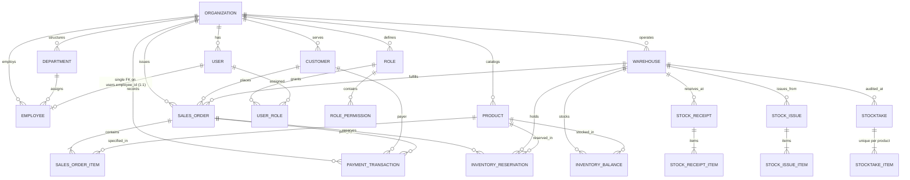

# RÀ SOÁT QUAN HỆ CƠ SỞ DỮ LIỆU & TÍNH TOÀN VẸN THAM CHIẾU
**Dự án:** BizPro+ Modular Business Management System  
**Tài liệu:** DATABASE_RELATIONSHIP_REVIEW.md  
**Phiên bản:** 1.1 — Updated Final Review  
**Trọng tâm:** Referential Integrity, Multi-Tenancy Scope, Cardinality & Orphan Record Defense  

---

## 1. TỔNG QUAN MA TRẬN QUAN HỆ DỮ LIỆU

BizPro+ bao gồm các thực thể nghiệp vụ liên kết chặt chẽ xung quanh thực thể cốt lõi `Organization`.

---

## 2. MA TRẬN HÀNH VI KHÓA NGOẠI (REFERENTIAL ACTION MATRIX)

Để ngăn ngừa triệt để tình trạng mất dữ liệu lịch sử hoặc tạo ra các bản ghi mồ côi (Orphan Records), hệ thống tuân thủ 3 nguyên tắc phân loại:

### 2.1. Nhóm Master - Detail (Sở hữu mạnh - Cascade)
Khi chứng từ cha bị xóa, các dòng chi tiết con không còn ý nghĩa độc lập:
| Bảng cha (Master) | Bảng con (Detail) | Khóa ngoại | Hành vi `onDelete` | Lý do kỹ thuật |
|---|---|---|:---:|---|
| `sales_orders` | `sales_order_items` | `sales_order_id` | **`Cascade`** | Xóa đơn hàng nháp thì xóa các dòng hàng thuộc đơn. |
| `sales_orders` | `sales_order_status_histories` | `sales_order_id` | **`Cascade`** | Lịch sử trạng thái gắn liền với vòng đời đơn. |
| `stock_receipts` | `stock_receipt_items` | `receipt_id` | **`Cascade`** | Xóa phiếu nhập nháp xóa các dòng chi tiết. |
| `stock_issues` | `stock_issue_items` | `issue_id` | **`Cascade`** | Xóa phiếu xuất nháp xóa các dòng chi tiết. |
| `stock_transfers` | `stock_transfer_items` | `transfer_id` | **`Cascade`** | Xóa phiếu điều chuyển nháp xóa các dòng chi tiết. |
| `stock_adjustments`| `stock_adjustment_items` | `adjustment_id` | **`Cascade`** | Xóa phiếu điều chỉnh nháp xóa chi tiết. |
| `stocktakes` | `stocktake_items` | `stocktake_id` | **`Cascade`** | Xóa đợt kiểm kê nháp xóa danh sách đếm. |
| `deals` | `deal_stage_histories` | `deal_id` | **`Cascade`** | Lịch sử chuyển stage đi theo Deal. |

### 2.2. Nhóm Danh mục cốt lõi & Ràng buộc giao dịch tài chính (Phòng vệ - Restrict)
Tuyệt đối không cho phép xóa một danh mục khi đã phát sinh bản ghi giao dịch kế toán, kho, đơn bán hoặc thanh toán:
| Bảng danh mục | Bảng phát sinh giao dịch | Khóa ngoại | Hành vi `onDelete` | Lý do kỹ thuật |
|---|---|---|:---:|---|
| `products` | `sales_order_items` | `product_id` | **`Restrict`** | Ngăn xóa sản phẩm đã từng bán để bảo vệ doanh thu & báo cáo lịch sử. |
| `products` | `inventory_balances` | `product_id` | **`Restrict`** | Ngăn xóa sản phẩm khi đang tồn tại số dư kho. |
| `products` | `inventory_transactions` | `product_id` | **`Restrict`** | Bảo vệ sổ cái giao dịch kho bất biến. |
| `products` | `inventory_reservations` | `product_id` | **`Restrict`** | Không thể xóa sản phẩm đang bị giữ chỗ đơn hàng. |
| `warehouses` | `inventory_balances` | `warehouse_id` | **`Restrict`** | Không thể xóa kho khi còn số dư hàng hóa. |
| `warehouses` | `sales_orders` | `warehouse_id` | **`Restrict`** | Không thể xóa kho xuất của các đơn hàng. |
| `customers` | `sales_orders` | `customer_id` | **`Restrict`** | Không thể xóa khách hàng đã có đơn mua hàng. |
| `customers` | `payment_transactions` | `customer_id` | **`Restrict`** | Không thể xóa khách hàng đã phát sinh giao dịch tiền tệ/công nợ. |
| `sales_orders` | `payment_transactions` | `sales_order_id` | **`Restrict`** | Không thể xóa đơn hàng khi đã có giao dịch tiền phát sinh (phải qua hoàn tiền). |
| `suppliers` | `stock_receipts` | `supplier_id` | **`Restrict`** | Không thể xóa nhà cung cấp đã có phiếu nhập kho. |
| `organizations` | `employee_contracts` | `organization_id`| **`Restrict`** | Không cho xóa tổ chức nếu còn hợp đồng lao động lưu trữ. |

### 2.3. Nhóm Người thực hiện / Phê duyệt & Liên kết Tài khoản (Kiểm toán - SetNull)
Khi tài khoản người dùng hoặc nhân viên nghỉ việc/bị xóa, bản ghi giao dịch vẫn giữ nguyên và chỉ giải phóng tham chiếu người thao tác:
| Bảng nguồn | Bảng tham chiếu | Cột khóa ngoại | Hành vi `onDelete` | Lý do kỹ thuật |
|---|---|---|:---:|---|
| `employees` | `users` | `employee_id` | **`SetNull`** | Nhân viên nghỉ việc không làm crash tài khoản; giải phóng liên kết `@unique`. |
| `users` | `audit_logs` | `user_id` | **`SetNull`** | Audit log tồn tại vĩnh viễn ngay cả khi user bị xóa. |
| `users` | `files` | `uploaded_by` | **`SetNull`** | File upload lưu trữ không bị xóa theo tài khoản. |
| `users` | `leads` | `assigned_to` | **`SetNull`** | Lead được trả về trạng thái chưa gán nhân viên phụ trách. |
| `users` | `deals` | `assigned_to` | **`SetNull`** | Cơ hội bán hàng trả về trạng thái chưa gán nhân viên. |
| `users` | `sales_orders` | `confirmed_by` | **`SetNull`** | Không làm mất đơn hàng khi người xác nhận nghỉ việc. |
| `employees` | `departments` | `manager_employee_id` | **`SetNull`** | Trưởng phòng nghỉ việc không làm xóa phòng ban. |
| `employees` | `warehouses` | `manager_employee_id` | **`SetNull`** | Thủ kho nghỉ việc không làm xóa kho hàng. |

---

## 3. KIỂM ĐỊNH TOÀN VẸN ĐA TỔ CHỨC (TENANT ISOLATION)

- **100% Master Entities (44/44, bao gồm `PaymentTransaction`)** có trường `organizationId` UUID và foreign key liên kết tới `Organization`.
- **100% Business Codes (31 mã nghiệp vụ)** đều có ràng buộc `@@unique([organizationId, <code>])`.
  - Không bao giờ xảy ra xung đột khi Organization A và Organization B cùng đặt mã SKU là `DELL-XPS`, mã đơn hàng là `SO-001` hoặc mã giao dịch `PT-001`.
- **Detail Line Items (8 bảng):** Kế thừa tenant context thông qua quan hệ với Master Table tương ứng (`salesOrderId`, `receiptId`, v.v.). Điều này tuân thủ chuẩn hóa cơ sở dữ liệu 3NF, loại bỏ việc lưu thừa `organization_id` trên từng dòng sản phẩm.
