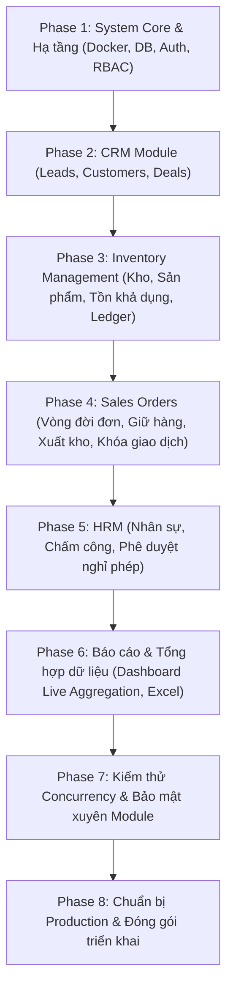

# PRIORITIZED IMPLEMENTATION ROADMAP: BIZPRO+
**LỘ TRÌNH TRIỂN KHAI THEO TỪNG PHÂN HỆ ĐỘC LẬP (ONE MODULE AT A TIME)**

* **Nguyên tắc bất biến:** Không làm đồng thời nhiều module lớn. Chỉ chuyển sang module tiếp theo khi module hiện tại đạt 100% tiêu chí nghiệm thu (Database, Backend API, Frontend Integration, Concurrency Test, Không còn Mock Data).

---

## TỔNG QUAN CÁC GIAI ĐOẠN TRIỂN KHAI (8 PHASES)

---

## CHI TIẾT CÁC TASK THEO TỪNG GIAI ĐOẠN

### GIAI ĐOẠN 1: HẠ TẦNG CỐT LÕI & XÁC THỰC (SYSTEM CORE & PLATFORM)
*Mục tiêu: Xây dựng nền tảng hạ tầng, Backend NestJS, CSDL PostgreSQL, kiểm toán 50 model, xác thực JWT Argon2id, phân quyền 2 lớp (RBAC + Data Scope) và cô lập đa tổ chức. Giai đoạn 1 được chia thành 5 chặng nhỏ có thứ tự phụ thuộc chặt chẽ.*

#### 1. Phase 1A — Quản lý mã nguồn & Hạ tầng (Source Control & Infrastructure)
| Task ID | Phân hệ | Mô tả công việc | Phụ thuộc | Mức ưu tiên | Trạng thái | Tiêu chí nghiệm thu (Acceptance Criteria) | Yêu cầu kiểm thử (Test Requirements) |
|---|---|---|:---:|:---:|:---:|---|---|
| `CORE-1A-01` | Git | Khởi tạo Git repository tại thư mục gốc `e:\dự án`, cấu hình `.gitignore` toàn diện (bảo vệ `node_modules`, `.next`, `.env`, build artifacts) | Không | **P0** | `COMPLETED` | Thư mục `.git` được tạo, `git status` sạch, không đưa secrets lên git. | Lệnh `git status` thực tế (đã pass). |
| `CORE-1A-02` | Git | Tạo Baseline Commit bảo vệ 100% mã nguồn hiện tại của dự án | `CORE-1A-01` | **P0** | `COMPLETED` | Có commit hash đầu tiên (`e671146`), không làm mất bất kỳ tệp tin hiện có nào. | Lệnh `git log -1` trả về commit baseline (đã pass). |
| `CORE-1A-03` | Docker | Thiết lập `docker-compose.yml` chạy PostgreSQL 16 (Port 5432) với healthcheck và persistent volume | `CORE-1A-02` | **P0** | `COMPLETED` | File `docker-compose.yml` và `.env.example` đã được cấu hình chuẩn và commit lên Git. | Lệnh `docker compose config` hợp lệ (đã pass). |

#### 2. Phase 1B — Nền tảng Backend (Backend Foundation)
| Task ID | Phân hệ | Mô tả công việc | Phụ thuộc | Mức ưu tiên | Trạng thái | Tiêu chí nghiệm thu (Acceptance Criteria) | Yêu cầu kiểm thử (Test Requirements) |
|---|---|---|:---:|:---:|:---:|---|---|
| `CORE-1B-01` | NestJS | Khởi tạo dự án NestJS Modular Monolith trong thư mục `/backend` (TypeScript strict mode, ESLint, Prettier) | `CORE-1A-03` | **P0** | `NOT_STARTED` | Ứng dụng chạy được tại port 4000, cấu trúc thư mục module hóa sạch sẽ. | Lệnh `npm run build` và `npm run start:dev` exit code 0. |
| `CORE-1B-02` | Cấu hình | Quản lý cấu hình biến môi trường (`@nestjs/config` + Joi/Zod validation) và file `.env.example` | `CORE-1B-01` | **P0** | `NOT_STARTED` | Backend từ chối khởi động nếu thiếu biến môi trường bắt buộc (DB URL, JWT Secret). | Test khởi động khi thiếu biến môi trường. |
| `CORE-1B-03` | Pipes & Filter| Thiết lập Global ValidationPipe (whitelist, forbidNonWhitelisted), Global HttpExceptionFilter và Response Envelope chuẩn | `CORE-1B-02` | **P0** | `NOT_STARTED` | Mọi request được validate tự động; response trả về chuẩn `{ success, data, error, timestamp, path }`. | Test gửi payload sai định dạng nhận lỗi 400 chuẩn. |
| `CORE-1B-04` | Docs & Health | Tích hợp Swagger OpenAPI (`/api/docs`), Endpoint Health Check (`/api/health` via Terminus) và Logger có cấu trúc | `CORE-1B-03` | **P1** | `NOT_STARTED` | Truy cập `/api/docs` ra giao diện Swagger; `/api/health` trả về trạng thái HTTP/DB `status: "ok"`. | Test curl `/api/health` trả về 200 OK. |

#### 3. Phase 1C — Nền tảng Cơ sở dữ liệu (Database Foundation)
| Task ID | Phân hệ | Mô tả công việc | Phụ thuộc | Mức ưu tiên | Trạng thái | Tiêu chí nghiệm thu (Acceptance Criteria) | Yêu cầu kiểm thử (Test Requirements) |
|---|---|---|:---:|:---:|:---:|---|---|
| `CORE-1C-01` | Prisma | Tích hợp Prisma CLI và Prisma Client vào `/backend`, cấu hình script quản trị CSDL | `CORE-1B-04` | **P0** | `NOT_STARTED` | Prisma Client kết nối thành công đến PostgreSQL container. | Lệnh `npx prisma --version` hoạt động trong `/backend`. |
| `CORE-1C-02` | Schema Audit | Rà soát & hoàn thiện 50 models trong `schema.prisma`: bổ sung composite indexes cho bảng con, thêm `paymentStatus`, `shippingAddress` | `CORE-1C-01` | **P0** | `NOT_STARTED` | Toàn bộ 50 models được rà soát kỹ lưỡng, quan hệ nhất quán, không có index thiếu trên foreign keys. | Chạy schema validation kiểm tra cú pháp thành công. |
| `CORE-1C-03` | Migration | Tạo migration đầu tiên (`init`) và áp dụng lên PostgreSQL kèm các Physical Check Constraints kho | `CORE-1C-02` | **P0** | `NOT_STARTED` | 50 bảng vật lý được tạo đầy đủ trên PostgreSQL kèm ràng buộc `on_hand >= reserved`. | Kiểm tra danh sách bảng trong PostgreSQL. |
| `CORE-1C-04` | Seed & Tests | Viết kịch bản seed dữ liệu mẫu (1 Organization, 1 Super Admin, danh mục quyền) và Integration Tests kiểm tra CSDL | `CORE-1C-03` | **P0** | `NOT_STARTED` | Dữ liệu seed nạp thành công; bộ test kết nối CSDL và ràng buộc toàn vẹn pass 100%. | Chạy `npm run test:e2e` kiểm tra seed và connection. |

#### 4. Phase 1D — Xác thực & Phân quyền RBAC (Authentication & RBAC)
| Task ID | Phân hệ | Mô tả công việc | Phụ thuộc | Mức ưu tiên | Trạng thái | Tiêu chí nghiệm thu (Acceptance Criteria) | Yêu cầu kiểm thử (Test Requirements) |
|---|---|---|:---:|:---:|:---:|---|---|
| `CORE-1D-01` | Auth Service | Xây dựng dịch vụ băm mật khẩu bằng Argon2id và xác thực đăng nhập (`/api/auth/login`, `/api/auth/logout`) | `CORE-1C-04` | **P0** | `NOT_STARTED` | Mật khẩu được băm an toàn; xác thực email + mật khẩu trả về phiên hợp lệ. | Unit test mã hóa mật khẩu, test login thành công/thất bại. |
| `CORE-1D-02` | Tokens | Xây dựng chiến lược JWT: Access Token ngắn hạn (15m) + Refresh Token dài hạn (7d) có rotation và thu hồi trong DB | `CORE-1D-01` | **P0** | `NOT_STARTED` | Cơ chế Refresh Token xoay vòng (Rotation) phát hiện tái sử dụng token gian lận; thu hồi token khi đăng xuất. | Test xoay vòng refresh token và test token hết hạn. |
| `CORE-1D-03` | RBAC Guards | Xây dựng `JwtAuthGuard`, `RolesGuard` và `PermissionsGuard` kiểm soát hành động theo mã quyền `<module>.<resource>.<action>` | `CORE-1D-02` | **P0** | `NOT_STARTED` | Chặn truy cập trái quyền ở Backend, trả về HTTP 401 hoặc 403 Forbidden. | Integration test gọi endpoint có và không có quyền tương ứng. |
| `CORE-1D-04` | FE Auth | Tích hợp trang Đăng nhập trên Frontend (`/login`), lưu trữ token an toàn (HttpOnly Cookie / Memory) và Next.js Route Middleware | `CORE-1D-03` | **P1** | `NOT_STARTED` | Bảo vệ toàn bộ route nội bộ; tự động redirect về `/login` nếu chưa xác thực; không lưu raw token ở `localStorage`. | E2E test luồng đăng nhập $\rightarrow$ vào Dashboard $\rightarrow$ đăng xuất. |

#### 5. Phase 1E — Cô lập Đa tổ chức & Nhật ký kiểm toán (Tenant Isolation & Audit Logging)
| Task ID | Phân hệ | Mô tả công việc | Phụ thuộc | Mức ưu tiên | Trạng thái | Tiêu chí nghiệm thu (Acceptance Criteria) | Yêu cầu kiểm thử (Test Requirements) |
|---|---|---|:---:|:---:|:---:|---|---|
| `CORE-1E-01` | Tenancy Context| Xây dựng TenantContextInterceptor dựa trên `AsyncLocalStorage` trích xuất `orgId` an toàn từ JWT | `CORE-1D-04` | **P0** | `NOT_STARTED` | `orgId` được truyền tự động xuyên suốt request lifecycle của NestJS. | Unit test kiểm tra context trong các async call lồng nhau. |
| `CORE-1E-02` | Data Scope | Xây dựng Data Scope Engine tự động chèn điều kiện lọc bản ghi theo phạm vi quyền (`OWN`, `DEPARTMENT`, `ALL`) | `CORE-1E-01` | **P0** | `NOT_STARTED` | Nhân viên quyền `OWN` chỉ thấy bản ghi của mình; Trưởng phòng thấy bản ghi phòng ban; Admin thấy toàn bộ. | Integration test truy vấn danh sách bản ghi theo từng role & scope. |
| `CORE-1E-03` | Audit Log | Xây dựng AuditLogInterceptor ghi vết tự động biến động dữ liệu vào bảng `audit_logs` (Actor, Action, Diff JSON, IP, User-Agent) | `CORE-1E-01` | **P0** | `NOT_STARTED` | Mọi thao tác Create, Update, Delete được ghi lại đầy đủ và bất biến trong cơ sở dữ liệu. | Kiểm tra bảng `audit_logs` có bản ghi diff sau khi thao tác. |
| `CORE-1E-04` | Security QA | Viết bộ Security Integration Tests kiểm tra phòng thủ đa tầng: Cross-Tenant Leak Test, IDOR Test, Raw SQL injection test | `CORE-1E-02`, `CORE-1E-03` | **P0** | `NOT_STARTED` | Chứng minh User Org A không thể đọc/ghi dữ liệu Org B qua bất kỳ đường dẫn API nào (kể cả raw query). | Chạy bộ test an ninh bảo mật pass 100%. |

---

### GIAI ĐOẠN 2: PHÂN HỆ CRM (CUSTOMERS, LEADS, DEALS)
*Mục tiêu: Chuyển đổi toàn bộ dữ liệu CRM từ Mock RAM sang Database thật có ràng buộc chống trùng lặp.*

| Task ID | Phân hệ | Mô tả công việc | Phụ thuộc | Mức ưu tiên | Trạng thái | Tiêu chí nghiệm thu (Acceptance Criteria) | Yêu cầu kiểm thử (Test Requirements) |
|---|---|---|:---:|:---:|:---:|---|---|
| `CRM-01` | CRM | Xây dựng CRUD API cho Khách hàng (`CustomersController`, `CustomersService`) | `CORE-05` | **P1** | `NOT_STARTED` | Thêm, sửa, xóa, tìm kiếm, phân trang khách hàng qua REST API kết nối PostgreSQL. | Test validation mã số thuế/email, test phân trang. |
| `CRM-02` | CRM | Xây dựng CRUD API cho Leads và Cơ hội Deals (Pipeline Stages) | `CRM-01` | **P1** | `NOT_STARTED` | Quản lý Leads theo nguồn, cập nhật trạng thái Deal qua các cột Kanban. | Test di chuyển stage Deal, test lọc Lead theo trạng thái. |
| `CRM-03` | CRM | Lập trình nghiệp vụ Chuyển đổi Lead $\rightarrow$ Customer (Transaction) | `CRM-02` | **P0** | `NOT_STARTED` | Chuyển đổi trong 1 DB Transaction: tạo Customer mới, kiểm tra chống trùng SĐT, cập nhật Lead thành `CONVERTED`. | Test không tạo 2 khách hàng trùng email/phone, test rollback nếu lỗi. |
| `CRM-04` | CRM Frontend| Thay thế `AppContext` bằng React Query kết nối API thật cho toàn bộ trang `/crm/*` | `CRM-03` | **P1** | `NOT_STARTED` | Tạo khách hàng hoặc chuyển đổi Lead trên giao diện lưu thẳng vào DB, F5 không mất dữ liệu. | E2E kiểm tra tạo Lead trên web $\rightarrow$ bấm F5 $\rightarrow$ dữ liệu vẫn còn. |

---

### GIAI ĐOẠN 3: PHÂN HỆ QUẢN LÝ KHO (INVENTORY MANAGEMENT)
*Mục tiêu: Quản lý hàng hóa, bảo vệ công thức tồn khả dụng và ghi sổ cái kho bất biến.*

| Task ID | Phân hệ | Mô tả công việc | Phụ thuộc | Mức ưu tiên | Trạng thái | Tiêu chí nghiệm thu (Acceptance Criteria) | Yêu cầu kiểm thử (Test Requirements) |
|---|---|---|:---:|:---:|:---:|---|---|
| `INV-01` | Inventory | Xây dựng CRUD API Sản phẩm, Danh mục, Đơn vị tính và Kho hàng | `CORE-05` | **P1** | `NOT_STARTED` | Quản lý SKU, giá vốn, giá bán, kho lưu trữ trên cơ sở dữ liệu thật. | Test trùng SKU bị từ chối, test đơn vị tính chuẩn hóa. |
| `INV-02` | Inventory | Xây dựng Service quản lý Tồn kho (`InventoryBalancesService`) | `INV-01` | **P0** | `NOT_STARTED` | Luôn bảo đảm `Available = OnHand - Reserved`. Không cho phép tồn khả dụng âm. | Unit test tính toán tồn kho, test điều kiện tồn tối thiểu. |
| `INV-03` | Inventory | Xây dựng API Phiếu Nhập kho (Goods Receipt) & Ghi sổ tăng tồn | `INV-02` | **P0** | `NOT_STARTED` | Duyệt phiếu nhập kho sẽ tăng `onHand` và tự động ghi 1 dòng vào `inventory_transactions`. | Test transaction commit cả phiếu nhập và số dư kho. |
| `INV-04` | Inventory | Xây dựng API Kiểm kê kho (Stocktake) và Phiếu điều chỉnh cân bằng kho | `INV-03` | **P1** | `NOT_STARTED` | Ghi nhận độ lệch thực tế và hệ thống, lập phiếu tăng/giảm tồn có lý do giải trình. | Test điều chỉnh tăng/giảm tồn kho cập nhật đúng sổ cái. |
| `INV-05` | Inv Frontend| Kết nối toàn bộ trang `/inventory/*` với API backend thật | `INV-04` | **P1** | `NOT_STARTED` | Tạo sản phẩm, nhập kho trên web phản ánh lập tức vào cơ sở dữ liệu thật. | Kiểm tra thêm sản phẩm $\rightarrow$ vào DB kiểm tra bản ghi tương ứng. |

---

### GIAI ĐOẠN 4: ĐƠN BÁN HÀNG & KHÓA GIAO DỊCH (SALES ORDERS)
*Mục tiêu: Đảm bảo liên kết toàn vẹn CRM $\leftrightarrow$ Kho qua cơ chế giữ hàng và xuất kho có khóa dòng.*

| Task ID | Phân hệ | Mô tả công việc | Phụ thuộc | Mức ưu tiên | Trạng thái | Tiêu chí nghiệm thu (Acceptance Criteria) | Yêu cầu kiểm thử (Test Requirements) |
|---|---|---|:---:|:---:|:---:|---|---|
| `SO-01` | Sales | Xây dựng API Tạo đơn hàng nháp (`DRAFT`) kèm chi tiết sản phẩm | `INV-02`, `CRM-01` | **P1** | `NOT_STARTED` | Tính tổng tiền tự động, snapshot giá bán tại thời điểm tạo đơn, chưa giữ hàng. | Test tính tổng tiền, chiết khấu và thuế. |
| `SO-02` | Sales | Lập trình API Xác nhận đơn hàng & Giữ hàng (`CONFIRMED`) với `SELECT ... FOR UPDATE` | `SO-01` | **P0** | `NOT_STARTED` | Khóa dòng tồn kho, kiểm tra `available >= qty`, tăng `reserved`, tạo record `stock_reservations`. | **Concurrency Test:** Chạy 20 request đồng thời mua 1 sản phẩm cuối cùng; chỉ duy nhất 1 request thành công. |
| `SO-03` | Sales | Lập trình API Xuất kho hoàn tất (`FULFILLED`) | `SO-02` | **P0** | `NOT_STARTED` | Giảm `onHand`, giảm `reserved`, tự động sinh Phiếu xuất kho `stock_issues` và ghi sổ cái. | Test số dư kho giảm chính xác, không còn hàng giữ. |
| `SO-04` | Sales | Lập trình API Hủy đơn hàng (`CANCELLED`) & Giải phóng tồn đang giữ | `SO-02` | **P0** | `NOT_STARTED` | Giảm `reserved` hoàn trả lại tồn khả dụng, đánh dấu reservation thành `RELEASED`. | Test hủy đơn hoàn trả tồn khả dụng chính xác. |
| `SO-05` | Sales Frontend| Kết nối trang `/sales/orders` với API thật | `SO-04` | **P1** | `NOT_STARTED` | Toàn bộ quy trình Confirm $\rightarrow$ Fulfill $\rightarrow$ Cancel chạy qua backend thật. | E2E test đặt hàng và kiểm tra tồn kho đồng bộ thực tế. |

---

### GIAI ĐOẠN 5: PHÂN HỆ QUẢN TRỊ NHÂN SỰ (HRM)
*Mục tiêu: Quản lý nhân sự, chấm công chống gian lận và quy trình duyệt nghỉ phép.*

| Task ID | Phân hệ | Mô tả công việc | Phụ thuộc | Mức ưu tiên | Trạng thái | Tiêu chí nghiệm thu (Acceptance Criteria) | Yêu cầu kiểm thử (Test Requirements) |
|---|---|---|:---:|:---:|:---:|---|---|
| `HRM-01` | HRM | Xây dựng CRUD API Nhân viên, Phòng ban, Chức vụ | `CORE-05` | **P1** | `NOT_STARTED` | Quản lý hồ sơ nhân sự, mã nhân viên độc nhất, phân cấp phòng ban trên CSDL. | Test trùng mã nhân viên bị chặn. |
| `HRM-02` | HRM | Xây dựng API Chấm công (Attendance Check-in / Check-out) | `HRM-01` | **P0** | `NOT_STARTED` | Ghi nhận timestamp thực từ server, chống check-in trùng 2 lần trong cùng ca làm việc. | Test chặn check-in lần 2 khi chưa check-out. |
| `HRM-03` | HRM | Xây dựng Quy trình xin nghỉ & Phê duyệt nghỉ phép (Leave Request Workflow) | `HRM-01` | **P1** | `NOT_STARTED` | Kiểm tra số dư ngày phép năm, chuyển trạng thái `PENDING` $\rightarrow$ `APPROVED` / `REJECTED`. | Test trừ ngày phép khi đơn được duyệt. |
| `HRM-04` | HRM Frontend| Kết nối các trang `/hrm/*` với API thật | `HRM-03` | **P1** | `NOT_STARTED` | Chấm công và duyệt nghỉ phép lưu trực tiếp vào cơ sở dữ liệu thật. | E2E kiểm tra chấm công trên giao diện. |

---

### GIAI ĐOẠN 6: BÁO CÁO & DASHBOARD TẬP TRUNG (REPORTING)
*Mục tiêu: Đưa dữ liệu tổng hợp trực tiếp từ cơ sở dữ liệu lên Dashboard và xuất file báo cáo.*

| Task ID | Phân hệ | Mô tả công việc | Phụ thuộc | Mức ưu tiên | Trạng thái | Tiêu chí nghiệm thu (Acceptance Criteria) | Yêu cầu kiểm thử (Test Requirements) |
|---|---|---|:---:|:---:|:---:|---|---|
| `REP-01` | Reports | Xây dựng API Tổng hợp chỉ số Dashboard (`/api/dashboard/stats`) | P2, P3, P4, P5 | **P1** | `NOT_STARTED` | Truy vấn aggregate doanh thu thực, số đơn hàng, tồn khả dụng, đơn nghỉ chờ duyệt từ DB. | Test tốc độ query aggregate < 200ms. |
| `REP-02` | Reports | Xây dựng API Xuất Excel sao kê đơn hàng và báo cáo Nhập - Xuất - Tồn | `SO-03`, `INV-03`| **P2** | `NOT_STARTED` | Xuất file `.xlsx` chuẩn định dạng có header, số tiền, ngày tháng chuẩn ERP. | Test tải file và mở trên Microsoft Excel/Google Sheets. |
| `REP-03` | Reports Frontend| Nối Dashboard và màn hình Báo cáo với API aggregate thật | `REP-01`, `REP-02`| **P1** | `NOT_STARTED` | Mọi biểu đồ và thẻ KPI hiển thị chính xác số liệu từ cơ sở dữ liệu. | Kiểm tra số liệu Dashboard khớp 100% với dữ liệu trong database. |

---

### GIAI ĐOẠN 7 & 8: TÍCH HỢP HỆ THỐNG, QA & SẴN SÀNG PRODUCTION
* `QA-01`: Viết bộ Integration Test xuyên module: Lead $\rightarrow$ Customer $\rightarrow$ Order $\rightarrow$ Reserve $\rightarrow$ Fulfill $\rightarrow$ Ledger $\rightarrow$ Dashboard.
* `SEC-01`: Kiểm toán an ninh mạng: Quét lỗ hổng IDOR, Injection, kiểm tra rò rỉ dữ liệu giữa 2 tenant mẫu.
* `PROD-01`: Đóng gói Docker Compose cho môi trường Production (Nginx reverse proxy, HTTPS, biến môi trường `.env.production`).
