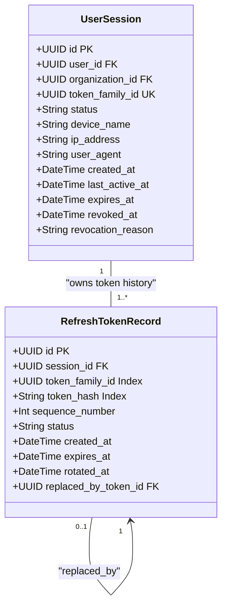
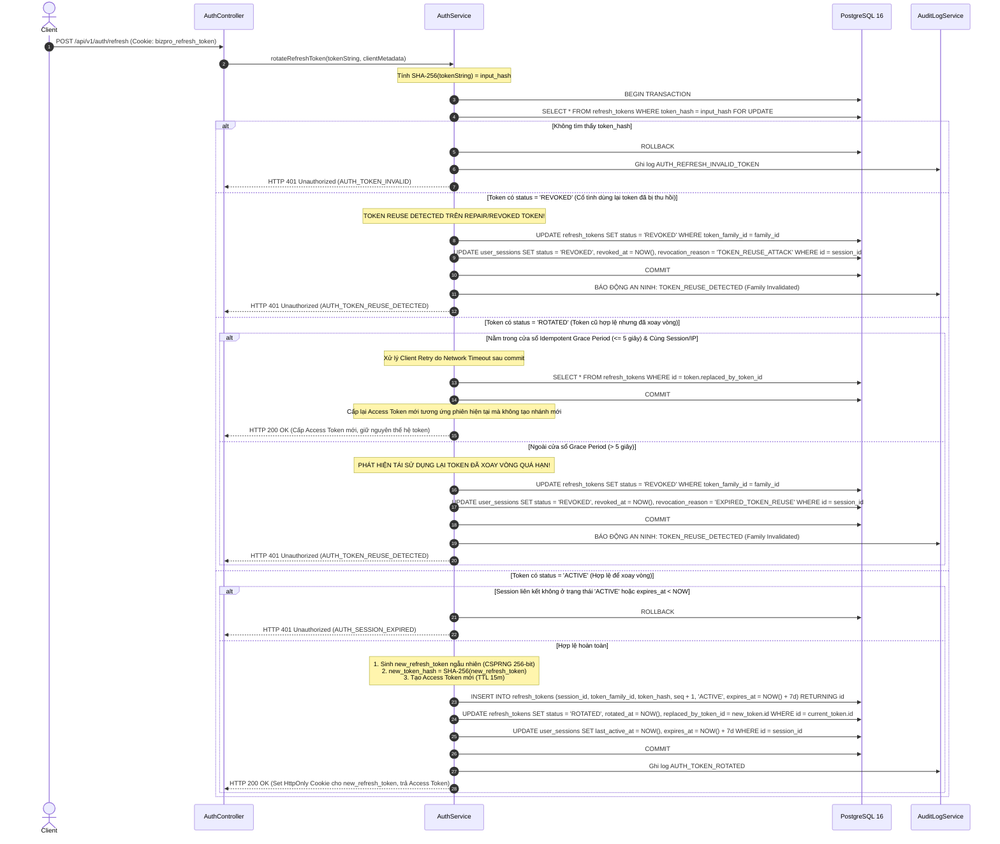
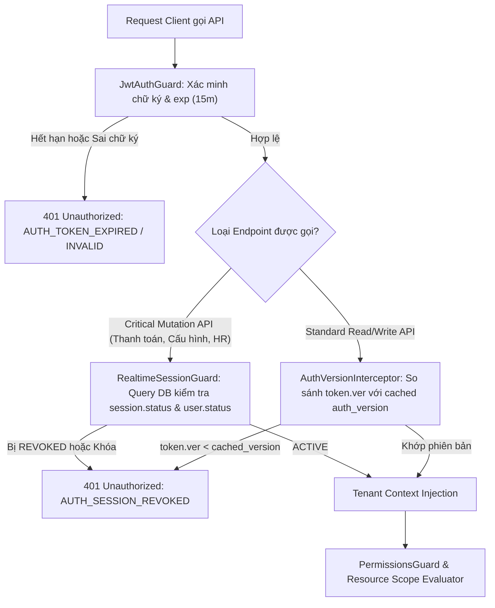
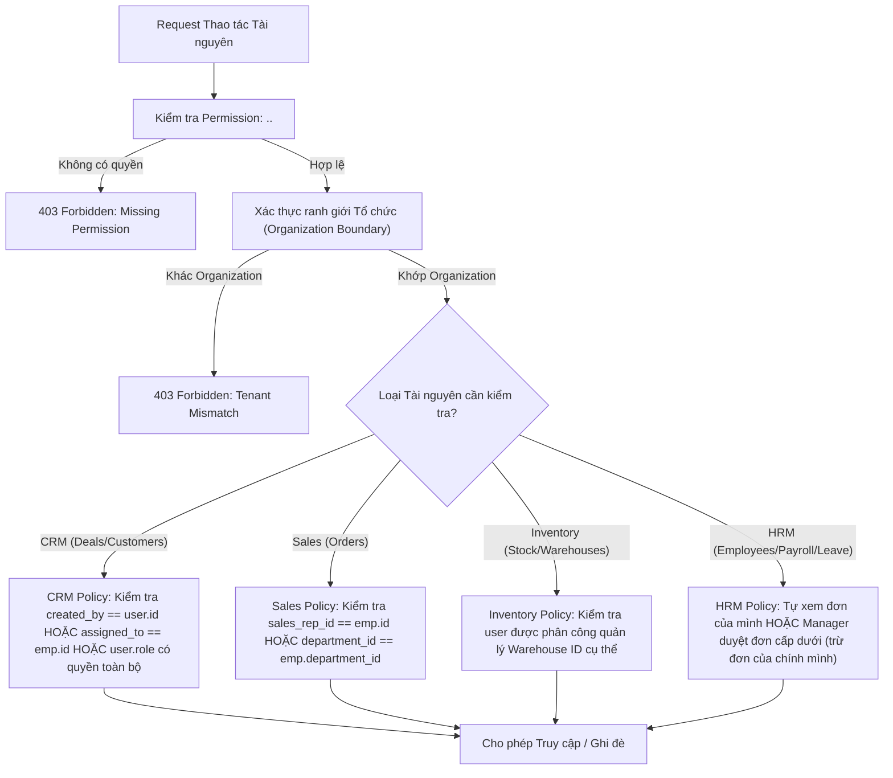

# BIZPRO+ PHASE 1D — AUTHENTICATION & RBAC ARCHITECTURE BLUEPRINT
**Tài liệu:** `docs/PHASE_1D_ARCHITECTURE_BLUEPRINT.md`  
**Phiên bản:** 2.0.0 (Comprehensive Cross-Document Architecture Revision)  
**Tác giả:** Senior Security Architect, Backend Architect & Database Architect  
**Trạng thái tài liệu:** DRAFT SPECIFICATION FOR ARCHITECTURAL REVIEW (DESIGN ONLY)  
**Gate Status:** NOT APPROVED — Awaiting Independent Multi-Agent Review  

---

## 1. TỔNG QUAN KIẾN TRÚC & NGUYÊN TẮC CỐT LÕI (ARCHITECTURE FOUNDATION)

Hệ thống BizPro+ là nền tảng quản trị doanh nghiệp hợp nhất đa tổ chức (Multi-Tenant Modular Monolith). Giai đoạn 1D (Authentication & RBAC) thiết lập hạ tầng định danh, kiểm soát truy cập và bảo vệ biên dữ liệu, kế thừa và bảo toàn 100% các Database Invariants đã được nghiệm thu vật lý tại Phase 1C-C.

```mermaid
graph TD
    Client["Client (Next.js 15 Web SPA / Native Mobile App)"]
    
    subgraph Edge_Security["Tầng Biên Bảo mật (Edge & Reverse Proxy / Nginx)"]
        WAF["WAF & SSL Termination (TLS 1.3, Strict-Transport-Security)"]
        RateLimiter["ThrottlerGuard (@nestjs/throttler: Per-IP & Per-Account)"]
        SecurityHeaders["Helmet (CSP, X-Frame-Options, HSTS, Referrer-Policy)"]
    end

    subgraph Authentication_Layer["Tầng Xác thực & Quản lý Phiên (Authentication & Session Engine)"]
        JwtGuard["JwtAuthGuard (Passport JWT: Verify Signature, exp, iss, aud)"]
        AuthVersionValidator["AuthVersionInterceptor (Validate user.auth_version vs token.ver)"]
        SessionValidator["SessionStateValidator (Validate session.status == 'ACTIVE')"]
        TenantResolver["TenantContextResolver (Extract verified organization_id into AsyncLocalStorage)"]
    end

    subgraph Authorization_Layer["Tầng Phân quyền Ngữ cảnh (Contextual Authorization Engine)"]
        PermGuard["PermissionsGuard (@RequirePermissions: Deny-by-default)"]
        ResourceScopePolicy["ResourceScopePolicyEngine (Resource-specific Evaluation)"]
        OwnershipBoundary["Ownership & Department Boundary Evaluator"]
    end

    subgraph Domain_Services["Tầng Dịch vụ Miền (Domain Services & Repositories)"]
        AuthService["AuthService (Argon2id, Session Lifecycle, Token Family RTR)"]
        CRMService["CRM Domain Service (Customers, Deals, Leads)"]
        SalesService["Sales Domain Service (Orders, Quotes)"]
        InventoryService["Inventory Domain Service (Products, Stock)"]
        HRMService["HRM Domain Service (Employees, Attendance, Leave)"]
    end

    subgraph Storage_Layer["Tầng Lưu trữ Vật lý (PostgreSQL 16 Engine)"]
        UsersTbl[("users (password_hash, auth_version, lockout)")]
        SessionsTbl[("user_sessions (family_id, device, status)")]
        RefreshTokensTbl[("refresh_tokens (token_hash, family_id, seq, status)")]
        RbacTbls[("roles, permissions, role_permissions, user_roles")]
        CompositeFKs[("Phase 1C-C Invariants: Composite FKs & CHECK Constraints")]
    end

    Client --> WAF --> SecurityHeaders --> RateLimiter
    RateLimiter --> JwtGuard --> AuthVersionValidator --> SessionValidator --> TenantResolver
    TenantResolver --> PermGuard --> ResourceScopePolicy --> OwnershipBoundary
    OwnershipBoundary --> Domain_Services
    AuthService --> UsersTbl
    AuthService --> SessionsTbl
    AuthService --> RefreshTokensTbl
    PermGuard --> RbacTbls
    Domain_Services --> CompositeFKs
```



### 1.1. Các nguyên tắc kiến trúc bất biến (Architectural Invariants)
1. **Deny-by-Default (Mặc định từ chối):** Mọi endpoint công khai bắt buộc phải được đánh dấu bằng decorator `@Public()` tường minh. Toàn bộ endpoint còn lại đều yêu cầu JWT hợp lệ và quyền hạn rõ ràng.
2. **Zero-Trust Client Input (Không tin cậy dữ liệu Client):** Tuyệt đối không bao giờ tin cậy `organizationId`, `userId`, `role`, `departmentId` hoặc bất kỳ tham số ngữ cảnh nào được gửi trong request body, query params hay custom headers. Mọi định danh ngữ cảnh chỉ được phân giải từ Token Signature đã qua xác thực cryptographic.
3. **Layered Defense-in-Depth (Phòng thủ đa tầng):** Không dựa vào một cơ chế bảo vệ đơn lẻ (ví dụ: không coi Prisma Extension là giải pháp bảo vệ 100%). Sự cô lập dữ liệu và bảo mật được thực thi đồng thời tại:
   - Tầng Xác thực (Guard)
   - Tầng Ngữ cảnh (AsyncLocalStorage Tenant Context)
   - Tầng Ứng dụng & Dịch vụ (Service Layer Filter)
   - Tầng Truy vấn & ORM (Repository & Prisma Extension)
   - Tầng Cơ sở dữ liệu vật lý (PostgreSQL Composite FKs & CHECK Constraints)
4. **Bảo toàn Invariant Phase 1C-C:** Mọi quyết định thiết kế Phase 1D tuyệt đối không can thiệp, không phá vỡ quan hệ 1-1 vật lý giữa `users.employee_id` và `employees.id`, các Composite Foreign Keys thanh toán, 11 CHECK constraints, và snapshot trigger đã nghiệm thu.

---

## 2. KIẾN TRÚC REFRESH TOKEN & QUẢN LÝ PHIÊN (TOKEN FAMILY ARCHITECTURE)

### 2.1. Hạn chế của mô hình cũ & Thiết kế mới
- **Mô hình cũ (Đã bị bác bỏ):** Lưu duy nhất một `refresh_token_hash` trực tiếp trên bảng `user_sessions` rồi ghi đè sau mỗi lần rotate. Mô hình này làm mất toàn bộ lịch sử xoay vòng, không thể phân biệt giữa hành vi retry hợp lệ do timeout mạng với tấn công token replay, và dễ gây ra false-positive thu hồi nhầm tài khoản của người dùng.
- **Mô hình mới (Được thiết lập tại Phase 1D):** Tách biệt rõ ràng thực thể **Phiên làm việc (`UserSession`)** và **Bản ghi Token Xoay vòng (`RefreshTokenRecord`)**, liên kết theo cấu trúc **Token Family**:
  - `UserSession`: Đại diện cho một phiên làm việc vật lý gắn với thiết bị, IP, User-Agent và trạng thái tổng thể (`ACTIVE`, `REVOKED`, `EXPIRED`).
  - `RefreshTokenRecord`: Lưu trữ từng thế hệ token trong một chuỗi xoay vòng (Token Chain), có `token_family_id`, `token_hash` (SHA-256), `sequence_number`, `status` (`ACTIVE`, `ROTATED`, `REVOKED`), `rotated_at`, và `replaced_by_token_id`.



### 2.2. Luồng Xoay vòng Token (Refresh Token Rotation - RTR) & Transaction Locking
Mọi thao tác xoay vòng token bắt buộc phải thực thi trong một Database Transaction với cơ chế khóa hàng bi quan (**Pessimistic Row Lock: `SELECT ... FOR UPDATE`**) để triệt tiêu hoàn toàn race condition khi có nhiều request đồng thời.



### 2.3. Đánh giá lại cơ chế Grace Period & Concurrent Refresh Handling
- **Nguy cơ của Grace Period thả nổi:** Việc cho phép token cũ được sử dụng tự do trong 10 giây mở ra cửa sổ để kẻ tấn công thực hiện replay attack thành công song song với nạn nhân.
- **Quy chuẩn kỹ thuật mới của BizPro+:**
  1. **Atomic Lock:** Khóa bi quan `SELECT ... FOR UPDATE` bắt buộc tuần tự hóa mọi request refresh trên cùng một token family. Không thể xảy ra trường hợp hai transaction cùng đọc được token ở trạng thái `ACTIVE`.
  2. **Thời gian Grace Window rút gọn:** Cố định tối đa **5 giây** và chỉ áp dụng cho request có cùng chữ ký Client Fingerprint (IP Subnet và User-Agent) và chỉ trả về Access Token tương ứng của token thế hệ kế tiếp, tuyệt đối không tạo ra token nhánh (branching token).
  3. **Idempotent Retry Response:** Khi client gặp timeout mạng sau khi DB đã commit: client gửi lại token cũ (bị `ROTATED` cách đó dưới 5 giây), server tra cứu `replaced_by_token_id` và trả lại thông tin phiên an toàn mà không cần lưu token dạng rõ trong DB.
  4. **Phạm vi thu hồi khi phát hiện Reuse (Token Revocation Scope):** Không mặc định thu hồi tất cả các session trên các thiết bị khác nhau của User. Hệ thống áp dụng chính sách **Targeted Family Invalidation**:
     - Lập tức chuyển toàn bộ tokens trong `token_family_id` sang `REVOKED`.
     - Chuyển `UserSession` liên kết sang `REVOKED`.
     - Các session độc lập khác của User trên thiết bị khác vẫn được duy trì trừ khi mức độ rủi ro leo thang (ví dụ: tài khoản bị brute-force nhiều lần liên tiếp, khi đó mới kích hoạt khóa tài khoản và tăng `auth_version`).

---

## 3. KIẾN TRÚC ACCESS TOKEN & CƠ CHẾ THU HỒI TỨC THỜI (REVOCATION ENGINE)

### 3.1. Hạn chế của Stateless JWT & Giải pháp lai (Hybrid Token Strategy)
- **Hạn chế:** JWT Access Token có bản chất là Stateless. Nếu chỉ dựa vào thời hạn `exp` (15 phút), khi Admin thu hồi quyền, chuyển phòng ban, vô hiệu hóa User hoặc User đổi mật khẩu, token cũ vẫn có hiệu lực cho đến khi hết 15 phút.
- **Giải pháp lai:**
  1. **Access Token TTL ngắn:** 15 phút (`900 giây`).
  2. **Trường `auth_version` trên thực thể User:**
     - Trong bảng `users` bổ sung cột `auth_version INT DEFAULT 1`.
     - Trong JWT Payload chứa claim `ver: user.auth_version`.
     - Khi xảy ra các sự kiện nhạy cảm: Đổi mật khẩu, Reset mật khẩu, Admin khóa tài khoản, Admin thu hồi vai trò $\rightarrow$ Hệ thống tăng `auth_version = auth_version + 1` trong DB.
     - `AuthVersionInterceptor` kiểm tra: Nếu `payload.ver < user.auth_version` $\rightarrow$ Từ chối ngay lập tức bằng mã lỗi `401 Unauthorized` (`AUTH_TOKEN_REVOKED`).
  3. **Phân loại Endpoint theo yêu cầu kiểm tra trạng thái:**
     - *Nhóm 1 (Critical Mutation APIs - Bắt buộc kiểm tra DB Session/User Realtime):*
       - Thanh toán, hoàn tiền (`/api/v1/sales/orders/:id/payments`, `/refunds`).
       - Thay đổi cấu hình bảo mật, phân quyền (`/api/v1/settings/*`, `/api/v1/auth/change-password`).
       - Quản lý tổ chức và nhân sự cấp cao (`/api/v1/hrm/employees/*`).
       - $\rightarrow$ Các API này bắt buộc chạy qua `RealtimeSessionGuard` kiểm tra trạng thái `user_sessions.status == 'ACTIVE'` và `users.status == 'ACTIVE'`.
     - *Nhóm 2 (Standard Read APIs - Tối ưu hiệu năng qua Stateless JWT):*
       - Đọc danh sách CRM, tra cứu sản phẩm tồn kho, xem báo cáo thường quy.
       - $\rightarrow$ Dựa vào chữ ký JWT và `auth_version` (được cache trong bộ nhớ với TTL ngắn 30-60 giây), giảm tải 90% truy vấn vào DB.



---

## 4. AN NINH ĐA TỔ CHỨC: MÔ HÌNH PHÒNG THỦ ĐA TẦNG (DEFENSE-IN-DEPTH)

Mô hình dữ liệu của BizPro+ là Shared Database, Shared Schema có Discriminator Column (`organization_id`). Không tuyên bố một công nghệ đơn lẻ (như Prisma Extension) có thể bảo vệ 100%. Hệ thống xây dựng 6 lớp phòng thủ ranh giới tổ chức:

```
[Layer 1: JWT Signature Verification] ────► Xác thực chữ ký số, trích xuất organization_id
                   │
[Layer 2: Tenant Context Resolution] ─────► Lưu trữ organization_id vào AsyncLocalStorage
                   │
[Layer 3: Service Layer Parameter Guard] ─► Bắt buộc mọi hàm Service nhận orgId làm tham số đầu tiên
                   │
[Layer 4: Repository & Query Builders] ───► Mọi câu query (CRUD) tự động inject WHERE organization_id = :orgId
                   │
[Layer 5: Prisma Extension Hook] ─────────► Bổ trợ tự động thêm organizationId cho truy vấn thông thường
                   │
[Layer 6: Physical Database Constraints] ─► Composite Foreign Keys & RLS bảo vệ vật lý tại PostgreSQL
```

### 4.1. Phân tích giới hạn của Prisma Extension và biện pháp khắc phục
Prisma Client Extension là một tầng tiện ích rất hữu hiệu nhưng **KHÔNG THỂ BẢO VỆ 100%** trong các trường hợp phức tạp:

| Trường hợp truy vấn đặc thù | Nguy cơ khi chỉ dựa vào Prisma Extension | Cơ chế Kiểm soát Bắt buộc tại BizPro+ (Remediation) |
| :--- | :--- | :--- |
| **Raw SQL (`$queryRaw`, `$executeRaw`)** | Prisma Extension hoàn toàn bỏ qua, không thể phân tích cú pháp SQL thô để tự thêm `WHERE organization_id = ...`. | **Quy tắc bất biến:** Cấm sử dụng `$queryRaw` tùy tiện. Mọi lệnh Raw SQL bắt buộc phải đi qua `TenantSafeSqlHelper` với tham số bind `:orgId` tường minh và phải qua Senior Review. |
| **Nested Writes (`create`, `connect`, `include`)** | Khi tạo bản ghi con lồng nhau, client có thể truyền `connect: { id: foreign_id }` thuộc về tổ chức khác. | **Service Validation:** Service Layer bắt buộc phải xác minh quyền sở hữu của `foreign_id` trong cùng `organization_id` trước khi gọi nested write. |
| **Aggregations & GroupBy** | Lệnh gom nhóm tính tổng doanh thu hoặc số lượng nếu sót điều kiện lọc sẽ rò rỉ số liệu thống kê giữa các tenant. | **Repository Wrappers:** Bọc toàn bộ phương thức `groupBy` và `aggregate` trong BaseRepository với filter `organizationId` mặc định. |
| **Upsert Operations** | Mệnh đề `where` trong upsert thường dựa vào Unique Index đơn (ví dụ `code`), có thể cập nhật nhầm bản ghi của tenant khác nếu index không có `organization_id`. | Áp dụng Partial Unique Index hoặc Composite Unique `(code, organization_id)`. |
| **Interactive Transactions (`prisma.$transaction`)** | Việc chuyển giao context trong transaction client có thể làm mất gắn kết `AsyncLocalStorage`. | `TenantContextService` truyền ngữ cảnh tổ chức trực tiếp vào Transaction Execution Context. |

### 4.2. Vai trò của Database Constraints đã nghiệm thu tại Phase 1C-C
- **Composite Foreign Keys:** Bảng `payment_transactions` sở hữu ràng buộc vật lý:
  `FOREIGN KEY (sales_order_id, organization_id) REFERENCES sales_orders(id, organization_id) ON DELETE RESTRICT`.
  Ràng buộc này bảo đảm rằng ngay cả khi tầng ứng dụng xảy ra lỗi logic nghiêm trọng, PostgreSQL 16 sẽ từ chối ở mức độ đĩa cứng nếu một giao dịch thanh toán của Tổ chức A cố tình liên kết đến đơn hàng của Tổ chức B.

---

## 5. KIẾN TRÚC PHÂN QUYỀN RBAC & RESOURCE-SPECIFIC DATA SCOPE

### 5.1. Bác bỏ Maximum Scope Priority & Thiết lập Ma trận Phân quyền theo Ngữ cảnh Tài nguyên
- **Lý do bác bỏ `OWN < DEPARTMENT < ALL`:** Thang thứ bậc tuyến tính không phản ánh đúng nghiệp vụ doanh nghiệp thực tế. Ví dụ:
  - Một Trưởng phòng Nhân sự có thể có quyền quản lý nhân viên cấp dưới trong phòng ban của mình (`DEPARTMENT`), nhưng đối với hồ sơ kỷ luật hoặc thông tin lương của chính mình, họ không được phép tự duyệt (`OWN` bị hạn chế theo Separation of Duties).
  - Trong Kho hàng, khái niệm `DEPARTMENT` không tồn tại; ranh giới là theo **Kho vật lý (`Warehouse Boundary`)**.
  - Trong Bán hàng, một nhân viên kinh doanh có thể là Creator của Deal A (quyền `OWN`), nhưng đồng thời được Assign hỗ trợ Deal B của đồng nghiệp (quyền `COLLABORATOR`), và là Manager của nhóm bán lẻ C (quyền `TEAM`).
- **Mô hình mới: Resource-Specific Policy Evaluation Engine:**
  Quyền hạn thực thi được đánh giá dựa trên 5 yếu tố ngữ cảnh:
  $$\text{AccessDecision} = f(\text{Permission}, \text{ResourceContext}, \text{OwnershipPolicy}, \text{OrgBoundary}, \text{EmployeeContext})$$



### 5.2. Chính sách Phân quyền cụ thể theo từng Phân hệ Nghiệp vụ

#### 1. Phân hệ CRM (Khách hàng & Cơ hội Bán hàng):
- **Tài nguyên:** `Customer`, `Deal`, `Lead`.
- **Chính sách:**
  - *Cấp cá nhân (Personal/Own):* User là người tạo (`created_by_id = user.id`) HOẶC là người trực tiếp phụ trách chăm sóc (`assigned_to_id = employee.id`).
  - *Cấp phòng ban (Departmental):* User là Trưởng nhóm/Trưởng phòng, xem và quản lý các deal được giao cho các nhân viên trực thuộc phòng ban (`department_id = employee.department_id`).
  - *Cấp toàn tổ chức (Organizational):* Giám đốc kinh doanh hoặc Quản trị viên (`is_system_role = true`), xem toàn bộ dữ liệu CRM thuộc cùng `organization_id`.

#### 2. Phân hệ Bán hàng (Sales Orders & Quotes):
- **Tài nguyên:** `SalesOrder`, `SalesOrderItem`, `PaymentTransaction`.
- **Chính sách:**
  - Nhân viên bán hàng chỉ được chỉnh sửa đơn hàng khi đơn ở trạng thái `DRAFT` và do chính mình tạo.
  - Khi đơn đã chuyển sang trạng thái `SUBMITTED`, chỉ có cấp quản lý phòng ban trở lên mới có quyền `sales.orders.approve`.
  - Quyền thanh toán (`sales.orders.pay`) chỉ dành cho Kế toán bán hàng hoặc Thu ngân được phân quyền rõ ràng; nhân viên kinh doanh không được tự ý xác nhận thanh toán đơn hàng do mình lập (Separation of Duties).

#### 3. Phân hệ Kho hàng (Warehouses & Stock Balance):
- **Tài nguyên:** `Product`, `Warehouse`, `InventoryTransaction`, `Stocktake`.
- **Chính sách:**
  - Không áp dụng khái niệm Department cho Kho. Thay vào đó, áp dụng **Kho được phân quyền (Warehouse Assignment Policy)**.
  - Thủ kho chỉ được phép tạo phiếu nhập/xuất kho (`inventory.receipts.create`, `inventory.issues.create`) trên danh sách `warehouse_id` mà nhân viên đó được phân công trực tiếp trong bảng phân quyền kho (`warehouse_staff`).
  - Lệnh kiểm kê (`Stocktake`) bắt buộc phải có ít nhất 2 người tham gia: Người lập lệnh và Người xác nhận cân đối kho.

#### 4. Phân hệ Nhân sự (HRM & Attendance & Leave):
- **Tài nguyên:** `Employee`, `AttendanceRecord`, `LeaveRequest`, `PayrollRecord`.
- **Chính sách:**
  - *Nhân viên bình thường:* Chỉ được xem bảng chấm công của chính mình (`employee_id = current_user.employee_id`), tạo đơn xin nghỉ phép cho chính mình.
  - *Quản lý trực tiếp (Direct Manager):* Được xem hồ sơ và phê duyệt đơn xin nghỉ phép của nhân viên có `manager_id = current_user.employee_id`. **Quy tắc ngăn chặn xung đột lợi ích:** Quản lý không được tự duyệt đơn xin nghỉ phép của chính mình.
  - *Nhân sự cấp cao (HR Manager):* Được xem và quản lý toàn bộ hồ sơ nhân viên trong tổ chức, nhưng việc thay đổi cấu trúc lương/hợp đồng yêu cầu quyền `hrm.payroll.manage`.

---

## 6. XỬ LÝ CÁC TÌNH HUỐNG BIÊN BẢO MẬT & VÒNG ĐỜI TÀI KHOẢN (EDGE CASES)

| Kịch bản sự cố biên | Tác động kỹ thuật | Quy trình Phản ứng & Phòng vệ Kiến trúc |
| :--- | :--- | :--- |
| **1. Tổ chức bị tạm đình chỉ (Organization Suspension)** | Tổ chức chưa thanh toán cước phí hoặc vi phạm chính sách (`status = 'SUSPENDED'`). | `TenantContextResolver` kiểm tra trạng thái Organization trong cache/DB. Nếu `SUSPENDED`, lập tức chặn 100% request từ cửa ngõ với mã lỗi `403 Forbidden` (`AUTH_ORGANIZATION_SUSPENDED`), vô hiệu hóa mọi phiên làm việc thuộc tổ chức này. |
| **2. User bị khóa hoặc đổi quyền giữa chừng** | User bị thu hồi quyền hoặc chuyển trạng thái sang `INACTIVE` khi Access Token 15m còn hạn. | Tăng `users.auth_version`. Mọi request mutation hoặc request tiếp theo qua `AuthVersionInterceptor` sẽ phát hiện `token.ver < user.auth_version` và từ chối `401 Unauthorized` (`AUTH_TOKEN_REVOKED`). |
| **3. Xóa liên kết Employee (ON DELETE SET NULL)** | Nhân viên nghỉ việc, bản ghi `employees` bị xóa. Bảng `users` có `employee_id` chuyển thành `NULL` (Phase 1C-C Invariant). | User mất toàn bộ ngữ cảnh phòng ban. Mọi câu query yêu cầu `department_id` tự động thoái lui về từ chối hoặc chỉ giới hạn ở phạm vi tài khoản cá nhân, không rò rỉ dữ liệu của phòng ban cũ. |
| **4. Điều chuyển phòng ban nhân viên** | Nhân viên chuyển từ Phòng Kinh Doanh 1 sang Phòng Kinh Doanh 2. | Không cần đăng xuất tài khoản. `EmployeeContextResolver` tự động đọc `department_id` mới từ bảng `employees`, các câu truy vấn phòng ban tiếp theo lập tức áp dụng phạm vi phòng ban mới và ngắt truy cập phòng ban cũ. |
| **5. Cố tình gửi JWT cũ đã đăng xuất (Logout Token Replay)** | Kẻ gian lấy được Access Token cũ trước khi User nhấn Logout. | Khi User gọi `/logout`, session bị đánh dấu `REVOKED`. Đối với các API nhạy cảm, `RealtimeSessionGuard` chặn ngay lập tức. Sau 15 phút, Access Token hết hạn tự nhiên và không thể refresh. |
| **6. Khóa tài khoản sau 5 lần đăng nhập sai (Brute-Force Lockout)** | Kẻ tấn công dò mật khẩu. | Bảng `users` ghi nhận `failed_login_attempts = 5`, cập nhật `locked_until = NOW() + 15 minutes`. Các request đăng nhập tiếp theo bị từ chối với mã lỗi `423 Locked` kèm thời gian chờ. |

---

## 7. KẾT LUẬN & ĐIỀU KIỆN MỞ GATE TRIỂN KHAI (GATE STATUS)

Kiến trúc Phase 1D đã được tái cấu trúc toàn diện, loại bỏ hoàn toàn các giả định tuyến tính sai lệch về Data Scope, chuẩn hóa kiến trúc Token Family và Transaction Locking cho Refresh Token, đồng thời tích hợp đa tầng phòng thủ Multi-Tenancy.

> [!IMPORTANT]
> **GATE STATUS HIỆN TẠI: NOT APPROVED (DRAFT FOR REVIEW)**  
> Toàn bộ nội dung trên thuộc phạm vi **DESIGN ONLY**. Chưa có bất kỳ dòng code thực thi, migration hay thay đổi cấu trúc nào được áp dụng trên cơ sở dữ liệu thực tế cho đến khi có sự phê duyệt chính thức từ người dùng.
