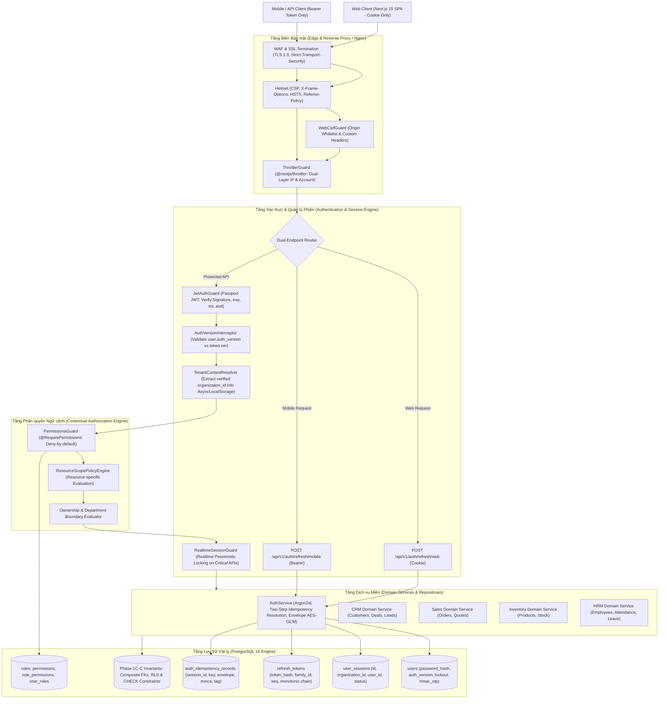

# BIZPRO+ PHASE 1D — AUTHENTICATION & RBAC ARCHITECTURE BLUEPRINT
**Tài liệu:** `docs/PHASE_1D_ARCHITECTURE_BLUEPRINT.md`  
**Phiên bản:** 3.2.0-SYNCHRONIZED (Comprehensive Architecture Blueprint)  
**Tác giả:** Principal Security Architect, Backend Architect, PostgreSQL Architect & Distributed Systems Architect  
**Trạng thái tài liệu:** SPECIFICATION SYNCHRONIZED — CONTROLLED DOCUMENTATION (DESIGN ONLY)  
**Gate Status:** NOT APPROVED (HOLD) — Implementation Gate Strict Preservation  

---

## 1. TỔNG QUAN KIẾN TRÚC & NGUYÊN TẮC CỐT LÕI (ARCHITECTURE FOUNDATION)

Hệ thống BizPro+ là nền tảng quản trị doanh nghiệp hợp nhất đa tổ chức (Multi-Tenant Modular Monolith). Giai đoạn 1D (Authentication & RBAC) thiết lập hạ tầng định danh, kiểm soát truy cập và bảo vệ biên dữ liệu, kế thừa và bảo toàn 100% các Database Invariants đã được nghiệm thu vật lý tại Phase 1C-C.



### 1.1. Các nguyên tắc kiến trúc bất biến (Architectural Invariants)
1. **Deny-by-Default (Mặc định từ chối):** Mọi endpoint công khai bắt buộc phải được đánh dấu bằng decorator `@Public()` tường minh. Toàn bộ endpoint còn lại đều yêu cầu JWT hợp lệ và quyền hạn rõ ràng.
2. **Zero-Trust Client Input (Không tin cậy dữ liệu Client):** Tuyệt đối không bao giờ tin cậy `organizationId`, `userId`, `role`, `departmentId` hoặc bất kỳ tham số ngữ cảnh nào được gửi trong request body, query params hay custom headers. Mọi định danh ngữ cảnh chỉ được phân giải từ Token Signature đã qua xác thực cryptographic.
3. **Layered Defense-in-Depth (Phòng thủ đa tầng):** Sự cô lập dữ liệu và bảo mật được thực thi đồng thời tại:
   - Tầng Xác thực (Guard)
   - Tầng Ngữ cảnh (AsyncLocalStorage Tenant Context)
   - Tầng Ứng dụng & Dịch vụ (Service Layer Parameter Guard & Filter)
   - Tầng Truy vấn & ORM (Repository & Prisma Client Extensions)
   - Tầng Cơ sở dữ liệu vật lý (PostgreSQL Row-Level Security, Composite FKs & CHECK Constraints)
4. **Bảo toàn Invariant Phase 1C-C:** Mọi quyết định thiết kế Phase 1D tuyệt đối không can thiệp, không phá vỡ quan hệ 1-1 vật lý giữa `users.employee_id` và `employees.id`, các Composite Foreign Keys thanh toán, 11 CHECK constraints, và snapshot trigger đã nghiệm thu.

---

## 2. KIẾN TRÚC REFRESH TOKEN & QUẢN LÝ PHIÊN (TOKEN FAMILY ARCHITECTURE)

### 2.1. Phân Tách Thực Thể & Cấu Trúc Token Family
- **Bãi bỏ Mô hình Ghi đè Phiên:** Không lưu duy nhất một token hash trên `user_sessions`.
- **Mô hình Token Family Đa thế hệ:**
  - `UserSession`: Đại diện cho một phiên làm việc vật lý gắn với thiết bị, IP, User-Agent và trạng thái tổng thể (`ACTIVE`, `REVOKED`, `EXPIRED`).
  - `TokenFamily`: Nhóm quản lý logic chuỗi xoay vòng, gắn kết 1-1 với `UserSession`.
  - `RefreshTokenRecord`: Lưu trữ từng thế hệ token trong một chuỗi xoay vòng đơn điệu (Strict Directed Linear Chain), có `token_family_id`, `token_hash` (SHA-256), `sequence_number` (tăng đơn điệu ngặt), `status` (`ACTIVE`, `ROTATED`, `REVOKED`, `EXPIRED`), `rotated_at`, và `replaced_by_token_id`.
  - `AuthIdempotencyRecord`: Lưu trữ response envelope đã được mã hóa bằng AES-256-GCM để khôi phục phản hồi cho client khi gặp sự cố mạng (Recovery TTL 30s), có phạm vi ràng buộc duy nhất theo `(session_id, idempotency_key)`.

### 2.2. Giao Thức Phân Giải Idempotency Hai Bước (Two-Step Idempotency Resolution Protocol)
Nhằm khắc phục triệt để lỗi logic ở các phiên bản trước (câu truy vấn gộp nhiều điều kiện gây nhầm lẫn giữa record không tồn tại với mismatch payload, làm tê liệt mã lỗi 422 và tiềm ẩn rò rỉ session), BizPro+ chuẩn hóa quy trình phân giải 2 bước:

```mermaid
sequenceDiagram
    autonumber
    actor Client
    participant Controller as AuthController
    participant Service as AuthService
    participant DB as PostgreSQL 16

    Client->>Controller: POST /api/v1/auth/refresh/web (Token T, Header Idempotency-Key K)
    Controller->>Service: rotateToken(T, K)
    Note over Service: Tính request_token_hash = SHA256(T)
    
    Service->>DB: Tx BEGIN (lock_timeout = 2000ms)
    Note over Service: BƯỚC 1: Xác thực Credential & Khóa dòng Token
    Service->>DB: SELECT * FROM refresh_tokens WHERE token_hash = SHA256(T) FOR UPDATE;
    
    alt Token KHÔNG TỒN TẠI trong DB
        Service->>DB: ROLLBACK
        Service-->>Controller: HTTP 401 Unauthorized (AUTH_INVALID_TOKEN)
    else Token có status = 'ACTIVE' (Xoay vòng bình thường)
        Note over Service: 1. Sinh Token T_new, seq = seq + 1<br/>2. INSERT T_new (ACTIVE)<br/>3. UPDATE T_old (ROTATED, replaced_by = T_new.id)<br/>4. Mã hóa Envelope (AES-256-GCM, Nonce Hybrid 96-bit)<br/>5. INSERT auth_idempotency_records (session_id, K, envelope)
        Service->>DB: INSERT INTO refresh_tokens ...; UPDATE refresh_tokens ...; INSERT INTO auth_idempotency_records ...;
        Service->>DB: COMMIT
        Service-->>Controller: HTTP 200 OK (Set-Cookie T_new, trả Access Token)
    else Token có status = 'ROTATED' (Token đã xoay vòng, kích hoạt Phân giải Bước 2)
        Note over Service: BƯỚC 2: Phân giải Ngữ cảnh Idempotency (Scoped theo session_id)
        Service->>DB: SELECT * FROM auth_idempotency_records WHERE session_id = token.session_id AND idempotency_key = K FOR UPDATE;
        
        alt Tìm thấy Record R
            alt R.request_token_hash == SHA256(T) AND R.expires_at > NOW()
                Note over Service: KHÔI PHỤC HỢP LỆ TRONG CỬA SỔ RECOVERY (<= 30s)
                Service->>DB: COMMIT
                Note over Service: Giải mã Envelope (AES-GCM Authenticated Decrypt)
                Service-->>Controller: HTTP 200 OK (Gửi lại nguyên vẹn Response gốc)
            else R.request_token_hash == SHA256(T) AND R.expires_at <= NOW()
                Note over Service: QUÁ HẠN RECOVERY WINDOW (> 30s) -> FAIL-CLOSED!
                Service->>DB: UPDATE refresh_tokens SET status = 'REVOKED' WHERE token_family_id = token.token_family_id;
                Service->>DB: UPDATE user_sessions SET status = 'REVOKED' WHERE id = token.session_id;
                Service->>DB: COMMIT
                Service-->>Controller: HTTP 401 Unauthorized (AUTH_RECOVERY_WINDOW_EXPIRED)
            else R.request_token_hash != SHA256(T)
                Note over Service: CÙNG KEY NHƯNG KHÁC TOKEN TRONG CÙNG SESSION!
                Service->>DB: ROLLBACK
                Service-->>Controller: HTTP 422 Unprocessable Entity (AUTH_IDEMPOTENCY_PAYLOAD_MISMATCH)
            end
        else Record NOT FOUND (Khác Key hoặc không có chứng thực recovery)
            Note over Service: PHÁT HIỆN TOKEN REUSE / REPLAY TẤN CÔNG!
            Service->>DB: UPDATE refresh_tokens SET status = 'REVOKED' WHERE token_family_id = token.token_family_id;
            Service->>DB: UPDATE user_sessions SET status = 'REVOKED' WHERE id = token.session_id;
            Service->>DB: COMMIT
            Service-->>Controller: HTTP 401 Unauthorized (AUTH_TOKEN_REUSE_DETECTED)
        end
    else Token có status = 'REVOKED'
        Service->>DB: ROLLBACK
        Service-->>Controller: HTTP 401 Unauthorized (AUTH_TOKEN_REVOKED)
    else Token có status = 'EXPIRED'
        Service->>DB: ROLLBACK
        Service-->>Controller: HTTP 401 Unauthorized (AUTH_TOKEN_EXPIRED)
    end
```

### 2.3. Bóc Tách Bản Chất Các Ngưỡng Thời Gian & An Ninh
1. **Thời gian là Policy, không phải Cryptographic Proof:**
   - Việc quy định $5\text{s}$ hay $30\text{s}$ hoàn toàn không phải bằng chứng an ninh chứng minh request là "hợp lệ" hay "độc hại". Một kẻ tấn công trộm được token vẫn có thể replay trong vòng $500\text{ms}$; ngược lại, người dùng hợp lệ bị rớt mạng trong thang máy có thể retry sau $40\text{s}$.
   - **$T_{\text{recovery}} = 30\text{s}$** là **Chính sách Thời hạn Lưu trữ Response (Recovery Window Policy)**. Sau 30s, server dọn dẹp bộ nhớ và không còn cam kết khả năng replay response gốc. Do server không thể phân biệt giữa client chậm trễ và kẻ tấn công, hệ thống lựa chọn chính sách an ninh **Fail-Closed (Targeted Family Invalidation)** để bảo vệ tài sản doanh nghiệp.
   - **Concurrency Synchronization:** Tranh chấp đồng thời (Multi-tab race) được giải quyết bằng **PostgreSQL Row Lock (`FOR UPDATE`)**, không dùng bộ đếm thời gian. Request thứ hai bị block tại DB; sau khi Request 1 commit, Request 2 đọc thấy token đã `ROTATED`, bước vào Step 2, tìm thấy record Idempotency vừa tạo và nhận lại kết quả HTTP 200 đồng nhất.
2. **Cơ chế Client Lưu Trữ Bền Vững Idempotency-Key:**
   - **Web SPA:** Key được ghi vào `sessionStorage.setItem('bizpro_pending_refresh_key', key)` trước khi gọi fetch. Nếu trang bị reload giữa chừng (F5), ứng dụng đọc lại key từ `sessionStorage` để gửi lại request khôi phục phiên.
   - **Mobile App:** Lưu trữ trong SQLite / EncryptedSharedPreferences / iOS Keychain.

### 2.4. Mã Hóa Response Envelope (AES-256-GCM) & Vòng Đời Khóa
1. **Cấu trúc Nonce 96-bit Hybrid Chống Va Chạm:**
   $$\text{Nonce (12 Bytes)} = \text{Timestamp (6B / 48b)} \,\|\, \text{Worker ID (2B / 16b)} \,\|\, \text{CSPRNG (4B / 32b)}$$
   - 48 bits đầu: Epoch millisecond đảm bảo tính đơn điệu tăng dần.
   - 16 bits tiếp: Worker ID của container (hỗ trợ tối đa 65,536 instances độc lập).
   - 32 bits cuối: Sinh từ `/dev/urandom` của OS (`crypto.randomBytes(4)`).
   - Xác suất va chạm đạt $0$ tuyệt đối trong phạm vi giới hạn của NIST SP 800-38D (tối đa $2^{32}$ lần mã hóa trên 1 khóa).
2. **Canonical Length-Prefixed Binary AAD (Additional Authenticated Data):**
   $$\text{AAD} = \text{BE16}(\text{len}(K_{\text{id}})) \,\|\, K_{\text{id}} \,\|\, \text{BE16}(\text{len}(K_{\text{idemp}})) \,\|\, K_{\text{idemp}} \,\|\, \text{UUID}_{16}(\text{sess}) \,\|\, \text{UUID}_{16}(\text{fam}) \,\|\, \text{SHA256}_{32}(T) \,\|\, \text{BE16}(\text{len}(\text{ep})) \,\|\, \text{ep}$$
   - Độ dài tường minh loại trừ hoàn toàn nguy cơ tấn công Canonicalization / Parser Confusion.
3. **Quản trị Khóa Bí mật (Key Management):**
   - Khóa `AUTH_RESPONSE_ENVELOPE_KEY` là một Shared Symmetric Key được nạp an toàn từ HashiCorp Vault / AWS Secrets Manager / K8s Secrets vào bộ nhớ container lúc khởi động.
   - Trạng thái khóa: `ACTIVE` (mã hóa & giải mã), `RETIRED` (chỉ giải mã, lưu giữ 24h), `REVOKED` (bị thỏa hiệp, lập tức từ chối giải mã và kích hoạt Fail-Closed).

---

## 3. KIẾN TRÚC ACCESS TOKEN & CƠ CHẾ THU HỒI TỨC THỜI (REVOCATION ENGINE)

### 3.1. Điểm Tuyến Tính Hóa Thu Hồi (Revocation Linearization Point) & TOCTOU
Để loại trừ triệt để lỗ hổng Time-of-Check to Time-of-Use (TOCTOU) trên các giao dịch tài chính và kho vận:
* **Revocation Linearization Point** được định nghĩa chính xác là thời điểm câu lệnh `COMMIT` của transaction thu hồi quyền hoàn tất ghi xuống PostgreSQL Write-Ahead Log (WAL).
* Mọi transaction nghiệp vụ (Mutation) chiếm được khóa `FOR SHARE` **TRƯỚC** thời điểm này sẽ hoàn tất thực thi hợp lệ.
* Mọi transaction nghiệp vụ yêu cầu khóa **SAU** thời điểm này sẽ đọc thấy `auth_version` đã tăng hoặc session đã `REVOKED` và bị hủy bỏ lập tức (`ROLLBACK` + 401).

### 3.2. Ma Trận 7 Đường Dẫn Thu Hồi Quyền (Revoke Paths Matrix)

| Mã Đường dẫn | Hành động Thu hồi | Bảng bị Cập nhật & Khóa | Thứ tự Khóa Chuẩn hóa (Lock Ordering) | Thay đổi `auth_version` | Cập nhật Session Status |
| :--- | :--- | :--- | :--- | :---: | :---: |
| **REV-01** | Đăng xuất thiết bị hiện tại | `user_sessions`, `refresh_tokens` | `user_sessions` (FOR UPDATE) $\to$ `refresh_tokens` (FOR UPDATE) | Giữ nguyên | Chuyển `REVOKED` |
| **REV-02** | Đăng xuất tất cả thiết bị | `users`, `user_sessions`, `refresh_tokens` | `users` (FOR UPDATE) $\to$ `user_sessions` (FOR UPDATE) $\to$ `refresh_tokens` (FOR UPDATE) | **Tăng +1** | Tất cả thành `REVOKED` |
| **REV-03** | Admin Khóa người dùng | `users`, `user_sessions` | `users` (FOR UPDATE) $\to$ `user_sessions` (FOR UPDATE) | **Tăng +1** | Tất cả thành `REVOKED` |
| **REV-04** | Admin Hủy 1 Session | `user_sessions`, `refresh_tokens` | `user_sessions` (FOR UPDATE) $\to$ `refresh_tokens` (FOR UPDATE) | Giữ nguyên | Chuyển `REVOKED` (1 session) |
| **REV-05** | Reset Mật khẩu | `users`, `user_sessions`, `refresh_tokens` | `users` (FOR UPDATE) $\to$ `user_sessions` (FOR UPDATE) $\to$ `refresh_tokens` (FOR UPDATE) | **Tăng +1** | Tất cả thành `REVOKED` |
| **REV-06** | Đổi Mật khẩu | `users`, `user_sessions`, `refresh_tokens` | `users` (FOR UPDATE) $\to$ `user_sessions` (FOR UPDATE) | **Tăng +1** | Revoke tất cả session khác |
| **REV-07** | Đổi Quyền / Role | `users`, `user_roles` | `users` (FOR UPDATE) $\to$ `user_roles` (FOR UPDATE) | **Tăng +1** | Giữ session, ép JWT refresh |

### 3.3. Giao Thức Khóa Bi Quan Phân Tầng trên Critical Mutation APIs
Mọi API nghiệp vụ trọng yếu (Thanh toán `payment_transactions`, Duyệt đơn `sales_orders`, Xuất kho `stock_issues`) bắt buộc thực thi theo giao thức khóa kép:
```sql
BEGIN;
SET LOCAL lock_timeout = '2000ms';

-- Khóa kiểm tra User Row (FOR SHARE không chặn các mutation khác của cùng user)
SELECT auth_version, status FROM users WHERE id = :user_id FOR SHARE;

-- Khóa kiểm tra Session Row (Đồng bộ ngay cả khi auth_version không đổi, ví dụ REV-01, REV-04)
SELECT status FROM user_sessions WHERE id = :session_id FOR SHARE;

-- Đánh giá Invariants:
-- IF users.auth_version != :jwt_ver OR users.status != 'ACTIVE' OR user_sessions.status != 'ACTIVE' THEN
--   ROLLBACK;
--   RAISE EXCEPTION 'AUTH_REVOKED';
-- END IF;

-- Thực thi Mutation nghiệp vụ
UPDATE payment_transactions SET status = 'SUCCESS' WHERE id = :payment_id;

COMMIT;
```
* **Deterministic Lock Ordering:** Mọi transaction trên toàn hệ thống bắt buộc tuân thủ thứ tự khóa tăng dần ngặt:
  $$\text{users (user\_id ASC)} \longrightarrow \text{user\_sessions (session\_id ASC)} \longrightarrow \text{business\_entities (id ASC)}$$
  Loại trừ 100% điều kiện bế tắc vòng lặp Deadlock (Coffman Condition).

### 3.4. Vòng Đời LISTEN/NOTIFY & Chế Độ Suy Thoái An Toàn (Safe Degradation)
1. **Dedicated Connection:** Mỗi node NestJS duy trì đúng 1 kết nối trực tiếp dài hạn tới PostgreSQL riêng biệt cho kênh `LISTEN auth_version_invalidation`, bỏ qua connection pooling.
2. **Giám sát Sức khỏe 3 Tầng:**
   - OS TCP Keepalive (`keepAlive: true`, `keepAliveInitialDelayMillis: 10000`).
   - Application SQL Heartbeat: Mỗi $15\text{s}$ gửi `SELECT 1;` với client timeout 3000ms ($T_{\text{detect}} \le 18\text{s}$).
   - Driver Socket Error Handlers.
3. **Safe Degradation Protocol:**
   - Khi mất kết nối LISTEN: `caching_enabled = false`. Mọi API chuyển sang truy vấn trực tiếp DB (độ trễ thu hồi bằng $0\text{ms}$).
   - Khi kết nối lại thành công: Thực thi `local_cache.clear()`, đăng ký lại `LISTEN`, sau đó mới bật lại cache.
   - Khi DB ngừng hoạt động: Chuyển sang **Fail-Closed**, trả về HTTP `503 Service Unavailable`.

---

## 4. AN NINH ĐA TỔ CHỨC: MÔ HÌNH PHÒNG THỦ ĐA TẦNG (DEFENSE-IN-DEPTH)

### 4.1. Kết Quả Kiểm Toán Thực Tế Schema (100% Zero Mock Data)
Kiểm toán đối chiếu trực tiếp tệp `prisma/schema.prisma` và Catalog PostgreSQL 16:
* **Tổng số model:** Đúng **51 models**.
* **39 Bảng Trực Tiếp (Direct Tenant Tables):** Có cột `organization_id` trực tiếp (`users`, `roles`, `audit_logs`, `notifications`, `files`, `departments`, `positions`, `employees`, `employee_contracts`, `work_shifts`, `attendance_records`, `leave_types`, `leave_balances`, `leave_requests`, `employee_histories`, `companies`, `contacts`, `leads`, `customers`, `pipelines`, `pipeline_stages`, `deals`, `activities`, `crm_notes`, `product_categories`, `units_of_measure`, `products`, `warehouses`, `inventory_balances`, `suppliers`, `stock_receipts`, `stock_issues`, `stock_transfers`, `stock_adjustments`, `stocktakes`, `inventory_transactions`, `inventory_reservations`, `sales_orders`, `payment_transactions`).
* **10 Bảng Con (Parent-Joined Tables):** Không có `organization_id` trực tiếp, liên kết phụ thuộc qua khóa ngoại (`role_permissions`, `user_roles`, `deal_stage_histories`, `stock_receipt_items`, `stock_issue_items`, `stock_transfer_items`, `stock_adjustment_items`, `stocktake_items`, `sales_order_items`, `sales_order_status_histories`).
* **2 Bảng Ngoại Lệ (Root / Global):** `organizations` (Root Tenant, cách ly qua ID lookup) và `permissions` (Catalog tĩnh 66 quyền toàn cục).

### 4.2. Cú Pháp Prisma Gọi `set_config()` Chuẩn Xác
Trong PostgreSQL, `SELECT set_config(...)` là hàm trả về dữ liệu scalar:
* **Cú pháp bắt buộc:** Sử dụng `tx.$queryRaw` thay cho `$executeRaw`:
  ```typescript
  await tx.$queryRaw`SELECT set_config('app.current_organization_id', ${orgId}::text, true);`;
  ```
* Tham số thứ ba `true` đặt cờ `is_local = true`, giới hạn phạm vi biến cấu hình trong transaction hiện tại, triệt tiêu 100% rủi ro rò rỉ tenant context trong connection pool.

### 4.3. Ranh Giới Tin Cậy Của RLS (Trust Boundary)
* RLS là lớp bảo vệ phòng thủ chiều sâu (Defense-in-Depth) chống lại lỗi lập trình sót `organizationId` ở tầng ứng dụng/ORM.
* RLS **KHÔNG** bảo vệ chống lại kẻ tấn công chiếm quyền RCE trên máy chủ ứng dụng hoặc tài khoản database có cờ `SUPERUSER` hoặc `BYPASSRLS`.

---

## 5. KIẾN TRÚC PHÂN QUYỀN RBAC & RESOURCE-SPECIFIC DATA SCOPE

Quyền hạn thực thi được đánh giá dựa trên 5 yếu tố ngữ cảnh:
$$\text{AccessDecision} = f(\text{Permission}, \text{ResourceContext}, \text{OwnershipPolicy}, \text{OrgBoundary}, \text{EmployeeContext})$$
- Phân hệ CRM: Đánh giá theo người phụ trách (`assigned_to_id`) hoặc người tạo (`created_by_id`).
- Phân hệ Bán hàng: Phân tách quyền chỉnh sửa DRAFT với quyền duyệt SUBMITTED và quyền thanh toán.
- Phân hệ Kho hàng: Phân quyền theo Danh sách Kho vật lý được giao (`warehouse_staff`), không áp dụng Department.
- Phân hệ Nhân sự: Quản lý trực tiếp duyệt đơn nghỉ phép của cấp dưới; nghiêm cấm tự phê duyệt đơn của chính mình (Separation of Duties).

---

## 6. XỬ LÝ CÁC TÌNH HUỐNG BIÊN BẢO MẬT & VÒNG ĐỜI TÀI KHOẢN (EDGE CASES)

### 6.1. Chính Sách Khóa Tài Khoản Bậc Thang & Anti-DoS
- Lần sai 1 đến 4: Trả về **HTTP `401 Unauthorized`** (`AUTH_CREDENTIALS_INVALID`).
- Lần sai thứ 5: Khóa tài khoản trong 15 phút. Server trả về **HTTP `423 Locked`** (`AUTH_ACCOUNT_LOCKED`), kèm thuộc tính `lockedUntil` và `retryAfter: 900`.
- Lần thứ 6 trở đi khi đang bị khóa: Trả về ngay **HTTP `423 Locked`** (Fast-Path, không tốn CPU tính toán Argon2id).
- Phòng thủ DoS: Yêu cầu Cloudflare Turnstile CAPTCHA sau 3 lần đăng nhập thất bại từ cùng 1 IP; hỗ trợ mở khóa tức thì qua Email OTP.

### 6.2. Mã Hóa OTP 6 Chữ Số Bằng HMAC-SHA256 Phía Server
- Không gian $10^6$ của OTP số được bảo vệ bằng cách lưu:
  $$\text{unlock\_otp\_hash} = \text{HMAC-SHA256}(\text{otp\_code}, \text{SERVER\_HMAC\_SECRET})$$
- `SERVER_HMAC_SECRET` lưu tại Secret Store ngoài database. Kẻ tấn công có bản sao database hoàn toàn không thể dò quét offline mã OTP.
- Ràng buộc: Tối đa 3 lần thử sai, thời hạn 10 phút, giãn cách gửi email tối thiểu 60s.

### 6.3. Phương Pháp Luận Thống Kê Chống Account Enumeration (KS-Test)
- Bãi bỏ cam kết "độ lệch $\le 8\%$".
- Thiết lập phương pháp kiểm định thống kê **Two-Sample Kolmogorov-Smirnov Test (KS-Test)** với mẫu $N = 1,000$ email thật và $N = 1,000$ email ảo ở mức ý nghĩa $\alpha = 0.05$ ($p\text{-value} > 0.05$).
- Thực thi `argon2.verify(DUMMY_ARGON2_HASH, incomingPassword)` khi email không tồn tại.
- Endpoint `POST /api/v1/auth/request-unlock` luôn trả về HTTP `200 OK` đồng nhất kèm delay jitter $50\text{ms} - 100\text{ms}$.

### 6.4. Kiến Trúc Dual-Endpoint Phân Tách Web và Mobile / API Clients
- Bãi bỏ việc phân loại client dựa vào sự hiện diện của Cookie.
- `POST /api/v1/auth/refresh/web`: Nhận Cookie ONLY (`SameSite=Strict`, `HttpOnly`), bắt buộc kiểm tra Origin Whitelist và Custom Header `X-Requested-With`. Chặn token gửi qua Body/Header.
- `POST /api/v1/auth/refresh/mobile`: Nhận Bearer Token ONLY trong Header/Body, hoàn toàn không đọc Cookie, miễn nhiễm tự nhiên với CSRF.

---

## 7. KẾT LUẬN & ĐIỀU KIỆN MỞ GATE TRIỂN KHAI (GATE STATUS)

Kiến trúc Phase 1D đã được hoàn thiện chuẩn xác, loại bỏ toàn bộ các mâu thuẫn logic, giải quyết triệt để 9 blockers kiến trúc, đồng bộ tuyệt đối với 51 model của schema thực tế.

> [!IMPORTANT]
> **GATE STATUS HIỆN TẠI: NOT APPROVED (HOLD)**  
> Toàn bộ nội dung trên thuộc phạm vi **DESIGN ONLY**. Bảo vệ nguyên trạng toàn bộ mã nguồn backend, schema.prisma, migration và database của Phase 1C-C Database Hardening. Chưa mở Implementation Gate.
