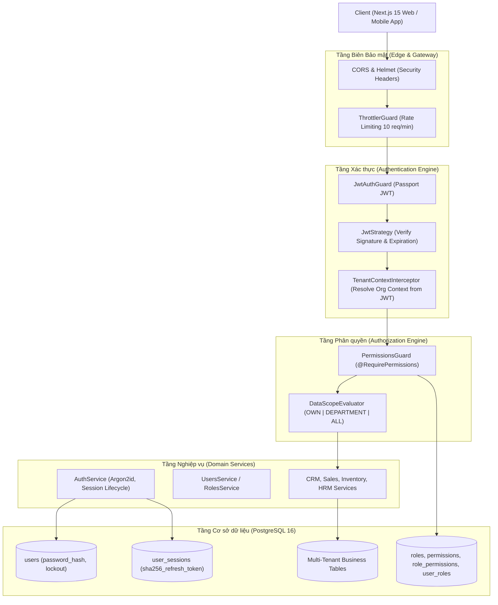
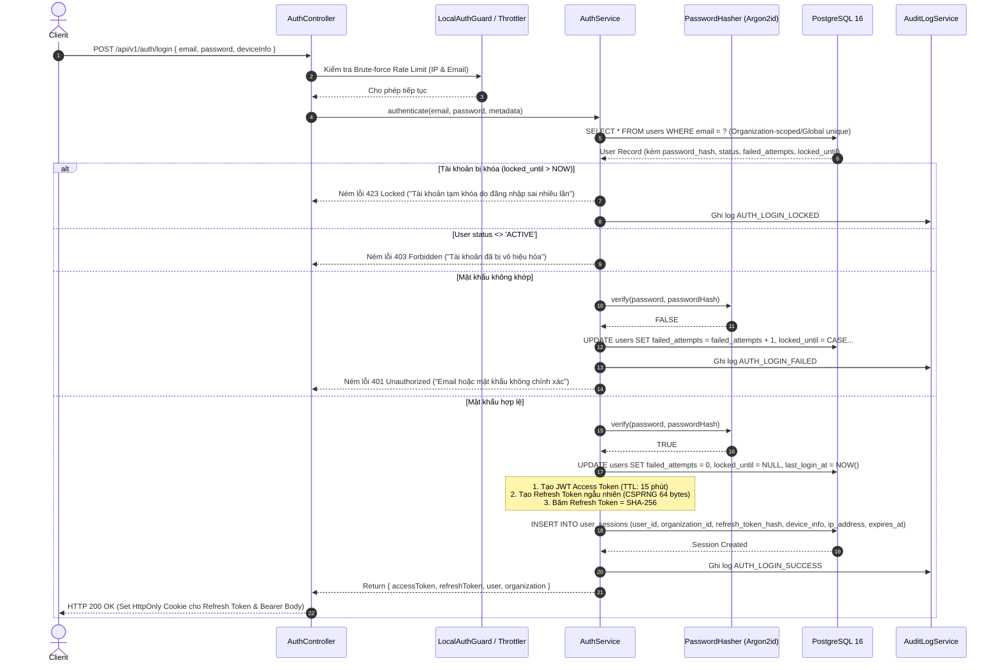
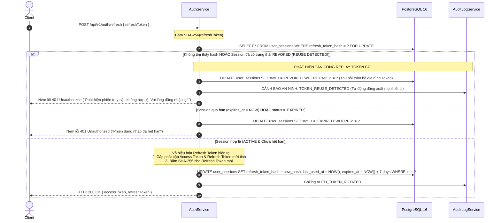
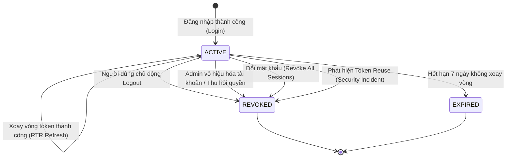
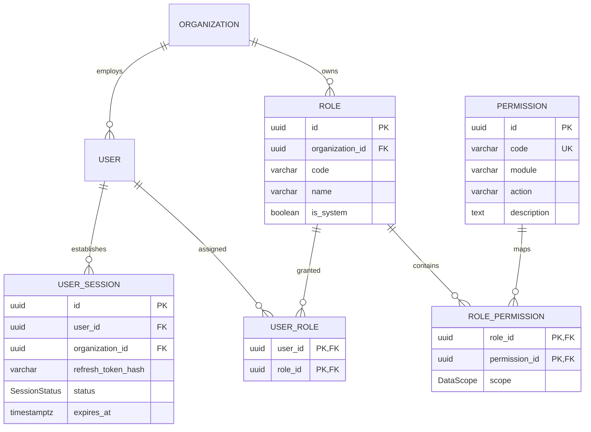
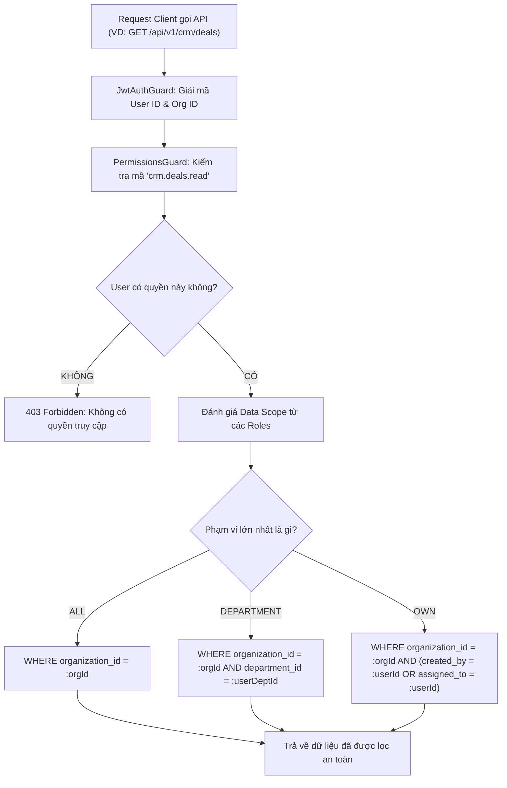

# KIẾN TRÚC TỔNG THỂ XÁC THỰC & PHÂN QUYỀN (PHASE 1D)
## BIZPRO+ AUTHENTICATION & RBAC ARCHITECTURE BLUEPRINT
**Tài liệu:** `docs/PHASE_1D_ARCHITECTURE_BLUEPRINT.md`  
**Phiên bản:** 1.0 (Draft Architecture Specification)  
**Tác giả:** Senior Security Architect, Backend Architect & Database Architect  
**Trạng thái:** SẴN SÀNG ĐỂ REVIEW & CHỜ PHÊ DUYỆT GATE (DESIGN ONLY)  

---

## 1. TỔNG QUAN KIẾN TRÚC (ARCHITECTURE OVERVIEW)

BizPro+ là hệ thống quản trị doanh nghiệp hợp nhất đa tổ chức (Multi-Tenant Modular Monolith). Kiến trúc bảo mật của Phase 1D được thiết kế dựa trên nguyên lý **Zero-Trust**, **Deny-by-Default** và **Defense-in-Depth** (Bảo vệ đa tầng).



### Các nguyên tắc nền tảng:
1. **Cô lập ngữ cảnh đa tổ chức (Tenant Context Isolation):** `organization_id` tuyệt đối không bao giờ được lấy từ `request.body`, `request.query` hay client headers. Ngữ cảnh tổ chức chỉ được phân giải từ chữ ký số JWT Access Token đã qua kiểm chứng.
2. **Xác thực và Phân quyền phân tách rõ rệt:**
   - *Xác thực (Authentication):* Trả lời câu hỏi *"Bạn là ai? Danh tính của bạn còn hợp lệ không?"* (do `JwtAuthGuard` và `SessionManager` xử lý).
   - *Phân quyền (Authorization):* Trả lời câu hỏi *"Bạn được phép làm gì trên tài nguyên nào và ở phạm vi nào?"* (do `PermissionsGuard` và `DataScopeEngine` xử lý).
3. **Mặc định từ chối (Deny by Default):** Mọi endpoint không được gắn decorator `@Public()` đều mặc định yêu cầu Access Token hợp lệ. Mọi thao tác ghi/đọc dữ liệu đều đòi hỏi quyền năng tường minh.
4. **Không tin cậy tầng Client:** Ẩn/hiện nút bấm trên giao diện Next.js chỉ là cải thiện trải nghiệm người dùng (UX). Toàn bộ quy tắc bảo mật và phạm vi dữ liệu được ép buộc $100\%$ tại NestJS Controller, Service và Database Queries.

---

## 2. LUỒNG XÁC THỰC CHI TIẾT (AUTHENTICATION FLOWS)

### 2.1. Luồng Đăng nhập (Login Flow)



### 2.2. Luồng Xoay vòng Refresh Token (Refresh Token Rotation & Reuse Detection)

Cơ chế **Refresh Token Rotation (RTR)** bảo đảm mỗi Refresh Token chỉ được sử dụng duy nhất một lần. Nếu kẻ tấn công đánh cắp được một Refresh Token cũ và cố tình gửi lại, hệ thống sẽ kích hoạt quy trình **Token Family Invalidation**.



---

## 3. QUẢN LÝ PHIÊN ĐĂNG NHẬP (SESSION LIFECYCLE & STATE MACHINE)

### 3.1. Máy trạng thái phiên (Session State Machine)

Một phiên làm việc (`UserSession`) được định nghĩa tuần tự qua 4 trạng thái bất biến:



### 3.2. Bảng ma trận chuyển đổi trạng thái (State Transition Matrix):

| Trạng thái hiện tại | Sự kiện kích hoạt (Event) | Trạng thái đích | Hành động kèm theo (Side Effects) |
| :--- | :--- | :---: | :--- |
| `ACTIVE` | `TOKEN_REFRESH` (Token hợp lệ) | `ACTIVE` | Cập nhật `refresh_token_hash` mới, gia hạn `expires_at`, tăng `rotation_counter`. |
| `ACTIVE` | `USER_LOGOUT` (Thiết bị hiện tại) | `REVOKED` | Cập nhật `revoked_at = NOW()`, `revocation_reason = 'USER_LOGOUT'`. Cookie bị xóa. |
| `ACTIVE` | `LOGOUT_ALL` (Đăng xuất mọi thiết bị) | `REVOKED` | Thu hồi toàn bộ các `user_sessions` đang active của User. |
| `ACTIVE` | `PASSWORD_CHANGED` | `REVOKED` | Thu hồi toàn bộ session cũ (trừ phiên hiện tại nếu client chọn ghi nhớ). |
| `ACTIVE` | `TOKEN_REUSE_DETECTED` | `REVOKED` | Lập tức thu hồi **toàn bộ phiên của người dùng**, gửi cảnh báo qua email/audit log. |
| `ACTIVE` | `TTL_TIMEOUT` (> 7 ngày) | `EXPIRED` | Phiên bị đóng tự nhiên, yêu cầu người dùng xác thực lại từ đầu. |
| `REVOKED` / `EXPIRED` | Mọi request sử dụng lại token | `REJECTED` | Trả về HTTP 401 Unauthorized, không cho phép phục hồi trạng thái. |

---

## 4. AN NINH ĐA TỔ CHỨC (MULTI-TENANT SECURITY ARCHITECTURE)

BizPro+ áp dụng mô hình **Shared Database, Shared Schema với Discriminator Column (`organization_id`)**. Để bảo đảm tuyệt đối dữ liệu không bị rò rỉ chéo giữa các tổ chức, hệ thống triển khai kiến trúc 3 lớp bảo vệ:

```
[Layer 1: JWT Signature Verification] ──► Giữ organization_id bất biến trong Payload ký số
                  │
[Layer 2: NestJS TenantContextInterceptor] ──► Inject organization_id vào AsyncLocalStorage (Request Scope)
                  │
[Layer 3: Prisma Client Extension] ──► Tự động chèn { where: { organizationId } } vào mọi câu lệnh ORM
```

### 4.1. Cấu trúc JWT Payload chuẩn hóa
```json
{
  "sub": "b2f5c782-9e12-42da-912a-8c7634f1e920",
  "email": "nguyen.vana@bizpro.vn",
  "orgId": "d1c9e421-4321-4a12-8910-123456789abc",
  "sessionId": "a8712345-6789-4def-0123-abcdef456789",
  "roles": ["SALES_STAFF"],
  "iat": 1793849000,
  "exp": 1793849900,
  "iss": "bizpro-auth-service",
  "aud": "bizpro-api"
}
```

### 4.2. Đánh giá kỹ thuật về PostgreSQL Row-Level Security (RLS)
- **Ưu điểm của RLS:** Là tầng bảo vệ tận cùng tại PostgreSQL Engine. Ngay cả khi developer viết query raw thiếu `WHERE organization_id = ...`, PostgreSQL vẫn tự động lọc dữ liệu theo cấu hình session variable `current_setting('app.current_organization_id')`.
- **Thách thức đối với Prisma & Connection Pooling:**
  - Prisma Client sử dụng Connection Pool (PgBouncer hoặc pooling nội bộ). Các kết nối được tái sử dụng liên tục giữa các request của các Organization khác nhau.
  - Nếu sử dụng `SET LOCAL app.current_organization_id = ...`, bắt buộc mọi truy vấn phải được bọc trong một Database Transaction tường minh. Điều này làm tăng độ trễ (overhead) thêm $15-25\%$ và dễ gây nghẽn pool kết nối khi tải cao.
- **Quyết định kiến trúc:**
  - **Phase 1D:** Triển khai **Prisma Client Extension / NestJS Interceptor Enforced Tenancy**. Tầng ORM tự động inject `organizationId` vào 100% queries.
  - **Khuyến nghị RLS:** Chưa bật RLS vật lý ở Phase 1D để tránh xung đột với Prisma Connection Pooling khi chưa có PgBouncer session affinity. Sẽ đánh giá RLS ở giai đoạn Enterprise Hardening khi triển khai Dedicated Read/Write Replicas.

### 4.3. Kế hoạch bổ sung Composite Foreign Keys cho Inventory
Tại Phase 1C-C, kiểm toán đã ghi nhận các bảng `inventory_reservations` và `inventory_balances` hiện chưa có Composite FK đa cột đến `sales_orders(id, organization_id)` và `warehouses(id, organization_id)`.
- **Đánh giá ảnh hưởng đến Phase 1D:** Việc thiếu Composite FK ở tầng tồn kho **KHÔNG ẢNH HƯỞNG ĐẾN AUTHENTICATION & RBAC**, vì Phase 1D chỉ làm việc trên các bảng `users`, `user_sessions`, `roles`, `permissions`, `organizations`.
- **Lộ trình thực hiện:** Đã đưa vào danh mục Hardening đợt 2, sẽ bổ sung migration tạo Composite FK cho Inventory đồng thời với việc tích hợp API đơn hàng ở Phase 2.

---

## 5. KIẾN TRÚC PHÂN QUYỀN RBAC & DATA SCOPE ENGINE

### 5.1. Mô hình Phân quyền (RBAC Entity Relationship)



### 5.2. Danh mục Vai trò Hệ thống (System Predefined Roles)
BizPro+ định nghĩa sẵn 6 System Roles (có `is_system = true`, không thể bị xóa):
1. **Organization Admin (`ORG_ADMIN`):** Quản trị toàn bộ tổ chức, quản lý người dùng, phân vai trò, xem toàn bộ dữ liệu (Scope: `ALL` trên toàn bộ 66 permissions).
2. **Sales Manager (`SALES_MANAGER`):** Quản lý đội ngũ bán hàng, duyệt báo giá, xem toàn bộ dữ liệu CRM và Đơn hàng của phòng ban (Scope: `DEPARTMENT`).
3. **Sales Staff (`SALES_STAFF`):** Tạo và chăm sóc Lead, Khách hàng, Deal được giao; lập đơn hàng nháp (Scope: `OWN`).
4. **Warehouse Manager (`WAREHOUSE_MANAGER`):** Quản lý xuất nhập tồn, lập lệnh kiểm kê, xác nhận phiếu xuất/nhập kho (Scope: `ALL` các kho trong tổ chức).
5. **HR Manager (`HR_MANAGER`):** Quản lý hồ sơ nhân sự, hợp đồng lao động, phê duyệt đơn xin nghỉ phép, chốt công (Scope: `ALL`).
6. **Viewer / Regular Employee (`EMPLOYEE`):** Tự chấm công, gửi đơn xin nghỉ phép cá nhân, xem thông tin bảng lương của chính mình (Scope: `OWN`).

### 5.3. Động cơ Đánh giá Phạm vi Dữ liệu (Data Scope Engine)
Khi User sở hữu nhiều vai trò (Multi-Role), quyền hạn được áp dụng theo **Nguyên tắc Hợp nhất Quyền cao nhất (Most Permissive Scope Union)**:
$$\text{EffectiveScope} = \max(\text{Scope}_{\text{Role}_1}, \text{Scope}_{\text{Role}_2}, \dots)$$
Với thứ tự ưu tiên:
$$\text{ALL} > \text{DEPARTMENT} > \text{OWN}$$



---

## 6. XỬ LÝ CÁC TÌNH HUỐNG BIÊN BẢO MẬT (SECURITY EDGE CASES)

| Tình huống biên (Edge Case) | Hành vi và Ràng buộc Kỹ thuật được Thực thi |
| :--- | :--- |
| **1. User bị khóa khi đang có JWT Access Token còn hạn** | Access Token có thời hạn ngắn (15 phút). Khi hết 15 phút, request gọi refresh token sẽ bị chặn đứng tại DB vì `users.status = 'INACTIVE'` hoặc `locked_until > NOW()`. Đối với thao tác nhạy cảm (Đổi mật khẩu, Chuyển tiền), hệ thống kiểm tra trạng thái User realtime trong DB. |
| **2. Admin thu hồi Role / Permission của User đang đăng nhập** | Khi RolePermission bị thay đổi, hệ thống phát tín hiệu `UserPermissionsChangedEvent`. Toàn bộ phiên làm việc của User trong bảng `user_sessions` được cập nhật `status = 'REVOKED'`, buộc người dùng phải xác thực lại để lấy quyền mới. |
| **3. Employee bị xóa vật lý nhưng User vẫn tồn tại** | Nhờ ràng buộc `ON DELETE SET NULL` trên `users.employee_id`, User vẫn tồn tại nhưng không còn liên kết nhân viên. Data Scope `DEPARTMENT` lập tức thoái lui về `OWN` (vì `user.employee.departmentId = NULL`), ngăn chặn lộ dữ liệu phòng ban cũ. |
| **4. User bị điều chuyển sang Phòng ban khác** | Khi `employees.department_id` cập nhật sang phòng ban B, câu truy vấn dữ liệu Scope `DEPARTMENT` tiếp theo sẽ tự động đọc `department_id` mới từ bảng `employees`, lập tức tước quyền xem dữ liệu phòng ban A mà không cần đăng xuất. |
| **5. Organization bị vô hiệu hóa (Disabled Tenant)** | Khi `organizations.status = 'INACTIVE'`, `TenantContextInterceptor` chặn đứng 100% request từ cửa ngõ Controller với mã lỗi `403 Forbidden: Tổ chức của bạn đã bị tạm khóa`. |
| **6. Đổi mật khẩu thành công** | Cập nhật `users.password_hash`, đồng thời cập nhật `user_sessions.status = 'REVOKED'` cho toàn bộ các session của User (ngoại trừ session hiện tại đang thực hiện lệnh đổi mật khẩu). |
