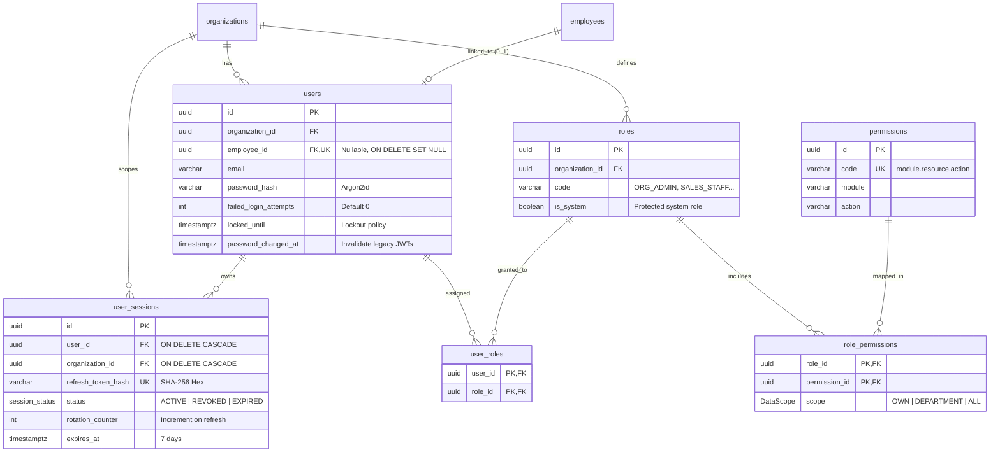

# THIẾT KẾ CƠ SỞ DỮ LIỆU BẢO MẬT & PHÂN QUYỀN (PHASE 1D)
## BIZPRO+ DATABASE DESIGN & SECURITY SCHEMA SPECIFICATION
**Tài liệu:** `docs/PHASE_1D_DATABASE_DESIGN.md`  
**Phiên bản:** 1.0 (Design Only - Chưa áp dụng Migration)  
**Tác giả:** Senior Database Architect & Backend Architect  
**Trạng thái:** BẢN THIẾT KẾ ĐỀ XUẤT PHÊ DUYỆT TRƯỚC KHI TẠO MIGRATION  

---

## 1. ĐỐI SOÁT HIỆN TRẠNG CƠ SỞ DỮ LIỆU (EXISTING SCHEMA AUDIT)

Dựa trên kết quả truy vấn thực tế từ PostgreSQL 16 Catalog và tệp `backend/prisma/schema.prisma` tại Phase 1C-C:

| Bảng / Model | Trạng thái hiện tại | Cấu trúc vật lý đang có | Đánh giá & Khoảng trống bảo mật (Security Gap) |
| :--- | :---: | :--- | :--- |
| `organizations` | `VERIFIED` | `id`, `name`, `code` (Unique), `status`, `currency`, `timezone`... | Đã đầy đủ thông tin tổ chức. Chưa có cờ `is_active` / `is_suspended` riêng biệt (đang dùng `CommonStatus`). |
| `users` | `VERIFIED` | `id`, `organization_id`, `employee_id` (Unique, Nullable), `full_name`, `email`, `password_hash`, `status`, `last_login_at` | **Thiếu các trường kiểm soát an ninh:** Chưa có đếm số lần đăng nhập sai (`failed_login_attempts`), thời gian khóa tài khoản (`locked_until`), thời điểm đổi mật khẩu (`password_changed_at`), và mã băm đặt lại mật khẩu (`password_reset_token_hash`). |
| `roles` | `VERIFIED` | `id`, `organization_id`, `name`, `code`, `is_system` | Đã có khóa ngoại tới Organization (`ON DELETE CASCADE`). Đã có cờ `is_system` để bảo vệ vai trò hệ thống không bị xóa. |
| `permissions` | `VERIFIED` | `id`, `code` (Unique), `module`, `action`, `description` | Đã chuẩn hóa danh mục 66 quyền toàn hệ thống. Bảng mang tính chất Global System Catalog. |
| `role_permissions`| `VERIFIED` | `role_id`, `permission_id`, `scope` (`DataScope`: `OWN`, `DEPARTMENT`, `ALL`) | Đã có Composite PK `@@id([role_id, permission_id])`. Khóa ngoại `ON DELETE CASCADE`. |
| `user_roles` | `VERIFIED` | `user_id`, `role_id` | Đã có Composite PK `@@id([user_id, role_id])`. Khóa ngoại `ON DELETE CASCADE`. |
| `user_sessions` | `MISSING` | **Chưa tồn tại trong PostgreSQL và Schema** | **LỖ HỔNG CỐT LÕI:** Không có bảng lưu phiên làm việc, không thể thực hiện xoay vòng Refresh Token (RTR), không thể thu hồi phiên từ xa khi bị lộ token hoặc đổi mật khẩu. |

---

## 2. CÁC THAY ĐỔI ĐỀ XUẤT CHO PHASE 1D (PROPOSED SCHEMA ADDITIONS)

> [!CAUTION]
> **Tuân thủ quy tắc làm việc:** Dưới đây là các định nghĩa đề xuất. Hệ thống **CHƯA** chỉnh sửa `schema.prisma` và **CHƯA** tạo bất kỳ migration vật lý nào lên PostgreSQL cho đến khi nhận được phê duyệt chính thức từ người dùng.

### 2.1. Bổ sung Model `UserSession` (Bảng `user_sessions`)

#### Mục đích:
Lưu trữ phiên làm việc của người dùng, phục vụ quản lý đăng nhập đa thiết bị, lưu mã băm SHA-256 của Refresh Token, phát hiện dùng lại token cũ (Reuse Detection), và hỗ trợ thu hồi phiên (Revocation).

#### Đặc tả Prisma Model:
```prisma
enum SessionStatus {
  ACTIVE
  REVOKED
  EXPIRED

  @@map("session_status")
}

model UserSession {
  id                String        @id @default(dbgenerated("gen_random_uuid()")) @db.Uuid
  userId            String        @map("user_id") @db.Uuid
  organizationId    String        @map("organization_id") @db.Uuid
  refreshTokenHash  String        @map("refresh_token_hash") @db.VarChar(64)
  deviceInfo        String?       @map("device_info") @db.VarChar(255)
  ipAddress         String?       @map("ip_address") @db.VarChar(45)
  userAgent         String?       @map("user_agent") @db.Text
  status            SessionStatus @default(ACTIVE)
  rotationCounter   Int           @default(0) @map("rotation_counter")
  revokedAt         DateTime?     @map("revoked_at") @db.Timestamptz
  revocationReason  String?       @map("revocation_reason") @db.VarChar(100)
  lastUsedAt        DateTime      @default(now()) @map("last_used_at") @db.Timestamptz
  expiresAt         DateTime      @map("expires_at") @db.Timestamptz
  createdAt         DateTime      @default(now()) @map("created_at") @db.Timestamptz
  updatedAt         DateTime      @default(now()) @updatedAt @map("updated_at") @db.Timestamptz

  user         User         @relation(fields: [userId], references: [id], onDelete: Cascade)
  organization Organization @relation(fields: [organizationId], references: [id], onDelete: Cascade)

  @@unique([organizationId, refreshTokenHash], name: "uq_user_sessions_org_token_hash")
  @@index([userId, status], name: "idx_user_sessions_user_status")
  @@index([expiresAt], name: "idx_user_sessions_expires_at")
  @@map("user_sessions")
}
```

#### SQL DDL vật lý tương ứng:
```sql
CREATE TYPE session_status AS ENUM ('ACTIVE', 'REVOKED', 'EXPIRED');

CREATE TABLE user_sessions (
    id UUID PRIMARY KEY DEFAULT gen_random_uuid(),
    user_id UUID NOT NULL REFERENCES users(id) ON DELETE CASCADE,
    organization_id UUID NOT NULL REFERENCES organizations(id) ON DELETE CASCADE,
    refresh_token_hash VARCHAR(64) NOT NULL,
    device_info VARCHAR(255),
    ip_address VARCHAR(45),
    user_agent TEXT,
    status session_status NOT NULL DEFAULT 'ACTIVE',
    rotation_counter INT NOT NULL DEFAULT 0,
    revoked_at TIMESTAMPTZ,
    revocation_reason VARCHAR(100),
    last_used_at TIMESTAMPTZ NOT NULL DEFAULT CURRENT_TIMESTAMP,
    expires_at TIMESTAMPTZ NOT NULL,
    created_at TIMESTAMPTZ NOT NULL DEFAULT CURRENT_TIMESTAMP,
    updated_at TIMESTAMPTZ NOT NULL DEFAULT CURRENT_TIMESTAMP
);

CREATE UNIQUE INDEX uq_user_sessions_org_token_hash ON user_sessions(organization_id, refresh_token_hash);
CREATE INDEX idx_user_sessions_user_status ON user_sessions(user_id, status);
CREATE INDEX idx_user_sessions_expires_at ON user_sessions(expires_at);
```

---

### 2.2. Bổ sung các cột kiểm soát an ninh vào Model `User` (Bảng `users`)

#### Lý do cần thiết:
1. Chống tấn công Brute-force và Password Guessing: Bắt buộc đếm số lần sai và tạm khóa sau 5 lần liên tiếp.
2. Vô hiệu hóa token khi đổi mật khẩu: `password_changed_at` cho phép so sánh với thời điểm phát hành JWT `iat` để từ chối các token cũ.
3. Luồng Quên / Đặt lại mật khẩu (Forgot Password): Cần lưu mã băm token đặt lại mật khẩu với thời hạn ngắn (15 phút).

#### Các cột bổ sung:
```prisma
model User {
  // ... các trường hiện có ...

  // Bổ sung cho Phase 1D Security:
  failedLoginAttempts     Int       @default(0) @map("failed_login_attempts")
  lockedUntil             DateTime? @map("locked_until") @db.Timestamptz
  passwordChangedAt       DateTime? @map("password_changed_at") @db.Timestamptz
  passwordResetTokenHash  String?   @map("password_reset_token_hash") @db.VarChar(64)
  passwordResetExpiresAt  DateTime? @map("password_reset_expires_at") @db.Timestamptz

  sessions                UserSession[]

  // ... các relations hiện có ...
}
```

#### SQL DDL vật lý tương ứng:
```sql
ALTER TABLE users 
ADD COLUMN failed_login_attempts INT NOT NULL DEFAULT 0,
ADD COLUMN locked_until TIMESTAMPTZ,
ADD COLUMN password_changed_at TIMESTAMPTZ,
ADD COLUMN password_reset_token_hash VARCHAR(64),
ADD COLUMN password_reset_expires_at TIMESTAMPTZ;

CREATE INDEX idx_users_reset_token ON users(password_reset_token_hash) 
WHERE password_reset_token_hash IS NOT NULL;
```

---

## 3. LƯỢC ĐỒ QUAN HỆ THỰC THỂ BẢO MẬT (SECURITY ERD)



---

## 4. ĐÁNH GIÁ TÁC ĐỘNG VÀ TÍNH TƯƠNG THÍCH MIGRATION (MIGRATION IMPACT ANALYSIS)

### 4.1. Tác động đến dữ liệu hiện có:
- Thêm bảng `user_sessions`: Bảng mới hoàn toàn, không ảnh hưởng đến bất kỳ bảng nào đang có dữ liệu.
- Thêm các cột vào bảng `users`:
  - `failed_login_attempts` có giá trị mặc định `DEFAULT 0`.
  - Các cột còn lại đều là `NULLABLE`.
  - Do đó, lệnh `ALTER TABLE users` chạy với độ trễ dưới $10\text{ms}$, **không gây lock bảng kéo dài và không làm hỏng dữ liệu User hiện có**.

### 4.2. Khả năng tương thích ngược với Prisma:
- Quan hệ `User` $\rightarrow$ `UserSession[]` là quan hệ 1-N tiêu chuẩn của Prisma.
- Không thay đổi bất kỳ kiểu dữ liệu nào của các khóa ngoại hiện có.
- Bảo toàn nguyên vẹn quan hệ `users.employee_id` với `ON DELETE SET NULL` đã được nghiệm thu tại Phase 1C-C.
