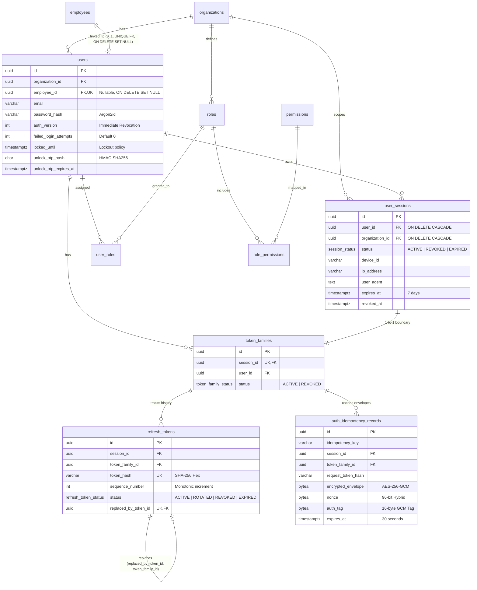

# BIZPRO+ PHASE 1D — DATABASE DESIGN & SECURITY SCHEMA SPECIFICATION
**Tài liệu:** `docs/PHASE_1D_DATABASE_DESIGN.md`  
**Phiên bản:** 3.2.0-SYNCHRONIZED (Comprehensive Database Design Specification)  
**Tác giả:** Principal PostgreSQL Architect, Senior Database Architect & Backend Architect  
**Trạng thái tài liệu:** SPECIFICATION SYNCHRONIZED — CONTROLLED DOCUMENTATION (DESIGN ONLY)  
**Gate Status:** NOT APPROVED (HOLD) — Implementation Gate Strict Preservation  

---

## 1. ĐỐI SOÁT HIỆN TRẠNG CƠ SỞ DỮ LIỆU THỰC TẾ (REAL SCHEMA AUDIT)

Kiểm toán trực tiếp từ `prisma/schema.prisma` và PostgreSQL 16 Catalog tại Phase 1C-C (Tuyệt đối không dùng Mock Data):
* **Tổng số model hiện hữu:** Đúng **51 models**.
* **Phân loại vật lý 3 Nhóm:**
  1. **39 Bảng Trực Tiếp (Direct Tenant Tables):** Có cột `organization_id` trực tiếp (`users`, `roles`, `audit_logs`, `notifications`, `files`, `departments`, `positions`, `employees`, `employee_contracts`, `work_shifts`, `attendance_records`, `leave_types`, `leave_balances`, `leave_requests`, `employee_histories`, `companies`, `contacts`, `leads`, `customers`, `pipelines`, `pipeline_stages`, `deals`, `activities`, `crm_notes`, `product_categories`, `units_of_measure`, `products`, `warehouses`, `inventory_balances`, `suppliers`, `stock_receipts`, `stock_issues`, `stock_transfers`, `stock_adjustments`, `stocktakes`, `inventory_transactions`, `inventory_reservations`, `sales_orders`, `payment_transactions`).
  2. **10 Bảng Con (Parent-Joined Tables):** Không có `organization_id` trực tiếp, quan hệ phụ thuộc qua FK cha (`role_permissions`, `user_roles`, `deal_stage_histories`, `stock_receipt_items`, `stock_issue_items`, `stock_transfer_items`, `stock_adjustment_items`, `stocktake_items`, `sales_order_items`, `sales_order_status_histories`).
  3. **2 Bảng Ngoại Lệ (Root / Global):** `organizations` (Root Tenant, cách ly qua ID lookup) và `permissions` (Catalog tĩnh 66 quyền toàn cục).

| Nhóm Bảng | Số lượng | Cơ chế Kiểm soát RLS Đề xuất | Trạng thái Hiện tại |
| :--- | :---: | :--- | :---: |
| **Direct Tenant Tables** | 39 | `organization_id = NULLIF(current_setting('app.current_organization_id', true), '')::uuid` (`USING` + `WITH CHECK`) | `EXISTING` |
| **Parent-Joined Tables** | 10 | `EXISTS (SELECT 1 FROM parent WHERE parent.id = child.parent_id AND parent.organization_id = ...)` | `EXISTING` |
| **Root Tenant Table** | 1 (`organizations`) | Lookup theo ID xác thực; Quản trị viên Superadmin mới có quyền liên tổ chức | `EXISTING` |
| **Global System Table** | 1 (`permissions`) | Read-Only toàn cục cho mọi authenticated users; Chỉ migration mới được ghi | `EXISTING` |
| **Bổ sung Phase 1D (Auth)** | 4 | `user_sessions` (Direct Tenant), `token_families`, `refresh_tokens`, `auth_idempotency_records` (Scoped Child) | `PROPOSED` |

---

## 2. CÁC THAY ĐỔI ĐỀ XUẤT CHO PHASE 1D (PROPOSED SCHEMA ADDITIONS)

> [!CAUTION]
> **Ràng buộc làm việc nghiêm ngặt (Design Only):** Dưới đây là các định nghĩa đề xuất về mặt kiến trúc. Hệ thống **CHƯA** chỉnh sửa `schema.prisma` và **CHƯA** tạo bất kỳ migration vật lý nào lên PostgreSQL cho đến khi nhận được phê duyệt chính thức từ người dùng.

### 2.1. Bổ sung Model `UserSession` (Bảng `user_sessions`)
- **Mục đích:** Đại diện cho một phiên đăng nhập vật lý của người dùng trên một thiết bị/trình duyệt cụ thể. Quản lý trạng thái phiên, IP, User Agent, và gắn liền với một `token_family_id` duy nhất.

```prisma
enum SessionStatus {
  ACTIVE
  REVOKED
  EXPIRED

  @@map("session_status")
}

model UserSession {
  id                String        @id @default(dbgenerated("gen_random_uuid()")) @db.Uuid
  userId            String        @map("user_id") @db.Uuid
  organizationId    String        @map("organization_id") @db.Uuid
  status            SessionStatus @default(ACTIVE)
  deviceId          String?       @map("device_id") @db.VarChar(128)
  ipAddress         String?       @map("ip_address") @db.VarChar(45)
  userAgent         String?       @map("user_agent") @db.Text
  createdAt         DateTime      @default(now()) @map("created_at") @db.Timestamptz
  updatedAt         DateTime      @default(now()) @updatedAt @map("updated_at") @db.Timestamptz
  expiresAt         DateTime      @map("expires_at") @db.Timestamptz
  revokedAt         DateTime?     @map("revoked_at") @db.Timestamptz

  user              User          @relation(fields: [userId], references: [id], onDelete: Cascade)
  organization      Organization  @relation(fields: [organizationId], references: [id], onDelete: Cascade)
  tokenFamily       TokenFamily?
  refreshTokens     RefreshTokenRecord[]
  idempotencyRecords AuthIdempotencyRecord[]

  @@index([userId, status], name: "idx_user_sessions_user_status")
  @@index([organizationId], name: "idx_user_sessions_org")
  @@index([expiresAt], name: "idx_user_sessions_expires_at")
  @@map("user_sessions")
}
```

### 2.2. Bổ sung Model `TokenFamily` (Bảng `token_families`)
```prisma
enum TokenFamilyStatus {
  ACTIVE
  REVOKED

  @@map("token_family_status")
}

model TokenFamily {
  id                String            @id @default(dbgenerated("gen_random_uuid()")) @db.Uuid
  sessionId         String            @unique @map("session_id") @db.Uuid
  userId            String            @map("user_id") @db.Uuid
  status            TokenFamilyStatus @default(ACTIVE)
  createdAt         DateTime          @default(now()) @map("created_at") @db.Timestamptz
  revokedAt         DateTime?         @map("revoked_at") @db.Timestamptz

  session           UserSession       @relation(fields: [sessionId], references: [id], onDelete: Cascade)
  user              User              @relation(fields: [userId], references: [id], onDelete: Cascade)
  refreshTokens     RefreshTokenRecord[]
  idempotencyRecords AuthIdempotencyRecord[]

  @@map("token_families")
}
```

### 2.3. Bổ sung Model `RefreshTokenRecord` (Bảng `refresh_tokens`) Với Ràng Buộc Chống Chu Trình
```prisma
enum RefreshTokenStatus {
  ACTIVE
  ROTATED
  REVOKED
  EXPIRED

  @@map("refresh_token_status")
}

model RefreshTokenRecord {
  id                String             @id @default(dbgenerated("gen_random_uuid()")) @db.Uuid
  sessionId         String             @map("session_id") @db.Uuid
  tokenFamilyId     String             @map("token_family_id") @db.Uuid
  tokenHash         String             @unique @map("token_hash") @db.VarChar(64)
  sequenceNumber    Int                @map("sequence_number")
  status            RefreshTokenStatus @default(ACTIVE)
  createdAt         DateTime           @default(now()) @map("created_at") @db.Timestamptz
  expiresAt         DateTime           @map("expires_at") @db.Timestamptz
  rotatedAt         DateTime?          @map("rotated_at") @db.Timestamptz
  replacedByTokenId String?            @unique @map("replaced_by_token_id") @db.Uuid

  session           UserSession        @relation(fields: [sessionId], references: [id], onDelete: Cascade)
  tokenFamily       TokenFamily        @relation(fields: [tokenFamilyId], references: [id], onDelete: Cascade)

  @@unique([tokenFamilyId, sequenceNumber], name: "uq_refresh_tokens_family_seq")
  @@index([tokenFamilyId, status], name: "idx_refresh_tokens_family_status")
  @@index([sessionId], name: "idx_refresh_tokens_session")
  @@index([tokenHash], name: "idx_refresh_tokens_hash")
  @@map("refresh_tokens")
}
```

### 2.4. Bổ sung Model `AuthIdempotencyRecord` (Bảng `auth_idempotency_records`)
```prisma
model AuthIdempotencyRecord {
  id                 String      @id @default(dbgenerated("gen_random_uuid()")) @db.Uuid
  idempotencyKey     String      @map("idempotency_key") @db.VarChar(128)
  sessionId          String      @map("session_id") @db.Uuid
  tokenFamilyId      String      @map("token_family_id") @db.Uuid
  requestTokenHash   String      @map("request_token_hash") @db.VarChar(64)
  endpoint           String      @db.VarChar(255)
  responseStatusCode Int         @map("response_status_code")
  responseHeaders    Json        @map("response_headers")
  encryptedEnvelope  Bytes       @map("encrypted_envelope")
  keyId              String      @map("key_id") @db.VarChar(64)
  nonce              Bytes       @db.ByteA
  authTag            Bytes       @map("auth_tag") @db.ByteA
  createdAt          DateTime    @default(now()) @map("created_at") @db.Timestamptz
  expiresAt          DateTime    @map("expires_at") @db.Timestamptz

  session            UserSession @relation(fields: [sessionId], references: [id], onDelete: Cascade)
  tokenFamily        TokenFamily @relation(fields: [tokenFamilyId], references: [id], onDelete: Cascade)

  @@unique([sessionId, idempotencyKey], name: "uq_auth_idempotency_session_key")
  @@index([expiresAt], name: "idx_auth_idempotency_expires_at")
  @@map("auth_idempotency_records")
}
```

### 2.5. Bổ sung Cột An Ninh Cho Model `User` (Bảng `users`)
```prisma
model User {
  // ... các trường hiện có ...

  // Bổ sung cho Phase 1D Security:
  authVersion            Int       @default(1) @map("auth_version")
  failedLoginAttempts    Int       @default(0) @map("failed_login_attempts")
  lockedUntil            DateTime? @map("locked_until") @db.Timestamptz
  unlockOtpHash          String?   @map("unlock_otp_hash") @db.VarChar(64)
  unlockOtpExpiresAt     DateTime? @map("unlock_otp_expires_at") @db.Timestamptz
  unlockOtpAttempts      Int       @default(0) @map("unlock_otp_attempts")
  lastUnlockOtpSentAt    DateTime? @map("last_unlock_otp_sent_at") @db.Timestamptz
  passwordChangedAt      DateTime? @map("password_changed_at") @db.Timestamptz

  sessions               UserSession[]
  tokenFamilies          TokenFamily[]

  // ... các relations hiện có ...
}
```

---

## 3. THIẾT KẾ DDL VẬT LÝ VÀ DATABASE INVARIANTS (SQL BLUEPRINT)

```sql
-- 1. Tạo Enums mới cho quản lý phiên và token
CREATE TYPE session_status AS ENUM ('ACTIVE', 'REVOKED', 'EXPIRED');
CREATE TYPE token_family_status AS ENUM ('ACTIVE', 'REVOKED');
CREATE TYPE refresh_token_status AS ENUM ('ACTIVE', 'ROTATED', 'REVOKED', 'EXPIRED');

-- 2. Cập nhật bảng users với các cột an ninh
ALTER TABLE users 
ADD COLUMN auth_version INT NOT NULL DEFAULT 1,
ADD COLUMN failed_login_attempts INT NOT NULL DEFAULT 0,
ADD COLUMN locked_until TIMESTAMPTZ,
ADD COLUMN unlock_otp_hash CHAR(64),
ADD COLUMN unlock_otp_expires_at TIMESTAMPTZ,
ADD COLUMN unlock_otp_attempts INT NOT NULL DEFAULT 0,
ADD COLUMN last_unlock_otp_sent_at TIMESTAMPTZ,
ADD COLUMN password_changed_at TIMESTAMPTZ;

-- 3. Tạo bảng user_sessions
CREATE TABLE user_sessions (
    id UUID PRIMARY KEY DEFAULT gen_random_uuid(),
    user_id UUID NOT NULL REFERENCES users(id) ON DELETE CASCADE,
    organization_id UUID NOT NULL REFERENCES organizations(id) ON DELETE CASCADE,
    status session_status NOT NULL DEFAULT 'ACTIVE',
    device_id VARCHAR(128),
    ip_address VARCHAR(45),
    user_agent TEXT,
    created_at TIMESTAMPTZ NOT NULL DEFAULT CURRENT_TIMESTAMP,
    updated_at TIMESTAMPTZ NOT NULL DEFAULT CURRENT_TIMESTAMP,
    expires_at TIMESTAMPTZ NOT NULL,
    revoked_at TIMESTAMPTZ
);

CREATE INDEX idx_user_sessions_user_status ON user_sessions(user_id, status);
CREATE INDEX idx_user_sessions_org ON user_sessions(organization_id);
CREATE INDEX idx_user_sessions_expires_at ON user_sessions(expires_at);

-- 4. Tạo bảng token_families
CREATE TABLE token_families (
    id UUID PRIMARY KEY DEFAULT gen_random_uuid(),
    session_id UUID NOT NULL UNIQUE REFERENCES user_sessions(id) ON DELETE CASCADE,
    user_id UUID NOT NULL REFERENCES users(id) ON DELETE CASCADE,
    status token_family_status NOT NULL DEFAULT 'ACTIVE',
    created_at TIMESTAMPTZ NOT NULL DEFAULT CURRENT_TIMESTAMP,
    revoked_at TIMESTAMPTZ
);

-- 5. Tạo bảng refresh_tokens với ràng buộc chống chu trình
CREATE TABLE refresh_tokens (
    id UUID PRIMARY KEY DEFAULT gen_random_uuid(),
    session_id UUID NOT NULL REFERENCES user_sessions(id) ON DELETE CASCADE,
    token_family_id UUID NOT NULL REFERENCES token_families(id) ON DELETE CASCADE,
    token_hash VARCHAR(64) NOT NULL UNIQUE,
    sequence_number INT NOT NULL CHECK (sequence_number > 0),
    status refresh_token_status NOT NULL DEFAULT 'ACTIVE',
    created_at TIMESTAMPTZ NOT NULL DEFAULT CURRENT_TIMESTAMP,
    expires_at TIMESTAMPTZ NOT NULL,
    rotated_at TIMESTAMPTZ,
    replaced_by_token_id UUID,

    -- Bất biến đơn vị sequence trong family
    CONSTRAINT uq_refresh_tokens_family_seq UNIQUE (token_family_id, sequence_number),
    
    -- Chống phân nhánh cây (Mỗi token chỉ được thay thế bởi tối đa 1 token mới)
    CONSTRAINT uq_refresh_tokens_replaced_by UNIQUE (replaced_by_token_id),
    
    -- Khóa ngoại nội bộ gia đình token (Intra-family Replacement)
    CONSTRAINT uq_refresh_tokens_id_family UNIQUE (id, token_family_id),
    CONSTRAINT fk_refresh_tokens_replacement FOREIGN KEY (replaced_by_token_id, token_family_id)
      REFERENCES refresh_tokens (id, token_family_id) ON DELETE RESTRICT,
      
    -- CHECK constraint đồng bộ trạng thái state machine
    CONSTRAINT chk_refresh_tokens_lifecycle CHECK (
      (status = 'ACTIVE' AND rotated_at IS NULL AND replaced_by_token_id IS NULL) OR
      (status = 'ROTATED' AND rotated_at IS NOT NULL AND replaced_by_token_id IS NOT NULL) OR
      (status = 'REVOKED') OR
      (status = 'EXPIRED')
    )
);

-- Partial Unique Index bảo đảm duy nhất tối đa 1 token ACTIVE trên mỗi Family
CREATE UNIQUE INDEX idx_uq_active_token_per_family 
ON refresh_tokens (token_family_id) 
WHERE status = 'ACTIVE';

CREATE INDEX idx_refresh_tokens_family_status ON refresh_tokens(token_family_id, status);
CREATE INDEX idx_refresh_tokens_session ON refresh_tokens(session_id);
CREATE INDEX idx_refresh_tokens_hash ON refresh_tokens(token_hash);

-- 6. Tạo bảng auth_idempotency_records
CREATE TABLE auth_idempotency_records (
    id UUID PRIMARY KEY DEFAULT gen_random_uuid(),
    idempotency_key VARCHAR(128) NOT NULL,
    session_id UUID NOT NULL REFERENCES user_sessions(id) ON DELETE CASCADE,
    token_family_id UUID NOT NULL REFERENCES token_families(id) ON DELETE CASCADE,
    request_token_hash VARCHAR(64) NOT NULL,
    endpoint VARCHAR(255) NOT NULL,
    response_status_code INT NOT NULL,
    response_headers JSONB NOT NULL,
    encrypted_envelope BYTEA NOT NULL,
    key_id VARCHAR(64) NOT NULL,
    nonce BYTEA NOT NULL,
    auth_tag BYTEA NOT NULL,
    created_at TIMESTAMPTZ NOT NULL DEFAULT CURRENT_TIMESTAMP,
    expires_at TIMESTAMPTZ NOT NULL,

    -- Scoped Unique Constraint theo session_id và idempotency_key
    CONSTRAINT uq_auth_idempotency_session_key UNIQUE (session_id, idempotency_key)
);

CREATE INDEX idx_auth_idempotency_expires_at ON auth_idempotency_records (expires_at);

-- 7. Bật Row Level Security (RLS) cho toàn bộ 51 Bảng
-- (Ví dụ tiêu chuẩn cho 39 bảng trực tiếp)
ALTER TABLE sales_orders ENABLE ROW LEVEL SECURITY;
ALTER TABLE sales_orders FORCE ROW LEVEL SECURITY;

CREATE POLICY tenant_isolation_policy ON sales_orders
  FOR ALL
  USING (organization_id = NULLIF(current_setting('app.current_organization_id', true), '')::uuid)
  WITH CHECK (organization_id = NULLIF(current_setting('app.current_organization_id', true), '')::uuid);

-- (Ví dụ tiêu chuẩn cho 10 bảng con)
ALTER TABLE sales_order_items ENABLE ROW LEVEL SECURITY;
ALTER TABLE sales_order_items FORCE ROW LEVEL SECURITY;

CREATE POLICY tenant_child_isolation_policy ON sales_order_items
  FOR ALL
  USING (
    EXISTS (
      SELECT 1 FROM sales_orders so
      WHERE so.id = sales_order_items.sales_order_id
        AND so.organization_id = NULLIF(current_setting('app.current_organization_id', true), '')::uuid
    )
  )
  WITH CHECK (
    EXISTS (
      SELECT 1 FROM sales_orders so
      WHERE so.id = sales_order_items.sales_order_id
        AND so.organization_id = NULLIF(current_setting('app.current_organization_id', true), '')::uuid
    )
  );
```

---

## 4. LƯỢC ĐỒ QUAN HỆ THỰC THỂ BẢO MẬT (SECURITY ERD)



---

## 5. ĐÁNH GIÁ TÁC ĐỘNG VÀ BẢO TOÀN INVARIANT (MIGRATION IMPACT ANALYSIS)

1. **Bảo Toàn 100% Invariants Phase 1C-C:**
   - Quan hệ 1-1 vật lý giữa `users.employee_id` và `employees.id` được giữ nguyên vẹn (`UNIQUE`, `ON DELETE SET NULL`).
   - Khóa ngoại phức hợp thanh toán `payment_transactions(sales_order_id, organization_id)` và 11 CHECK constraints không bị sửa đổi.
2. **Prisma API Runtime Guarantee:**
   - Cú pháp thiết lập tenant context được chuẩn hóa bằng `await tx.$queryRawSELECT set_config('app.current_organization_id', ${orgId}::text, true);`.
3. **Hiệu Năng & Zero Table Rewrite:**
   - Thêm cột `auth_version INT DEFAULT 1` và `failed_login_attempts INT DEFAULT 0` vào `users` là metadata-only operations trong PostgreSQL 11+, không lock bảng và không rewrite dữ liệu.
