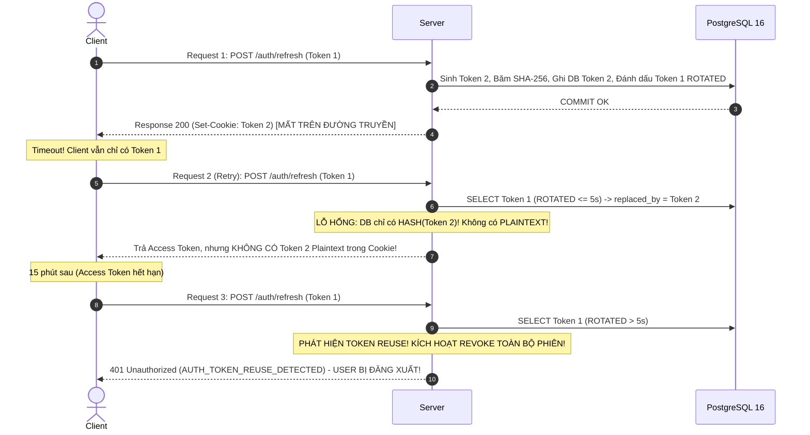
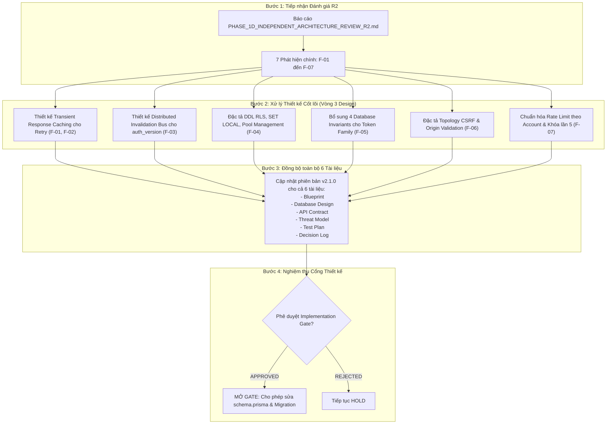

# BIZPRO+ PHASE 1D — BÁO CÁO KIỂM ĐỊNH KIẾN TRÚC ĐỘC LẬP VÒNG 2 (INDEPENDENT ARCHITECTURE REVIEW R2)
**Mã tài liệu:** `docs/PHASE_1D_INDEPENDENT_ARCHITECTURE_REVIEW_R2.md`  
**Phiên bản đối chiếu:** v2.0.0 (Bộ 6 tài liệu kỹ thuật Phase 1D)  
**Phân loại kiểm toán:** Lead Security Architect & Independent Technical Auditor Review  
**Ngày thực hiện:** 05/11/2026  
**Trạng thái cổng nghiệm thu (Implementation Gate):** **`NOT APPROVED (CONDITIONAL HOLD)`**  
**Chỉ đạo bắt buộc:** **DESIGN ONLY — Tuyệt đối KHÔNG sửa `schema.prisma`, KHÔNG chạy migration PostgreSQL và KHÔNG triển khai mã nguồn cho đến khi toàn bộ các phát hiện được phê duyệt phương án khắc phục.**

---

## 1. TỔNG QUAN ĐÁNH GIÁ & KẾT LUẬN CỔNG NGHIỆM THU (EXECUTIVE SUMMARY)

### 1.1. Bối cảnh & Mục tiêu Đánh giá
Sau khi bộ 6 tài liệu Phase 1D phiên bản 2.0.0 được đệ trình:
1. [`PHASE_1D_ARCHITECTURE_BLUEPRINT.md`](file:///e:/dự%20án/docs/PHASE_1D_ARCHITECTURE_BLUEPRINT.md) (v2.0.0)
2. [`PHASE_1D_DATABASE_DESIGN.md`](file:///e:/dự%20án/docs/PHASE_1D_DATABASE_DESIGN.md) (v2.0.0)
3. [`PHASE_1D_API_CONTRACT.md`](file:///e:/dự%20án/docs/PHASE_1D_API_CONTRACT.md) (v2.0.0)
4. [`PHASE_1D_SECURITY_THREAT_MODEL.md`](file:///e:/dự%20án/docs/PHASE_1D_SECURITY_THREAT_MODEL.md) (v2.0.0)
5. [`PHASE_1D_TEST_PLAN.md`](file:///e:/dự%20án/docs/PHASE_1D_TEST_PLAN.md) (v2.0.0)
6. [`PHASE_1D_DECISION_LOG.md`](file:///e:/dự%20án/docs/PHASE_1D_DECISION_LOG.md) (v2.0.0)

Đợt kiểm định kiến trúc độc lập Vòng 2 (**Independent Architecture Review R2**) được thực hiện nhằm trực tiếp rà soát tính khả thi kỹ thuật, tính toàn vẹn toán học và tính bảo mật của toàn bộ các giải pháp đề xuất. Đợt review này **không dựa trên báo cáo tóm tắt tự khai** mà trực tiếp mổ xẻ nội dung chi tiết từng luồng xử lý, từng constraint, từng sequence diagram và từng trường hợp biên (edge cases).

### 1.2. Kết luận Cổng Nghiệm thu (Implementation Gate Decision)
* **Kết luận chính thức:** **`NOT APPROVED (CONDITIONAL HOLD)`**
* **Lý do:** Bộ tài liệu v2.0.0 đã có những bước tiến lớn trong việc loại bỏ các giả định ngây thơ (bác bỏ Max Scope Priority `OWN < DEPT < ALL`, bác bỏ tuyên bố Prisma Extension bảo vệ 100%, thiết lập Token Family). Tuy nhiên, **vẫn tồn tại 4 lỗi thiết kế mức độ cao (P1) và 3 bất cập mức độ trung bình (P2)** liên quan đến tính toán học của khôi phục token, ranh giới an ninh của retry, độ trễ thu hồi token phân tán, và thiếu hụt các đặc tả bất biến vật lý ở cơ sở dữ liệu.
* **Quy tắc chuyển tiếp:** Hệ thống tiếp tục giữ nguyên ranh giới **Phase 1C-C Database Hardening**. Toàn bộ 51 Models, 23 Enums, 11 PostgreSQL CHECK Constraints và Composite FK đã nghiệm thu của Phase 1C-C được bảo vệ nguyên trạng. Không có bất kỳ lệnh `prisma migrate` nào được phép thực thi.

---

## 2. ĐÁNH GIÁ CHUYÊN SÂU THEO TỪNG TÀI LIỆU NGUỒN (SOURCE-BY-SOURCE EVALUATION)

### 2.1. Đánh giá `PHASE_1D_ARCHITECTURE_BLUEPRINT.md` (v2.0.0)
* **Điểm đạt:**
  * Đã chuẩn hóa mô hình Token Family với khóa bi quan `SELECT ... FOR UPDATE` trên bảng `refresh_tokens`, triệt tiêu race condition đọc đồng thời token `ACTIVE`.
  * Đã chuyển dịch mô hình thu hồi toàn cục sang **Targeted Family Invalidation**, bảo vệ các phiên làm việc trên các thiết bị khác của người dùng.
  * Đã cấu trúc lại mô hình phòng thủ ranh giới tổ chức thành 6 lớp (Layered Defense-in-Depth).
* **Điểm chưa đạt / Lỗ hổng phát hiện:**
  * *Lỗ hổng khôi phục Token Plaintext trong Idempotent Retry (Mục 2.2, Step 153-156):* Tài liệu quy định khi request đến trong cửa sổ $\le 5$s, server tìm token thế hệ kế tiếp qua `replaced_by_token_id` và trả lại response thành công. Tuy nhiên, server chỉ lưu SHA-256 hash của token này; do đó server **hoàn toàn bất lực trong việc tái tạo giá trị plaintext** để set vào header `Set-Cookie`.
  * *Mâu thuẫn Immediate Revocation vs Cache (Mục 3.1 & 3.2):* Tuyên bố `auth_version` cho phép thu hồi JWT tức thời, nhưng lại cho phép cache `auth_version` 30–60 giây trên các Standard Read API mà không có cơ chế bus phân tán đồng bộ cache invalidation giữa các ứng dụng chạy cụm (multi-instance/cluster).
  * *Thiếu hụt đặc tả triển khai RLS (Mục 4.1, Layer 6):* Tuyên bố tầng 6 sử dụng RLS tại PostgreSQL, nhưng không đưa ra bất kỳ mô tả nào về cấu hình session, cách truyền context qua connection pool, hay cách xử lý bypass role.

### 2.2. Đánh giá `PHASE_1D_DATABASE_DESIGN.md` (v2.0.0)
* **Điểm đạt:**
  * Tách bạch thực thể quản lý phiên vật lý `UserSession` và thực thể quản lý lịch sử chuỗi xoay vòng `RefreshTokenRecord` (`refresh_tokens`).
  * Bổ sung đầy đủ các trường phục vụ brute-force mitigation (`failed_login_attempts`, `locked_until`) và token revocation (`auth_version`).
* **Điểm chưa đạt / Lỗ hổng phát hiện:**
  * *Thiếu Unique Constraint theo Family trên `sequence_number`:* Cột `sequence_number` chưa có ràng buộc `UNIQUE (token_family_id, sequence_number)`. Điều này cho phép database lưu trữ hai token có cùng số thứ tự trong cùng một chuỗi thế hệ nếu ứng dụng gặp lỗi.
  * *Thiếu Partial Unique Index bảo vệ trạng thái `ACTIVE`:* Không có constraint nào ở tầng database đảm bảo rằng tại một thời điểm, một `token_family_id` chỉ có **tối đa duy nhất 1 token** ở trạng thái `ACTIVE` (`CREATE UNIQUE INDEX idx_unique_active_per_family ON refresh_tokens (token_family_id) WHERE status = 'ACTIVE'`).
  * *Thiếu Unique Constraint trên `replaced_by_token_id`:* Không có ràng buộc `UNIQUE (replaced_by_token_id)`. Điều này cho phép một token con có thể là "vật thay thế" của nhiều token cha khác nhau, phá vỡ cấu trúc chuỗi đơn hướng (linked list) và tạo ra hiện tượng rẽ nhánh (branching).
  * *Mất liên kết quan hệ thực thể giữa `UserSession` và `token_family_id`:* Bảng `user_sessions` không lưu cột `token_family_id` và không có Composite Foreign Key bảo đảm tính toàn vẹn giữa Session và Family.
  * *Bất nhất Enum `RefreshTokenStatus`:* Enum chỉ định nghĩa 3 trạng thái (`ACTIVE`, `ROTATED`, `REVOKED`), thiếu trạng thái `EXPIRED` đã được cam kết trong báo cáo tiến độ R1.

### 2.3. Đánh giá `PHASE_1D_API_CONTRACT.md` (v2.0.0)
* **Điểm đạt:**
  * Quy chuẩn rõ ràng 10 RESTful Endpoints với đầy đủ DTOs, Validation pipes và cấu trúc Payload JSON thống nhất.
  * Tách biệt mã lỗi an ninh rõ ràng: `401 Unauthorized` (Token lỗi/Reuse), `423 Locked` (Khóa tài khoản), `429 Too Many Requests` (Vượt rate limit).
* **Điểm chưa đạt / Lỗ hổng phát hiện:**
  * *Đặc tả response của `/auth/refresh` khi retry:* Mục 3.2 mô tả retry trong 5 giây sẽ trả về Access Token mới và giữ nguyên phiên, nhưng không chỉ rõ cookie `bizpro_refresh_token` sẽ được xử lý như thế nào (bỏ qua hay gửi lại token gì).
  * *Bất nhất Rate Limiting:* Login rate limit chỉ quy định theo IP (5 req/phút/IP) mà không quy định rate limit theo tài khoản (Account/Email level rate limiting). Điều này khiến kẻ tấn công có thể sử dụng botnet phân tán IP (Distributed IP Brute-Force) để bypass hoàn toàn cơ chế chặn.
  * *Cookie SameSite Topology:* Quy định `SameSite=Strict` nhưng không đặc tả cấu hình CORS và Origin Validation khi ứng dụng Frontend (Next.js) và Backend (NestJS) triển khai khác port hoặc khác subdomain.

### 2.4. Đánh giá `PHASE_1D_SECURITY_THREAT_MODEL.md` (v2.0.0)
* **Điểm đạt:**
  * Bổ sung phân tích mối đe dọa tấn công Hash Exhaustion DoS nhắm vào hàm băm Argon2id và đề xuất chặn độ dài mật khẩu 128 ký tự.
  * Phân loại chi tiết các kịch bản Replay Attack, Token Reuse và Side-Channel Timing Attack.
* **Điểm chưa đạt / Lỗ hổng phát hiện:**
  * *Client Fingerprint không đủ độ tin cậy để xác thực Retry:* Dùng IP Subnet và User-Agent để xác thực client retry trong Grace Window là một lỗ hổng nghiêm trọng. Trong môi trường NAT doanh nghiệp hoặc mạng di động, hàng nghìn thiết bị có chung IP Subnet và User-Agent mặc định. Kẻ tấn công nằm cùng mạng NAT hoàn toàn có thể tận dụng cửa sổ 5s để lấy được phiên hợp lệ.
  * *Thiếu kịch bản Denial of Service thông qua cơ chế khóa tài khoản:* Kẻ tấn công cố tình nhập sai mật khẩu 5 lần cho tài khoản của Giám đốc/Admin để kích hoạt trạng thái `423 Locked`, gây tê liệt hoạt động quản trị của doanh nghiệp.

### 2.5. Đánh giá `PHASE_1D_TEST_PLAN.md` (v2.0.0)
* **Điểm đạt:**
  * Đã chuyển hóa toàn bộ 8 test case sang định dạng ma trận 8 cột chuẩn mực.
  * Xây dựng phương pháp luận Benchmark hiệu năng thực tế trên 4 vCPU, 8GB RAM thay vì các con số giả định.
* **Điểm chưa đạt / Lỗ hổng phát hiện:**
  * *Kịch bản TC-CONC-01 mâu thuẫn bảo mật:* Quy định khi bắn đồng thời 10 request refresh với cùng Token 1, 1 request đầu trả `200 OK` và 9 request còn lại trả `200 OK` (Idempotent). Việc cho phép 9 request đồng thời đều nhận được kết quả thành công biến Grace Window thành một lỗ hổng Replay Attack mở rộng.
  * *Mâu thuẫn HTTP Status trong Test Case Khóa tài khoản (TC-BRUTE-01):* Bước 1-4 trả về `401 Unauthorized`. Lần thứ 5 vẫn trả `401 Unauthorized`, nhưng cơ sở dữ liệu đã khóa (`locked_until` được ghi). Đến lần thứ 6 mới trả `423 Locked`. Điều này gây bất nhất giữa thời điểm ghi nhận sự kiện khóa và phản hồi API.

### 2.6. Đánh giá `PHASE_1D_DECISION_LOG.md` (v2.0.0)
* **Điểm đạt:**
  * Thực thi nghiêm ngặt vòng đời ADR: Đã đánh dấu `SUPERSEDED` cho ADR-1D-006 (Max Scope) và ADR-1D-007 (Prisma Extension Tenancy), thay thế bằng ADR-1D-008 và ADR-1D-009.
  * Duy trì trạng thái `PROPOSED` cho toàn bộ các đề xuất mới, không tự ý ghi nhận `ACCEPTED`.
* **Điểm chưa đạt / Lỗ hổng phát hiện:**
  * *ADR-1D-003 nhận định phiến diện về CSRF:* Tuyên bố "Cờ `SameSite=Strict` ngăn chặn hoàn toàn việc trình duyệt tự động gửi cookie trong các truy vấn Cross-Site (CSRF Defense)" là nhận định thiếu cẩn trọng, chưa xem xét trường hợp subdomain takeover, cookie injection hoặc chuyển hướng cấp cao (top-level navigation).
  * *ADR-1D-004 chưa giải quyết bài toán mất response:* Cam kết cung cấp cửa sổ Idempotent Grace Period nhưng không định nghĩa cấu trúc dữ liệu lưu trữ response cache tạm thời.

---

## 3. SỔ BỘ PHÁT HIỆN KIẾN TRÚC VÒNG 2 (FINDINGS REGISTER)

```
┌────────────────────────────────────────────────────────────────────────┐
│                        TỔNG HỢP CÁC PHÁT HIỆN                          │
│                                                                        │
│   [P0 - Blocker]        : 0 phát hiện (Không có lỗi dừng hệ thống)     │
│   [P1 - High Severity]  : 4 phát hiện (Sai sót thiết kế cốt lõi)      │
│   [P2 - Medium Severity]: 3 phát hiện (Thiếu sót bảo vệ dữ liệu)      │
│   [P3 - Informational]  : 2 phát hiện (Khuyến nghị hoàn thiện)        │
└────────────────────────────────────────────────────────────────────────┘
```

| ID | Tiêu đề Phát hiện | Mức độ | Tài liệu liên quan | Tóm tắt Hệ quả Kỹ thuật |
| :--- | :--- | :---: | :--- | :--- |
| **F-01** | Không thể khôi phục Plaintext Refresh Token sau sự cố rớt mạng trong Idempotent Retry | **P1** | Architecture Blueprint, API Contract | Client bị mất token mới, giữ lại token cũ đã `ROTATED`. Lần refresh tiếp theo sẽ bị hệ thống nhận diện nhầm là tấn công Replay và thu hồi oan toàn bộ phiên làm việc của người dùng. |
| **F-02** | Chữ ký Client Fingerprint (IP/User-Agent) không đủ điều kiện an ninh để xác thực Retry | **P1** | Architecture Blueprint, Test Plan | Trong mạng NAT/VPN/Mobile, kẻ tấn công có cùng fingerprint với nạn nhân có thể tận dụng cửa sổ 5s để thực hiện replay token hợp lệ, biến Grace Window thành Replay Window. |
| **F-03** | Xung đột kiến trúc giữa tuyên bố Immediate Revocation và cơ chế Cache `auth_version` 30-60s | **P1** | Architecture Blueprint, Decision Log | Khi Admin tước quyền hoặc khóa tài khoản, các instance khác vẫn tin tưởng giá trị cache cũ trong tối đa 60 giây. JWT bị thu hồi vẫn tiếp tục gọi được các Read API. |
| **F-04** | Lỗ hổng đặc tả tầng phòng thủ Multi-Tenant: Tuyên bố có RLS nhưng thiếu 100% đặc tả DDL & Session Context | **P1** | Architecture Blueprint, Database Design | RLS trên PostgreSQL là vô nghĩa nếu không có DDL cụ thể, không có cơ chế `SET LOCAL` ranh giới tenant an toàn khi dùng Connection Pooling (PgBouncer/Prisma Pool), và không kiểm soát quyền `BYPASSRLS`. |
| **F-05** | Thiếu hụt các ràng buộc toàn vẹn dữ liệu vật lý (Database Invariants) của Token Family | **P2** | Database Design | Thiếu Unique constraint cho `(token_family_id, sequence_number)`, thiếu Unique constraint cho `replaced_by_token_id`, và thiếu Partial Unique Index cho trạng thái `ACTIVE`. |
| **F-06** | Tuyệt đối hóa cookie `SameSite=Strict` cho CSRF Defense mà thiếu đặc tả Topology Triển khai thực tế | **P2** | Decision Log, API Contract | Chưa xác định rõ mô hình triển khai giữa Frontend và Backend (Same-origin vs Cross-origin / Subdomain). Chưa có lớp bảo vệ bổ sung (Custom Request Header, Origin/Referer Validation). |
| **F-07** | Bất nhất giữa chính sách Rate Limiting, Brute-Force Account Lockout và mã phản hồi HTTP | **P2** | API Contract, Test Plan | Thiếu Account-level rate limit. Lần nhập sai thứ 5 bị bất nhất giữa thời điểm DB ghi nhận khóa và phản hồi HTTP trả về (401 vs 423). Nguy cơ bị lợi dụng để DoS tài khoản mục tiêu. |
| **F-08** | Thiếu quy chuẩn thu hồi Token Family khi thực hiện Đổi / Reset Mật khẩu | **P3** | Database Design, Threat Model | Khi user đổi mật khẩu, hệ thống tăng `auth_version` để thu hồi Access Token nhưng chưa quy định rõ ràng việc thu hồi toàn bộ các bản ghi `refresh_tokens` trong database. |
| **F-09** | Thiếu chuẩn hóa cấu trúc Audit Log Context cho các sự kiện phân quyền và Session Alerts | **P3** | Architecture Blueprint, API Contract | Các mã sự kiện an ninh (`AUTH_TOKEN_REUSE_DETECTED`, `SECURITY_CROSS_TENANT_ACCESS_ATTEMPT`) chưa có JSON Schema chuẩn hóa cho các trường metadata bắt buộc. |

---

## 4. CHI TIẾT KỸ THUẬT CÁC PHÁT HIỆN MỨC ĐỘ CAO (P1 DEEP-DIVE)

### 4.1. [F-01] Không thể khôi phục Plaintext Refresh Token sau sự cố rớt mạng trong Idempotent Retry

#### Bản chất kỹ thuật của vấn đề:
Quy trình hiện tại trong tài liệu:
```
1. Client gửi: Refresh Token 1 (Plaintext: "rt_abc...").
2. Server tạo: Refresh Token 2 (Plaintext: "rt_xyz...").
3. Server băm: SHA-256("rt_xyz...") = "hash_xyz...".
4. Server lưu: INSERT INTO refresh_tokens (token_hash = "hash_xyz...", status = 'ACTIVE').
5. Server cập nhật: UPDATE refresh_tokens SET status = 'ROTATED', replaced_by_token_id = token2.id WHERE id = token1.id.
6. DB COMMIT thành công.
7. Server gửi Response HTTP 200 (Set-Cookie: "rt_xyz...").
   ===> SỰ CỐ: Gói tin Response bị rớt trên đường truyền (Network Drop / Client Timeout).
8. Client không nhận được "rt_xyz...", vẫn lưu "rt_abc...".
9. Client thực hiện Idempotent Retry: Gửi lại "rt_abc...".
10. Server nhận "rt_abc...", tra cứu DB thấy status = 'ROTATED' và rotated_at <= 5s.
11. Server tra cứu replaced_by_token_id -> tìm thấy bản ghi Token 2.
```
**Điểm bế tắc (Dead End):**
Tại bước 11, bản ghi Token 2 trong database **chỉ chứa `token_hash = hash_xyz`**. Server hoàn toàn không lưu plaintext `rt_xyz` (theo đúng nguyên tắc bảo mật một chiều).
* Vì không có plaintext, Server **không thể tái tạo header `Set-Cookie: bizpro_refresh_token=rt_xyz`** để gửi lại cho Client.
* Nếu Server chỉ trả về Access Token mới trong Body mà không set Cookie Refresh Token mới:
  * Client tiếp tục giữ Refresh Token 1 ("rt_abc...").
  * 15 phút sau, khi Access Token hết hạn, Client gửi lại Refresh Token 1 ("rt_abc...").
  * Lúc này, thời gian `rotated_at` đã trôi qua 15 phút ($> 5$ giây Grace Period).
  * Server lập tức kích hoạt **Token Reuse Detection** $\rightarrow$ Thu hồi toàn bộ Token Family $\rightarrow$ **Người dùng bị đăng xuất oan 100%!**



#### Phương án khắc phục chuẩn kiến trúc (Remediation Architecture):
Có 2 hướng tiếp cận chuẩn công nghiệp, nhóm thiết kế cần chọn 1 trong 2 để đưa vào văn bản Vòng 3:
1. **Phương án A — Transient Encrypted Response Caching (Khuyến nghị):**
   * Trong vòng đời giao dịch xoay vòng token, Server tạo một bản mã hóa tạm thời của Response Payload (chứa cả Access Token và chuỗi plaintext của Refresh Token mới), mã hóa bằng một Symmetric Key bảo vệ phiên và lưu vào bảng tạm hoặc cache có TTL đúng bằng cửa sổ Grace Period (ví dụ: 10 giây).
   * Khi phát hiện request retry hợp lệ trong cửa sổ: Server giải mã lấy lại đúng bản tin response ban đầu và gửi lại nguyên vẹn qua header `Set-Cookie`. Hết TTL, bản ghi tự động bị xóa sổ.
2. **Phương án B — Atomic Re-issuance & Chain Advancement on Retry:**
   * Thay vì cố gắng gửi lại Token 2, Server coi retry hợp lệ là một yêu cầu hợp thức để **thay thế Token 2 bằng Token 3** (`seq = 3`, `replaced_by_token_id` của Token 1 được cập nhật trỏ sang Token 3, Token 2 bị đánh dấu `REVOKED_UNCONSUMED`).
   * Server trả về chuỗi plaintext mới của Token 3 cho Client. Cơ chế này loại bỏ hoàn toàn việc cần lưu plaintext, nhưng đòi hỏi transaction handling cực kỳ chặt chẽ.

---

### 4.2. [F-02] Chữ ký Client Fingerprint (IP/User-Agent) không đủ điều kiện an ninh để xác thực Retry

#### Bản chất kỹ thuật của vấn đề:
Tài liệu quy định: Cho phép retry trong vòng 5 giây nếu có cùng "Client Fingerprint (IP Subnet và User-Agent)".
* **Môi trường NAT / Văn phòng Doanh nghiệp:** Hàng trăm nhân viên trong cùng một công ty truy cập internet qua chung một Public IP Gateway (ví dụ: IP tĩnh của tòa nhà văn phòng).
* **Môi trường Trình duyệt Tiêu chuẩn:** Hàng trăm máy tính cùng chạy bản cập nhật Windows 11 và Chrome 130 sẽ có chuỗi `User-Agent` giống nhau đến từng ký tự:  
  `Mozilla/5.0 (Windows NT 10.0; Win64; x64) AppleWebKit/537.36 (KHTML, like Gecko) Chrome/130.0.0.0 Safari/537.36`.
* **Kịch bản Khai thác (Replay Window Exploitation):**
  1. Nạn nhân gửi Refresh Token 1 trong mạng Wi-Fi công ty hoặc quán cà phê.
  2. Kẻ tấn công trên cùng mạng nội bộ (hoặc kẻ đã cướp được Token 1 qua kênh truyền) lập tức gửi tiếp Token 1 trong vòng 5 giây.
  3. Vì kẻ tấn công đi qua cùng Public IP của mạng và sử dụng cùng User-Agent phổ biến, Server kiểm tra thấy thỏa mãn điều kiện Fingerprint $\rightarrow$ Server cấp phiên cho kẻ tấn công!
  4. Hơn nữa, việc Test Plan cho phép **9 request đồng thời đều nhận được kết quả `200 OK` (Idempotent)** đã vô tình biến Grace Window thành một "cửa sổ chia sẻ phiên" cho bất kỳ request nào đến kịp trong 5 giây.

#### Phương án khắc phục chuẩn kiến trúc:
1. **Loại bỏ khái niệm Client Fingerprint làm yếu tố xác thực an ninh:** IP và User-Agent chỉ được dùng làm metadata phục vụ điều tra sự cố (Audit Logging & Anomaly Detection), tuyệt đối không dùng làm điều kiện cho phép truy cập.
2. **Triển khai Client-Generated Idempotency Key:**
   * Mọi request refresh từ Client bắt buộc phải đính kèm một `Idempotency-Key` (hoặc `X-Refresh-Request-Id`) dạng UUIDv4 do Client sinh ngẫu nhiên trước khi gửi.
   * Nếu Client bị timeout và gửi lại, Client gửi **chính xác `Idempotency-Key` cũ**.
   * Server chỉ chấp nhận trả lại kết quả xoay vòng cũ nếu khớp chính xác `Idempotency-Key`. Kẻ tấn công hoặc các tab trình duyệt khác không thể đoán được key này.
3. **Thắt chặt Concurrency Handling:**
   * Trong 10 request đồng thời: **Chỉ có duy nhất 1 request đầu tiên được xử lý thành công (200 OK)**.
   * 9 request còn lại khi vào transaction lock sẽ thấy token đã chuyển sang `ROTATED` mà không có Idempotency Key hợp lệ tương ứng $\rightarrow$ Bị từ chối bằng mã lỗi `409 Conflict` (`AUTH_CONCURRENT_REFRESH_IN_PROGRESS`) hoặc yêu cầu Client chờ đợi, tuyệt đối không tự động phát hành 9 token thành công.

---

### 4.3. [F-03] Xung đột kiến trúc giữa tuyên bố Immediate Revocation và cơ chế Cache `auth_version` 30-60s

#### Bản chất kỹ thuật của vấn đề:
Tài liệu đưa ra 2 tuyên bố mâu thuẫn trực diện trong cùng một tài liệu kiến trúc:
* **Tuyên bố 1 (Mục 3.1):** *"Tăng `auth_version` giải quyết triệt để hạn chế của Stateless JWT, vô hiệu hóa tức thời (Immediate Revocation) khi Admin thu hồi quyền hoặc đổi mật khẩu"*.
* **Tuyên bố 2 (Mục 3.1 & Decision Log ADR-1D-002):** *"Dựa vào chữ ký JWT và `auth_version` (được cache trong bộ nhớ với TTL ngắn 30-60 giây), giảm tải 90% truy vấn vào DB"*.

#### Hệ quả trong kiến trúc phân tán (Distributed System Failure):
Giả sử hệ thống triển khai 2 instances backend (Node 1 và Node 2) phục vụ cân bằng tải:
```
10:00:00 - User đăng nhập trên Node 1, nhận JWT có claim "ver: 1". Cả Node 1 và Node 2 lưu cache user.auth_version = 1 (TTL 60s).
10:00:15 - Admin phát hiện User bị lộ thông tin, gọi API tước quyền:
           -> Node 1 xử lý lệnh: UPDATE users SET auth_version = 2 WHERE id = user_id.
           -> Node 1 xóa cache cục bộ của mình.
10:00:20 - Kẻ tấn công sử dụng JWT cũ ("ver: 1") gửi request đọc dữ liệu CRM:
           -> Bộ cân bằng tải (Load Balancer) điều phối request này vào Node 2.
           -> Node 2 kiểm tra: JWT có ver = 1.
           -> Node 2 đọc cache bộ nhớ cục bộ của mình: user.auth_version vẫn đang là 1 (chưa hết TTL 60s)!
           -> Node 2 chấp nhận request: Trả toàn bộ dữ liệu bí mật kinh doanh cho kẻ tấn công!
```
Như vậy, việc thu hồi **hoàn toàn KHÔNG tức thời**. Nó có độ trễ lên tới 60 giây (hoặc lâu hơn nếu cache không đồng bộ).

#### Phương án khắc phục chuẩn kiến trúc:
1. **Chuẩn hóa lại Tuyên bố Kiến trúc (Architectural Honesty):**
   * Nếu chấp nhận kiến trúc Caching: Phải sửa toàn bộ văn bản từ "Immediate Revocation" thành **"Near-Realtime Revocation with Bounded Eventual Consistency (Delay $\le 30\text{s}$)"**.
2. **Cơ chế Phân tán Cache Invalidation (Distributed Cache Invalidation Bus):**
   * Để đạt được Immediate Revocation thực sự trên nhiều instances: Khi `auth_version` thay đổi, instance thực hiện phải phát một bản tin sự kiện qua **Redis Pub/Sub** hoặc **PostgreSQL `LISTEN/NOTIFY`** (`NOTIFY user_auth_version_changed, '{"user_id": "...", "ver": 2}'`).
   * Tất cả các instances khác lắng nghe kênh này và lập tức xóa bỏ (evict) cache của `user_id` tương ứng trong vòng dưới 10ms.

---

### 4.4. [F-04] Lỗ hổng đặc tả tầng phòng thủ Multi-Tenant: Tuyên bố có RLS nhưng thiếu 100% đặc tả DDL & Session Context

#### Bản chất kỹ thuật của vấn đề:
Trong `PHASE_1D_ARCHITECTURE_BLUEPRINT.md` (Mục 4), tầng 6 được ghi nhận là:
`[Layer 6: Physical Database Constraints] ─► Composite Foreign Keys & RLS bảo vệ vật lý tại PostgreSQL`.

Tuy nhiên, trong toàn bộ tài liệu kiến trúc và tài liệu Database Design:
* Không có một dòng DDL nào về `ALTER TABLE ... ENABLE ROW LEVEL SECURITY;`.
* Không có chính sách `CREATE POLICY ... ON ... USING (...) WITH CHECK (...);`.
* Không có hướng dẫn làm thế nào ứng dụng NestJS truyền `organization_id` vào session kết nối của PostgreSQL.
* Không có giải pháp xử lý khi ứng dụng sử dụng **Connection Pooling (Prisma Client Pool hoặc PgBouncer)**.

#### Nguy cơ rò rỉ dữ liệu chéo tổ chức khi dùng Connection Pool (Pool Bleeding Vulnerability):
Nếu ứng dụng thực thi `SET app.current_organization_id = 'org_A';` trên một connection:
1. Request 1 của Tổ chức A sử dụng Connection #5, set `app.current_organization_id = 'org_A'`.
2. Request 1 kết thúc, connection được trả về Pool mà **không được reset**.
3. Request 2 của Tổ chức B mượn đúng Connection #5 từ Pool. Nếu lập trình viên quên set lại context của Tổ chức B:
4. PostgreSQL vẫn giữ giá trị `'org_A'` trong session state $\rightarrow$ Request của Tổ chức B vô tình đọc/ghi nhầm vào dữ liệu của Tổ chức A!

#### Phương án khắc phục chuẩn kiến trúc:
Văn bản Vòng 3 bắt buộc phải đặc tả đầy đủ 5 nội dung kỹ thuật sau:
1. **Danh sách bảng bắt buộc kích hoạt RLS:** Bắt buộc kích hoạt trên toàn bộ các bảng chứa dữ liệu nghiệp vụ nhạy cảm: `users`, `user_sessions`, `refresh_tokens`, `customers`, `sales_orders`, `products`, `stock_receipts`, `employees`.
2. **Cú pháp Policy chuẩn mực:**
   ```sql
   ALTER TABLE sales_orders ENABLE ROW LEVEL SECURITY;
   ALTER TABLE sales_orders FORCE ROW LEVEL SECURITY;

   CREATE POLICY tenant_isolation_policy ON sales_orders
     FOR ALL
     USING (organization_id = NULLIF(current_setting('app.current_organization_id', true), '')::uuid)
     WITH CHECK (organization_id = NULLIF(current_setting('app.current_organization_id', true), '')::uuid);
   ```
3. **Cơ chế Transaction-Scoped Session Variable:**
   * Bắt buộc dùng cú pháp `SET LOCAL`:
     `SET LOCAL app.current_organization_id = '...';` bên trong một Transaction block (`BEGIN ... COMMIT`).
   * Biến session được thiết lập bằng `SET LOCAL` sẽ **tự động biến mất và reset về NULL ngay khi transaction kết thúc (COMMIT hoặc ROLLBACK)**. Điều này triệt tiêu 100% nguy cơ "Pool Bleeding" khi tái sử dụng connection trong Pool.
4. **Phân quyền Database Role:**
   * User kết nối của ứng dụng (`bizpro_app_user`) tuyệt đối **KHÔNG ĐƯỢC LÀ SUPERUSER** và **KHÔNG CÓ QUYỀN `BYPASSRLS`**.
   * Chỉ duy nhất database migration role (`bizpro_migrator`) mới được sở hữu quyền DDL và bypass RLS.
5. **Cơ chế FORCE ROW LEVEL SECURITY:**
   * Bắt buộc sử dụng `FORCE ROW LEVEL SECURITY` trên tất cả các bảng tenant để đảm bảo ngay cả khi table owner thực thi truy vấn thì RLS vẫn được áp dụng nghiêm ngặt.

---

## 5. CHI TIẾT KỸ THUẬT CÁC PHÁT HIỆN MỨC ĐỘ TRUNG BÌNH (P2 DEEP-DIVE)

### 5.1. [F-05] Thiếu hụt các ràng buộc toàn vẹn dữ liệu vật lý (Database Invariants) của Token Family
Trong `PHASE_1D_DATABASE_DESIGN.md`, bảng `refresh_tokens` thiếu 4 ràng buộc toàn vẹn dữ liệu cực kỳ quan trọng:
1. **Thiếu Unique Sequence per Family:**
   * Hiện tại: `sequenceNumber Int @default(1) @map("sequence_number")`.
   * Hậu quả: Không thể ngăn chặn hai token có cùng số thứ tự trong một gia đình token nếu tầng ứng dụng gặp race condition.
   * Khắc phục: Bổ sung ràng buộc vật lý:
     `@@unique([tokenFamilyId, sequenceNumber], name: "uq_refresh_tokens_family_seq")`.
2. **Thiếu ràng buộc duy nhất 1 Token ACTIVE trên mỗi Family:**
   * Hậu quả: Một gia đình token có thể tồn tại 2 token `ACTIVE` cùng lúc, dẫn đến hiện tượng "phân thân phiên" (session split).
   * Khắc phục: Bổ sung PostgreSQL Partial Unique Index:
     ```sql
     CREATE UNIQUE INDEX idx_uq_active_token_per_family 
     ON refresh_tokens (token_family_id) 
     WHERE status = 'ACTIVE';
     ```
3. **Thiếu Unique Constraint trên `replaced_by_token_id`:**
   * Hiện tại: `replacedByTokenId String? @map("replaced_by_token_id") @db.Uuid`.
   * Hậu quả: Hai token khác nhau có thể cùng trỏ đến một token thay thế, tạo cấu trúc đồ thị dạng hội tụ thay vì danh sách liên kết đơn hướng.
   * Khắc phục: Bổ sung ràng buộc `@unique` trên `replacedByTokenId`:
     `@@unique([replacedByTokenId], name: "uq_refresh_tokens_replaced_by")`.
4. **Thiếu liên kết Composite Foreign Key giữa `UserSession` và `RefreshTokenRecord`:**
   * Cần có sự ràng buộc đảm bảo rằng mọi token trong `token_family_id` đều thuộc về chính xác `session_id` tương ứng, ngăn chặn việc gán nhầm token của session này vào family của session khác.

### 5.2. [F-06] Tuyệt đối hóa cookie `SameSite=Strict` cho CSRF Defense mà thiếu đặc tả Topology Triển khai thực tế
* **Vấn đề:** ADR-1D-003 và Decision Log coi `SameSite=Strict` là lá chắn chống CSRF hoàn hảo.
* **Thực tế kỹ thuật:**
  * Nếu Frontend chạy trên `app.bizpro.vn` và Backend API chạy trên `api.bizpro.vn` (Cross-subdomain):
    * Theo tiêu chuẩn Cookie, `SameSite=Strict` coi hai subdomain là cùng một "registrable domain" (eTLD+1). Nhưng nếu một ứng dụng khác trên `forum.bizpro.vn` bị lỗ hổng XSS hoặc Cookie Tossing, kẻ tấn công hoàn toàn có thể giả mạo hoặc ghi đè cookie.
  * Nếu Frontend và Backend chạy khác hoàn toàn domain (ví dụ Frontend deploy trên Vercel `bizpro.vercel.app`, Backend chạy trên Cloud VPS `api-bizpro.com`):
    * Trình duyệt sẽ coi đây là **Cross-Site tuyệt đối**. Cờ `SameSite=Strict` sẽ chặn 100% việc gửi cookie ngay cả trong các truy vấn hợp lệ từ Frontend của chính BizPro+!
* **Khắc phục:**
  1. Phải chốt rõ Topology: BizPro+ triển khai theo mô hình **Same-Origin** (qua Reverse Proxy / Nginx chung domain `app.bizpro.vn/api/v1`) hay mô hình **Cross-Origin** (`api.bizpro.vn`).
  2. Bổ sung cơ chế phòng thủ CSRF chuyên sâu (Defense-in-Depth):
     * Bắt buộc kiểm tra Header `Origin` và `Referer` trên toàn bộ các Mutation Requests (`POST`, `PUT`, `PATCH`, `DELETE`).
     * Áp dụng Custom Header Requirement: Mọi request mutation bắt buộc phải có header `X-Requested-With: XMLHttpRequest` hoặc `X-BizPro-Client: WebSPA`. Trình duyệt không bao giờ tự động đính kèm header tùy biến này trong các đòn tấn công CSRF HTML form truyền thống.

### 5.3. [F-07] Bất nhất giữa chính sách Rate Limiting, Brute-Force Account Lockout và mã phản hồi HTTP
* **Vấn đề 1 — Thiếu Account-Level Rate Limiting:**
  * Tài liệu chỉ quy định Rate Limit theo IP (5 requests / phút / IP).
  * Kẻ tấn công sử dụng hạ tầng botnet hoặc mạng Tor (mỗi request từ một IP khác nhau) có thể thử hàng nghìn mật khẩu vào tài khoản `admin@bizpro.vn` mà không bao giờ bị kích hoạt IP Rate Limit.
* **Vấn đề 2 — Nguy cơ Account Denial of Service (Account Locking DoS):**
  * Kẻ xấu chỉ cần gửi 5 request sai mật khẩu vào email của nạn nhân để khóa tài khoản nạn nhân 15 phút. Sau 15 phút, kẻ xấu lại gửi 5 request tiếp, khiến nạn nhân vĩnh viễn không thể đăng nhập.
* **Vấn đề 3 — Bất nhất mã phản hồi HTTP ở lần thứ 5:**
  * `PHASE_1D_TEST_PLAN.md` (Dòng 31): Lần 1-4 trả về `401`. Lần 5 trả về `401`. Lần 6 trả về `423 Locked`.
  * `PHASE_1D_API_CONTRACT.md` (Dòng 143): "Tài khoản bị tạm khóa do nhập sai liên tiếp quá 5 lần (`AUTH_ACCOUNT_LOCKED`), trả về `423 Locked`".
  * Nếu lần thứ 5 đã khóa thì ngay tại lần thứ 5 phải trả về `423 Locked` kèm thời gian `lockedUntil`, không được để sang lần thứ 6 mới thông báo.
* **Khắc phục:**
  1. Thống nhất quy tắc: Nhập sai lần 1-4 $\rightarrow$ `401 Unauthorized` (kèm số lần thử còn lại trong meta). Nhập sai lần thứ 5 $\rightarrow$ Lập tức khóa và trả về ngay mã `423 Locked`.
  2. Phân định rõ 2 tầng Rate Limiting:
     * *Tầng IP:* 10 requests / phút / IP (ngăn chặn spam request làm nghẽn CPU hash Argon2id).
     * *Tầng Tài khoản:* 5 lần sai liên tiếp trên cùng một email $\rightarrow$ Khóa tài khoản tạm thời 15 phút.
  3. Cơ chế chống DoS khóa tài khoản: Sau lần khóa thứ 2, hệ thống không tự động tăng thời gian khóa mà yêu cầu xác thực qua kênh phụ (Mã OTP gửi về Email hoặc CAPTCHA) để bảo vệ người dùng hợp lệ.

---

## 6. MA TRẬN TRUY VẾT CHÉO GIỮA 6 TÀI LIỆU (CROSS-DOCUMENT TRACEABILITY MATRIX)

Ma trận dưới đây kiểm tra tính nhất quán của từng hạng mục kiến trúc xuyên suốt cả 6 tài liệu:

| Hạng mục Kiến trúc | Architecture Blueprint | Database Design | API Contract | Threat Model | Test Plan | Decision Log | Đánh giá Tính nhất quán |
| :--- | :---: | :---: | :---: | :---: | :---: | :---: | :--- |
| **Token Family Rotation (RTR)** | Có mô tả | Có mô hình | Có API | Có phân tích | Có test case | Có ADR-004 | **BẤT NHẤT:** Thiếu phương án khôi phục Plaintext token trong Idempotent Retry (F-01). |
| **Token Invariants ở Database** | Có đề cập | **THIẾU** | Không áp dụng | Có đề cập | Có test case | Có đề cập | **BẤT NHẤT:** Database thiếu Unique Sequence, Partial Unique Active, Unique Replaced_by (F-05). |
| **Immediate Revocation via `auth_version`** | Có mô tả | Có cột DB | Có mã lỗi 401 | Có kịch bản | Có test case | Có ADR-002 | **MÂU THUẪN:** Blueprint và ADR cho phép cache 30-60s, mâu thuẫn với chữ "Tức thời" (F-03). |
| **PostgreSQL Row-Level Security (RLS)** | Có tuyên bố | **THIẾU DDL** | Không áp dụng | Có viện dẫn | **THIẾU** | Có ADR-009 | **LỖ HỔNG:** Chỉ tuyên bố suông ở Layer 6, thiếu 100% chi tiết kỹ thuật triển khai RLS (F-04). |
| **Phòng thủ CSRF & Cookie Topology** | Có mô tả | Không áp dụng | Có thuộc tính | Có đánh giá | Có test case | Có ADR-003 | **THIẾU SÓT:** Tuyệt đối hóa SameSite=Strict mà không tính đến topology triển khai thực tế (F-06). |
| **Rate Limiting & Account Lockout** | Có đề cập | Có cột DB | Có đặc tả | Có phân tích | Có test case | Có ADR-001 | **BẤT NHẤT:** Mâu thuẫn giữa lần sai thứ 5 vs thứ 6, thiếu Account-level rate limit (F-07). |
| **Resource-Specific Scope Policy** | Có công thức | Có quan hệ | Có Scope | Có phân tích | Có test case | Có ADR-008 | **ĐẠT:** Đã loại bỏ hoàn toàn Max Scope tuyến tính, mô hình đánh giá 5 yếu tố ngữ cảnh đồng bộ. |

---

## 7. RÀ SOÁT CÁC BẢN GHI QUYẾT ĐỊNH KIẾN TRÚC (ADR REVIEW)

| ADR ID | Tiêu đề Quyết định | Trạng thái Hiện tại | Kết quả Rà soát R2 | Khuyến nghị Hành động cho Vòng 3 |
| :--- | :--- | :---: | :---: | :--- |
| **ADR-1D-001** | Băm mật khẩu Argon2id & Benchmark | `PROPOSED` | **ĐẠT** | Giữ nguyên. Triển khai benchmark khi mở Implementation Gate. |
| **ADR-1D-002** | Thu hồi tức thời qua `auth_version` | `PROPOSED` | **CẦN SỬA** | Cập nhật cơ chế Distributed Cache Invalidation qua Pub/Sub hoặc sửa tuyên bố thành Near-Realtime (F-03). |
| **ADR-1D-003** | Chiến lược lưu trữ Token & CSRF | `PROPOSED` | **CẦN SỬA** | Bổ sung Origin/Referer Validation và xác định rõ topology cùng/khác domain (F-06). |
| **ADR-1D-004** | Quản lý phiên & Token Family trong DB | `PROPOSED` | **CẦN SỬA** | Thiết kế lại cơ chế Transient Encrypted Response Caching cho Idempotent Retry (F-01, F-02). |
| **ADR-1D-005** | Phân quyền RBAC Deny-by-default | `PROPOSED` | **ĐẠT** | Giữ nguyên 66 permissions nghiệp vụ chuẩn hóa 3 cấp độ. |
| **ADR-1D-006** | Maximum Scope Priority | `SUPERSEDED` | **ĐẠT** | Đã bị bác bỏ vĩnh viễn, không phục hồi. |
| **ADR-1D-007** | Phân tách Tenant bằng Prisma Extension | `SUPERSEDED` | **ĐẠT** | Đã bị bác bỏ vĩnh viễn, không phục hồi. |
| **ADR-1D-008** | Resource-Specific Scope Policy | `PROPOSED` | **ĐẠT** | Giữ nguyên mô hình đánh giá ngữ cảnh thay thế ADR-1D-006. |
| **ADR-1D-009** | Layered Multi-Tenant Defense-in-Depth | `PROPOSED` | **CẦN SỬA** | Bổ sung đặc tả kỹ thuật toàn diện cho PostgreSQL RLS (DDL, Set Local, Pool Management) (F-04). |

---

## 8. QUY TRÌNH HÀNH ĐỘNG KHẮC PHỤC CHO VÒNG 3 (ROUND 3 ACTION PLAN)

Để đưa bộ tài liệu Phase 1D đạt đủ điều kiện phê duyệt Cổng Nghiệm thu (Implementation Gate Approval), nhóm thiết kế phải thực hiện đúng quy trình chuẩn hóa đồng bộ trên cả 6 tài liệu:



### Chi tiết các công việc bắt buộc thực hiện trong Vòng 3:
1. **Xử lý dứt điểm F-01 & F-02 (Token Recovery & Idempotent Retry):**
   * Đưa vào tài liệu giải pháp **Transient Encrypted Response Cache (TTL 10s)**: Khi xoay vòng token thành công, lưu bản mã hóa của HTTP response trong bộ đệm tạm thời. Khi có retry hợp lệ kèm `Idempotency-Key`, trả lại nguyên vẹn response này bao gồm cả header `Set-Cookie` chứa token plaintext.
   * Xóa bỏ hoàn toàn việc dùng IP/User-Agent làm điều kiện xác thực retry. Thay thế bằng bắt buộc Client gửi `Idempotency-Key` (UUIDv4).
2. **Xử lý dứt điểm F-03 (`auth_version` Invalidation):**
   * Đặc tả cơ chế **Distributed Cache Invalidation**: Sử dụng PostgreSQL `LISTEN/NOTIFY` hoặc Redis Pub/Sub để khi một instance tăng `auth_version`, toàn bộ các instances khác lập tức xóa cache trong vòng 10ms.
   * Đồng thời chỉnh sửa câu chữ trong Blueprint và Threat Model, làm rõ độ trễ tối đa cho phép.
3. **Xử lý dứt điểm F-04 (PostgreSQL Row-Level Security DDL & Pool Management):**
   * Viết chi tiết toàn bộ các câu lệnh SQL DDL kích hoạt RLS (`ENABLE & FORCE ROW LEVEL SECURITY`) cho các bảng nghiệp vụ.
   * Đặc tả rõ ràng kỹ thuật sử dụng `SET LOCAL app.current_organization_id = ...` trong interactive transaction để biến session tự động hủy khi commit/rollback, triệt tiêu lỗi rò rỉ tenant trong connection pool.
4. **Xử lý dứt điểm F-05 (Token Family Database Invariants):**
   * Trong `PHASE_1D_DATABASE_DESIGN.md`, bổ sung vào model Prisma và migration SQL:
     * `@@unique([tokenFamilyId, sequenceNumber])`
     * `@unique` cho `replacedByTokenId`
     * Partial Unique Index cho trạng thái `ACTIVE`: `CREATE UNIQUE INDEX idx_uq_active_token_per_family ON refresh_tokens (token_family_id) WHERE status = 'ACTIVE';`
5. **Xử lý dứt điểm F-06 & F-07 (CSRF Defense & Rate Limiting):**
   * Xác định rõ topology triển khai (Same-origin qua Reverse Proxy).
   * Bổ sung cơ chế xác thực Header `Origin`, `Referer`, và Custom Header `X-Requested-With`.
   * Thống nhất mã lỗi: Lần thứ 5 sai mật khẩu lập tức trả `423 Locked`. Bổ sung Account-level rate limiting chống tấn công từ chối dịch vụ.

---

## 9. QUYẾT ĐỊNH CUỐI CÙNG VÀ BẢN TUYÊN BỐ CỔNG NGHIỆM THU

* **Trạng thái cổng nghiệm thu hiện tại:** **`NOT APPROVED (CONDITIONAL HOLD)`**
* **Hiệu lực thi hành:**
  * **Tuyệt đối KHÔNG sửa đổi `backend/prisma/schema.prisma`.**
  * **Tuyệt đối KHÔNG sinh và chạy bất kỳ file migration PostgreSQL nào.**
  * **Tuyệt đối KHÔNG viết mã nguồn triển khai cho Phase 1D.**
  * Toàn bộ trạng thái hệ thống giữ nguyên ở mức độ **DESIGN ONLY** cho đến khi đợt sửa đổi Vòng 3 hoàn tất và nhận được văn bản phê duyệt chính thức từ Lead Auditor / Người dùng.

---
*Báo cáo được biên soạn độc lập bởi Lead Security Architect & Independent Technical Auditor.*  
*Lưu trữ vĩnh viễn tại:* `docs/PHASE_1D_INDEPENDENT_ARCHITECTURE_REVIEW_R2.md`