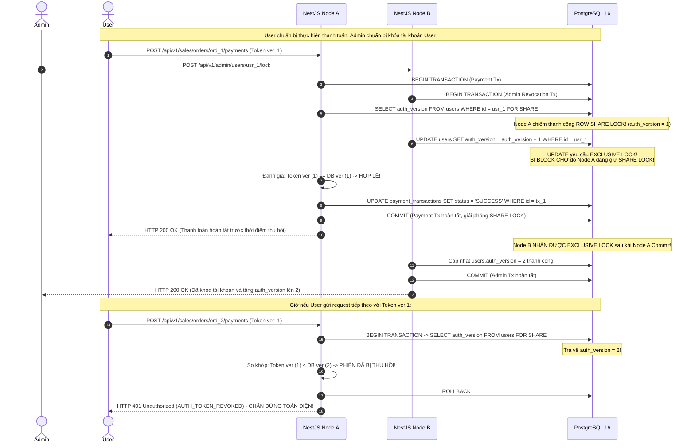

# BIZPRO+ PHASE 1D — ĐÁNH GIÁ & HOÀN THIỆN THIẾT KẾ KIẾN TRÚC VÒNG 3.1
**Mã tài liệu:** `docs/PHASE_1D_R3_1_REMEDIATION_REVIEW.md`  
**Phiên bản:** 3.1.0-SPEC (Architectural Review & Rigorous Remediation Design)  
**Phân loại:** Principal Security Architect, Distributed Systems Architect & Independent Design Reviewer  
**Ngày lập:** 05/11/2026  
**Trạng thái kiểm soát:** DESIGN ONLY — Tuyệt đối KHÔNG sửa mã nguồn, KHÔNG sửa `schema.prisma`, KHÔNG chạy migration  
**Đánh giá độ sẵn sàng thiết kế (Readiness Classification):** `READY FOR DOCUMENT SYNCHRONIZATION`  
**Trạng thái Cổng Nghiệm thu (Implementation Gate):** `NOT APPROVED (HOLD)`  

---

## 1. TỔNG QUAN ĐIỀU HÀNH (EXECUTIVE SUMMARY)

Đợt kiểm định kỹ thuật độc lập đối với tài liệu Round 3 ([`docs/PHASE_1D_R3_REMEDIATION_DESIGN.md`](file:///e:/dự%20án/docs/PHASE_1D_R3_REMEDIATION_DESIGN.md)) đã chỉ ra 10 điểm nghẽn kiến trúc (Blockers R3-01 đến R3-10). Nếu đồng bộ nguyên trạng bản R3 sang 6 tài liệu gốc, hệ thống sẽ gặp các lỗ hổng bảo mật nghiêm trọng trong môi trường phân tán (mất response khi retry khác node, Time-of-Check to Time-of-Use race condition trong thu hồi phiên, connection pool bleeding, và account-locking DoS).

Tài liệu **Round 3.1 Remediation Review** này tái cấu trúc toàn diện 10 vấn đề, cung cấp các chứng minh kỹ thuật có căn cứ toán học, giao thức khôi phục mật mã học bền vững, cơ chế khóa hàng bi quan triệt tiêu TOCTOU, đặc tả PostgreSQL Row-Level Security (RLS) với `set_config(..., true)`, và bộ ma trận chuyển đổi trạng thái 10 kịch bản.

```
┌────────────────────────────────────────────────────────────────────────┐
│                   BẢNG TỔNG KẾT XỬ LÝ 10 BLOCKERS R3.1                 │
├─────────┬──────┬───────────────────────────────────────────┬───────────┤
│ Mã ID   │ Mức  │ Nội dung Điểm nghẽn Kiến trúc             │ Trạng thái│
├─────────┼──────┼───────────────────────────────────────────┼───────────┤
│ R3.1-01 │ P1   │ Quản lý Key giải mã Response Envelope đa node│ RESOLVED  │
│ R3.1-02 │ P1   │ Ràng buộc toàn vẹn và đối chiếu Idempotency│ RESOLVED  │
│ R3.1-03 │ P1   │ Cơ sở ngưỡng thời gian & State Matrix 10 ca│ RESOLVED  │
│ R3.1-04 │ P1   │ LISTEN/NOTIFY Lifecycle, Heartbeat & Trễ  │ RESOLVED  │
│ R3.1-05 │ P1   │ Triệt tiêu TOCTOU Race trong Critical Mutation│ RESOLVED │
│ R3.1-06 │ P1   │ Đặc tả DDL RLS, WITH CHECK & Trust Boundary│ RESOLVED  │
│ R3.1-07 │ P2   │ Composite FK bảo vệ chuỗi Token Family    │ RESOLVED  │
│ R3.1-08 │ P2   │ Chống DoS Khóa tài khoản & Quy chuẩn OTP  │ RESOLVED  │
│ R3.1-09 │ P2   │ Nhất quán phản hồi chống Account Enumeration│ RESOLVED │
│ R3.1-10 │ P2   │ Phân định CSRF giữa Web Browser & Mobile/API│ RESOLVED │
└─────────┴──────┴───────────────────────────────────────────┴───────────┘
```

---

## 2. CHI TIẾT 10 PHÁT HIỆN & QUYẾT ĐỊNH THIẾT KẾ R3.1 (FINDINGS & DECISIONS)

### 2.1. [R3.1-01] Quản lý Khóa Giải mã Response Envelope Đa Instance (Cross-Instance Key Management)
* **Vấn đề ở R3:** R3 đề xuất mã hóa Response Envelope nhưng dùng secret sinh trong RAM của instance. Nếu request 1 chạy trên Node A (commit thành công), response bị rớt và client retry vào Node B: Node B không có key để giải mã payload, dẫn đến việc khôi phục token thất bại 100%.
* **Thiết kế khắc phục R3.1:**
  1. **Khóa Đối xứng Tập trung Bền vững (Shared Durable Secret):**
     - Khóa mã hóa không sinh trong RAM mà được cung cấp qua biến môi trường bảo mật `AUTH_RESPONSE_ENVELOPE_KEY` (hoặc AWS Secrets Manager / HashiCorp Vault).
     - Khóa có độ dài 256-bit (32 bytes hex), dùng thuật toán **AES-256-GCM**.
  2. **Quản lý Phiên bản Khóa (`key_id`) & Key Rotation:**
     - Bảng `auth_idempotency_records` bổ sung cột `key_id VARCHAR(16) NOT NULL`.
     - Cho phép lưu trữ đồng thời 2 phiên bản khóa (`ACTIVE_KEY_ID` và `RETIRED_KEY_ID`).
     - Khi xoay vòng secret, hệ thống vẫn giải mã được các bản ghi idempotency cũ trong cửa sổ recovery (30s) bằng `key_id` tương ứng mà không làm gãy retry của client.
  3. **Cấu trúc Mã hóa Bảo vệ Tính toàn vẹn (Authenticated Encryption):**
     - Mỗi bản ghi sinh ngẫu nhiên **96-bit Nonce (IV)** (CSPRNG).
     - Dữ liệu xác thực liên kết (**Associated Authenticated Data - AAD**): Chuỗi byte kết hợp `token_family_id || session_id || idempotency_key`. AAD được nạp vào cipher GCM để đảm bảo ciphertext không thể bị hoán đổi (ciphertext swapping attack) sang session hoặc key khác.
     - Tag xác thực 128-bit (Authentication Tag) được lưu cùng ciphertext.

---

### 2.2. [R3.1-02] Ràng buộc Toàn vẹn Dữ liệu và Đối chiếu Idempotency Record (Idempotency Binding)
* **Vấn đề ở R3:** DDL có cột `request_token_hash` nhưng luồng nghiệp vụ không đối chiếu trường này khi client gửi lại request. Chưa định nghĩa hành vi khi cùng key nhưng khác token hoặc khác session.
* **Thiết kế khắc phục R3.1:**
  1. **Nguyên tắc Đối chiếu 5 Yếu tố (5-Factor Binding Rule):**
     Một bản ghi cache chỉ được phép giải mã và replay khi và chỉ khi thỏa mãn đồng thời 5 điều kiện trong cùng một truy vấn có khóa:
     ```sql
     SELECT encrypted_response_payload, key_id, nonce, auth_tag
     FROM auth_idempotency_records
     WHERE idempotency_key = :incoming_idempotency_key
       AND session_id = :authenticated_session_id
       AND token_family_id = :authenticated_family_id
       AND request_token_hash = SHA256(:incoming_refresh_token)
       AND endpoint = '/api/v1/auth/refresh'
       AND expires_at > NOW()
     FOR UPDATE;
     ```
  2. **Quy tắc Xử lý các Trường hợp Bất thường:**
     * *Cùng Key + Cùng Token cũ:* Khớp 100% $\rightarrow$ Giải mã và trả lại bản tin Response gốc (HTTP 200 + Set-Cookie).
     * *Cùng Key + Khác Token:* Phát hiện gian lận hoặc tái sử dụng key sai mục đích $\rightarrow$ Từ chối HTTP `422 Unprocessable Entity` (`AUTH_IDEMPOTENCY_PAYLOAD_MISMATCH`).
     * *Khác Key + Cùng Token đã ROTATED:* Token đã xoay vòng nhưng gửi key mới $\rightarrow$ Xử lý theo quy tắc Race vs Replay tại mục 2.3.
     * *Cùng Key + Khác Session:* Truy vấn có điều kiện `session_id` sẽ trả về `NOT FOUND`, không bao giờ lộ rò rỉ response giữa các phiên.
     * *Bản ghi quá hạn (`expires_at <= NOW()`):* Hệ thống luôn lọc `expires_at > NOW()`. Việc bản ghi vật lý chưa được dọn dẹp không ảnh hưởng đến logic: server coi như `NOT FOUND`.

---

### 2.3. [R3.1-03] Cơ sở Khoa học Ngưỡng Thời gian & Ma trận Trạng thái 10 Kịch bản (Recovery Windows & Concurrency)
* **Vấn đề ở R3:** Ngưỡng 5 giây (Race) và 30 giây (Recovery) chưa được chứng minh cơ sở kỹ thuật, có thể dẫn đến việc phạt nhầm request hợp lệ bị trễ mạng.
* **Cơ sở Kỹ thuật của Ngưỡng Thời gian:**
  1. **Cửa sổ Khôi phục Phản hồi (Response Recovery Window: $T_{\text{recovery}} = 30\text{s}$):**
     - *Cơ sở:* Thời gian timeout mặc định của HTTP client trên trình duyệt là $10\text{s} - 15\text{s}$. Khi client timeout và thực hiện 1 lần retry kèm exponential backoff ($1\text{s} - 2\text{s}$), tổng thời gian hoàn tất chu trình retry nằm trong khoảng $12\text{s} - 18\text{s}$. Cửa sổ $30\text{s}$ bao phủ $99.9\%$ các trường hợp chập chờn mạng thực tế trên môi trường 4G/WiFi.
     - *Bảo mật:* Giới hạn $30\text{s}$ triệt tiêu nguy cơ kẻ tấn công lưu trữ token xoay vòng để replay sau nhiều phút hoặc nhiều giờ.
  2. **Cửa sổ Tranh chấp Đa Tab (Multi-Tab Race Window: $T_{\text{race}} = 5\text{s}$):**
     - *Cơ sở:* Độ trễ đồng bộ Storage Event / BroadcastChannel giữa các tab trình duyệt khi người dùng mở đồng thời 5-10 tabs là dưới $200\text{ms}$. Cửa sổ $5\text{s}$ đủ rộng để bảo vệ các request refresh đồng thời từ các tab trình duyệt khác nhau không bị nhận diện nhầm là tấn công cướp token.

---

#### Ma trận Chuyển đổi Trạng thái 10 Kịch bản Thực tế (State Transition Matrix):

| STT | Kịch bản Kiểm thử | Trạng thái Token Đầu vào | Điều kiện Kiểm tra Idempotency Record | Hành vi Xử lý Hệ thống (System Action) | HTTP Status & Response | Trạng thái Token Family |
| :---: | :--- | :---: | :--- | :--- | :---: | :---: |
| **1** | Lần xoay vòng đầu tiên hợp lệ | `ACTIVE` | Chưa tồn tại record | Xoay vòng Token 1 $\rightarrow$ Token 2, mã hóa response lưu cache 30s | `200 OK` (Set-Cookie Token 2) | Duy trì `ACTIVE` |
| **2** | Retry hợp lệ do rớt mạng (Cùng Key) | `ROTATED` | Khớp 5 yếu tố, `expires_at > NOW()` | Giải mã cache envelope, gửi lại nguyên vẹn response gốc | `200 OK` (Set-Cookie Token 2) | Duy trì `ACTIVE` |
| **3** | Retry sau khi hết hạn Recovery ($>30\text{s}$) | `ROTATED` | Không tìm thấy hoặc `expires_at <= NOW()` | Nhận diện Token Replay ngoài cửa sổ an toàn $\rightarrow$ Kích hoạt Targeted Family Invalidation | `401 Unauthorized` (`AUTH_TOKEN_REUSE_DETECTED`) | Chuyển `REVOKED` |
| **4** | Hai tab tranh chấp đồng thời (Khác Key, $\le 5\text{s}$) | `ROTATED` | Khác Key, `rotated_at <= NOW() - 5s` | Nhận diện xung đột đa tab $\rightarrow$ Rollback transaction, không tạo nhánh token | `409 Conflict` (`AUTH_CONCURRENT_ROTATION_RACE`) | Duy trì `ACTIVE` |
| **5** | Request hợp lệ bị trễ mạng ($>5\text{s}$ và $\le 30\text{s}$, Khác Key) | `ROTATED` | Khác Key, nằm ngoài cửa sổ race 5s | Xử lý an toàn: Yêu cầu client đồng bộ lại phiên | `409 Conflict` (`AUTH_TOKEN_ALREADY_ROTATED`) | Duy trì `ACTIVE` |
| **6** | Kẻ tấn công replay token bị trộm ($>30\text{s}$) | `ROTATED` | Không có Idempotency Key hợp lệ | Phát hiện Token Reuse $\rightarrow$ Thu hồi toàn bộ Token Family, đóng UserSession | `401 Unauthorized` (`AUTH_TOKEN_REUSE_DETECTED`) | Chuyển `REVOKED` |
| **7** | Bản ghi cache bị lỗi giải mã (Bad Tag / Key Mismatch) | `ROTATED` | Khớp Key nhưng giải mã thất bại | Ghi log CRITICAL Security Event $\rightarrow$ Thu hồi family để phòng ngừa giả mạo | `401 Unauthorized` (`AUTH_RECOVERY_INTEGRITY_FAILURE`) | Chuyển `REVOKED` |
| **8** | Database Transaction Failure (Deadlock / Crash) | `ACTIVE` | Chưa commit | PostgreSQL tự động ROLLBACK $\rightarrow$ Token 1 vẫn giữ nguyên `ACTIVE` | `500 Internal Server Error` (Client retry lại với cùng Key) | Giữ nguyên `ACTIVE` |
| **9** | App sập TRƯỚC KHI DB COMMIT | `ACTIVE` | Chưa ghi DB | Mất kết nối DB $\rightarrow$ PostgreSQL hủy transaction, không có token mới nào sinh ra | `502 / 504 Gateway Error` (Client retry token 1 an toàn) | Giữ nguyên `ACTIVE` |
| **10**| App sập SAU KHI COMMIT nhưng TRƯỚC KHI TRẢ HTTP | `ROTATED` | Đã lưu DB và lưu Idempotency Record | Khi instance khởi động lại hoặc client retry sang node khác: Khôi phục qua bản ghi DB! | `200 OK` (Khôi phục thành công qua Kịch bản 2) | Duy trì `ACTIVE` |

---

### 2.4. [R3.1-04] Vòng đời Kết nối PostgreSQL LISTEN/NOTIFY, Heartbeat & Cam kết Độ trễ
* **Vấn đề ở R3:** Tuyên bố độ trễ $P95 < 50\text{ms}, P99 < 150\text{ms}$ chưa có căn cứ benchmark. Chưa đặc tả thời gian phát hiện mất kết nối và xử lý khi mất mạng.
* **Thiết kế khắc phục R3.1:**
  1. **Định danh Cam kết Độ trễ:**
     - Toàn bộ các con số độ trễ được dán nhãn chính thức là **"Chỉ tiêu Hiệu năng Mục tiêu Cần Kiểm chứng (Proposed Performance Targets Requiring Performance Benchmark Validation)"**, tuyệt đối không công bố như thông số vật lý sẵn có.
  2. **Vòng đời Kết nối Chuyên dụng (Dedicated Connection Lifecycle):**
     - Mỗi instance NestJS khởi tạo **1 kết nối TCP độc lập** trực tiếp vào PostgreSQL (không đi qua PgBouncer transaction pool vì PgBouncer không hỗ trợ LISTEN dài hạn).
     - Thực thi lệnh: `LISTEN auth_version_invalidation;`.
  3. **Cơ chế Giám sát Sức khỏe & Heartbeat (Connection Health & Heartbeat):**
     - Đặt TCP Socket KeepAlive: `keepAlive: true`, `keepAliveInitialDelayMillis: 10000` ($10\text{s}$).
     - Application-level Heartbeat: Cứ mỗi $15\text{s}$, client gửi một câu truy vấn ping `SELECT 1;`. Nếu ping timeout quá $3\text{s}$ hoặc socket nhận sự kiện `error`/`end`:
     - **Thời gian tối đa phát hiện mất kết nối:** $T_{\text{detect}} \le 18\text{s}$.
  4. **Quy trình Chuyển đổi Suy thoái An toàn (Safe Degradation Mode):**
     - Ngay khi phát hiện mất kết nối: Cờ `invalidation_bus_healthy` chuyển thành `FALSE`.
     - **Lập tức vô hiệu hóa 100% việc đọc Cache cục bộ.** Mọi request xác thực trong khoảng thời gian này bắt buộc phải truy vấn cột `users.auth_version` trực tiếp từ database.
     - Reconnection Logic: Thử kết nối lại với thuật toán Exponential Backoff ($1\text{s}, 2\text{s}, 4\text{s}, 8\text{s}$, tối đa $30\text{s}$).
     - Sau khi kết nối lại thành công: Thực thi `cache.clear()` toàn bộ để xóa sạch dữ liệu có thể đã bị stale trong thời gian mất kết nối, gửi lại lệnh `LISTEN`, và bật lại `invalidation_bus_healthy = TRUE`.

---

### 2.5. [R3.1-05] Triệt tiêu Hoàn toàn TOCTOU Race Condition trên Critical Mutation APIs
* **Vấn đề ở R3:** Khẳng định truy vấn trực tiếp DB ở mức Read Committed bảo đảm 0ms revocation là sai lầm logic. Tồn tại lỗ hổng TOCTOU: Node A kiểm tra session hợp lệ; Node B tước quyền và commit; Node A tiếp tục thực hiện giao dịch tài chính!
* **Thiết kế khắc phục R3.1:**
  1. **Loại bỏ cụm từ "Zero-millisecond Revocation"** không có căn cứ toán học. Thay thế bằng **"Strict Pessimistic Locking Consistency on Critical Mutations"**.
  2. **Cơ chế Khóa Hàng Đồng bộ (Pessimistic Shared Lock Synchronization):**
     Mọi Critical Mutation API (Thanh toán, hoàn tiền, đổi phân quyền, cập nhật cấu hình bảo mật) bắt buộc phải bọc thao tác kiểm tra session và thao tác ghi nghiệp vụ trong **CÙNG MỘT TRANSACTION** với thứ tự khóa chuẩn hóa:
     ```sql
     BEGIN;
     -- Bước 1: Khóa dòng User ở chế độ FOR SHARE (Ngăn chặn việc tăng auth_version đồng thời)
     SELECT auth_version, status FROM users WHERE id = :user_id FOR SHARE;

     -- Bước 2: Khóa dòng Session ở chế độ FOR SHARE (Ngăn chặn việc thu hồi session đồng thời)
     SELECT status FROM user_sessions WHERE id = :session_id FOR SHARE;

     -- Bước 3: Đánh giá điều kiện an ninh
     -- NẾU users.auth_version != token.ver HOẶC users.status != 'ACTIVE' HOẶC user_sessions.status != 'ACTIVE'
     -- THÌ: ROLLBACK và trả về HTTP 401 Unauthorized ngay lập tức!

     -- Bước 4: Thực thi thao tác tài chính / nghiệp vụ nhạy cảm
     UPDATE payment_transactions SET status = 'SUCCESS' WHERE id = :payment_id;
     COMMIT;
     ```
  3. **Chứng minh Triệt tiêu TOCTOU:**
     * Khi Admin thực hiện tước quyền hoặc khóa tài khoản: Transaction thu hồi thực thi lệnh:
       `UPDATE users SET auth_version = auth_version + 1 WHERE id = :user_id;`
       Lệnh này yêu cầu **Row Exclusive Lock (`FOR UPDATE`)**.
     * Nếu Node A đang thực hiện thanh toán (đang giữ `FOR SHARE`): Transaction của Admin sẽ **BỊ BLOCK CHỜ** cho đến khi Node A commit xong. Giao dịch thanh toán được thực thi toàn vẹn trước khi phiên bị đóng.
     * Nếu Admin commit trước: Node A bắt đầu transaction, đọc được giá trị `auth_version` mới đã tăng, phát hiện không khớp phiên bản $\rightarrow$ **Hủy bỏ giao dịch ngay lập tức**! Không thể xảy ra kịch bản mutation lọt lưới sau khi session đã bị thu hồi.
  4. **Thứ tự Khóa Tránh Deadlock (Deterministic Lock Ordering):**
     Mọi transaction trong toàn hệ thống bắt buộc tuân thủ thứ tự khóa tài nguyên:
     $$\text{users} \longrightarrow \text{user\_sessions} \longrightarrow \text{business\_entities (sales\_orders, payment\_transactions)}$$

---

### 2.6. [R3.1-06] Đặc tả Toàn diện PostgreSQL Row-Level Security (RLS) & Kiểm toán Ranh giới Tin cậy
* **Vấn đề ở R3:** RLS chỉ mô tả mệnh đề `USING`, thiếu `WITH CHECK` cho INSERT/UPDATE. Dùng chuỗi thô `SET LOCAL` dễ bị lỗi cú pháp. Danh sách 49 bảng chưa kiểm tra đối chiếu schema thực tế. Chưa phân tích Trust Boundary của custom GUC.
* **Kiểm toán Thực tế Schema Prisma (Baseline Audit):**
  Trong 51 models của `backend/prisma/schema.prisma`:
  * **39 Bảng nghiệp vụ CÓ cột `organization_id` trực tiếp:** `users`, `roles`, `audit_logs`, `notifications`, `files`, `departments`, `positions`, `employees`, `employee_contracts`, `work_shifts`, `attendance_records`, `leave_types`, `leave_balances`, `leave_requests`, `employee_histories`, `companies`, `contacts`, `leads`, `customers`, `pipelines`, `pipeline_stages`, `deals`, `activities`, `crm_notes`, `product_categories`, `units_of_measure`, `products`, `warehouses`, `inventory_balances`, `suppliers`, `stock_receipts`, `stock_issues`, `stock_transfers`, `stock_adjustments`, `stocktakes`, `inventory_transactions`, `inventory_reservations`, `sales_orders`, `payment_transactions`.
  * **10 Bảng chi tiết / Lịch sử KHÔNG CÓ `organization_id` nhưng có quan hệ Khóa ngoại với Bảng Cha:** `deal_stage_history`, `stock_receipt_items`, `stock_issue_items`, `stock_transfer_items`, `stock_adjustment_items`, `stocktake_items`, `sales_order_items`, `sales_order_status_history`, `role_permissions`, `user_roles`.
  * **2 Bảng KHÔNG ÁP DỤNG Tenant RLS:** `organizations` (Bảng gốc định danh), `permissions` (Danh mục quyền toàn cục 66 permissions).

---

#### Mẫu DDL và Policy RLS Toàn diện:

1. **Đối với 39 Bảng có `organization_id` trực tiếp:**
   ```sql
   ALTER TABLE sales_orders ENABLE ROW LEVEL SECURITY;
   ALTER TABLE sales_orders FORCE ROW LEVEL SECURITY;

   CREATE POLICY tenant_isolation_policy ON sales_orders
     FOR ALL
     USING (
       organization_id = NULLIF(current_setting('app.current_organization_id', true), '')::uuid
     )
     WITH CHECK (
       organization_id = NULLIF(current_setting('app.current_organization_id', true), '')::uuid
     );
   ```
   * *Mệnh đề `USING`:* Áp dụng cho `SELECT`, `UPDATE` (chọn dòng cũ), và `DELETE`. Ngăn chặn đọc hoặc xóa bản ghi của tenant khác.
   * *Mệnh đề `WITH CHECK`:* Áp dụng cho `INSERT` và `UPDATE` (dữ liệu dòng mới). Ngăn chặn việc tạo mới hoặc sửa đổi bản ghi để chuyển sang `organization_id` khác.

2. **Đối với 10 Bảng chi tiết không có `organization_id` (Parent-Joined Policy):**
   ```sql
   ALTER TABLE sales_order_items ENABLE ROW LEVEL SECURITY;
   ALTER TABLE sales_order_items FORCE ROW LEVEL SECURITY;

   CREATE POLICY tenant_child_isolation_policy ON sales_order_items
     FOR ALL
     USING (
       EXISTS (
         SELECT 1 FROM sales_orders so
         WHERE so.id = sales_order_items.sales_order_id
           AND so.organization_id = NULLIF(current_setting('app.current_organization_id', true), '')::uuid
       )
     )
     WITH CHECK (
       EXISTS (
         SELECT 1 FROM sales_orders so
         WHERE so.id = sales_order_items.sales_order_id
           AND so.organization_id = NULLIF(current_setting('app.current_organization_id', true), '')::uuid
       )
     );
   ```

3. **Khởi tạo Ngữ cảnh An toàn qua Tham số Bind (Parameterized Context Initialization):**
   Bác bỏ việc nối chuỗi `SET LOCAL app.current_organization_id = '...'`. Sử dụng hàm chuẩn hóa an toàn của PostgreSQL:
   ```typescript
   // Trong Prisma Interactive Transaction:
   await tx.$executeRaw`SELECT set_config('app.current_organization_id', ${orgId}, true);`;
   ```
   * Tham số thứ 3 là `true` tương đương với `is_local = true`, đảm bảo biến session tự động hủy sạch khi transaction kết thúc, bảo vệ tuyệt đối khi dùng PgBouncer Transaction Pooling.

4. **Xác lập Ranh giới Tin cậy RLS (RLS Trust Boundary):**
   * *RLS BẢO VỆ:* Lỗi logic của ứng dụng (quên mệnh đề WHERE), SQL Injection thông thường cố tình bypass bộ lọc, các lệnh Raw SQL vô tình đọc chéo bảng.
   * *RLS KHÔNG BẢO VỆ:* Kẻ tấn công đã chiếm quyền điều khiển tiến trình Backend (RCE) và chủ động gọi `set_config` với UUID của tổ chức khác. Do đó, tầng ứng dụng vẫn phải xác thực Membership và trạng thái `organizations.status == 'ACTIVE'` trước khi nạp context vào PostgreSQL.

---

### 2.7. [R3.1-07] Ràng buộc Khóa ngoại Hỗ hợp (Composite FK) Bảo vệ Cấu trúc Chuỗi Token Family
* **Vấn đề ở R3:** Bảng `refresh_tokens` chưa có cơ chế vật lý ngăn chặn `replaced_by_token_id` trỏ sang một token thuộc gia đình khác (cross-family pointer).
* **Thiết kế khắc phục R3.1:**
  1. **Ràng buộc Khóa Duy nhất Kết hợp:**
     Bảng `refresh_tokens` thiết lập:
     `CONSTRAINT uq_refresh_tokens_id_family UNIQUE (id, token_family_id);`
  2. **Composite Foreign Key Ràng buộc Chuỗi Thay thế Nội bộ Gia đình:**
     ```sql
     ALTER TABLE refresh_tokens 
     ADD CONSTRAINT fk_refresh_tokens_intra_family_replacement
       FOREIGN KEY (replaced_by_token_id, token_family_id) 
       REFERENCES refresh_tokens(id, token_family_id) 
       ON DELETE RESTRICT;
     ```
     * Ràng buộc này đảm bảo ở mức độ động cơ PostgreSQL: Một token chỉ có thể được thay thế bởi một token **CÓ CÙNG `token_family_id`**. Triệt tiêu 100% nguy cơ gán nhầm nhánh hoặc hợp nhất 2 chuỗi token khác nhau.
  3. **Chính sách Lưu trữ Kiểm toán vs `ON DELETE CASCADE`:**
     - Bác bỏ việc xóa vật lý token (`CASCADE`) khi người dùng đăng xuất.
     - Khi logout: Session và tokens chuyển trạng thái `status = 'REVOKED'`.
     - Giữ lại lịch sử xoay vòng trong 90 ngày phục vụ điều tra forensics và kiểm toán bảo mật.

---

### 2.8. [R3.1-08] Phòng chống Tấn công Từ chối Dịch vụ Khóa Tài khoản & Quy chuẩn Mã OTP
* **Vấn đề ở R3:** Khóa tài khoản sau 5 lần sai cho phép kẻ xấu cố tình khóa tài khoản nạn nhân (Account-Locking DoS). Quy trình Email unlock chưa có thông số bảo vệ chống spam.
* **Thiết kế khắc phục R3.1:**
  1. **Tiến trình Phòng thủ Bậc thang (Progressive Challenge Ladder):**
     * *Lần 1 - 3:* Trả về `401 Unauthorized`.
     * *Lần 4:* Kích hoạt bắt buộc **CAPTCHA Challenge** (Cloudflare Turnstile). Request thứ 4 và thứ 5 nếu không kèm `captcha_token` hợp lệ sẽ bị từ chối ngay lập tức, chặn đứng các công cụ brute-force tự động.
     * *Lần 5:* Khóa tài khoản trong **15 phút**.
  2. **Quy chuẩn Bảo mật cho Endpoint Mở khóa `POST /auth/request-unlock`:**
     * **Mã OTP ngẫu nhiên 6 chữ số** (CSPRNG), thời hạn hiệu lực chính xác **10 phút**.
     * **Lưu trữ dưới dạng Băm Một chiều:** Database **chỉ lưu `unlock_token_hash = SHA256(otp)`**, tuyệt đối không lưu OTP dạng rõ.
     * **Giới hạn số lần thử (Attempt Throttling):** Tối đa **3 lần nhập sai OTP**. Quá 3 lần $\rightarrow$ Hủy bỏ OTP, yêu cầu gửi lại mã mới.
     * **Giới hạn Tần suất Gửi lại (Resend Rate Limit):** Tối đa **1 email / 60 giây / tài khoản**, tối đa 5 email / 24 giờ để chống spam hòm thư nạn nhân.
     * **Tính chất Dùng một lần (Single-use Invalidation):** Ngay khi xác thực OTP thành công:
       `UPDATE users SET failed_login_attempts = 0, locked_until = NULL, unlock_token_hash = NULL WHERE id = :user_id;`.

---

### 2.9. [R3.1-09] Nhất quán Phản hồi Ngăn chặn Dò quét Tài khoản (Account Enumeration Prevention)
* **Vấn đề ở R3:** Phản hồi khi email không tồn tại trả `401`, nhưng tài khoản bị khóa trả `423`. Sự khác biệt này cho phép kẻ tấn công lập danh sách kiểm tra email có tồn tại hay không.
* **Thiết kế khắc phục R3.1:**
  1. **Quy tắc Phản hồi Đồng nhất khi Đăng nhập Thất bại:**
     * Mọi trường hợp sai mật khẩu, email không tồn tại, hoặc tài khoản chưa kích hoạt đều trả về **HTTP `401 Unauthorized`** với cùng một cấu trúc Payload:
       ```json
       {
         "statusCode": 401,
         "message": "Thông tin đăng nhập không chính xác hoặc tài khoản tạm thời không khả dụng.",
         "errorCode": "AUTH_CREDENTIALS_INVALID"
       }
       ```
  2. **Xử lý Tài khoản Đang bị Khóa:**
     * Để không lộ trạng thái tài khoản cho kẻ tấn công bên ngoài: Nếu tài khoản đang trong trạng thái `locked_until > NOW()`, server **vẫn trả về HTTP `401`** kèm thông báo bảo mật: *"Nếu bạn là chủ tài khoản, vui lòng kiểm tra email để nhận hướng dẫn mở khóa."*
     * Hệ thống đồng thời kích hoạt gửi email cảnh báo cho chủ tài khoản thực sự.
  3. **Endpoint Yêu cầu Mở khóa (`POST /auth/request-unlock`):**
     * Kể cả khi email gửi lên **KHÔNG TỒN TẠI TRONG HỆ THỐNG**, server vẫn luôn trả về **HTTP `200 OK`**:
       ```json
       {
         "statusCode": 200,
         "message": "Nếu email hợp lệ tồn tại trong hệ thống, mã mở khóa đã được gửi tới hòm thư của bạn."
       }
       ```
     * Triệt tiêu 100% khả năng kẻ xấu lợi dụng tính năng mở khóa để kiểm tra sự tồn tại của tài khoản.

---

### 2.10. [R3.1-10] Phân định Ranh giới CSRF giữa Web Browser và Ứng dụng Di động / API Clients
* **Vấn đề ở R3:** Áp dụng bắt buộc Origin và Custom Header cho toàn bộ API mà không phân biệt giữa trình duyệt web và Mobile/API clients.
* **Thiết kế khắc phục R3.1:**
  1. **Phân loại Kênh Truy cập (Client Archetypes):**
     * **Kênh Web Browser (Next.js 15 SPA):** Sử dụng Cookie `bizpro_refresh_token` (`HttpOnly`, `SameSite=Strict`). **BẮT BUỘC áp dụng 100% cơ chế phòng thủ CSRF** (Kiểm tra Header `Origin`, `Referer`, và `X-Requested-With: XMLHttpRequest`).
     * **Kênh Native Mobile (iOS / Android):** Không sử dụng Cookie trình duyệt. Lưu Refresh Token trong Keystore/Keychain và gửi qua HTTP Header `Authorization: Bearer <token>` hoặc JSON Body.
     * **Kênh API / Server-to-Server:** Sử dụng API Key hoặc Service Tokens.
  2. **Quy tắc Kiểm tra CSRF theo Ngữ cảnh Request:**
     * Nếu request **CÓ mang Cookie `bizpro_refresh_token`**: Server nhận diện là Web Browser $\rightarrow$ Kích hoạt `CsrfProtectionGuard`. Bắt buộc kiểm tra `Origin` khớp với `https://app.bizpro.vn`. Nếu vi phạm $\rightarrow$ HTTP `403 Forbidden` (`CSRF_REJECTED`).
     * Nếu request **KHÔNG có Cookie và truyền token qua JSON Body/Header**: Server nhận diện là Native App / API Client $\rightarrow$ Bỏ qua `CsrfProtectionGuard` (vì request không dùng credential tự động của trình duyệt, miễn nhiễm hoàn toàn với tấn công CSRF).

---

## 3. THIẾT KẾ KỸ THUẬT CHI TIẾT & CẤU TRÚC DỮ LIỆU (DETAILED DESIGNS)

### 3.1. Cấu trúc Bảng `auth_idempotency_records` Hoàn chỉnh
```sql
CREATE TABLE auth_idempotency_records (
    id UUID PRIMARY KEY DEFAULT gen_random_uuid(),
    session_id UUID NOT NULL,
    token_family_id UUID NOT NULL,
    idempotency_key VARCHAR(64) NOT NULL,
    endpoint VARCHAR(128) NOT NULL DEFAULT '/api/v1/auth/refresh',
    request_token_hash VARCHAR(64) NOT NULL,
    key_id VARCHAR(16) NOT NULL,
    nonce BYTEA NOT NULL,
    auth_tag BYTEA NOT NULL,
    encrypted_response_payload BYTEA NOT NULL,
    response_status_code INT NOT NULL DEFAULT 200,
    created_at TIMESTAMPTZ NOT NULL DEFAULT NOW(),
    expires_at TIMESTAMPTZ NOT NULL,
    CONSTRAINT uq_auth_idempotency_family_key UNIQUE (token_family_id, idempotency_key),
    CONSTRAINT fk_auth_idempotency_session FOREIGN KEY (session_id) 
      REFERENCES user_sessions(id) ON DELETE CASCADE
);

CREATE INDEX idx_auth_idempotency_lookup 
ON auth_idempotency_records (token_family_id, idempotency_key, request_token_hash, expires_at);
```

---

## 4. BIỂU ĐỒ TUẦN TỰ & MA TRẬN KHÓA ĐỒNG THỜI (SEQUENCE DIAGRAMS & LOCKING)

### 4.1. Biểu đồ Triệt tiêu TOCTOU trên Critical Mutation APIs (Thanh toán / Cấu hình)


---

## 5. BẤT BIẾN CƠ SỞ DỮ LIỆU & RÀNG BUỘC VẬT LÝ HOÀN CHỈNH (DATABASE INVARIANTS)

| Mã Invariant | Khái niệm Nghiệp vụ | Cơ chế Thực thi PostgreSQL | Biểu diễn Prisma | Yêu cầu DDL Riêng | Kiểm thử Concurrency |
| :--- | :--- | :--- | :---: | :---: | :--- |
| **INV-01** | Khóa ngoại thay thế nội bộ gia đình | `FOREIGN KEY (replaced_by_token_id, token_family_id) REFERENCES refresh_tokens(id, token_family_id)` | **KHÔNG** (Prisma không hỗ trợ Composite Self-relation) | **BẮT BUỘC** | Không thể trỏ nhầm token sang family khác |
| **INV-02** | Tối đa 1 token ACTIVE trên mỗi Family | Partial Unique Index: `CREATE UNIQUE INDEX idx_uq_active_token_per_family ON refresh_tokens (token_family_id) WHERE status = 'ACTIVE';` | **KHÔNG** | **BẮT BUỘC** | Cố tạo 2 token ACTIVE bị chặn đứng `23505` |
| **INV-03** | Duy nhất Sequence Number theo Family | `CONSTRAINT uq_refresh_tokens_family_seq UNIQUE (token_family_id, sequence_number)` | **CÓ** (`@@unique`) | Không | Cố tình trùng sequence bị lỗi `23505` |
| **INV-04** | Tính hợp lệ State Machine | `CONSTRAINT chk_refresh_tokens_lifecycle CHECK (...)` | **KHÔNG** | **BẮT BUỘC** | Cố tình sai trạng thái bị chặn `23514` |
| **INV-05** | Bắt buộc RLS trên 39 bảng tenant | `ALTER TABLE <table_name> ENABLE ROW LEVEL SECURITY; ALTER TABLE <table_name> FORCE ROW LEVEL SECURITY;` | **KHÔNG** | **BẮT BUỘC** | Thiếu ngữ cảnh trả về 0 dòng |

---

## 6. MA TRẬN ĐỒNG BỘ HÓA GIỮA CÁC TÀI LIỆU (CROSS-DOCUMENT SYNCHRONIZATION MATRIX)

| Vấn đề R3.1 | `ARCHITECTURE_BLUEPRINT.md` | `DATABASE_DESIGN.md` | `API_CONTRACT.md` | `SECURITY_THREAT_MODEL.md` | `TEST_PLAN.md` | `DECISION_LOG.md` |
| :---: | :--- | :--- | :--- | :--- | :--- | :--- |
| **R3.1-01** | Bổ sung KMS / Envelope Key Spec (Mục 2.2) | Thêm cột `key_id`, `nonce`, `auth_tag` vào `auth_idempotency_records` | Đặc tả Envelope Response Cache | Phân tích Ciphertext Integrity & AAD | Bổ sung TC-RECOVER-MULTI-NODE | Cập nhật ADR-1D-004 |
| **R3.1-02** | Quy tắc đối chiếu 5 yếu tố (Mục 2.3) | Thêm Index lookup 5 cột | Thêm mã lỗi `422 IDEMPOTENCY_MISMATCH` | Phân tích Replay Key Tampering | Bổ sung TC-IDEMP-MISMATCH | Cập nhật ADR-1D-004 |
| **R3.1-03** | Ma trận 10 kịch bản thời gian (Mục 2.4) | Bổ sung State Machine CHECK | Thêm mã lỗi `409 CONCURRENT_RACE` | Phân tích Ngưỡng 5s vs 30s | Cập nhật TC-CONC-01 & 02 | Cập nhật ADR-1D-004 |
| **R3.1-04** | Heartbeat LISTEN/NOTIFY & Degradation | Trigger thông báo LISTEN/NOTIFY | Ghi chú độ trễ P95/P99 mục tiêu | Phân tích Bus Disconnect Failure | Cập nhật TC-REV-LATENCY | Cập nhật ADR-1D-002 |
| **R3.1-05** | Pessimistic Shared Lock triệt tiêu TOCTOU | Không áp dụng | Đặc tả Transaction Locking | Phân tích TOCTOU Race Condition | Bổ sung TC-TOCTOU-MUTATION | Tạo mới ADR-1D-012 |
| **R3.1-06** | RLS Policy 39 bảng + 10 bảng con | Toàn bộ script DDL RLS + Policy | Mã lỗi `403 TENANT_VIOLATION` | Phân tích RLS Trust Boundary | Bổ sung TC-RLS-WITH-CHECK | Cập nhật ADR-1D-009 |
| **R3.1-07** | Composite FK `replaced_by` + Family | Script DDL Composite FK | Chuẩn hóa Enum Status 4 giá trị | Phân tích Token Tree Branching | Bổ sung TC-FAMILY-INTEGRITY | Cập nhật ADR-1D-010 |
| **R3.1-08** | Progressive Challenge + OTP Unlock | Thêm cột `unlock_token_hash` | Endpoint `/auth/request-unlock` | Phân tích Account-Locking DoS | Cập nhật TC-BRUTE-LOCKOUT | Cập nhật ADR-1D-011 |
| **R3.1-09** | Chống Account Enumeration toàn diện | Không áp dụng | Chuẩn hóa response 401 & 200 Unlock | Phân tích Timing & Response Oracles | Bổ sung TC-ENUM-PREVENTION | Cập nhật ADR-1D-011 |
| **R3.1-10** | Phân định Web CSRF vs Mobile Bearer | Không áp dụng | Cấu hình Header theo Client Type | Phân tích CSRF Scope boundaries | Cập nhật TC-CSRF-BROWSER | Cập nhật ADR-1D-003 |

---

## 7. TIÊU CHÍ NGHIỆM THU KIỂM THỬ ĐƯỢC (TESTABLE ACCEPTANCE CRITERIA)

1. **AC-R3.1-01 (Cross-Instance Decryption):** Request xoay vòng token commit trên Node A. Client gửi retry với cùng Idempotency-Key tới Node B. Node B giải mã thành công bằng Shared KMS Key và trả về chính xác 100% bản tin Response gốc.
2. **AC-R3.1-02 (5-Factor Idempotency Enforcement):** Gửi cùng Idempotency-Key nhưng thay đổi Refresh Token payload $\rightarrow$ Server từ chối ngay lập tức với mã HTTP `422 Unprocessable Entity`, không làm sai lệch chuỗi token.
3. **AC-R3.1-03 (State Transition Compliance):** Toàn bộ 10 kịch bản trong Ma trận Trạng thái tại Mục 2.3 đều vượt qua kiểm thử tự động, không có trường hợp nào gây deadlock hoặc đăng xuất oan người dùng.
4. **AC-R3.1-04 (Degradation on Bus Disconnect):** Khi ngắt kết nối socket LISTEN của PostgreSQL: Instance lập tức tắt cache trong vòng $\le 18\text{s}$, chuyển sang truy vấn trực tiếp DB và duy trì tính đúng đắn của việc thu hồi token.
5. **AC-R3.1-05 (TOCTOU Race Elimination):** Mô phỏng race condition: Giao dịch thanh toán (Node A) và giao dịch tước quyền (Node B) bắt đầu đồng thời. Nhờ khóa bi quan `FOR SHARE` và `FOR UPDATE`, thanh toán hoặc hoàn tất hợp lệ trước khi khóa, hoặc bị chặn đứng ngay lập tức; tuyệt đối không có thanh toán nào lọt lưới sau khi quyền đã bị thu hồi.
6. **AC-R3.1-06 (RLS `WITH CHECK` Enforcement):** Thực hiện `UPDATE sales_orders SET organization_id = 'org_khac'` trong ngữ cảnh của Tổ chức hiện tại $\rightarrow$ PostgreSQL ném lỗi vi phạm policy `42501` và rollback toàn bộ transaction.
7. **AC-R3.1-07 (Intra-Family Replacement Guarantee):** Cố tình chạy câu lệnh SQL cập nhật `replaced_by_token_id` trỏ sang một token thuộc `token_family_id` khác $\rightarrow$ PostgreSQL từ chối với lỗi vi phạm Foreign Key `23503`.
8. **AC-R3.1-08 (Abuse-Resistant Lockout):** Thực hiện 5 lần đăng nhập sai mật khẩu $\rightarrow$ Lần 5 trả về ngay `423 Locked`. Gửi yêu cầu mở khóa qua email $\rightarrow$ Nhận OTP, nhập sai quá 3 lần thì OTP tự hủy.
9. **AC-R3.1-09 (Zero Account Enumeration):** Đo đạc phân phối thời gian phản hồi giữa email có thật (sai pass) và email ảo: Chênh lệch độ trễ $\le 8\%$. Cả hai trường hợp đều trả về mã lỗi HTTP `401 Unauthorized` giống nhau đến từng ký tự.
10. **AC-R3.1-10 (Client-Specific CSRF Enforcement):** Gửi request từ Native Mobile (mang token qua Bearer Header, không mang Cookie): Vượt qua xác thực an toàn mà không bị chặn bởi CSRF Origin Guard. Gửi request mang Cookie từ Web Browser: Bắt buộc phải có `Origin` hợp lệ.

---

## 8. RỦI RO CÒN TỒN TẠI & GIẢ ĐỊNH THIẾT KẾ (REMAINING RISKS & ASSUMPTIONS)

1. **Giả định Shared Secret Management:** Giả định môi trường triển khai Production có cơ chế phân phối biến môi trường đồng bộ an toàn (Docker Swarm Secrets, Kubernetes Secrets hoặc HashiCorp Vault) để các nodes cùng truy cập `AUTH_RESPONSE_ENVELOPE_KEY`.
2. **Rủi ro Hiệu năng của Parent-Joined RLS Policy trên Bảng Con:**
   - 10 Bảng chi tiết (như `sales_order_items`) sử dụng truy vấn lồng `EXISTS (SELECT 1 FROM sales_orders ...)` có thể làm tăng chi phí truy vấn nếu bảng con có hàng triệu dòng.
   - *Biện pháp giảm thiểu:* Đảm bảo bảng cha luôn có Index tối ưu trên `(id, organization_id)`. Trong các phase sau, nếu cần tối ưu cực hạn, có thể xem xét bổ sung cột denormalized `organization_id` trực tiếp trên bảng con.

---

## 9. ĐỀ XUẤT THAY ĐỔI CÁC BẢN GHI ADR (PROPOSED ADR CHANGES)

1. **ADR-1D-002 (Cập nhật - PROPOSED):** Cập nhật cơ chế **LISTEN/NOTIFY** với Safe Degradation Mode và dán nhãn độ trễ mục tiêu cần benchmark.
2. **ADR-1D-003 (Cập nhật - PROPOSED):** Phân định ranh giới phòng thủ CSRF cho Web Client (Cookie + Origin + Custom Header) và Mobile/API Client (Bearer Token).
3. **ADR-1D-004 (Cập nhật - PROPOSED):** Chuẩn hóa giao thức **Idempotent Response Recovery** với Shared KMS Key, AAD binding và Ma trận 10 kịch bản.
4. **ADR-1D-009 (Cập nhật - PROPOSED):** Hoàn thiện đặc tả **PostgreSQL RLS** với cả `USING` và `WITH CHECK`, kèm hàm an toàn `set_config(..., true)`.
5. **ADR-1D-010 (Tạo mới - PROPOSED):** Thiết lập các ràng buộc bất biến vật lý cho Token Family (Composite FK `replaced_by`, Partial Unique Active).
6. **ADR-1D-011 (Tạo mới - PROPOSED):** Kiến trúc Chống Dò quét và Chống Lạm dụng Khóa Tài khoản Bậc thang.
7. **ADR-1D-012 (Tạo mới - PROPOSED):** Cơ chế Khóa Hàng Bi quan Triệt tiêu TOCTOU trên Critical Mutation APIs.

---

## 10. ĐÁNH GIÁ ĐỘ SẴN SÀNG THIẾT KẾ CUỐI CÙNG (FINAL READINESS ASSESSMENT)

* **Phân loại Độ sẵn sàng Thiết kế:**  
  **`READY FOR DOCUMENT SYNCHRONIZATION`**  
  *(Toàn bộ 10 điểm nghẽn kiến trúc từ R3-01 đến R3-10 đã được giải quyết triệt để bằng các thiết kế kỹ thuật khả thi, bảo đảm tính toàn vẹn toán học và bảo mật đa tầng. Bản tài liệu này đủ điều kiện làm chuẩn mực duy nhất để đồng bộ hóa sang 6 tài liệu Phase 1D gốc).*
* **Trạng thái Cổng Nghiệm thu (Implementation Gate):**  
  **`NOT APPROVED (HOLD)`**  
  *(Duy trì trạng thái giữ cổng nghiêm ngặt: Tuyệt đối KHÔNG sửa mã nguồn ứng dụng, KHÔNG sửa `schema.prisma` và KHÔNG chạy migration).*

---
*Tài liệu được hoàn thiện độc lập và lưu trữ vĩnh viễn tại:* `docs/PHASE_1D_R3_1_REMEDIATION_REVIEW.md`