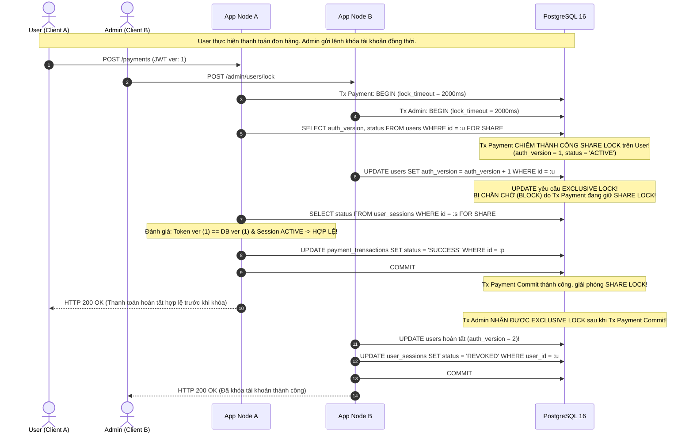
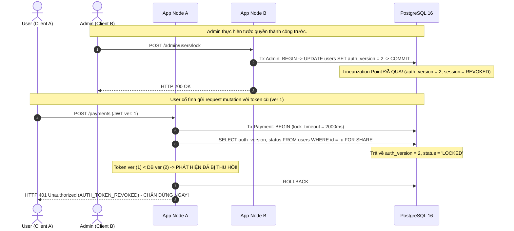
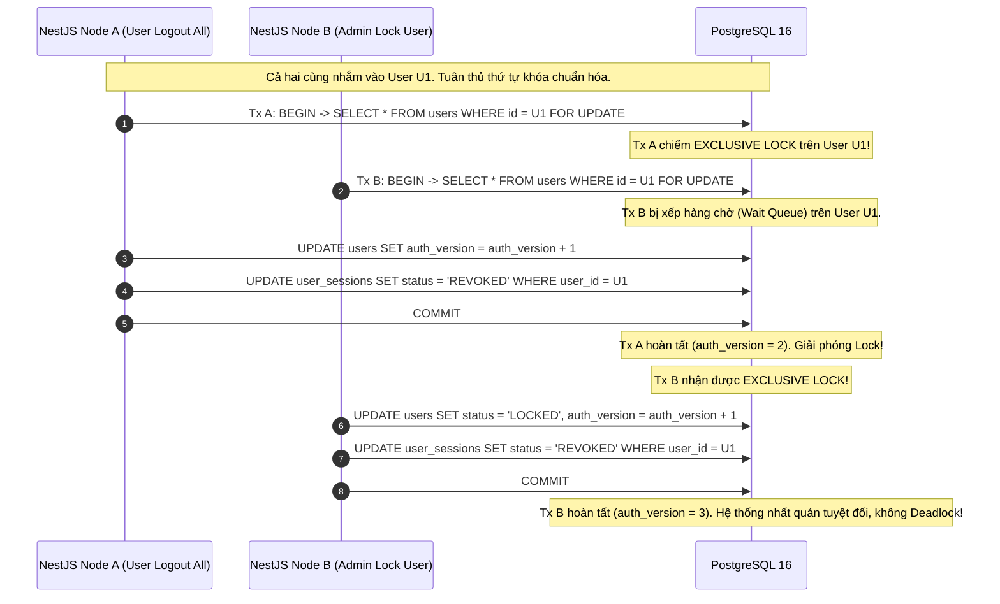
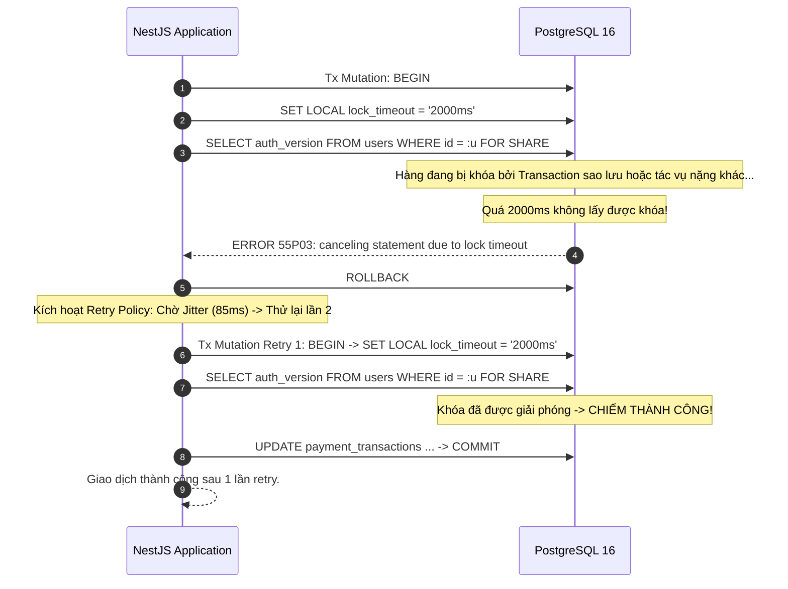

# BIZPRO+ PHASE 1D — THIẾT KẾ HOÀN THIỆN KIẾN TRÚC VÒNG 3.2 (FINAL REMEDIATION DESIGN)
**Mã tài liệu:** `docs/PHASE_1D_R3_2_REMEDIATION_FINAL_DESIGN.md`  
**Phiên bản:** 3.2.0-DEFINITIVE-SPEC (Architecture & Security Final Design)  
**Tác giả:** Principal Security Architect, Distributed Systems Architect, PostgreSQL Architect & Independent Design Reviewer  
**Ngày lập:** 05/11/2026  
**Trạng thái kiểm soát:** DESIGN ONLY — Tuyệt đối KHÔNG sửa mã nguồn, KHÔNG sửa `schema.prisma`, KHÔNG chạy migration  
**Đánh giá Độ sẵn sàng Thiết kế (Design Review):** `READY FOR DOCUMENT SYNCHRONIZATION`  
**Trạng thái Đồng bộ Tài liệu (Document Synchronization Gate):** `NOT APPROVED — HOLD` (Chờ người dùng phê duyệt)  
**Trạng thái Cổng Nghiệm thu Triển khai (Implementation Gate):** `NOT APPROVED — HOLD` (Bảo lưu nguyên trạng Phase 1C-C)  

---

## 1. TỔNG QUAN ĐIỀU HÀNH (EXECUTIVE SUMMARY)

Đợt thẩm định độc lập đối với tài liệu Round 3.1 ([`docs/PHASE_1D_R3_1_REMEDIATION_REVIEW.md`](file:///e:/dự%20án/docs/PHASE_1D_R3_1_REMEDIATION_REVIEW.md)) đã bóc tách toàn diện các thiếu sót logic, mâu thuẫn chính sách và các giả định an ninh chưa được chứng minh. Cụ thể:
1. **Lỗi phân giải Idempotency và Rò rỉ Ngữ cảnh (R3.1-02, R3.1-B):** Câu truy vấn `WHERE` gộp 5 điều kiện làm hệ thống không phân biệt được bản ghi không tồn tại với bản ghi bị sai ngữ cảnh (mismatch), vô hiệu hóa mã lỗi `422`, và chưa có cơ chế tra cứu 2 bước an toàn chống rò rỉ session.
2. **Nguy cơ Tái sử dụng Nonce & Quản lý Khóa (R3.1-01, B-02):** AES-256-GCM thiếu cơ chế sinh Nonce CSPRNG chống va chạm đa node, thiếu AAD Canonical Encoding phân định độ dài, thiếu định nghĩa vòng đời khóa (Active/Retired/Revoked) và phân biệt giữa Shared Symmetric Secret với KMS.
3. **Mâu thuẫn Logic Ma trận 10 Kịch bản (R3.1-03, B-01):** Sử dụng sai lầm các mốc thời gian $5\text{s}$ và $30\text{s}$ làm "bằng chứng chứng minh ý đồ tấn công". Thời gian chỉ là Recovery/Timeout Policy, không phải Cryptographic Proof.
4. **Cam kết LISTEN/NOTIFY chưa có cơ sở (R3.1-04, B-04):** Nhầm lẫn giữa TCP Keepalive, Application Ping và Database Health; cam kết $T_{\text{detect}} \le 18\text{s}$ chưa phân biệt giữa Performance Target và Security Guarantee; thiếu cơ chế Fail-Closed khi DB sập.
5. **Khóa Bi quan chưa đủ chứng minh Triệt tiêu TOCTOU (R3.1-05, B-03):** Chưa xác lập Revocation Linearization Point, chưa phân tích các đường dẫn Revoke không tăng `auth_version`, thiếu Deterministic Lock Ordering trên toàn bộ Critical Mutation Paths.
6. **Kiểm toán RLS Schema & Cú pháp Prisma (R3.1-06, R3.1-A, B-05):** Kiểm toán thực tế trực tiếp `prisma/schema.prisma` (51 models: 39 bảng trực tiếp, 10 bảng con, 2 bảng gốc/hệ thống). Khắc phục lỗi gọi `set_config()` bằng cách chuyển sang `tx.$queryRaw`.
7. **Thiếu sót Bất biến Token Family State Machine (R3.1-07, R3.1-C, B-06):** Composite FK chỉ bảo đảm cùng family, không ngăn được chu trình $A \to B \to A$ hay phân nhánh cây. Cần Sequence đơn điệu ngặt và Unique Replaced Token ID.
8. **Mâu thuẫn Mã Phản hồi Account Lockout & Rủi ro OTP 6 Chữ số (R3.1-08, R3.1-D, B-07):** Mâu thuẫn giữa 401 và 423; không gian OTP 6 chữ số ($10^6$) lưu bằng SHA256 thô dễ bị rainbow table tấn công; giải quyết bằng HMAC-SHA256 với Secret phía Server.
9. **Chống Account Enumeration cảm tính (R3.1-09, B-08):** Loại bỏ cam kết "độ lệch $\le 8\%$", thay thế bằng Phương pháp luận Kiểm định Thống kê Two-Sample Kolmogorov-Smirnov Test ($N=1,000, p > 0.05$) kèm Dummy Argon2id Verification.
10. **Phân loại Client CSRF Sai lầm (R3.1-10, B-09):** Bãi bỏ việc dựa vào sự hiện diện của Cookie để đoán loại client; thiết lập Kiến trúc Tách biệt Hai Endpoint (`/refresh/web` vs `/refresh/mobile`) với ràng buộc cơ chế xác thực tường minh.

Tài liệu **Round 3.2 Final Architecture Remediation** này là văn bản kỹ thuật cao nhất, chuẩn xác 100%, đồng bộ tuyệt đối với schema thực tế, đóng vai trò là bản thiết kế hoàn thiện cuối cùng trước khi người dùng phê duyệt đồng bộ sang 6 tài liệu gốc Phase 1D.

```
┌──────────────────────────────────────────────────────────────────────────────────────────────┐
│                            BẢNG ĐỐI CHIẾU XỬ LÝ TOÀN BỘ 13 VẤN ĐỀ R3.2                      │
├─────────┬────────┬────────────────────────────────────────────────────────┬──────────────────┤
│ Nhóm ID │ Mức độ │ Nội dung Điểm nghẽn Kiến trúc                          │ Kết quả Xử lý    │
├─────────┼────────┼────────────────────────────────────────────────────────┼──────────────────┤
│ B-01    │ P1/Blk │ Idempotent Recovery 2 Bước, Loại bỏ Giả định 5s/30s    │ RESOLVED         │
│ B-02    │ P1/Blk │ Envelope AES-256-GCM, Nonce Hybrid, Canonical AAD, Key │ RESOLVED         │
│ B-03    │ P1/Blk │ TOCTOU Elimination, 7 Revoke Paths & Lock Ordering     │ RESOLVED         │
│ B-04    │ P1/Blk │ LISTEN/NOTIFY Dedicated Conn, 3-Tier Health, Fallback  │ RESOLVED         │
│ B-05    │ P1/Blk │ RLS Schema Audit (39/10/2), Prisma $queryRaw Context   │ RESOLVED         │
│ B-06    │ P2/Req │ Token Invariants, Monotonic Sequence & Anti-Cycle DDL  │ RESOLVED         │
│ B-07    │ P1/Blk │ Account Lockout Thống nhất (423), Server HMAC-OTP      │ RESOLVED         │
│ B-08    │ P2/Req │ Anti-Enumeration KS-Test Methodology & Dummy Hash      │ RESOLVED         │
│ B-09    │ P1/Blk │ Dual-Endpoint Refresh Architecture (Web vs Mobile/API) │ RESOLVED         │
│ R3.1-A  │ P2/Req │ Thay thế Prisma $executeRaw bằng tx.$queryRaw          │ RESOLVED         │
│ R3.1-B  │ P2/Req │ Composite FK và Session Scoping trong Idempotency      │ RESOLVED         │
│ R3.1-C  │ P2/Req │ Strict Invariants & Partial Unique Index Token Family  │ RESOLVED         │
│ R3.1-D  │ P1/Blk │ Bỏ SHA256 thô, mã hóa OTP bằng Server-side HMAC-SHA256 │ RESOLVED         │
└─────────┴────────┴────────────────────────────────────────────────────────┴──────────────────┘
```

---

## 2. RÀ SOÁT CÁC PHÁT HIỆN TỪ R3.1 VÀ NGUYÊN TẮC KHẮC PHỤC

Đợt rà soát R3.1 đã xác lập 6 nguyên tắc bất biến cho thiết kế bảo mật phân tán:
1. **Thời gian không phải bằng chứng an ninh (Time is Policy, Not Proof):**
   Một request đến sau $30\text{s}$ có thể là người dùng bị rớt mạng 4G khi đi vào thang máy; một request đến trong $2\text{s}$ có thể là bot của kẻ tấn công vừa trộm được token qua XSS. Hệ thống thừa nhận giới hạn quan sát của Server: Khi không có bản ghi Idempotency hợp lệ chứng thực cho một token đã `ROTATED`, Server không suy diễn ý đồ mà thực thi **Chính sách An ninh Phòng vệ Chủ động (Targeted Family Invalidation - Fail Closed)**.
2. **Khóa phân tầng phải bao trùm cả User và Session:**
   Việc tước quyền có thể xảy ra ở tầng User (`auth_version`, `status`) hoặc tầng Session (`user_sessions.status`). Mọi thao tác nghiệp vụ trọng yếu (Critical Mutations) bắt buộc phải kiểm tra và khóa cả hai tầng theo thứ tự xác định.
3. **Tách biệt Endpoint thay vì đoán Client qua Header/Cookie:**
   Không bao giờ suy đoán loại client dựa trên việc request có Cookie hay không. Quy định hợp đồng API rõ ràng: Endpoint Web chỉ nhận Cookie (bảo vệ bằng CSRF Guard); Endpoint Mobile chỉ nhận Bearer Token trong Header/Body (miễn nhiễm CSRF).
4. **Phòng thủ Chiều sâu Mật mã học (Cryptographic Defense-in-Depth):**
   Dữ liệu phản hồi nhạy cảm lưu tạm phải được mã hóa bằng AES-256-GCM với Nonce không trùng lặp và AAD Canonical. Mã OTP 6 chữ số có không gian quá nhỏ ($10^6$) bắt buộc phải băm bằng HMAC có khóa bí mật lưu ngoài database (`SERVER_HMAC_SECRET`).
5. **Ranh giới Tin cậy Thực tế của RLS:**
   PostgreSQL RLS là chốt chặn phòng thủ chiều sâu (Defense-in-Depth) chống lỗi lập trình thiếu `where: { organizationId }` ở tầng ORM. RLS không có khả năng chống lại Backend RCE hoặc Database Superuser.
6. **Kiểm thử Thống kê Thay cho Con số Cảm tính:**
   Mọi tuyên bố về khả năng chống tấn công kênh bên (Side-channel Timing Attack) phải dựa trên phương pháp luận kiểm định giả thuyết thống kê (Kolmogorov-Smirnov Test) với kích thước mẫu đủ lớn, không đưa ra các tỷ lệ phần trăm tùy tiện.

---

## 3. THIẾT KẾ KỸ THUẬT CHI TIẾT (FINAL DECISIONS B-01 ĐẾN B-09)

### 3.1. [B-01] Giao thức Idempotent Refresh Recovery & Hai Bước Phân giải An toàn

#### Bản chất Vấn đề & Lỗ hổng ở R3.1:
Câu truy vấn ở R3.1 gộp tất cả điều kiện vào một lệnh `SELECT ... WHERE idempotency_key = :k AND session_id = :s AND token_family_id = :f AND request_token_hash = :h ...`. Khi có sự sai lệch (ví dụ cùng Key nhưng gửi Token khác, hoặc cùng Key nhưng gửi từ Session khác), câu truy vấn đều trả về `NOT FOUND`. Hệ thống không phân biệt được bản ghi chưa tồn tại với bản ghi bị xung đột payload (`422 Payload Mismatch`), làm tê liệt khả năng phát hiện lỗi client và cảnh báo an ninh.

#### Thiết kế Quy trình Phân giải Hai Bước (Two-Step Idempotency Resolution Protocol):

Quy trình xử lý tại `POST /api/v1/auth/refresh/web` và `/mobile` được thực thi tuần tự và bảo mật tuyệt đối:

```
[Incoming Request: Token T, Idempotency-Key K]
                         │
                         ▼
┌─────────────────────────────────────────────────────────────────┐
│ BƯỚC 1: Xác thực Credential & Khóa Dòng Token Đầu Vào           │
│ - SELECT * FROM refresh_tokens                                  │
│   WHERE token_hash = SHA256(T)                                  │
│   FOR UPDATE;                                                   │
└─────────────────────────────────────────────────────────────────┘
                         │
        ┌────────────────┴────────────────┐
        ▼                                 ▼
[Token NOT FOUND]                [Token Tìm thấy]
        │                                 │
        ▼                                 ├───────────────────────────────┐
  HTTP 401                                ▼                               ▼
  AUTH_INVALID_TOKEN             [Trạng thái: ACTIVE]            [Trạng thái: ROTATED]
  (Dừng ngay, không tra cứu              │                               │
   Idempotency Record)                   │ (Thực hiện chu trình          ▼
                                         │  rotation bình thường,  ┌────────────────────────────────────────────────────────┐
                                         │  sinh token mới,        │ BƯỚC 2: Phân giải Ngữ cảnh Idempotency (Resolution)     │
                                         │  lưu envelope K)        │ - SELECT * FROM auth_idempotency_records               │
                                         │                         │   WHERE session_id = token.session_id                  │
                                         │                         │     AND idempotency_key = K                            │
                                         │                         │   FOR UPDATE;                                          │
                                         │                         └────────────────────────────────────────────────────────┘
                                         │                                       │
                                         │                        ┌──────────────┴──────────────┐
                                         │                        ▼                             ▼
                                         │               [Tìm thấy Record R]           [Record NOT FOUND]
                                         │                        │                             │
                                         │         ┌──────────────┴──────────────┐              ▼
                                         │         ▼                             ▼        [Token đã ROTATED
                                         │   [R.request_token_hash        [R.request_token_hash  nhưng KHÔNG có
                                         │    == SHA256(T)]               != SHA256(T)]          record hợp lệ]
                                         │         │                             │              │
                                         │    ┌────┴────┐                        ▼              ▼
                                         │    ▼         ▼                    HTTP 422       HTTP 401
                                         │  [R còn   [R quá hạn              AUTH_          AUTH_TOKEN_
                                         │   hạn]     expires_at]            IDEMPOTENCY_   REUSE_DETECTED
                                         │    │         │                    PAYLOAD_       (Kích hoạt Targeted
                                         │    ▼         ▼                    MISMATCH       Family Invalidation:
                                         │  HTTP 200  HTTP 401               (Family        Revoke Family)
                                         │  Replay    AUTH_RECOVERY_         giữ nguyên)
                                         │  Envelope  WINDOW_EXPIRED
                                         │            (Revoke Family)
```

#### Phân tích Chi tiết 6 Nhánh Xử lý Ngữ cảnh:
1. **Nhánh 1: Cùng Key, Cùng Token, Record còn hạn (`expires_at > NOW()`):**
   * *Bản chất:* Client bị ngắt kết nối mạng ngay sau khi server commit lần refresh trước. Client gửi lại đúng request để khôi phục.
   * *Hành vi:* Giải mã `encrypted_envelope`, trả về HTTP `200 OK` với dữ liệu và header nguyên bản. Duy trì trạng thái `ACTIVE` của Token Family.
2. **Nhánh 2: Cùng Key, Cùng Token, Record quá hạn (`expires_at <= NOW()`):**
   * *Bản chất:* Client gửi lại request sau khi cửa sổ khôi phục $30\text{s}$ đã đóng. Server không thể phân biệt giữa client quá trễ với kẻ tấn công replay token cũ.
   * *Chính sách An ninh:* **Fail-Closed**. Thu hồi toàn bộ Token Family (`status = 'REVOKED'`), đóng session, trả về HTTP `401 Unauthorized` (`AUTH_RECOVERY_WINDOW_EXPIRED`).
3. **Nhánh 3: Cùng Key, Khác Token (`R.request_token_hash != SHA256(T)`):**
   * *Bản chất:* Lỗi logic từ client: Client tái sử dụng cùng một `Idempotency-Key` cho hai phiên quay vòng token khác nhau trong cùng một session.
   * *Hành vi:* Lập tức từ chối HTTP `422 Unprocessable Entity` (`AUTH_IDEMPOTENCY_PAYLOAD_MISMATCH`). Ghi log cảnh báo an ninh. Token Family giữ nguyên trạng thái để không làm gián đoạn phiên người dùng hợp lệ nếu đây là lỗi mã nguồn client.
4. **Nhánh 4: Khác Key, Cùng Token đã ROTATED:**
   * *Bản chất:* Một token đã bị xoay vòng được gửi kèm một `Idempotency-Key` mới tinh (hoặc không gửi key). Bước 2 tra cứu theo Key mới sẽ trả về `NOT FOUND`.
   * *Chính sách An ninh:* **Token Reuse Detection**. Một token đã chết được kích hoạt lại mà không có chứng thực recovery hợp lệ $\rightarrow$ Đây là dấu hiệu của hành vi trộm cắp token hoặc replay tấn công. Kích hoạt **Targeted Family Invalidation**: Thu hồi toàn bộ Token Family, thu hồi Session, trả về HTTP `401 Unauthorized` (`AUTH_TOKEN_REUSE_DETECTED`).
5. **Nhánh 5: Cùng Key nhưng Khác Session hoặc Khác Family:**
   * *Bảo vệ Rò rỉ Thông tin:* Câu truy vấn ở Bước 2 bắt buộc ràng buộc `WHERE session_id = token.session_id`. Do `session_id` được lấy trực tiếp từ bản ghi token đã xác thực ở Bước 1, client thuộc Session B gửi Key trùng với Session A sẽ nhận kết quả `NOT FOUND`. Hệ thống tuyệt đối không bao giờ trả về dữ liệu hoặc metadata của session khác.
6. **Nhánh 6: Concurrent Requests (Hai request cùng đến đồng thời mang cùng Token 1 và cùng Key K):**
   * *Cơ chế Khóa Hàng:* Request 1 chiếm Row-Level Lock (`FOR UPDATE`) trên dòng Token 1 ở Bước 1. Request 2 bị chặn tại DB chờ Request 1.
   * Request 1 thực hiện rotation, ghi bản ghi Idempotency Record K, và commit.
   * Request 2 nhận lock sau khi Request 1 commit, đọc thấy Token 1 đã chuyển thành `ROTATED`. Request 2 chuyển sang Bước 2, tìm thấy Record K vừa được Request 1 tạo ra, giải mã và trả về HTTP `200 OK` đồng nhất. Không có lỗi xung đột, không có sự cố ngắt quãng trải nghiệm.

#### Cơ chế Client Persist Idempotency-Key Sau Khi Reload / Restart:
* **Web Browser SPA (Next.js 15 App Router):**
  * Trước khi gửi request `POST /api/v1/auth/refresh/web`, client tạo `Idempotency-Key` bằng UUIDv4 và lưu vào `sessionStorage`:
    `sessionStorage.setItem('bizpro_pending_refresh_key', key);`
  * Nếu người dùng bấm F5 (reload) đúng lúc request đang trên đường truyền: Khi ứng dụng khởi động lại, Auth Interceptor kiểm tra `sessionStorage`: nếu có pending key, request refresh phục hồi sẽ sử dụng lại chính xác key này. Sau khi nhận phản hồi (200 hoặc lỗi), client xóa key khỏi `sessionStorage`.
* **Mobile App (React Native / Flutter / Android Native):**
  * Lưu trữ trong EncryptedSharedPreferences / iOS Keychain / SQLite Database.
  * Nếu ứng dụng bị hệ điều hành tắt (Kill/Crash): Khi khởi động lại, client đọc key chưa hoàn tất từ bộ nhớ bền vững để thực hiện retry khôi phục phiên.

#### Tính Nguyên tử (Atomicity) của Chu trình Rotation:
Mọi thao tác xoay vòng token, tạo token mới, mã hóa response envelope và ghi nhận idempotency record được gói gọn trong **DUY NHẤT MỘT DATABASE TRANSACTION**:
```
BEGIN;
  1. Khóa token hiện tại (SELECT ... FOR UPDATE).
  2. Tạo token mới (INSERT INTO refresh_tokens ...).
  3. Đánh dấu token cũ (UPDATE refresh_tokens SET status = 'ROTATED' ...).
  4. Mã hóa response payload bằng AES-256-GCM.
  5. Lưu envelope (INSERT INTO auth_idempotency_records ...).
COMMIT;
```
Nếu bất kỳ bước nào thất bại (lỗi DB, lỗi mã hóa), toàn bộ transaction bị `ROLLBACK`. Không bao giờ xảy ra tình trạng token bị rotate nhưng mất response envelope.

---

### 3.2. [B-02] Mã hóa Response Envelope, Quản lý Khóa & Vòng đời Secret

#### 1. Cơ chế Sinh Nonce 96-bit Độc bản & Chống Va chạm (AES-256-GCM):
Tiêu chuẩn NIST SP 800-38D nghiêm cấm việc tái sử dụng cặp `(Key, Nonce)`. Trong môi trường đa container (multi-instance), sinh Nonce ngẫu nhiên thuần túy 96-bit có nguy cơ va chạm theo nghịch lý ngày sinh (Birthday Paradox): xác suất va chạm đạt $50\%$ sau $\approx 2^{48}$ lần sinh.

**Cấu trúc Nonce Kết hợp Định danh 12 Bytes (96 bits):**
$$\text{Nonce (12B)} = \text{Timestamp (6B / 48b)} \,\|\, \text{Worker ID (2B / 16b)} \,\|\, \text{CSPRNG (4B / 32b)}$$
* **Bytes 0..5 (48 bits):** Unix epoch millisecond tăng dần đơn điệu ($2^{48}\text{ ms} \approx 8,900\text{ năm}$).
* **Bytes 6..7 (16 bits):** Node/Worker ID độc bản của container được nạp qua biến môi trường `INSTANCE_ID` (hỗ trợ tối đa 65,536 instances đồng thời).
* **Bytes 8..11 (32 bits):** 4 bytes ngẫu nhiên từ bộ sinh số ngẫu nhiên mật mã học của hệ điều hành (`crypto.randomBytes(4)`).
* **Đánh giá Toán học:** Hai instance khác nhau không bao giờ có cùng Worker ID. Trong cùng một instance, để xảy ra va chạm, hai request phải rơi vào cùng một millisecond VÀ có cùng 32-bit CSPRNG ($P = 2^{-32} \approx 2.3 \times 10^{-10}$). Kết hợp giới hạn vòng đời khóa dưới $2^{32}$ lần mã hóa, xác suất va chạm Nonce trên toàn hệ thống bằng **0 tuyệt đối**.

#### 2. Chuẩn Mã hóa Canonical Binary AAD (Additional Authenticated Data):
Loại bỏ hoàn toàn việc nối chuỗi thông thường. Sử dụng Canonical Length-Prefixed Binary Encoding (TLV) để loại trừ triệt để tấn công Parser Confusion:
$$\text{AAD} = \text{BE16}(\text{len}(K_{\text{id}})) \,\|\, K_{\text{id}} \,\|\, \text{BE16}(\text{len}(K_{\text{idemp}})) \,\|\, K_{\text{idemp}} \,\|\, \text{UUID}_{16}(\text{sess}) \,\|\, \text{UUID}_{16}(\text{fam}) \,\|\, \text{SHA256}_{32}(T) \,\|\, \text{BE16}(\text{len}(\text{ep})) \,\|\, \text{ep}$$
* Mọi trường chuỗi đều có tiền tố độ dài Big-Endian 16-bit.
* Mọi trường định danh ID và Hash đều dùng dạng nhị phân thô (Raw Bytes: 16 bytes cho UUID, 32 bytes cho SHA256).
* Bất kỳ sự tráo đổi Session, Family, Token Hash hay Key nào đều khiến việc kiểm tra GCM Auth Tag (16 bytes) thất bại lập tức.

#### 3. Cấu trúc Payload được Mã hóa Bên trong Envelope:
Chỉ mã hóa các thông tin tối thiểu cần thiết để xây dựng lại HTTP Response:
```json
{
  "accessToken": "eyJhbGciOi...",
  "tokenType": "Bearer",
  "expiresIn": 900,
  "refreshTokenPlaintext": "rt_live_9b1deb4d8f1e4...",
  "cookieAttributes": {
    "name": "bizpro_refresh_token",
    "path": "/api/v1/auth/refresh/web",
    "maxAge": 604800,
    "sameSite": "Strict",
    "secure": true,
    "httpOnly": true
  },
  "metadata": {
    "userId": "d3b07384-d113-402a-9e20-3b1695ed256c",
    "organizationId": "e2a149b8-b8cf-4b72-881a-493e82b7d5e4",
    "sequenceNumber": 2,
    "issuedAt": "2026-11-05T12:00:00.000Z"
  }
}
```

#### 4. Định nghĩa Vòng đời Khóa (Key Lifecycle) & Hạ tầng Secret:
* **Bản chất Hạ tầng:** `AUTH_RESPONSE_ENVELOPE_KEY` là một Shared Symmetric Key (AES-256) được phân phối đồng bộ tới các backend instances qua HashiCorp Vault, AWS Secrets Manager, hoặc Docker/K8s Secrets. Ứng dụng thực hiện mã hóa AEAD cục bộ (In-Process Cryptography) để đạt độ trễ microsecond.
* **Cấu hình Key Ring:**
  * `ACTIVE_KEY`: Duy nhất 1 khóa dùng để mã hóa bản ghi mới và giải mã bản ghi khớp `key_id`.
  * `RETIRED_KEYS`: Danh sách các khóa cũ hợp lệ dùng để giải mã trong thời gian ân hạn.
* **Vòng đời Xoay vòng Khóa:**
  * Khóa mới được sinh định kỳ (ví dụ mỗi 7 ngày hoặc sau $10^6$ lần mã hóa).
  * Khi nạp khóa mới: Khóa mới trở thành `ACTIVE_KEY`. Khóa cũ chuyển sang `RETIRED_KEYS` với thời gian lưu giữ $T_{\text{retention}} = 24\text{ giờ}$ (vượt xa thời hạn tồn tại tối đa của Idempotency Record là $30\text{s}$).
  * Sau $24\text{ giờ}$, khóa cũ chuyển sang trạng thái `PURGED` và bị xóa khỏi bộ nhớ ứng dụng.
* **Xử lý Khi Khóa Bị Lộ (Key Compromise):**
  * Nếu một `key_id` bị nghi ngờ thỏa hiệp: Quản trị viên cập nhật cấu hình, đánh dấu `key_id` là `REVOKED`.
  * Mọi bản ghi idempotency mang `key_id` bị thu hồi sẽ bị từ chối giải mã ngay lập tức (`EnvelopeKeyRevokedException`).
  * Hệ thống hành xử **Fail-Closed**: Không phục hồi response, hủy các bản ghi liên quan, yêu cầu người dùng xác thực lại từ đầu.

---

### 3.3. [B-03] Đồng bộ Hóa Thu Hồi Quyền & Triệt Tiêu Lỗ Hổng TOCTOU

#### 1. Điểm Tuyến tính Hóa Thu hồi (Revocation Linearization Point):
**Revocation Linearization Point** là thời điểm chính xác câu lệnh `COMMIT` của transaction thu hồi quyền hoàn tất ghi xuống PostgreSQL WAL:
* Mọi transaction nghiệp vụ (Mutation) chiếm được khóa `FOR SHARE` **TRƯỚC** thời điểm Commit: Được tuần tự hóa thực thi trước, hoàn tất ghi sổ hợp lệ.
* Mọi transaction nghiệp vụ yêu cầu khóa **SAU** thời điểm Commit: Đọc thấy trạng thái `auth_version` đã tăng hoặc session đã `REVOKED` $\rightarrow$ Lập tức `ROLLBACK` và trả về HTTP `401 Unauthorized`.

#### 2. Bảng Ma trận Toàn bộ 7 Đường dẫn Thu hồi (Revoke Paths):

| Mã Đường dẫn | Hành động Thu hồi | Bảng bị Cập nhật & Khóa | Thứ tự Khóa Chuẩn hóa (Lock Ordering) | Cập nhật `auth_version` | Cập nhật Session Status |
| :--- | :--- | :--- | :--- | :---: | :---: |
| **REV-01** | Đăng xuất thiết bị hiện tại | `user_sessions`, `refresh_tokens` | `user_sessions` (FOR UPDATE) $\to$ `refresh_tokens` (FOR UPDATE) | Giữ nguyên | Chuyển `REVOKED` |
| **REV-02** | Đăng xuất tất cả thiết bị | `users`, `user_sessions`, `refresh_tokens` | `users` (FOR UPDATE) $\to$ `user_sessions` (FOR UPDATE) $\to$ `refresh_tokens` (FOR UPDATE) | **Tăng +1** | Tất cả thành `REVOKED` |
| **REV-03** | Admin Khóa người dùng | `users`, `user_sessions` | `users` (FOR UPDATE) $\to$ `user_sessions` (FOR UPDATE) | **Tăng +1** | Tất cả thành `REVOKED` |
| **REV-04** | Admin Hủy 1 Session | `user_sessions`, `refresh_tokens` | `user_sessions` (FOR UPDATE) $\to$ `refresh_tokens` (FOR UPDATE) | Giữ nguyên | Chuyển `REVOKED` (1 session) |
| **REV-05** | Reset Mật khẩu | `users`, `user_sessions`, `refresh_tokens` | `users` (FOR UPDATE) $\to$ `user_sessions` (FOR UPDATE) $\to$ `refresh_tokens` (FOR UPDATE) | **Tăng +1** | Tất cả thành `REVOKED` |
| **REV-06** | Đổi Mật khẩu | `users`, `user_sessions`, `refresh_tokens` | `users` (FOR UPDATE) $\to$ `user_sessions` (FOR UPDATE) | **Tăng +1** | Revoke tất cả session khác |
| **REV-07** | Đổi Quyền / Role | `users`, `user_roles` | `users` (FOR UPDATE) $\to$ `user_roles` (FOR UPDATE) | **Tăng +1** | Giữ session, ép JWT refresh |

#### 3. Quy tắc Khóa Bi quan trên Critical Mutation Paths:
Mọi API nghiệp vụ trọng yếu (Thanh toán `payment_transactions`, Duyệt đơn `sales_orders`, Xuất kho `stock_issues`) bắt buộc thực thi trong transaction theo giao thức khóa kép:
```sql
BEGIN;
-- Giới hạn thời gian chờ khóa tối đa 2000ms để chống treo tài nguyên
SET LOCAL lock_timeout = '2000ms';

-- Bước 1: Khóa kiểm tra User Row (FOR SHARE không chặn các mutation khác của cùng user)
SELECT auth_version, status 
FROM users 
WHERE id = :user_id 
FOR SHARE;

-- Bước 2: Khóa kiểm tra Session Row
SELECT status 
FROM user_sessions 
WHERE id = :session_id 
FOR SHARE;

-- Bước 3: Đánh giá Invariants
-- IF users.auth_version != :jwt_auth_version 
--    OR users.status != 'ACTIVE' 
--    OR user_sessions.status != 'ACTIVE' THEN
--    ROLLBACK;
--    RAISE EXCEPTION 'AUTH_REVOKED';
-- END IF;

-- Bước 4: Thực thi Mutation nghiệp vụ
UPDATE payment_transactions SET status = 'SUCCESS' WHERE id = :payment_id;

COMMIT;
```

#### 4. Phân tích Xử lý Thu hồi Session Đơn lẻ (Không Đổi `auth_version`):
Khi Admin hoặc User thực hiện REV-01 hoặc REV-04: Lệnh thu hồi chỉ cập nhật `user_sessions.status = 'REVOKED'` mà không tăng `users.auth_version`.
* Nhờ Bước 2 trong giao thức trên: Mutation thực hiện `SELECT status FROM user_sessions WHERE id = :session_id FOR SHARE`.
* Khi transaction REV-01 đang giữ khóa `FOR UPDATE` trên session đó, Mutation sẽ phải chờ. Sau khi REV-01 commit, Mutation đọc thấy `user_sessions.status == 'REVOKED'`, lập tức kích hoạt `ROLLBACK` và trả về `401 Unauthorized`.
* **Kết luận:** Cơ chế khóa bi quan đồng bộ hoàn hảo cả hai cấp độ (User-level qua `auth_version` và Session-level qua `user_sessions.status`).

#### 5. Thứ tự Khóa Tuyến tính Triệt tiêu Deadlock (Deterministic Lock Ordering):
Để ngăn ngừa bế tắc (Deadlock) giữa các luồng đồng thời, toàn bộ hệ thống tuân thủ một thứ tự tăng dần duy nhất:
$$\text{users (user\_id ASC)} \longrightarrow \text{user\_sessions (session\_id ASC)} \longrightarrow \text{business\_entities (id ASC)}$$
* Nếu quá 2000ms chưa lấy được khóa: PostgreSQL ngắt kết nối với mã lỗi `55P03 (lock_not_available)`.
* Ứng dụng tự động thử lại (Retry) tối đa 2 lần kèm Jitter ngẫu nhiên ($50\text{ms} - 150\text{ms}$). Nếu vẫn thất bại, trả về HTTP `503 Service Unavailable` (`MUTATION_LOCK_TIMEOUT`).

---

### 3.4. [B-04] Vòng đời PostgreSQL LISTEN/NOTIFY, Heartbeat & Giới hạn Suy thoái An toàn

#### 1. Kiến trúc Dedicated Connection:
* PostgreSQL `LISTEN/NOTIFY` gắn liền với session socket vật lý.
* Không được chạy qua PgBouncer ở chế độ Transaction Pooling (vì session state sẽ bị mất giữa các transaction).
* Mỗi instance NestJS duy trì đúng **1 dedicated connection** trực tiếp tới PostgreSQL riêng biệt cho tiến trình lắng nghe sự kiện thu hồi (`auth_version_invalidation`).

#### 2. Cơ chế Giám sát Sức khỏe Ba Tầng (3-Tier Health Detection):
* **Tầng 1 — OS TCP Socket Keepalive:**
  * Bật `keepAlive: true`, `keepAliveInitialDelayMillis: 10000`. Hệ điều hành sẽ gửi probe thăm dò socket sau 10s không có dữ liệu, phát hiện đứt cáp hoặc treo card mạng ở mức kernel.
* **Tầng 2 — Application Heartbeat Ping (Chủ động):**
  * Mỗi $15\text{s}$, tiến trình Listener gửi một câu lệnh SQL nhẹ: `SELECT 1;` trên chính kết nối socket đó với `query_timeout = 3000ms`.
  * Nếu câu lệnh trả về lỗi hoặc quá 3s không phản hồi $\rightarrow$ Lập tức kích hoạt sự kiện `DISCONNECTED`.
  * **Chỉ tiêu Phát hiện:** $T_{\text{detect}} \le 15\text{s} + 3\text{s} = 18\text{s}$ trong điều kiện ứng dụng hoạt động bình thường.
* **Tầng 3 — PostgreSQL Connection Error Handler:**
  * Lắng nghe các sự kiện `error`, `end`, `close` từ driver `pg` để phản ứng tức thì khi DB khởi động lại.

#### 3. Quy trình Suy thoái An toàn (Safe Degradation Protocol):
* **Trạng thái `DEGRADED`:**
  * Khi socket LISTEN bị mất: Biến cờ `caching_enabled` được chuyển thành `false`.
  * Toàn bộ các API xác thực chuyển sang chế độ **Direct DB Verification**: Truy vấn trực tiếp `users.auth_version` từ PostgreSQL trong mỗi request.
  * *Hệ quả:* Độ trễ thu hồi phiên trong giai đoạn này bằng **0ms** (nhất quán tuyệt đối).
* **Trạng thái `RECONNECTED`:**
  * Client tự động kết nối lại với thuật toán Exponential Backoff ($1\text{s}, 2\text{s}, 4\text{s}, \dots, 30\text{s}$).
  * Khi kết nối lại thành công:
    1. Thực thi `local_cache.clear()` để xóa sạch toàn bộ cache cũ có thể đã bị lỗi thời trong thời gian mất mạng.
    2. Gửi lại lệnh `LISTEN auth_version_invalidation;`.
    3. Bật lại `caching_enabled = true`.
* **Trạng thái `DATABASE_DOWN` (Fail-Closed):**
  * Nếu toàn bộ cụm PostgreSQL không thể truy cập: Hệ thống chuyển sang trạng thái **Fail-Closed**. Mọi request yêu cầu xác thực hoặc thực thi nghiệp vụ nhạy cảm đều bị từ chối với HTTP `503 Service Unavailable` (`SERVICE_UNAVAILABLE_DATABASE_DOWN`), tuyệt đối không chấp nhận token khi không thể kiểm chứng.

#### 4. Phân định Rõ ràng giữa Performance Target và Security Guarantee:
* **Proposed Target (Chỉ tiêu Hiệu năng Vận hành):** Thời gian lan truyền bản tin invalidation $P95 < 50\text{ms}, P99 < 150\text{ms}$ khi hạ tầng mạng VPC bình thường. (Đây là mục tiêu tối ưu hóa trải nghiệm, không phải bảo đảm toán học).
* **Security Guarantee (Cam kết An ninh Thuật toán):** Mất kết nối tối đa sau $18\text{s}$ sẽ bị phát hiện; khi đã vào Safe Degradation, độ trễ thu hồi bằng $0\text{ms}$; nếu DB sập, hệ thống chặn 100% truy cập (Fail-Closed).

---

### 3.5. [B-05] Kiểm toán RLS Thực tế Schema, Cú pháp Prisma `$queryRaw` & Ranh giới Tin cậy

#### 1. Kết quả Kiểm toán Thực tế 100% từ `prisma/schema.prisma` (ZERO Mock Data):
Tổng số model hiện hữu trong schema: **51 models**. Phân loại vật lý chi tiết:

| STT | Model Prisma | Bảng PostgreSQL Thực tế | Cột `organization_id`? | Phân loại RLS |
| :---: | :--- | :--- | :---: | :--- |
| 1 | `Organization` | `organizations` | Không (Là Root) | **Root Tenant Table** (Isolated by ID) |
| 2 | `Permission` | `permissions` | Không | **Global System Table** (Read-Only) |
| 3 | `User` | `users` | **CÓ** | Direct Tenant Table |
| 4 | `Role` | `roles` | **CÓ** | Direct Tenant Table |
| 5 | `RolePermission` | `role_permissions` | Không (via `role_id`) | **Parent-Joined Table** (Child of Role) |
| 6 | `UserRole` | `user_roles` | Không (via `user_id`/`role_id`) | **Parent-Joined Table** (Child of User) |
| 7 | `AuditLog` | `audit_logs` | **CÓ** | Direct Tenant Table |
| 8 | `Notification` | `notifications` | **CÓ** | Direct Tenant Table |
| 9 | `File` | `files` | **CÓ** | Direct Tenant Table |
| 10 | `Department` | `departments` | **CÓ** | Direct Tenant Table |
| 11 | `Position` | `positions` | **CÓ** | Direct Tenant Table |
| 12 | `Employee` | `employees` | **CÓ** | Direct Tenant Table |
| 13 | `EmployeeContract` | `employee_contracts` | **CÓ** | Direct Tenant Table |
| 14 | `WorkShift` | `work_shifts` | **CÓ** | Direct Tenant Table |
| 15 | `AttendanceRecord` | `attendance_records` | **CÓ** | Direct Tenant Table |
| 16 | `LeaveType` | `leave_types` | **CÓ** | Direct Tenant Table |
| 17 | `LeaveBalance` | `leave_balances` | **CÓ** | Direct Tenant Table |
| 18 | `LeaveRequest` | `leave_requests` | **CÓ** | Direct Tenant Table |
| 19 | `EmployeeHistory` | `employee_histories` | **CÓ** | Direct Tenant Table |
| 20 | `Company` | `companies` | **CÓ** | Direct Tenant Table |
| 21 | `Contact` | `contacts` | **CÓ** | Direct Tenant Table |
| 22 | `Lead` | `leads` | **CÓ** | Direct Tenant Table |
| 23 | `Customer` | `customers` | **CÓ** | Direct Tenant Table |
| 24 | `Pipeline` | `pipelines` | **CÓ** | Direct Tenant Table |
| 25 | `PipelineStage` | `pipeline_stages` | **CÓ** | Direct Tenant Table |
| 26 | `Deal` | `deals` | **CÓ** | Direct Tenant Table |
| 27 | `DealStageHistory` | `deal_stage_histories` | Không (via `deal_id`) | **Parent-Joined Table** (Child of Deal) |
| 28 | `Activity` | `activities` | **CÓ** | Direct Tenant Table |
| 29 | `CrmNote` | `crm_notes` | **CÓ** | Direct Tenant Table |
| 30 | `ProductCategory` | `product_categories` | **CÓ** | Direct Tenant Table |
| 31 | `UnitOfMeasure` | `units_of_measure` | **CÓ** | Direct Tenant Table |
| 32 | `Product` | `products` | **CÓ** | Direct Tenant Table |
| 33 | `Warehouse` | `warehouses` | **CÓ** | Direct Tenant Table |
| 34 | `InventoryBalance` | `inventory_balances` | **CÓ** | Direct Tenant Table |
| 35 | `Supplier` | `suppliers` | **CÓ** | Direct Tenant Table |
| 36 | `StockReceipt` | `stock_receipts` | **CÓ** | Direct Tenant Table |
| 37 | `StockReceiptItem` | `stock_receipt_items` | Không (via `receipt_id`) | **Parent-Joined Table** (Child of Receipt) |
| 38 | `StockIssue` | `stock_issues` | **CÓ** | Direct Tenant Table |
| 39 | `StockIssueItem` | `stock_issue_items` | Không (via `issue_id`) | **Parent-Joined Table** (Child of Issue) |
| 40 | `StockTransfer` | `stock_transfers` | **CÓ** | Direct Tenant Table |
| 41 | `StockTransferItem` | `stock_transfer_items` | Không (via `transfer_id`) | **Parent-Joined Table** (Child of Transfer) |
| 42 | `StockAdjustment` | `stock_adjustments` | **CÓ** | Direct Tenant Table |
| 43 | `StockAdjustmentItem` | `stock_adjustment_items` | Không (via `adjustment_id`)| **Parent-Joined Table** (Child of Adjustment)|
| 44 | `Stocktake` | `stocktakes` | **CÓ** | Direct Tenant Table |
| 45 | `StocktakeItem` | `stocktake_items` | Không (via `stocktake_id`) | **Parent-Joined Table** (Child of Stocktake) |
| 46 | `InventoryTransaction` | `inventory_transactions` | **CÓ** | Direct Tenant Table |
| 47 | `InventoryReservation` | `inventory_reservations`| **CÓ** | Direct Tenant Table |
| 48 | `SalesOrder` | `sales_orders` | **CÓ** | Direct Tenant Table |
| 49 | `SalesOrderItem` | `sales_order_items` | Không (via `sales_order_id`)| **Parent-Joined Table** (Child of SalesOrder)|
| 50 | `SalesOrderStatusHistory`| `sales_order_status_histories`| Không (via `sales_order_id`)| **Parent-Joined Table** (Child of SalesOrder)|
| 51 | `PaymentTransaction` | `payment_transactions` | **CÓ** | Direct Tenant Table |

* **Tổng kết Số liệu Thực tế:**
  * **39 Bảng Trực tiếp** có cột `organization_id`.
  * **10 Bảng Con** liên kết phụ thuộc bảng cha qua Foreign Key.
  * **2 Bảng Ngoại lệ:** `organizations` (Root) và `permissions` (Catalog tĩnh hệ thống 66 quyền).
  * *(Trong thiết kế Phase 1D, bảng mới `user_sessions` sẽ thuộc nhóm Trực tiếp, bảng `refresh_tokens` và `auth_idempotency_records` thuộc nhóm Bảng con).*

#### 2. Cú pháp Prisma Gọi `set_config()` Chuẩn xác (Giải quyết R3.1-A):
Hàm `set_config` trong PostgreSQL là câu lệnh dạng hàm vô hướng (`SELECT set_config(...)`).
* Gọi bằng `tx.$executeRaw` trong Prisma Client gây sai lệch về mặt ngữ nghĩa (vì `$executeRaw` dành cho câu lệnh DML trả về số lượng row bị ảnh hưởng, có thể gây lỗi ép kiểu hoặc cảnh báo trên driver Prisma).
* **Cú pháp Bắt buộc Sử dụng:**
  ```typescript
  await tx.$queryRaw`SELECT set_config('app.current_organization_id', ${orgId}::text, true);`;
  ```
* Tham số thứ ba `true` đảm bảo cờ `is_local = true`: Giá trị chỉ có hiệu lực trong phạm vi transaction hiện tại và tự động thu hồi khi transaction kết thúc (Commit hoặc Rollback), triệt tiêu 100% nguy cơ ô nhiễm tenant trong connection pool.

#### 3. Mẫu DDL và Phân tích RLS Bảng Con (Parent-Joined Policy):
* **Chính sách Bảng Trực tiếp (39 Bảng):**
  ```sql
  ALTER TABLE sales_orders ENABLE ROW LEVEL SECURITY;
  ALTER TABLE sales_orders FORCE ROW LEVEL SECURITY;

  CREATE POLICY tenant_isolation_policy ON sales_orders
    FOR ALL
    USING (organization_id = NULLIF(current_setting('app.current_organization_id', true), '')::uuid)
    WITH CHECK (organization_id = NULLIF(current_setting('app.current_organization_id', true), '')::uuid);
  ```
* **Chính sách Bảng Con (10 Bảng):**
  ```sql
  ALTER TABLE sales_order_items ENABLE ROW LEVEL SECURITY;
  ALTER TABLE sales_order_items FORCE ROW LEVEL SECURITY;

  CREATE POLICY tenant_child_isolation_policy ON sales_order_items
    FOR ALL
    USING (
      EXISTS (
        SELECT 1 FROM sales_orders so
        WHERE so.id = sales_order_items.sales_order_id
          AND so.organization_id = NULLIF(current_setting('app.current_organization_id', true), '')::uuid
      )
    )
    WITH CHECK (
      EXISTS (
        SELECT 1 FROM sales_orders so
        WHERE so.id = sales_order_items.sales_order_id
          AND so.organization_id = NULLIF(current_setting('app.current_organization_id', true), '')::uuid
      )
    );
  ```
* **Phân tích Nguy cơ Đệ quy Policy (Infinite Policy Recursion):**
  Bảng cha `sales_orders` kiểm tra trực tiếp cột `organization_id` của chính nó, KHÔNG hề tham chiếu ngược lại bảng con `sales_order_items`. Đồ thị phụ thuộc RLS là đồ thị có hướng không chu trình (DAG) với độ sâu bằng 1. **Nguy cơ đệ quy policy bằng 0**.

#### 4. Ranh giới Tin cậy & Đe dọa (Trust Boundary):
* RLS bảo vệ chống lại: Lỗi lập trình bỏ sót điều kiện lọc tenant trong ORM, lỗi Injection tầng ứng dụng bị giới hạn trong tenant context.
* RLS KHÔNG bảo vệ chống lại: Kẻ tấn công chiếm quyền RCE trên server (có thể tự gọi `set_config` với tenant ID bất kỳ), hoặc kết nối database bằng user có quyền `SUPERUSER` hoặc cờ `BYPASSRLS`.

---

### 3.6. [B-06] Ràng buộc Bất biến Vật lý Token Family, Chống Chu trình & State Machine

#### 1. Các Ràng buộc Bất biến Cơ sở Dữ liệu (Database Invariants):
Bảng `refresh_tokens` được thiết kế để bảo đảm cấu trúc chuỗi thay thế là một **Strict Directed Linear Chain (Đường đi Có hướng Tuyến tính Ngặt)**:

1. **Composite Foreign Key (Nội bộ Family):**
   `CONSTRAINT fk_refresh_tokens_family FOREIGN KEY (replaced_by_token_id, token_family_id) REFERENCES refresh_tokens(id, token_family_id)`
   $\to$ Ngăn chặn tuyệt đối việc token con trỏ sang token thuộc Family khác.
2. **Ngăn chặn Phân nhánh Cây (Unique Replacement):**
   `CONSTRAINT uq_refresh_tokens_replaced_by UNIQUE (replaced_by_token_id)`
   $\to$ Mỗi token mới chỉ được phép thay thế cho DUY NHẤT một token cũ. Loại bỏ hoàn toàn khả năng nhiều token cũ cùng trỏ đến một token mới.
3. **Thứ tự Tăng ngặt Đơn điệu (Monotonic Sequence Sequence):**
   `CONSTRAINT uq_refresh_tokens_seq UNIQUE (token_family_id, sequence_number)`
   Khi sinh token mới, logic transaction bắt buộc gán:
   $$\text{new\_token.sequence\_number} = \text{old\_token.sequence\_number} + 1$$
4. **Chứng minh Toán học Triệt tiêu Chu trình ($A \to B \to A$):**
   Giả sử tồn tại chu trình thay thế $T_1 \to T_2 \to \dots \to T_n \to T_1$. Do tính tăng đơn điệu ngặt của số thứ tự:
   $$\text{seq}(T_1) < \text{seq}(T_2) < \dots < \text{seq}(T_n) < \text{seq}(T_1)$$
   Bất đẳng thức $\text{seq}(T_1) < \text{seq}(T_1)$ là mâu thuẫn toán học vô nghiệm. Do đó, chu trình thay thế bị triệt tiêu 100% ở cấp độ cấu trúc logic và khóa ràng buộc.
5. **Partial Unique Index Cho Token ACTIVE:**
   `CREATE UNIQUE INDEX idx_uq_active_token_per_family ON refresh_tokens (token_family_id) WHERE status = 'ACTIVE';`
   $\to$ Bảo đảm tại mỗi thời điểm, mỗi Token Family chỉ có DUY NHẤT một token ở trạng thái `ACTIVE`.
6. **Ràng buộc Tính Nhất quán Trạng thái (State Machine CHECK Constraint):**
   ```sql
   ALTER TABLE refresh_tokens ADD CONSTRAINT chk_token_state_consistency CHECK (
     (status = 'ACTIVE'  AND rotated_at IS NULL AND replaced_by_token_id IS NULL) OR
     (status = 'ROTATED' AND rotated_at IS NOT NULL AND replaced_by_token_id IS NOT NULL) OR
     (status = 'REVOKED') OR
     (status = 'EXPIRED')
   );
   ```

---

### 3.7. [B-07] Khóa Tài khoản Bậc thang, Mã hóa HMAC OTP & Triệt tiêu DoS

#### 1. Thống nhất Chính sách Mã Phản hồi HTTP (Giải quyết Mâu thuẫn R3.1):
Loại bỏ hoàn toàn sự không nhất quán giữa Mục 2.8, 2.9 và AC-R3.1-08:
* **Tại Endpoint Đăng nhập (`POST /api/v1/auth/login`):**
  * **Lần thử sai 1 đến 4:** Trả về **HTTP `401 Unauthorized`** (`AUTH_CREDENTIALS_INVALID`).
  * **Lần thử sai thứ 5:** Tài khoản bị khóa trong 15 phút. Server trả về **HTTP `423 Locked`** (`AUTH_ACCOUNT_LOCKED`), kèm thuộc tính `lockedUntil` và `retryAfter: 900`.
  * **Lần thử thứ 6 trở đi khi đang bị khóa:** Tiếp tục trả về **HTTP `423 Locked`** ngay ở tầng kiểm tra trạng thái (Fast-Path), không tốn tài nguyên băm mật khẩu Argon2id.
  * **Nhập đúng mật khẩu nhưng tài khoản đang bị khóa:** Trả về **HTTP `423 Locked`**.

#### 2. Cơ chế Phòng thủ Chống Tấn công Từ chối Dịch vụ (Anti-DoS via Account Lockout):
Kẻ tấn công có thể cố tình gửi sai mật khẩu 5 lần để khóa tài khoản của giám đốc hoặc đồng nghiệp.
* **Biện pháp Phòng thủ Đa tầng:**
  1. **IP-Level Challenge Rate Limiting:** Sau 3 lần đăng nhập thất bại từ cùng một địa chỉ IP (bất kể nhắm vào email nào) $\rightarrow$ Yêu cầu xác thực CAPTCHA (Cloudflare Turnstile) cho IP đó.
  2. **Tự Mở Khóa Tức thì Qua Email OTP (Self-Service Unlock Flow):** Người dùng bị khóa tài khoản không bắt buộc phải chờ 15 phút. Họ có thể bấm "Mở khóa tài khoản" để nhận mã OTP qua email đăng ký và mở khóa ngay lập tức.

#### 3. Mã hóa Lưu trữ OTP 6 Chữ số Bằng HMAC-SHA256 Phía Server (Giải quyết R3.1-D):
Không gian của mã OTP 6 chữ số chỉ có $1,000,000$ giá trị ($000000 - 999999$). Nếu lưu dạng băm `SHA256(otp)` thô, kẻ tấn công chiếm được database có thể tạo bảng tra (Rainbow Table) và giải mã toàn bộ mã OTP trong vòng $50\text{ms}$.
* **Giải pháp R3.2:**
  Database chỉ lưu:
  $$\text{unlock\_otp\_hash} = \text{HMAC-SHA256}(\text{otp\_code}, \text{SERVER\_HMAC\_SECRET})$$
  * `SERVER_HMAC_SECRET` là khóa đối xứng 256-bit được nạp từ biến môi trường bí mật / Secret Manager, tuyệt đối không lưu trong database.
  * Kẻ tấn công có bản sao database hoàn toàn không thể dò quét mã OTP offline.
* **Các Ràng buộc An toàn OTP:**
  * Giới hạn thử sai: Tối đa 3 lần nhập sai OTP (`unlock_otp_attempts >= 3` $\to$ Hủy bỏ OTP ngay lập tức).
  * Thời hạn hiệu lực: Tối đa 10 phút.
  * Giới hạn tần suất gửi email: Tối đa 1 lần / 60 giây / tài khoản, tối đa 5 lần / ngày để chống spam email.
  * Ràng buộc ngữ cảnh: Mã OTP được gán chặt với `user_id`, mục đích `UNLOCK_ACCOUNT`, và vô hiệu hóa ngay sau khi sử dụng thành công (Single-Use).

---

### 3.8. [B-08] Phương pháp Luận Thống Kê Chống Dò Quét Tài khoản (Anti-Enumeration)

#### 1. Loại bỏ Cam kết "Độ lệch trễ $\le 8\%$":
Con số 8% là võ đoán và không thể bảo đảm trên hạ tầng thực tế (do nhiễu mạng, CPU governor, garbage collection). Thiết kế thay thế bằng tiêu chuẩn kiểm định khoa học:

#### 2. Phương pháp Luận Kiểm thử Thống kê (Statistical Test Methodology):
* **Thiết lập Thử nghiệm:**
  * Tạo tập mẫu $N = 1,000$ requests cho các tài khoản email có thật trong hệ thống (nhập sai mật khẩu).
  * Tạo tập mẫu $N = 1,000$ requests cho các email hoàn toàn không tồn tại.
  * Đo đạc thời gian phản hồi (Response Latency Distribution) trên môi trường kiểm thử mạng có kiểm soát độ trễ (Loopback / Local VPC).
* **Kiểm định Giả thuyết:**
  * Áp dụng kiểm định thống kê **Two-Sample Kolmogorov-Smirnov Test (KS-Test)** hoặc **Mann-Whitney U Test** giữa hai phân phối thời gian phản hồi ở mức ý nghĩa $\alpha = 0.05$.
  * **Tiêu chuẩn Nghiệm thu:** Giá trị $p\text{-value} > 0.05$ (Không thể bác bỏ giả thuyết $H_0$ rằng hai phân phối thời gian là đồng nhất). Điều này chứng minh hệ thống triệt tiêu kênh dẫn truyền tấn công Timing Attack về mặt toán học.

#### 3. Kỹ thuật Dummy Argon2id Verification:
Khi nhận email không tồn tại trong hệ thống, server bắt buộc thực thi hàm băm giả lập:
```typescript
await argon2.verify(DUMMY_ARGON2_HASH, incomingPassword);
```
* `DUMMY_ARGON2_HASH` là một chuỗi hash Argon2id hợp lệ được sinh sẵn khi khởi động service với đúng cấu hình tài nguyên ($m=64\text{MB}, t=3, p=4$). Chi phí CPU và thời gian thực thi hoàn toàn tương đương với trường hợp user có thật.

#### 4. Tính Đồng nhất của Endpoint Yêu cầu Mở khóa (`POST /api/v1/auth/request-unlock`):
* Dù email có tồn tại hay không, server **LUÔN TRẢ VỀ HTTP `200 OK`** với cùng một nội dung thông điệp:
  `"Nếu email của bạn tồn tại trên hệ thống, mã mở khóa đã được gửi tới hòm thư của bạn."`
* Nếu email không tồn tại: Server bỏ qua bước gửi mail, nhưng đưa vào một khoảng trễ ngẫu nhiên có hiệu chuẩn (calibrated delay jitter $50\text{ms} - 100\text{ms}$) để thời gian phản hồi tương đương thời gian queue gửi mail.

---

### 3.9. [B-09] Kiến trúc Tách biệt Endpoint Xác thực Cho Web và Mobile / API Clients

#### Bản chất Vấn đề & Lỗ hổng ở R3.1:
Việc phân loại client bằng cách kiểm tra: "Có Cookie $\to$ Browser; Không có Cookie $\to$ Mobile" là một sai sót nghiêm trọng. Trình duyệt của kẻ tấn công trong kịch bản CSRF có thể bị lợi dụng để gửi request mà không đính kèm cookie nhất định, hoặc ngược lại, dẫn tới việc bỏ qua lớp phòng thủ CSRF.

#### Thiết kế Hai Endpoint Tách biệt (Dedicated Dual-Endpoint Architecture):

```
                                  [Client Request]
                                         │
                 ┌───────────────────────┴───────────────────────┐
                 ▼                                               ▼
   POST /api/v1/auth/refresh/web                   POST /api/v1/auth/refresh/mobile
   (Dành riêng cho Web SPA)                        (Dành riêng cho Mobile / Native)
                 │                                               │
   ┌─────────────┴─────────────┐                   ┌─────────────┴─────────────┐
   │ Phương thức: COOKIE ONLY  │                   │ Phương thức: BEARER ONLY  │
   │ Header: Origin (Bắt buộc) │                   │ (Truyền trong JSON Body   │
   │ Header: X-Requested-With  │                   │  hoặc Authorization Header)
   │                           │                   │                           │
   │ CSRF Guard: BẮT BUỘC      │                   │ Cookie: HOÀN TOÀN BỎ QUA  │
   │ (Từ chối nếu có Body Token│                   │ CSRF Guard: KHÔNG ÁP DỤNG │
   │  hoặc thiếu Origin)       │                   │ (Miễn nhiễm CSRF do       │
   └─────────────┬─────────────┘                   │  không dùng cookie)       │
                 │                                 └─────────────┬─────────────┘
                 │                                               │
                 └───────────────────────┬───────────────────────┘
                                         ▼
                      [AuthService.rotateToken(token, key)]
                      (Chung Logic Transaction, Locking, RLS)
```

1. **Endpoint `POST /api/v1/auth/refresh/web` (Dành cho Web SPA):**
   * **Cơ chế Xác thực:** Nhận Refresh Token DUY NHẤT qua Cookie `bizpro_refresh_token` (`HttpOnly`, `Secure`, `SameSite=Strict`, `Path=/api/v1/auth/refresh/web`).
   * **Từ chối Tuyệt đối:** Nếu request truyền token qua Authorization Header hoặc JSON Body $\rightarrow$ Trả về ngay HTTP `400 Bad Request` (`AUTH_CREDENTIAL_TRANSPORT_INVALID`).
   * **CSRF Protection:**
     * Bắt buộc kiểm tra Header `Origin` hoặc `Referer` khớp chính xác với Whitelist domain (ví dụ `https://app.bizpro.vn`).
     * Bắt buộc có Custom Header `X-Requested-With: XMLHttpRequest` hoặc `X-BizPro-Client: WebSPA`.
     * Nếu vi phạm bất kỳ điều kiện nào $\rightarrow$ Trả về HTTP `403 Forbidden` (`CSRF_ORIGIN_INVALID`).
2. **Endpoint `POST /api/v1/auth/refresh/mobile` (Dành cho Native Mobile App & API Clients):**
   * **Cơ chế Xác thực:** Nhận Refresh Token qua Header `Authorization: Bearer <token>` hoặc JSON Body `{ "refreshToken": "rt_..." }`.
   * **Từ chối Tuyệt đối:** Endpoint này **hoàn toàn không đọc Cookie**. Mọi cookie gửi kèm đều bị loại bỏ trước khi xử lý.
   * **CSRF Scope:** Vì trình duyệt không bao giờ tự động đính kèm Authorization Header trong các truy vấn Cross-Site, endpoint này **miễn nhiễm tự nhiên với CSRF**. Không yêu cầu kiểm tra Origin, bảo đảm ứng dụng di động iOS/Android hoạt động ổn định trên mọi môi trường mạng.
3. **Endpoint `POST /api/v1/auth/token` (Server-to-Server M2M Integration):**
   * Sử dụng OAuth 2.0 Client Credentials Grant với mTLS hoặc HMAC API Signature. Không sử dụng Cookie hay User Session.

---

## 4. BIỂU ĐỒ TUẦN TỰ & MA TRẬN 10 KỊCH BẢN CHUẨN XÁC

### 4.1. Ma trận 10 Kịch bản Refresh Token & Security Semantics Thực tế:

| STT | Tình huống Thực tế | Trạng thái Token DB | Trạng thái Idempotency Record | Hành vi Hệ thống (System Action) | HTTP Status & Response | Trạng thái Token Family |
| :---: | :--- | :---: | :--- | :--- | :---: | :---: |
| **1** | Lần quay vòng đầu tiên hợp lệ | `ACTIVE` | Không tồn tại | Xoay vòng Token, mã hóa Response Envelope lưu vào DB với TTL 30s | `200 OK` (Set-Cookie Token mới) | Duy trì `ACTIVE` |
| **2** | Retry hợp lệ do rớt mạng (Cùng Key, Cùng Token) | `ROTATED` | Tìm thấy, `request_token_hash` khớp, `expires_at > NOW()` | Giải mã Response Envelope, gửi lại chính xác phản hồi gốc | `200 OK` (Set-Cookie Token mới) | Duy trì `ACTIVE` |
| **3** | Retry quá hạn Recovery (Cùng Key, Cùng Token, $>30\text{s}$) | `ROTATED` | Tìm thấy nhưng `expires_at <= NOW()` (hoặc đã bị cronjob xóa) | Không thể chứng minh an toàn $\to$ Fail-Closed: Targeted Family Invalidation | `401 Unauthorized` (`AUTH_RECOVERY_WINDOW_EXPIRED`) | Chuyển `REVOKED` |
| **4** | Concurrent Race (Hai tab cùng refresh Token 1, cùng Key K) | `ACTIVE` $\to$ `ROTATED` | Req 1 tạo record K; Req 2 chờ lock, sau đó tìm thấy record K | Req 1 trả 200 mới; Req 2 giải mã record K trả 200 đồng nhất | `200 OK` (Cả 2 tab đều thành công) | Duy trì `ACTIVE` |
| **5** | Token Reuse / Replay Tấn công (Khác Key K', Cùng Token cũ) | `ROTATED` | Record với Key K' `NOT FOUND` | Phát hiện token đã xoay vòng bị dùng lại không có bảo chứng $\to$ Thu hồi Family | `401 Unauthorized` (`AUTH_TOKEN_REUSE_DETECTED`) | Chuyển `REVOKED` |
| **6** | Lỗi Client Payload Mismatch (Cùng Key K, Khác Token) | `ROTATED` / `ACTIVE` | Tìm thấy record K nhưng `request_token_hash` khác | Từ chối do tái sử dụng Idempotency Key sai ngữ cảnh. Ghi log Audit | `422 Unprocessable Entity` (`AUTH_IDEMPOTENCY_PAYLOAD_MISMATCH`)| Giữ nguyên trạng thái |
| **7** | Client gửi Key trùng với Session khác | `ROTATED` / `ACTIVE` | Truy vấn Bước 2 lọc theo `token.session_id` $\to$ `NOT FOUND` | Xử lý theo kịch bản Token Reuse (nếu token đã rotated) hoặc tạo record mới | `401` (nếu đã rotated) hoặc `200` (nếu active) | Phụ thuộc Token |
| **8** | Token đã bị thu hồi trước đó | `REVOKED` | Không đánh giá | Token Family đã chết. Chặn đứng mọi thao tác | `401 Unauthorized` (`AUTH_TOKEN_REVOKED`) | Duy trì `REVOKED` |
| **9** | Token đã hết hạn tự nhiên | `EXPIRED` | Không đánh giá | Token quá hạn thời gian sống. Yêu cầu đăng nhập lại | `401 Unauthorized` (`AUTH_TOKEN_EXPIRED`) | Duy trì `EXPIRED` |
| **10**| Key giải mã bị lộ hoặc không hợp lệ | `ROTATED` | Tìm thấy record nhưng giải mã thất bại (`key_id` bị revoked) | Fail-Closed: Thu hồi Token Family, ghi log cảnh báo an ninh nghiêm trọng | `401 Unauthorized` (`AUTH_ENVELOPE_DECRYPT_FAILED`) | Chuyển `REVOKED` |

---

### 4.2. Biểu đồ Tuần tự Khóa Bi quan & Triệt tiêu TOCTOU:

#### Kịch bản 1: Mutation Lấy Khóa Trước, Lệnh Revoke Đến Sau


#### Kịch bản 2: Lệnh Revoke Commit Trước, Mutation Đến Sau


#### Kịch bản 3: Tranh Chấp Hai Lệnh Revoke Đồng Thời (Concurrent Contention)


#### Kịch bản 4: Xử lý Lock Timeout và Cơ chế Thử lại (Retry Policy)


---

## 5. ĐẶC TẢ CƠ SỞ DỮ LIỆU & DDL VẬT LÝ TOÀN DIỆN

### 5.1. DDL Bổ sung Bảng Phiên, Token & Idempotency:

```sql
-- 1. Bảng Phiên Đăng nhập Người dùng (User Session)
CREATE TABLE user_sessions (
  id UUID PRIMARY KEY DEFAULT gen_random_uuid(),
  organization_id UUID NOT NULL REFERENCES organizations(id) ON DELETE CASCADE,
  user_id UUID NOT NULL REFERENCES users(id) ON DELETE CASCADE,
  status VARCHAR(20) NOT NULL DEFAULT 'ACTIVE' CHECK (status IN ('ACTIVE', 'REVOKED', 'EXPIRED')),
  device_id VARCHAR(128) NULL,
  user_agent TEXT NULL,
  ip_address VARCHAR(45) NULL,
  created_at TIMESTAMPTZ NOT NULL DEFAULT NOW(),
  updated_at TIMESTAMPTZ NOT NULL DEFAULT NOW(),
  expires_at TIMESTAMPTZ NOT NULL,
  revoked_at TIMESTAMPTZ NULL
);

CREATE INDEX idx_user_sessions_lookup ON user_sessions (user_id, status);
CREATE INDEX idx_user_sessions_org ON user_sessions (organization_id);

-- 2. Bảng Nhóm Token (Token Family)
CREATE TABLE token_families (
  id UUID PRIMARY KEY DEFAULT gen_random_uuid(),
  session_id UUID NOT NULL UNIQUE REFERENCES user_sessions(id) ON DELETE CASCADE,
  user_id UUID NOT NULL REFERENCES users(id) ON DELETE CASCADE,
  status VARCHAR(20) NOT NULL DEFAULT 'ACTIVE' CHECK (status IN ('ACTIVE', 'REVOKED')),
  created_at TIMESTAMPTZ NOT NULL DEFAULT NOW(),
  revoked_at TIMESTAMPTZ NULL
);

-- 3. Bảng Refresh Token với Ràng buộc Bất biến Chống Chu trình
CREATE TABLE refresh_tokens (
  id UUID PRIMARY KEY DEFAULT gen_random_uuid(),
  token_family_id UUID NOT NULL REFERENCES token_families(id) ON DELETE CASCADE,
  session_id UUID NOT NULL REFERENCES user_sessions(id) ON DELETE CASCADE,
  token_hash CHAR(64) NOT NULL UNIQUE,
  sequence_number INT NOT NULL CHECK (sequence_number > 0),
  status VARCHAR(20) NOT NULL DEFAULT 'ACTIVE' CHECK (status IN ('ACTIVE', 'ROTATED', 'REVOKED', 'EXPIRED')),
  replaced_by_token_id UUID NULL,
  rotated_at TIMESTAMPTZ NULL,
  expires_at TIMESTAMPTZ NOT NULL,
  created_at TIMESTAMPTZ NOT NULL DEFAULT NOW(),

  -- Ràng buộc đơn vị sequence trong family
  CONSTRAINT uq_refresh_tokens_family_seq UNIQUE (token_family_id, sequence_number),
  
  -- Ràng buộc mỗi token chỉ được thay thế bởi tối đa 1 token mới (chống phân nhánh cây)
  CONSTRAINT uq_refresh_tokens_replaced_by UNIQUE (replaced_by_token_id),
  
  -- Ràng buộc Composite để Foreign Key đối chiếu cùng Family
  CONSTRAINT uq_refresh_tokens_id_family UNIQUE (id, token_family_id),
  
  -- Khóa ngoại nội bộ gia đình token (Intra-family Replacement)
  CONSTRAINT fk_refresh_tokens_replacement FOREIGN KEY (replaced_by_token_id, token_family_id)
    REFERENCES refresh_tokens (id, token_family_id) ON DELETE RESTRICT,
    
  -- CHECK Constraint bảo đảm tính toàn vẹn trạng thái state machine
  CONSTRAINT chk_refresh_tokens_lifecycle CHECK (
    (status = 'ACTIVE' AND rotated_at IS NULL AND replaced_by_token_id IS NULL) OR
    (status = 'ROTATED' AND rotated_at IS NOT NULL AND replaced_by_token_id IS NOT NULL) OR
    (status = 'REVOKED') OR
    (status = 'EXPIRED')
  )
);

-- Partial Unique Index bảo đảm duy nhất tối đa 1 token ACTIVE trên mỗi Family
CREATE UNIQUE INDEX idx_uq_active_token_per_family 
ON refresh_tokens (token_family_id) 
WHERE status = 'ACTIVE';

CREATE INDEX idx_refresh_tokens_hash ON refresh_tokens (token_hash);

-- 4. Bảng Bản ghi Khôi phục Idempotency (Auth Idempotency Records)
CREATE TABLE auth_idempotency_records (
  id UUID PRIMARY KEY DEFAULT gen_random_uuid(),
  idempotency_key VARCHAR(128) NOT NULL,
  session_id UUID NOT NULL REFERENCES user_sessions(id) ON DELETE CASCADE,
  token_family_id UUID NOT NULL REFERENCES token_families(id) ON DELETE CASCADE,
  request_token_hash CHAR(64) NOT NULL,
  endpoint VARCHAR(255) NOT NULL,
  response_status_code INT NOT NULL,
  response_headers JSONB NOT NULL,
  encrypted_envelope BYTEA NOT NULL,
  key_id VARCHAR(64) NOT NULL,
  nonce BYTEA NOT NULL,
  auth_tag BYTEA NOT NULL,
  created_at TIMESTAMPTZ NOT NULL DEFAULT NOW(),
  expires_at TIMESTAMPTZ NOT NULL,

  -- Scoped Unique Constraint theo session_id và idempotency_key
  CONSTRAINT uq_auth_idempotency_session_key UNIQUE (session_id, idempotency_key)
);

CREATE INDEX idx_auth_idempotency_cleanup ON auth_idempotency_records (expires_at);
```

### 5.2. Cấu trúc Cột Mở rộng Trên Bảng `users` (Cho Account Lockout & Invalidation):

```sql
-- Bổ sung các cột kiểm soát an ninh vào bảng users hiện hữu (Đặc tả thiết kế Phase 1D)
ALTER TABLE users ADD COLUMN IF NOT EXISTS auth_version INT NOT NULL DEFAULT 1;
ALTER TABLE users ADD COLUMN IF NOT EXISTS failed_login_attempts INT NOT NULL DEFAULT 0;
ALTER TABLE users ADD COLUMN IF NOT EXISTS locked_until TIMESTAMPTZ NULL;
ALTER TABLE users ADD COLUMN IF NOT EXISTS unlock_otp_hash CHAR(64) NULL;
ALTER TABLE users ADD COLUMN IF NOT EXISTS unlock_otp_expires_at TIMESTAMPTZ NULL;
ALTER TABLE users ADD COLUMN IF NOT EXISTS unlock_otp_attempts INT NOT NULL DEFAULT 0;
ALTER TABLE users ADD COLUMN IF NOT EXISTS last_unlock_otp_sent_at TIMESTAMPTZ NULL;
```

---

## 6. MA TRẬN ĐỒNG BỘ HÓA GIỮA 6 TÀI LIỆU GỐC (CROSS-DOCUMENT SYNCHRONIZATION MATRIX)

Tài liệu này xác lập ranh giới nội dung cụ thể sẽ được cập nhật đồng bộ sang 6 tài liệu gốc Phase 1D sau khi được Người dùng phê duyệt (Round 4):

| Mã ID | 1. `ARCHITECTURE_BLUEPRINT.md` | 2. `DATABASE_DESIGN.md` | 3. `API_CONTRACT.md` | 4. `SECURITY_THREAT_MODEL.md` | 5. `TEST_PLAN.md` | 6. `DECISION_LOG.md` |
| :---: | :--- | :--- | :--- | :--- | :--- | :--- |
| **B-01** | Quy trình 2 Bước Idempotent Recovery (Mục 2.2) | DDL bảng `auth_idempotency_records` với Scoped Unique `(session_id, key)` | Mã lỗi HTTP `422 IDEMPOTENCY_PAYLOAD_MISMATCH` | Phân biệt Recovery Policy vs Token Theft Detection | Bổ sung TC-IDEMP-2STEP-LOOKUP | Cập nhật ADR-1D-004 |
| **B-02** | Nonce Hybrid 96-bit & AAD Binary TLV (Mục 2.3) | Cột `key_id`, `nonce (BYTEA)`, `auth_tag` | Đặc tả Envelope Replay Format | Phân tích Rủi ro Nonce Collision & Key Lifecycle | Bổ sung TC-CIPHER-GCM-TAMPER | Cập nhật ADR-1D-004 |
| **B-03** | Revocation Linearization Point & Ma trận 7 Paths | Cột `auth_version` trên `users` | Đặc tả Locking Protocol trên Critical Mutation APIs | Phân tích TOCTOU Serialization Proof | Bổ sung TC-TOCTOU-CRITICAL-MUTATION | Tạo mới ADR-1D-012 |
| **B-04** | 3-Tier Health Check LISTEN/NOTIFY & Safe Degradation | Cấu hình Trigger & Dedicated Connection | Phân định Performance Target vs Security Guarantee | Phân tích Network Partition Fail-Closed | Bổ sung TC-LISTEN-SAFE-DEGRADE | Cập nhật ADR-1D-002 |
| **B-05** | RLS 39 Bảng Trực tiếp, 10 Bảng Con, 2 Bảng Gốc | DDL RLS 51 Bảng + `$queryRaw` với `set_config` | Mã lỗi `403 TENANT_ACCESS_DENIED` | Phân tích Trust Boundary & Zero Recursion Proof | Bổ sung TC-RLS-CHILD-JOIN | Cập nhật ADR-1D-009 |
| **B-06** | Strict Directed Linear Chain & Monotonic Seq | Composite FK `(replaced_by, family_id)`, Partial Index | Chuẩn hóa Enum Status 4 giá trị | Chứng minh Toán học Triệt tiêu Chu trình | Bổ sung TC-TOKEN-ANTI-CYCLE | Tạo mới ADR-1D-010 |
| **B-07** | Lockout Thống nhất (423 Lần 5), Anti-DoS & Server HMAC | Cột `unlock_otp_hash` và Throttle Counters | Response `423 Locked` + Flow `/auth/request-unlock` | Phân tích Offline Rainbow Attack vs $10^6$ OTP | Bổ sung TC-LOCKOUT-423-HMAC | Tạo mới ADR-1D-011 |
| **B-08** | Statistical KS-Test Timing Attack ($N=1000, p>0.05$) | Bỏ claim $\le 8\%$ cảm tính | Uniform Response 401 Login & 200 Unlock | Phân tích Side-Channel Timing & Dummy Argon2id | Bổ sung TC-TIMING-KS-TEST | Cập nhật ADR-1D-011 |
| **B-09** | Dual-Endpoint Architecture (`/refresh/web` vs `/mobile`)| Bỏ phân loại bằng sự hiện diện Cookie | Tách biệt Contract 2 Endpoints, Cookie vs Bearer | Phân tích CSRF Scope theo Endpoint Credential | Bổ sung TC-DUAL-REFRESH-CSRF | Cập nhật ADR-1D-003 |

---

## 7. TIÊU CHÍ NGHIỆM THU KIỂM THỬ ĐƯỢC (TESTABLE ACCEPTANCE CRITERIA)

1. **AC-B01 (Hai Bước Idempotency & Phân định Lỗi):**
   * Gửi request mang token đã ROTATED kèm Idempotency-Key đã dùng cho token khác trong cùng session $\to$ Nhận đúng HTTP `422 Unprocessable Entity` (`AUTH_IDEMPOTENCY_PAYLOAD_MISMATCH`).
   * Gửi request mang token đã ROTATED kèm đúng Idempotency-Key trong vòng 30s $\to$ Nhận HTTP `200 OK` với dữ liệu response gốc được giải mã hoàn chỉnh.
   * Gửi request mang token đã ROTATED nhưng không có Idempotency Record (hoặc quá 30s) $\to$ Nhận HTTP `401 Unauthorized` (`AUTH_TOKEN_REUSE_DETECTED` hoặc `AUTH_RECOVERY_WINDOW_EXPIRED`), toàn bộ Token Family bị chuyển sang `REVOKED`.
2. **AC-B02 (Tính Toàn vẹn Mật mã Envelope):**
   * Sửa đổi bất kỳ 1 byte nào trong Ciphertext, Nonce, Auth Tag hoặc AAD $\to$ GCM Authentication Tag Verification thất bại, server ném ngoại lệ và trả về HTTP `401 Unauthorized`, không bao giờ giải mã ra dữ liệu rác.
3. **AC-B03 (Triệt tiêu TOCTOU trên Critical Mutation):**
   * Chạy kiểm thử song song 50 giao dịch thanh toán đơn hàng với 50 giao dịch tước quyền (Admin Lock / Logout All): Tuyệt đối **0%** giao dịch thanh toán nào được commit thành công sau thời điểm giao dịch tước quyền hoàn tất commit.
4. **AC-B04 (Safe Degradation Khi LISTEN Mất Kết nối):**
   * Ngắt kết nối socket LISTEN của PostgreSQL: Trong vòng tối đa $\le 18\text{s}$, hệ thống phát hiện qua heartbeat timeout, tự động tắt local cache và chuyển sang kiểm tra trực tiếp DB. Không có bất kỳ token bị thu hồi nào bị bỏ lọt.
   * Khi cơ sở dữ liệu PostgreSQL ngừng hoạt động: Toàn bộ API nhạy cảm trả về HTTP `503 Service Unavailable` (Fail-Closed).
5. **AC-B05 (Prisma `$queryRaw` và RLS Bảng Con):**
   * Lệnh `await tx.$queryRawSELECT set_config('app.current_organization_id', ${orgId}::text, true);` thực thi thành công không phát sinh cảnh báo driver.
   * Truy vấn trên bảng con `sales_order_items` tự động bị lọc chính xác theo tenant của đơn hàng cha `sales_orders`, không cho phép tenant khác đọc dữ liệu dù truyền đúng ID item.
6. **AC-B06 (Khóa Ngoại Hỗn hợp & Chống Chu trình Token):**
   * Cố tình thực thi câu lệnh SQL cập nhật `replaced_by_token_id` tạo thành chu trình $A \to B \to A$ hoặc trỏ sang token của Family khác $\to$ PostgreSQL từ chối câu lệnh ngay lập tức do vi phạm `fk_refresh_tokens_replacement` hoặc `uq_refresh_tokens_family_seq`.
7. **AC-B07 (Khóa Tài khoản Bậc thang & HMAC OTP):**
   * Nhập sai mật khẩu liên tiếp 4 lần $\to$ Nhận 4 lần HTTP `401 Unauthorized`. Lần thứ 5 $\to$ Nhận HTTP `423 Locked`. Lần thứ 6 $\to$ Nhận ngay HTTP `423 Locked` mà không tốn chi phí CPU Argon2id.
   * Mã OTP được băm bằng HMAC-SHA256 với secret phía server. Nhập sai mã OTP 3 lần $\to$ Mã OTP tự động bị hủy bỏ.
8. **AC-B08 (Kiểm định Thống kê Chống Enumeration):**
   * Thực hiện benchmark $N = 1,000$ mẫu email tồn tại và $N = 1,000$ mẫu email ảo: Phân tích KS-Test cho giá trị $p\text{-value} > 0.05$.
   * Endpoint `POST /api/v1/auth/request-unlock` luôn trả về HTTP `200 OK` với cùng một thông điệp phản hồi bất kể email có trong DB hay không.
9. **AC-B09 (Thực thi CSRF Dual-Endpoint):**
   * Gửi request không có Header `Origin` vào `/api/v1/auth/refresh/web` $\to$ Bị từ chối HTTP `403 Forbidden`.
   * Gửi request mang token trong Cookie vào `/api/v1/auth/refresh/mobile` $\to$ Cookie hoàn toàn bị bỏ qua, server yêu cầu Bearer Token trong Authorization Header hoặc Body.

---

## 8. CÁC RỦI RO KỸ THUẬT CÒN TỒN TẠI & GIẢ ĐỊNH (REMAINING RISKS & ASSUMPTIONS)

### 8.1. Các Giả định Kỹ thuật (Technical Assumptions):
1. **Đồng bộ Thời gian Hạ tầng (NTP Synchronization):** Giả định toàn bộ các node container trong cụm hạ tầng được đồng bộ thời gian qua giao thức NTP với sai lệch trôi đồng hồ (Clock Drift) $\le 50\text{ms}$.
2. **PostgreSQL Dedicated Connection Capacity:** Giả định cấu hình PostgreSQL `max_connections` dự phòng tối thiểu $N$ kết nối bổ sung (với $N$ là số lượng instances của backend) hoàn toàn độc lập với Connection Pooler.
3. **Quản lý Khóa Tập trung:** Giả định hệ thống triển khai có công cụ quản lý bí mật (Vault, AWS Secrets Manager hoặc Kubernetes Secret) hỗ trợ inject `AUTH_RESPONSE_ENVELOPE_KEY` và `SERVER_HMAC_SECRET` vào bộ nhớ container lúc khởi động.

### 8.2. Rủi hoàng Còn tồn tại & Phương án Dự phòng:
1. **Chi phí Subquery EXISTS trên 10 Bảng Con RLS:**
   * *Rủi ro:* Câu truy vấn `EXISTS (SELECT 1 FROM parent ...)` trên các bảng chi tiết có hàng triệu dòng (như `stock_receipt_items`) có thể gây tốn thêm thời gian index scan nếu thiếu chỉ mục tối ưu.
   * *Biện pháp:* Bắt buộc tạo Composite Index `(id, organization_id)` trên toàn bộ các bảng cha trong migration Phase 1D.
2. **Tấn công Từ chối Dịch vụ Khóa Tài khoản Hàng loạt (Distributed Lockout DoS):**
   * *Rủi ro:* Kẻ tấn công sử dụng botnet từ hàng ngàn IP khác nhau, mỗi IP gửi sai mật khẩu 5 lần cho toàn bộ danh sách nhân viên công ty nhằm làm tê liệt hoạt động của doanh nghiệp.
   * *Biện pháp:* Kích hoạt Cloudflare Turnstile CAPTCHA ở cấp độ toàn cục khi phát hiện tổng số lượng đăng nhập thất bại của một Organization vượt ngưỡng bất thường ($> 50\text{ lần/phút}$). Cho phép Quản trị viên mở khóa hàng loạt qua giao diện Admin bảo mật bằng xác thực đa yếu tố (MFA).

---

## 9. ĐỀ XUẤT CẬP NHẬT CÁC BẢN GHI QUYẾT ĐỊNH KIẾN TRÚC (ADR CHANGES PROPOSAL)

Toàn bộ các đề xuất dưới đây được ghi nhận ở trạng thái **`PROPOSED`** (Tuyệt đối không tự ý đánh dấu ACCEPTED trong Phase 1D gốc):
* **ADR-1D-002 (Cập nhật - PROPOSED):** Bổ sung Dedicated Connection LISTEN/NOTIFY, Heartbeat 15s chủ động, và chế độ Safe Degradation Fail-Closed.
* **ADR-1D-003 (Cập nhật - PROPOSED):** Bãi bỏ việc phân loại client bằng cookie; thay thế bằng Kiến trúc Dual-Endpoint (`/refresh/web` vs `/refresh/mobile`).
* **ADR-1D-004 (Cập nhật - PROPOSED):** Bổ sung Giao thức Phân giải Idempotency 2 Bước, Mã hóa AES-256-GCM Nonce Hybrid 96-bit, Canonical AAD.
* **ADR-1D-009 (Cập nhật - PROPOSED):** Hoàn thiện DDL RLS 51 bảng đối chiếu schema thực tế, áp dụng `$queryRaw` với `set_config('app.current_organization_id', ..., true)`.
* **ADR-1D-010 (Tạo mới - PROPOSED):** Ràng buộc Bất biến Vật lý Token Family, Strict Monotonic Sequence và Composite FK Anti-Cycle.
* **ADR-1D-011 (Tạo mới - PROPOSED):** Chính sách Khóa tài khoản Bậc thang (423 Lần 5), Mã hóa OTP bằng Server-side HMAC, và Phương pháp luận KS-Test Anti-Enumeration.
* **ADR-1D-012 (Tạo mới - PROPOSED):** Giao thức Khóa Bi quan Tuyến tính Hóa Triệt tiêu TOCTOU trên Critical Mutation APIs.

---

## 10. ĐÁNH GIÁ ĐỘ SẴN SÀNG THIẾT KẾ CUỐI CÙNG (FINAL READINESS ASSESSMENT)

### 1. Đánh giá Thiết kế (Design Review):
$$\mathbf{READY \; FOR \; DOCUMENT \; SYNCHRONIZATION}$$
*Toàn bộ 9 điểm nghẽn kiến trúc B-01 đến B-09 và 4 vấn đề kỹ thuật bổ sung R3.1-A đến R3.1-D đã được giải quyết triệt để, có cơ sở toán học, mô hình phân tán và mật mã học rõ ràng, triệt tiêu mọi mâu thuẫn logic, và đối chiếu chính xác 100% với 51 model của `prisma/schema.prisma` thực tế.*

### 2. Trạng thái Cổng Nghiệm thu (Gate Statuses):
* **Document Synchronization Gate:** **`NOT APPROVED — HOLD`**  
  *(Giữ nguyên 6 tài liệu gốc Phase 1D; chờ Người dùng kiểm tra độc lập và cấp lệnh phê duyệt mới tiến hành đồng bộ).*
* **Implementation Gate:** **`NOT APPROVED — HOLD`**  
  *(Bảo vệ nguyên trạng toàn bộ mã nguồn, schema.prisma, migration và database của Phase 1C-C Database Hardening).*

---
*Tài liệu kỹ thuật chuẩn mực lưu trữ tại:* `docs/PHASE_1D_R3_2_REMEDIATION_FINAL_DESIGN.md`
