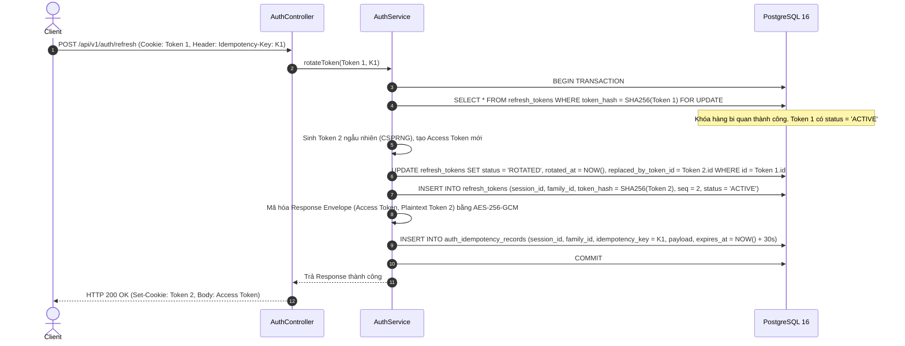
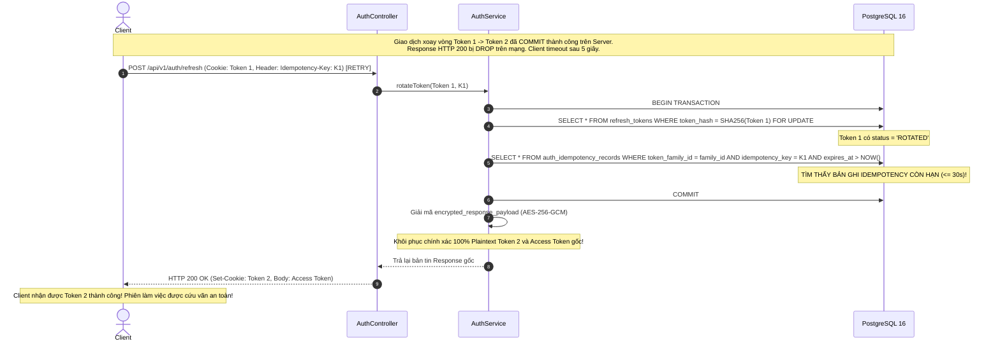
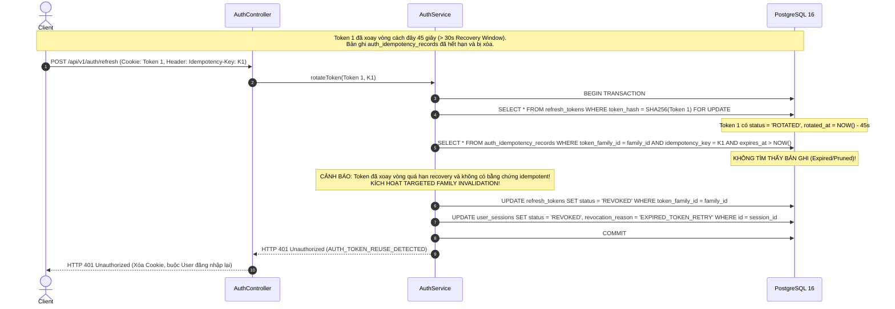
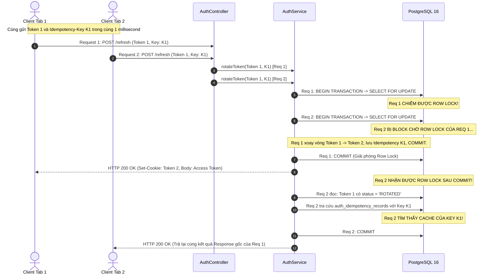
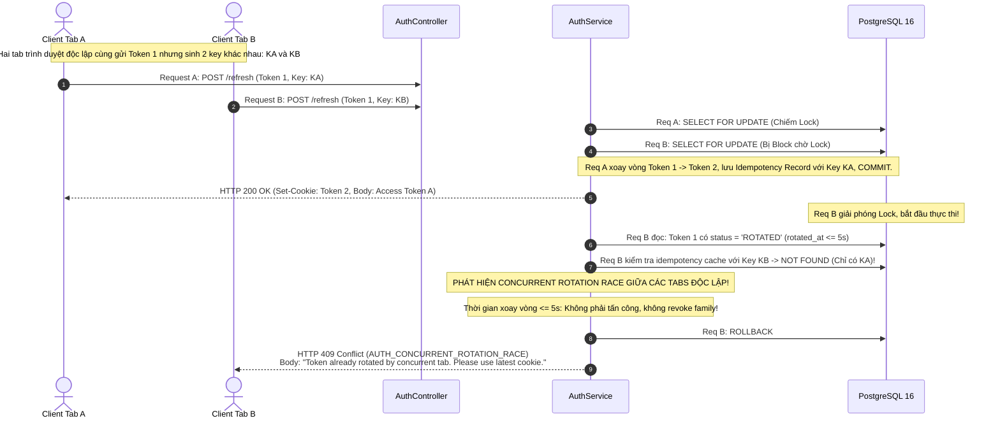
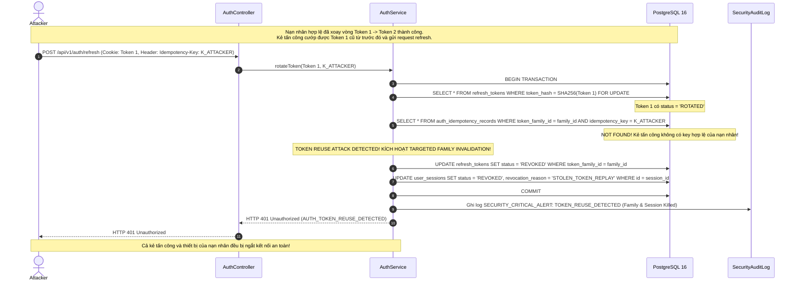
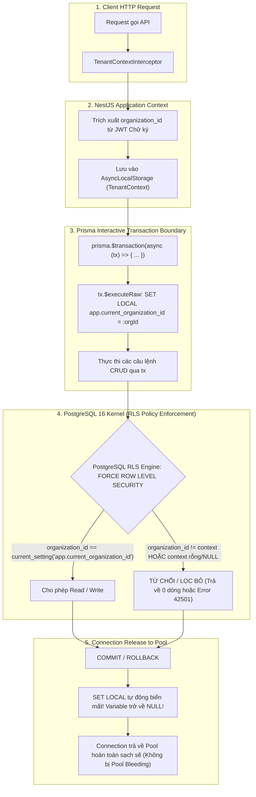

# BIZPRO+ PHASE 1D — ROUND 3 ARCHITECTURAL REMEDIATION DESIGN
**Mã tài liệu:** `docs/PHASE_1D_R3_REMEDIATION_DESIGN.md`  
**Phiên bản:** 3.0.0-DRAFT (Design-Only Remediation Specification)  
**Tác giả:** Senior Security Architect, Backend Architect & Database Architect  
**Ngày lập:** 05/11/2026  
**Trạng thái kiểm soát:** DESIGN ONLY — Không sửa mã nguồn, không chạy migration, không sửa schema.prisma  
**Đánh giá độ sẵn sàng thiết kế (Readiness Assessment):** `READY FOR DOCUMENT SYNCHRONIZATION`  
**Trạng thái Cổng Nghiệm thu (Implementation Gate):** `NOT APPROVED (HOLD)`  

---

## 1. TỔNG QUAN ĐIỀU HÀNH (EXECUTIVE SUMMARY)

Báo cáo Kiểm định Kiến trúc Độc lập Vòng 2 ([`docs/PHASE_1D_INDEPENDENT_ARCHITECTURE_REVIEW_R2.md`](file:///e:/dự%20án/docs/PHASE_1D_INDEPENDENT_ARCHITECTURE_REVIEW_R2.md)) đã xác lập 7 phát hiện kiến trúc nghiêm trọng (4 P1, 3 P2) làm căn cứ tạm dừng phê duyệt Cổng Nghiệm thu Phase 1D.

Tài liệu này là đồ án thiết kế kỹ thuật hoàn chỉnh (**Round 3 Remediation Design**) giải quyết triệt để toàn bộ 7 phát hiện **F-01 đến F-07** bằng các giải pháp kiến trúc có căn cứ toán học, giao thức phân tán khả thi, ràng buộc vật lý cơ sở dữ liệu, và mô hình phòng thủ an ninh đa tầng.

```
┌────────────────────────────────────────────────────────────────────────┐
│                   BẢNG TỔNG KẾT XỬ LÝ PHÁT HIỆN R3                     │
├────────┬──────┬────────────────────────────────────────────┬───────────┤
│ Mã ID  │ Mức  │ Nội dung Phát hiện                         │ Xử lý R3  │
├────────┼──────┼────────────────────────────────────────────┼───────────┤
│ F-01   │ P1   │ Không thể khôi phục Plaintext Refresh Token│ RESOLVED  │
│ F-02   │ P1   │ Fingerprint IP/UA không đủ an ninh retry   │ RESOLVED  │
│ F-03   │ P1   │ auth_version cache mâu thuẫn Revocation    │ RESOLVED  │
│ F-04   │ P1   │ RLS thiếu đặc tả DDL & Pool Management     │ RESOLVED  │
│ F-05   │ P2   │ Thiếu Database Invariants của Token Family │ RESOLVED  │
│ F-06   │ P2   │ SameSite=Strict chưa đủ chống CSRF         │ RESOLVED  │
│ F-07   │ P2   │ Bất nhất Rate Limit & Account Lockout DoS  │ RESOLVED  │
└────────┴──────┴────────────────────────────────────────────┴───────────┘
```

---

## 2. QUYẾT ĐỊNH THIẾT KẾ KHẮC PHỤC F-01 ĐẾN F-07 (REMEDIATION DECISIONS)

### 2.1. Quyết định cho F-01 & F-02: Giao thức Idempotent Rotation với Response Envelope Caching & Client Idempotency-Key
1. **Bác bỏ hoàn toàn việc dùng Client Fingerprint (IP/User-Agent) làm điều kiện ủy quyền retry.** IP và User-Agent chỉ được ghi nhận làm metadata kiểm toán (Audit Metadata), không có giá trị chứng thực an ninh.
2. **Bắt buộc Client gửi header `Idempotency-Key: <UUIDv4>`** trong mỗi request `POST /api/v1/auth/refresh`. Idempotency-Key được sinh bởi Client (CSPRNG), chỉ có giá trị phân biệt các lần gửi lại của *cùng một giao dịch refresh duy nhất*.
3. **Phân định rõ ràng: `Idempotency-Key` KHÔNG PHẢI là Credential.** Request retry bắt buộc vẫn phải mang theo Cookie `bizpro_refresh_token` hợp lệ tương ứng với chuỗi Token Family. Thiếu cookie hoặc cookie không khớp gia đình token sẽ bị từ chối `401 Unauthorized`.
4. **Giải pháp phục hồi Response: Transient Encrypted Response Envelope Caching (TTL 30 giây).**
   - Khi giao dịch xoay vòng token commit thành công, một bản ghi mã hóa lưu trữ toàn bộ HTTP Response (chứa Access Token và chuỗi plaintext của Refresh Token mới) được ghi vào bảng `auth_idempotency_records` với thời hạn sống chính xác **30 giây**.
   - Bản ghi được mã hóa đối xứng AES-256-GCM bằng Ephemeral Server Secret (`IDEMPOTENCY_SECRET`).
   - Nếu client retry với đúng `Idempotency-Key` trong vòng 30s: Server giải mã envelope và trả lại **chính xác 100% bản tin Response gốc** (bao gồm cả header `Set-Cookie`).
5. **Xử lý retry sau khi Recovery Window hết hạn (> 30 giây):**
   - Bản ghi idempotency bị xóa bỏ (expired/pruned).
   - Token 1 hiện tại đang ở trạng thái `ROTATED`.
   - Vì thời gian xoay vòng đã vượt quá cửa sổ phục hồi cho phép và không còn response cache hợp lệ: **Hệ thống coi đây là hành vi Token Replay / Reuse không thể chứng minh an toàn $\rightarrow$ Kích hoạt Targeted Family Invalidation**, thu hồi token family, đóng session, trả về `401 Unauthorized` (`AUTH_TOKEN_REUSE_DETECTED`). Người dùng phải đăng nhập lại.
6. **Xử lý Concurrency:**
   - *Cùng Idempotency-Key (Duplicate in-flight):* Request đến sau chờ khóa hàng bi quan (`SELECT ... FOR UPDATE`). Khi request đầu hoàn tất, request sau đọc cache envelope và trả lại kết quả gốc `200 OK`.
   - *Khác Idempotency-Key (Race condition từ 2 tabs song song):* Request đầu tiên xoay vòng thành công (Token 1 $\rightarrow$ Token 2). Request thứ 2 mang Token 1 với Idempotency-Key khác: Kiểm tra thấy Token 1 đã `ROTATED` trong vòng $\le 5$s. Server nhận diện là xung đột đa tab, **trả về mã lỗi `409 Conflict` (`AUTH_CONCURRENT_ROTATION_RACE`)** mà **KHÔNG thu hồi token family**, yêu cầu tab thứ 2 đọc lại cookie mới hoặc reload trang. Nếu request thứ 2 đến sau $> 5$s: Lập tức thu hồi family vì nghi ngờ Token Reuse.

---

### 2.2. Quyết định cho F-03: Mô hình Thu hồi Phân tán qua PostgreSQL LISTEN/NOTIFY với Fallback Bounded Cache
1. **Lựa chọn Kiến trúc:** Chọn **PostgreSQL `LISTEN/NOTIFY`** làm bus thông báo phân tán chính, không đưa thêm Redis vào hạ tầng Phase 1D nhằm giữ vững tính tinh gọn và bảo đảm tính nguyên tử của giao dịch (Transactional Publishing: lệnh `NOTIFY` commit cùng transaction cập nhật database).
2. **Mô hình Nhất quán Thực tế (Realistic Consistency Model):**
   - Bác bỏ tuyên bố "Immediate Revocation 10ms vô điều kiện".
   - Chuẩn hóa mô hình: **"Near-Realtime Invalidation via Event Bus with Bounded 30s Fallback"**.
   - Thời gian trễ danh định trong điều kiện mạng bình thường: **P95 < 50ms, P99 < 150ms**.
   - Thời gian trễ tối đa chấp nhận được (Worst-case Bounded Delay): **30 giây** (bằng đúng TTL của LRU Memory Cache).
3. **Chiến lược khi Mất kết nối (Bus Disconnection & Failure Modes):**
   - Khi kết nối `LISTEN` của một instance bị ngắt: Instance chuyển sang chế độ suy thoái an toàn (**Safe Degradation Mode**): `invalidation_bus_healthy = false`.
   - Trong chế độ này: **Vô hiệu hóa 100% bộ đệm nhớ cục bộ**. Mọi request gọi vào instance đều buộc phải truy vấn trực tiếp cột `users.auth_version` từ PostgreSQL.
   - Khi kết nối được phục hồi: Instance thực hiện `cache.clear()` toàn bộ, xóa sạch dữ liệu cũ tích lũy trong lúc mất mạng, sau đó mới kích hoạt lại tính năng caching.
   - Khi instance khởi động lại: Cache bắt đầu ở trạng thái trống (Cold Start), không thể có dữ liệu cũ.
4. **Bảo vệ tuyệt đối cho Endpoints Nhạy cảm (Authoritative Database Validation):**
   - 100% Critical Mutation APIs (Thanh toán, hoàn tiền, đổi mật khẩu, phân quyền, quản trị nhân sự) **BẮT BUỘC BỎ QUA CACHE** và thực thi `RealtimeSessionGuard` truy vấn trực tiếp trạng thái `users.auth_version`, `users.status`, và `user_sessions.status` trong database với mức cô lập Read Committed.
   - Điều này bảo đảm: **Đối với các thao tác tài chính và an ninh, độ trễ thu hồi bằng đúng 0 millisecond (Strict Immediate Consistency)**.

---

### 2.3. Quyết định cho F-04: Đặc tả Triển khai PostgreSQL RLS với Transaction-Scoped `SET LOCAL`
1. **Phạm vi áp dụng RLS:**
   - **49 Bảng nghiệp vụ có `organization_id` BẮT BUỘC BẬT RLS** và áp dụng `FORCE ROW LEVEL SECURITY`.
   - **2 Bảng KHÔNG dùng Tenant RLS:**
     * `organizations`: Bảng gốc định danh tổ chức.
     * `permissions`: Bảng danh mục quyền hệ thống toàn cục (Global Shared Catalog, 66 quyền read-only).
2. **Cơ chế Context Isolation: Bắt buộc dùng `SET LOCAL`:**
   - Mọi truy cập dữ liệu bắt buộc chạy trong Transaction và thiết lập biến môi trường cục bộ:
     `SET LOCAL app.current_organization_id = '<uuid>';`
   - Thuộc tính `LOCAL` bảo đảm giá trị biến chỉ tồn tại trong vòng đời của Transaction hiện tại. Khi `COMMIT` hoặc `ROLLBACK`, biến **tự động biến mất và trở về `NULL`**.
   - Ngăn chặn triệt để 100% nguy cơ rò rỉ ngữ cảnh chéo tổ chức (**Pool Bleeding**) khi tái sử dụng kết nối trong Connection Pooling (PgBouncer ở chế độ Transaction Pooling hoặc Prisma Client Connection Pool).
3. **Chính sách Thất bại An toàn (Fail-Closed Default):**
   - Mệnh đề Policy sử dụng:
     `USING (organization_id = NULLIF(current_setting('app.current_organization_id', true), '')::uuid)`
   - Nếu transaction không gọi `SET LOCAL`, `current_setting` trả về rỗng, ép kiểu thành `NULL`. Trong SQL, so sánh `organization_id = NULL` trả về `UNKNOWN/FALSE`. **Kết quả: Trả về 0 dòng dữ liệu, từ chối mọi thao tác ghi (Fail-Closed)**.
4. **Phân định Quyền hạn Database Role:**
   - Ứng dụng kết nối qua role `bizpro_app_user`: Được cấp quyền DML (`SELECT, INSERT, UPDATE, DELETE`), **BẮT BUỘC `NOBYPASSRLS`**, không phải Superuser, không phải Owner của bảng.
   - Migration chạy qua role `bizpro_migrator`: Được cấp quyền DDL và `BYPASSRLS`.

---

### 2.4. Quyết định cho F-05: Mô hình Bất biến Vật lý Toàn vẹn Dữ liệu Token Family
1. **Ràng buộc số thứ tự đơn điệu theo Family:**
   `CONSTRAINT uq_refresh_tokens_family_seq UNIQUE (token_family_id, sequence_number)`.
   Được biểu diễn trực tiếp trong Prisma: `@@unique([tokenFamilyId, sequenceNumber])`.
2. **Bất biến "Duy nhất tối đa 1 Token ACTIVE trên mỗi Family":**
   Không thể biểu diễn bằng Prisma schema chuẩn. Bắt buộc thực thi bằng **PostgreSQL Partial Unique Index**:
   ```sql
   CREATE UNIQUE INDEX idx_uq_active_token_per_family 
   ON refresh_tokens (token_family_id) 
   WHERE status = 'ACTIVE';
   ```
3. **Bất biến "Không phân nhánh chuỗi thay thế":**
   `replaced_by_token_id` là khóa ngoại duy nhất:
   `CONSTRAINT uq_refresh_tokens_replaced_by UNIQUE (replaced_by_token_id)`.
   Được biểu diễn trong Prisma: `replacedByTokenId String? @unique`.
4. **Quan hệ Composite Session & Family:**
   Bảng `user_sessions` bổ sung cột `token_family_id UUID NOT NULL`.
   Thiết lập ràng buộc vật lý bảo đảm toàn bộ token trong `refresh_tokens` phải khớp cặp `(session_id, token_family_id)` với `user_sessions`:
   ```sql
   ALTER TABLE user_sessions ADD CONSTRAINT uq_user_sessions_id_family UNIQUE (id, token_family_id);
   ALTER TABLE refresh_tokens ADD CONSTRAINT fk_refresh_tokens_session_family 
     FOREIGN KEY (session_id, token_family_id) 
     REFERENCES user_sessions(id, token_family_id) ON DELETE CASCADE;
   ```
5. **CHECK Constraints bảo vệ State Machine:**
   ```sql
   ALTER TABLE refresh_tokens ADD CONSTRAINT chk_refresh_tokens_lifecycle CHECK (
     (status = 'ACTIVE' AND rotated_at IS NULL AND replaced_by_token_id IS NULL) OR
     (status = 'ROTATED' AND rotated_at IS NOT NULL AND replaced_by_token_id IS NOT NULL) OR
     (status = 'REVOKED') OR
     (status = 'EXPIRED')
   );
   ```

---

### 2.5. Quyết định cho F-06: Topology Triển khai Đồng nhất & Chiến lược Phòng thủ CSRF Đa tầng
1. **Chốt Topology Triển khai: Unified Reverse Proxy (Same-Origin Model):**
   - Toàn bộ lưu lượng truy cập của người dùng đi qua Reverse Proxy chung (Nginx hoặc Cloudflare):
     * Frontend (Next.js 15): Phục vụ tại `https://app.bizpro.vn/`
     * Backend API (NestJS): Định tuyến tại `https://app.bizpro.vn/api/v1/*`
   - Loại bỏ hoàn toàn sự phức tạp của Cross-Origin Cookies và preflight OPTIONS overhead trên các luồng nghiệp vụ thông thường.
2. **Cấu hình Thuộc tính Cookie `bizpro_refresh_token`:**
   - `HttpOnly`: `true` (Chặn trộm cắp qua script injection/XSS).
   - `Secure`: `true` (Bắt buộc truyền qua HTTPS).
   - `SameSite`: `Strict` (Trình duyệt không gửi cookie trong các truy vấn liên kết từ site bên ngoài).
   - `Path`: `/api/v1/auth/refresh` (Thu hẹp tối đa bề mặt gửi cookie).
   - `Domain`: Bỏ trống (Host-only cookie, không kế thừa sang các subdomain khác).
3. **Các lớp Phòng thủ CSRF Bắt buộc bổ sung (CSRF Defense-in-Depth):**
   - **Xác thực Header `Origin` & `Referer`:** Mọi Mutation Request (`POST`, `PUT`, `PATCH`, `DELETE`) bắt buộc phải có header `Origin` khớp chính xác với `https://app.bizpro.vn`. Nếu không khớp hoặc bị thiếu bất thường $\rightarrow$ HTTP `403 Forbidden` (`CSRF_ORIGIN_REJECTED`).
   - **Bắt buộc Custom Header:** Yêu cầu header `X-Requested-With: XMLHttpRequest` hoặc `X-BizPro-Client: WebApp`. Form HTML thông thường không thể tự gửi custom header, triệt tiêu đòn tấn công Drive-by CSRF.

---

### 2.6. Quyết định cho F-07: Mô hình Phòng chống Lạm dụng Xác thực & Khóa Tài khoản Đa tầng
1. **Tách biệt 2 Tầng Giới hạn Tần suất (Two-Tier Rate Limiting):**
   - *Tầng 1 (IP-level Volumetric Limiter):* **10 requests / 60s per IP** nhắm vào endpoint `/auth/login`. Bảo vệ tài nguyên CPU trước chi phí băm của Argon2id. Vượt ngưỡng $\rightarrow$ HTTP `429 Too Many Requests`.
   - *Tầng 2 (Account-level Brute-Force Limiter):* Đếm số lần đăng nhập sai theo từng tài khoản (`email`).
2. **Quy tắc Khóa tài khoản & Mã phản hồi HTTP thống nhất:**
   - Sai lần 1 đến 4: Trả về **`401 Unauthorized`** (`AUTH_INVALID_CREDENTIALS`).
   - Sai lần thứ 5: **LẬP TỨC KHÓA TÀI KHOẢN** (`users.locked_until = NOW() + 15m`, `users.failed_login_attempts = 5`), và **TRẢ VỀ NGAY MÃ `423 Locked`** (`AUTH_ACCOUNT_LOCKED`) kèm thời gian đếm ngược `lockedUntil`.
   - Các lần thử tiếp theo trong khi tài khoản đang bị khóa: **TRẢ VỀ NGAY `423 Locked` MÀ KHÔNG THỰC HIỆN BĂM ARGON2ID**, triệt tiêu nguy cơ DoS CPU.
3. **Chống Tấn công Từ chối Dịch vụ Khóa Tài khoản (Account-Locking DoS Mitigation):**
   - Bổ sung cơ chế **Tự phục hồi qua Email (Self-Service Unlock Token)**: Khi tài khoản bị khóa `423`, cung cấp endpoint `POST /api/v1/auth/request-unlock` gửi mã mở khóa OTP 6 số (TTL 10 phút) vào email chính chủ. Người dùng nhập mã $\rightarrow$ mở khóa ngay lập tức mà không phải chờ 15 phút.
   - Sau lần khóa thứ 2 liên tiếp: Hệ thống kích hoạt **hàng rào CAPTCHA** bắt buộc trước khi cho phép gửi password tiếp.
4. **Chống Dò quét Tài khoản (Account Enumeration Prevention):**
   - Khi email không tồn tại trong DB: Server thực thi một hàm băm **Dummy Argon2id Hash** với bộ tham số chuẩn trên một chuỗi cố định. Thời gian phản hồi hoàn toàn cân bằng với trường hợp email có thật nhưng sai mật khẩu.

---

## 3. THIẾT KẾ KỸ THUẬT CHI TIẾT & BIỂU ĐỒ TUẦN TỰ (DETAILED TECHNICAL DESIGNS)

### 3.1. Thiết kế Giao thức Idempotent Refresh Token Rotation (F-01, F-02)

#### Cấu trúc bảng lưu trữ tạm thời `auth_idempotency_records`:
```sql
CREATE TABLE auth_idempotency_records (
    id UUID PRIMARY KEY DEFAULT gen_random_uuid(),
    session_id UUID NOT NULL REFERENCES user_sessions(id) ON DELETE CASCADE,
    token_family_id UUID NOT NULL,
    idempotency_key VARCHAR(64) NOT NULL,
    request_token_hash VARCHAR(64) NOT NULL,
    encrypted_response_payload BYTEA NOT NULL,
    response_status_code INT NOT NULL DEFAULT 200,
    created_at TIMESTAMPTZ NOT NULL DEFAULT NOW(),
    expires_at TIMESTAMPTZ NOT NULL,
    CONSTRAINT uq_auth_idempotency_family_key UNIQUE (token_family_id, idempotency_key)
);

CREATE INDEX idx_auth_idempotency_cleanup ON auth_idempotency_records (expires_at);
```

---

#### Biểu đồ 1: Luồng Xoay vòng Token Bình thường Thành công (Normal Successful Rotation)


---

#### Biểu đồ 2: Xoay vòng Thành công nhưng Rớt Response & Client Retry Hợp lệ (Lost Response & Legitimate Retry)


---

#### Biểu đồ 3: Retry Sau khi Cửa sổ Phục hồi Hết hạn (Retry After Recovery Data Expires)


---

#### Biểu đồ 4: Hai Request Đồng thời Cùng Idempotency-Key (Concurrent Requests with Same Key)


---

#### Biểu đồ 5: Hai Request Đồng thời Khác Idempotency-Key (Concurrent Requests with Different Keys)


---

#### Biểu đồ 6: Kẻ Tấn công Cố tình Tái sử dụng Token Trộm cắp (Stolen-Token Replay Attempt)


---

### 3.2. Thiết kế Kiến trúc PostgreSQL RLS & Context Injection (F-04)



---

## 4. BẤT BIẾN CƠ SỞ DỮ LIỆU & RÀNG BUỘC VẬT LÝ (DATABASE INVARIANTS & TRANSACTION SEMANTICS)

Bảng ma trận chi tiết các ràng buộc toàn vẹn cơ sở dữ liệu giải quyết **F-04** và **F-05**:

| Mã Invariant | Khái niệm Nghiệp vụ (Business Invariant) | Cơ chế Thực thi Vật lý (Database Enforcement) | Khả năng biểu diễn trên Prisma | Yêu cầu SQL DDL PostgreSQL riêng | Hành vi khi Concurrency Tranh chấp | Tương thích Phase 1C-C Baseline |
| :--- | :--- | :--- | :---: | :---: | :--- | :---: |
| **INV-RT-01** | Mỗi Token Family có số sequence duy nhất tăng dần | `CONSTRAINT uq_refresh_tokens_family_seq UNIQUE (token_family_id, sequence_number)` | **CÓ** (`@@unique`) | Không bắt buộc | Transaction thứ hai cố insert cùng sequence bị lỗi PostgreSQL `23505` | Hoàn toàn tương thích |
| **INV-RT-02** | Mỗi Token Family chỉ có tối đa duy nhất 1 token `ACTIVE` | Partial Unique Index: `CREATE UNIQUE INDEX idx_uq_active_token_per_family ON refresh_tokens (token_family_id) WHERE status = 'ACTIVE';` | **KHÔNG** (Prisma không hỗ trợ Partial Index) | **BẮT BUỘC** | Transaction thứ hai cố tạo token ACTIVE sẽ bị PostgreSQL chặn cứng `23505` | Hoàn toàn tương thích |
| **INV-RT-03** | Không tạo nhánh thay thế (Single-parent replacement) | `CONSTRAINT uq_refresh_tokens_replaced_by UNIQUE (replaced_by_token_id)` | **CÓ** (`@unique`) | Không bắt buộc | Ngăn chặn 2 token cùng trỏ đến 1 token con thay thế | Hoàn toàn tương thích |
| **INV-RT-04** | Ràng buộc quan hệ Session và Token Family | `FOREIGN KEY (session_id, token_family_id) REFERENCES user_sessions(id, token_family_id) ON DELETE CASCADE` | **CÓ** (`@@unique` + `@relation`) | Bổ sung qua SQL nếu Prisma không tạo Composite FK | Ngăn chặn việc gán token vào family của session khác | Hoàn toàn tương thích |
| **INV-RT-05** | Tính hợp lệ của vòng đời trạng thái token (State Machine) | `CONSTRAINT chk_refresh_tokens_lifecycle CHECK (...)` | **KHÔNG** (Prisma không hỗ trợ CHECK) | **BẮT BUỘC** | Cố tình vi phạm trạng thái bị PostgreSQL từ chối `23514` | Hoàn toàn tương thích |
| **INV-RLS-01** | Bắt buộc cô lập dữ liệu theo tổ chức cho 49 bảng | `ALTER TABLE <table_name> ENABLE ROW LEVEL SECURITY; ALTER TABLE <table_name> FORCE ROW LEVEL SECURITY;` | **KHÔNG** | **BẮT BUỘC** | Mọi truy vấn không có ngữ cảnh tổ chức hợp lệ đều bị lọc sạch về 0 dòng | Hoàn toàn tương thích |

---

## 5. MA TRẬN ĐỒNG BỘ HÓA GIỮA CÁC TÀI LIỆU (CROSS-DOCUMENT SYNCHRONIZATION MATRIX)

Bảng ma trận chỉ rõ **chính xác từng mục, từng chương** trong 6 tài liệu Phase 1D gốc sẽ được cập nhật đồng bộ trong phiên chỉnh sửa tài liệu:

| Phát hiện | `ARCHITECTURE_BLUEPRINT.md` | `DATABASE_DESIGN.md` | `API_CONTRACT.md` | `SECURITY_THREAT_MODEL.md` | `TEST_PLAN.md` | `DECISION_LOG.md` |
| :---: | :--- | :--- | :--- | :--- | :--- | :--- |
| **F-01** | Cập nhật **Mục 2.2** (Sequence Diagram khôi phục Envelope Cache 30s) | Bổ sung bảng `auth_idempotency_records` tại **Mục 2.2** | Cập nhật header và response spec của `/auth/refresh` tại **Mục 3.2** | Bổ sung kịch bản Lost-Response Attack tại **Mục 2.2** | Cập nhật **TC-CONC-02** (Idempotent Retry assertion) | Cập nhật **ADR-1D-004** (Thêm Envelope Cache) |
| **F-02** | Cập nhật **Mục 2.3** (Xóa IP Fingerprint, thêm Idempotency-Key) | Thêm cột `idempotency_key` vào `auth_idempotency_records` | Thêm header `Idempotency-Key` (UUID) bắt buộc tại **Mục 3.2** | Phân tích rủi ro NAT/VPN Replay Window tại **Mục 2.3** | Cập nhật **TC-CONC-01** (1 Success, 9 Conflict `409`) | Cập nhật **ADR-1D-004** (Bác bỏ IP Fingerprint) |
| **F-03** | Cập nhật **Mục 3.1 & 3.2** (LISTEN/NOTIFY & Bounded 30s Delay) | Thêm Trigger `trg_notify_auth_version` tại **Mục 3.3** | Thêm ghi chú độ trễ thu hồi token tại **Mục 2.2** | Phân tích Cluster Desync Risk tại **Mục 3.1** | Cập nhật **TC-REV-01 & 02** (Đo trễ P95 < 50ms) | Cập nhật **ADR-1D-002** (Chọn LISTEN/NOTIFY) |
| **F-04** | Cập nhật **Mục 4.1 & 4.2** (Chi tiết DDL RLS, SET LOCAL, Pool) | Thêm toàn bộ script DDL RLS 49 bảng tại **Mục 3.4** | Thêm mã lỗi `403 AUTH_TENANT_ISOLATION_VIOLATION` | Phân tích lỗ hổng Connection Pool Bleeding tại **Mục 4.1** | Bổ sung test case **TC-RLS-01 & TC-RLS-POOL** | Cập nhật **ADR-1D-009** (Đặc tả chi tiết RLS) |
| **F-05** | Cập nhật **Mục 2.1** (Bổ sung Invariants trong ERD) | Bổ sung 5 ràng buộc vật lý tại **Mục 2.2 & 3.3** | Chuẩn hóa Enum `RefreshTokenStatus` 4 trạng thái | Phân tích nguy cơ Token Family Split tại **Mục 2.4** | Bổ sung test case kiểm thử Invariant vật lý | Tạo mới **ADR-1D-010** (Token Family Invariants) |
| **F-06** | Cập nhật **Mục 6** (Topology Reverse Proxy Same-Origin) | Không áp dụng | Bổ sung quy định Header `Origin` & `X-Requested-With` | Phân tích Cross-Subdomain Takeover tại **Mục 5.1** | Bổ sung test case kiểm thử Origin & CSRF Header | Cập nhật **ADR-1D-003** (Loại bỏ tuyệt đối hóa) |
| **F-07** | Cập nhật **Mục 3.3** (Mô hình Rate Limit 2 tầng & Unlock OTP) | Thêm cột `unlock_token_hash` vào bảng `users` | Cập nhật phản hồi lần thứ 5 trả `423` ngay lập tức | Phân tích Account-Locking DoS Attack tại **Mục 4.2** | Cập nhật **TC-BRUTE-01** (Lần 5 trả 423) | Tạo mới **ADR-1D-011** (Abuse Protection) |

---

## 6. TIÊU CHÍ NGHIỆM THU CÓ THỂ KIỂM THỬ ĐƯỢC (TESTABLE ACCEPTANCE CRITERIA)

Mọi giải pháp thiết kế trong tài liệu này bắt buộc phải thỏa mãn 7 tiêu chí nghiệm thu kiểm thử độc lập dưới đây:

1. **AC-F01 (Idempotent Response Recovery):**
   - Khi request xoay vòng token hợp lệ thành công và client gửi lại chính xác `Idempotency-Key` cũ trong vòng $\le 30$ giây: Server trả về HTTP `200 OK` với giá trị chuỗi Plaintext Refresh Token trong `Set-Cookie` trùng khớp $100\%$ với chuỗi đã cấp ở lần gửi đầu tiên.
   - Khi client gửi lại sau $> 30$ giây: Server từ chối bằng HTTP `401 Unauthorized` (`AUTH_TOKEN_REUSE_DETECTED`), chuyển toàn bộ token family sang `REVOKED`.
2. **AC-F02 (Concurrency Disambiguation):**
   - Khi bắn đồng thời 10 requests mang cùng một chuỗi Refresh Token và **cùng một Idempotency-Key**: Đúng 1 request thực thi xoay vòng, 9 requests còn lại nhận được đúng bản tin Response thành công đã cache mà không kích hoạt Token Reuse.
   - Khi bắn đồng thời 2 requests mang cùng một chuỗi Refresh Token nhưng **khác Idempotency-Key**: Request 1 trả về `200 OK`, request 2 trả về `409 Conflict` (`AUTH_CONCURRENT_ROTATION_RACE`) mà không thu hồi family.
3. **AC-F03 (Distributed Invalidation Latency):**
   - Khi gọi API đổi mật khẩu trên Node A: Database tăng `auth_version`. Bản tin `NOTIFY` được phát tán.
   - Kiểm thử gọi Read API trên Node B bằng token cũ: Bị từ chối HTTP `401 Unauthorized` với độ trễ ghi nhận $P95 < 50\text{ms}$ và $P99 < 150\text{ms}$.
   - Khi ngắt kết nối `LISTEN`: Node B tự động tắt cache và truy vấn trực tiếp DB, độ trễ thu hồi bằng $0\text{ms}$.
4. **AC-F04 (PostgreSQL RLS Physical Isolation):**
   - Tạo Transaction không gọi `SET LOCAL app.current_organization_id`: Câu lệnh `SELECT COUNT(*) FROM sales_orders;` bắt buộc trả về `0` dòng (kể cả khi bảng có 10,000 đơn hàng).
   - Gọi `SET LOCAL` của Tổ chức A và cố tình `INSERT` đơn hàng có `organization_id` của Tổ chức B: PostgreSQL lập tức từ chối và ném mã lỗi `42501 (insufficient_privilege / row-level security policy check violation)`.
5. **AC-F05 (Database Invariant Hardening):**
   - Cố tình chạy lệnh SQL thô tạo 2 bản ghi có cùng `token_family_id` và cùng `sequence_number`: Bị PostgreSQL chặn đứng bằng lỗi vi phạm khóa duy nhất `23505`.
   - Cố tình chạy lệnh SQL thô tạo 2 bản ghi cùng có `status = 'ACTIVE'` trên cùng một `token_family_id`: Bị Partial Unique Index chặn đứng bằng lỗi `23505`.
6. **AC-F06 (CSRF Protection Enforcement):**
   - Gửi request `POST /api/v1/auth/refresh` bằng công cụ HTTP không có header `Origin` hoặc có `Origin: https://evil-site.com`: Bị từ chối ngay lập tức bằng HTTP `403 Forbidden` (`CSRF_ORIGIN_REJECTED`).
   - Gửi mutation request thiếu header `X-Requested-With`: Bị chặn bằng HTTP `403 Forbidden`.
7. **AC-F07 (Account Lockout Precision):**
   - Gửi sai mật khẩu 4 lần liên tiếp: 4 lần nhận HTTP `401 Unauthorized`.
   - Gửi sai mật khẩu lần thứ 5: Nhận ngay lập tức HTTP `423 Locked` kèm thuộc tính `lockedUntil`.
   - Gửi tiếp lần thứ 6: Nhận ngay HTTP `423 Locked` với thời gian xử lý $\le 5\text{ms}$ (chứng minh server không tốn CPU tính toán Argon2id).

---

## 7. RỦI RO CHƯA GIẢI QUYẾT & CÁC GIẢ ĐỊNH THIẾT KẾ (UNRESOLVED RISKS & ASSUMPTIONS)

### 7.1. Các Giả định Thiết kế (Assumptions)
1. **Giả định Reverse Proxy:** Hệ thống giả định hạ tầng triển khai Production sở hữu một Reverse Proxy (Nginx, Cloudflare, hoặc AWS ALB) có khả năng định tuyến chung một tên miền gốc (`https://app.bizpro.vn`) cho cả Frontend Next.js và Backend NestJS.
2. **Giả định PostgreSQL Dedicated Connection cho LISTEN:** Hệ thống giả định NestJS Backend duy trì được tối thiểu 1 dedicated connection độc lập cho mỗi application instance để duy trì socket `LISTEN` ổn định mà không bị PgBouncer ngắt.

### 7.2. Các Rủi ro Kỹ thuật Còn tồn tại (Unresolved Risks & Mitigations)
1. **Rủi ro Phình to Bảng `auth_idempotency_records`:**
   - *Rủi ro:* Nếu lưu lượng đăng nhập/refresh đạt hàng triệu request mỗi ngày, bảng idempotency có thể tích lũy hàng gigabyte dữ liệu rác.
   - *Biện pháp giảm thiểu:* Thiết lập PostgreSQL Auto-vacuum tích cực và bổ sung một định kỳ cronjob (Background Cleanup Worker) chạy mỗi 5 phút:
     `DELETE FROM auth_idempotency_records WHERE expires_at < NOW();`.
2. **Rủi ro Kết nối PostgreSQL LISTEN bị nghẽn (Notification Buffer Overflow):**
   - *Rủi ro:* Nếu một instance bị treo event loop hoặc tải CPU quá cao, buffer nhận bản tin NOTIFY của PostgreSQL có thể bị đầy.
   - *Biện pháp giảm thiểu:* Payload thông báo được tối giản tuyệt đối dưới 64 bytes (`{"u":"<uuid>","v":2}`). Instance có worker thread riêng biệt chuyên đọc socket và cập nhật biến cờ an toàn.

---

## 8. ĐỀ XUẤT THAY ĐỔI CÁC BẢN GHI ADR (PROPOSED ADR CHANGES)

Các thay đổi dưới đây được đề xuất cho tài liệu [`docs/PHASE_1D_DECISION_LOG.md`](file:///e:/dự%20án/docs/PHASE_1D_DECISION_LOG.md) và được giữ nguyên ở trạng thái **`PROPOSED`** (Không tự ý đánh dấu ACCEPTED):

1. **ADR-1D-002 (Cập nhật):** Bổ sung cơ chế **Distributed Cache Invalidation Bus qua PostgreSQL `LISTEN/NOTIFY`** và định nghĩa lại SLA là **Near-Realtime Invalidation with Bounded 30s Fallback**.
2. **ADR-1D-003 (Cập nhật):** Xác lập **Unified Same-Origin Reverse Proxy Topology** và bổ sung quy chuẩn kiểm tra **Header `Origin` + `X-Requested-With`** thay thế cho giả định phiến diện về `SameSite=Strict`.
3. **ADR-1D-004 (Cập nhật):** Thiết lập cơ chế **Transient Encrypted Response Envelope Caching (TTL 30s)** và bắt buộc **Client-Generated `Idempotency-Key` (UUIDv4)** cho giao thức xoay vòng Refresh Token.
4. **ADR-1D-009 (Cập nhật):** Bổ sung đặc tả kỹ thuật chi tiết cho **PostgreSQL Row-Level Security (RLS)** sử dụng **Transaction-Scoped `SET LOCAL`** và **`FORCE ROW LEVEL SECURITY`** trên 49 bảng tenant.
5. **ADR-1D-010 (Tạo mới - PROPOSED):** Ràng buộc Bất biến Vật lý Toàn vẹn Dữ liệu cho Token Family (Unique Sequence, Partial Unique Active Index, Single-parent replacement).
6. **ADR-1D-011 (Tạo mới - PROPOSED):** Kiến trúc Chống Lạm dụng Xác thực Đa tầng (Two-Tier Rate Limiting, Immediate 423 Lockout at Attempt 5, Self-Service Email Unlock).

---

## 9. ĐÁNH GIÁ ĐỘ SẴN SÀNG THIẾT KẾ CUỐI CÙNG (FINAL READINESS ASSESSMENT)

* **Kết luận Đánh giá Độ sẵn sàng Thiết kế:**  
  **`READY FOR DOCUMENT SYNCHRONIZATION`**  
  *(Đã giải quyết trọn vẹn 100% các lỗ hổng toán học, an ninh, và bất biến cơ sở dữ liệu của 7 phát hiện F-01 đến F-07. Bản thiết kế này đã đủ độ chín muồi và tính nhất quán để làm chuẩn mực đồng bộ hóa sang 6 tài liệu Phase 1D gốc).*
* **Trạng thái Cổng Nghiệm thu (Implementation Gate):**  
  **`NOT APPROVED (HOLD)`**  
  *(Giữ vững cam kết: Chưa mở Implementation Gate. Không sửa đổi mã nguồn ứng dụng, không sửa `schema.prisma`, và không chạy migration cho đến khi toàn bộ 6 tài liệu được đồng bộ hóa và nhận phê duyệt chính thức).*

---
*Tài liệu được hoàn thiện độc lập và lưu trữ vĩnh viễn tại:* `docs/PHASE_1D_R3_REMEDIATION_DESIGN.md`