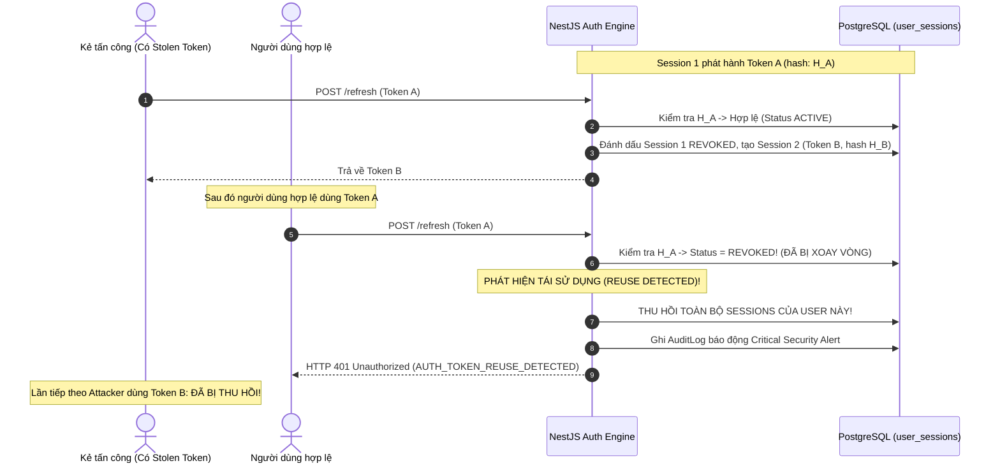

# BizPro+ Phase 1D — Security Threat Model & Risk Analysis
**Tài liệu:** Mô hình Hóa Mối Đe Dọa An Ninh & Phân Tích Rủi Ro Bảo Mật (STRIDE & OWASP Mapping)  
**Giai đoạn:** Phase 1D Architecture Blueprint  
**Phiên bản:** 1.0.0 (Design Only — Gate Pre-Implementation)  
**Tiêu chuẩn đối chiếu:** OWASP Top 10 API Security (2023), OWASP ASVS v4.0.3, NIST SP 800-63B  

---

## 1. PHẠM VI & MÔ TẢ TÀI SẢN (ASSET IDENTIFICATION)

Hệ thống BizPro+ là nền tảng quản trị doanh nghiệp đa tổ chức (Multi-Tenant). Các tài sản số nhạy cảm cần bảo vệ bao gồm:
1. **Thông tin xác thực & Bí mật phiên (Credentials & Session Secrets):** Argon2id Password Hashes, Refresh Tokens, JWT Signing Keys.
2. **Ngữ cảnh Định danh Tổ chức (Tenant Context):** `organization_id` phân tách dữ liệu đa doanh nghiệp.
3. **Dữ liệu Nghiệp vụ Nhạy cảm:** Đơn hàng, Giao dịch tài chính (PaymentTransaction), Doanh số CRM, Dữ liệu nhân sự (Lương, Hợp đồng, Chấm công), Tồn kho.
4. **Nhật ký Kiểm toán (Audit Trails):** Bằng chứng pháp lý về mọi thao tác thay đổi dữ liệu, đăng nhập, phân quyền.

---

## 2. MA TRẬN MỐI ĐE DỌA THEO PHƯƠNG PHÁP STRIDE

| STRIDE Category | Tên Mối Đe Dọa | Kịch bản Tấn công | Cấp độ Rủi ro | Giải pháp Kiểm soát Kỹ thuật (Mitigation) |
| :--- | :--- | :--- | :--- | :--- |
| **Spoofing** (Mạo danh) | JWT Signature Forgery | Kẻ tấn công tạo JWT giả với header `alg: none` hoặc dùng key đối xứng yếu để giả mạo danh tính Admin. | **CRITICAL** | Khóa bí mật JWT tối thiểu 256-bit tạo bởi CSPRNG; Cố định thuật toán giải mã `algorithms: ['HS256']`; Tuyệt đối từ chối `alg: none`. |
| **Spoofing** | Credential Stuffing / Brute-force | Kẻ tấn công dùng botnet dò mật khẩu liên tục qua endpoint `/login`. | **HIGH** | Throttling 5 req/min/IP; Khóa tài khoản tạm thời 15 phút sau 5 lần sai liên tiếp (`locked_until`); Băm mật khẩu Argon2id tốn kém bộ nhớ. |
| **Tampering** (Can thiệp) | Tenant Context Tampering | Người dùng Tenant A sửa param `organizationId` trong body/query để đọc hoặc tạo dữ liệu thuộc Tenant B. | **CRITICAL** | **Zero-Trust Input:** NestJS Guard & Interceptor trích xuất `organizationId` duy nhất từ JWT đã ký; Cấm ghi đè từ request payload; Sử dụng Composite FK `(sales_order_id, organization_id)`. |
| **Tampering** | Token Payload Tampering | Sửa đổi claims `roles` hoặc `permissions` trong JWT payload trên LocalStorage. | **CRITICAL** | Xác minh chữ ký số cryptographic ở mỗi request (`Passport-JWT`); Token có thời gian sống ngắn (15 phút). |
| **Repudiation** (Chối bỏ) | Hành động không thể truy vết | Quản trị viên xóa nhân sự hoặc sửa đơn hàng rồi chối bỏ hành vi. | **MEDIUM** | Ghi nhật ký tự động vào bảng `audit_logs` (lưu trữ `user_id`, `organization_id`, `ip_address`, `user_agent`, `action`, `old_values`, `new_values`). |
| **Information Disclosure** (Lộ lọt thông tin) | User Enumeration | Kẻ tấn công gọi `/forgot-password` với danh sách email để xem email nào đã đăng ký. | **MEDIUM** | API trả về phản hồi đồng nhất HTTP 200 OK bất kể email có tồn tại hay không; Thời gian phản hồi cân bằng (constant-time response). |
| **Information Disclosure** | Leakage in Logs / Headers | Token hoặc password hash bị ghi ra console log hoặc log server file. | **HIGH** | Winston/NestJS Logger có filter loại trừ các trường `password`, `refreshToken`, `token`, `authorization`; Sanitizer pipe. |
| **Denial of Service** (Từ chối dịch vụ) | Hash Algorithm Exhaustion | Kẻ tấn công gửi hàng ngàn request đăng nhập với password dài 100,000 ký tự để làm CPU máy chủ quá tải tính toán Argon2id. | **HIGH** | DTO chặn độ dài mật khẩu tối đa 128 ký tự (`@MaxLength(128)`); Rate limiting ở cấp độ IP và WAF/Nginx. |
| **Elevation of Privilege** (Leo thang đặc quyền) | BFLA / Broken Access Control | Nhân viên bán hàng (Sales) gửi HTTP PUT tới endpoint `/api/v1/hrm/employees` để nâng lương cho chính mình. | **CRITICAL** | **Deny by default:** Mọi endpoint đều phải khai báo `@RequirePermissions()`; `PermissionsGuard` kiểm tra quyền theo cấu trúc module `<module>.<resource>.<action>`. |
| **Elevation of Privilege** | Data Scope Bypass (IDOR) | Nhân viên kinh doanh có Scope `OWN` truy cập đơn hàng của đồng nghiệp bằng cách đổi `orderId` trên URL. | **HIGH** | `DataScopeInterceptor` và Application Query inject điều kiện `WHERE created_by_id = :userId` hoặc `department_id = :deptId` bắt buộc. |

---

## 3. PHÂN TÍCH CHUYÊN SÂU CÁC KỊCH BẢN TẤN CÔNG ĐẶC THÙ

### 3.1. Kịch bản 1: Refresh Token Replay Attack & Token Reuse Detection
- **Nguy cơ:** Kẻ tấn công đánh cắp Refresh Token của người dùng hợp lệ thông qua XSS hoặc sniffing mạng.
- **Quy trình phát hiện và tự vệ của BizPro+:**


### 3.2. Kịch bản 2: Cross-Tenant Data Leakage (Đột nhập dữ liệu chéo Tenant)
- **Vấn đề cốt lõi:** Trong hệ thống Multi-tenant SaaS, nguy cơ nghiêm trọng nhất là Tenant A xem hoặc ghi đè dữ liệu của Tenant B (ví dụ: đổi `organizationId` trong request body).
- **Cơ chế phòng vệ đa tầng (Defense-in-Depth):**
  1. **Tầng 1 (Authentication Guard):** `JwtAuthGuard` giải mã JWT đã kiểm tra chữ ký, lấy `organization_id` chính chủ và gắn vào `request.user.organizationId`.
  2. **Tầng 2 (Param Stripping & Validation):** DTO cấu hình cấm client truyền `organizationId` từ body/query (`forbidNonWhitelisted: true`).
  3. **Tầng 3 (Data Service Injection):** Mọi lệnh truy vấn Prisma Service bắt buộc bổ sung:
     ```typescript
     where: {
       id: targetId,
       organizationId: user.organizationId // Luôn lấy từ Context đã chứng thực
     }
     ```
  4. **Tầng 4 (Physical Database Constraints):** Composite Foreign Key thiết lập ở Phase 1C-C:
     `payment_transactions(sales_order_id, organization_id) REFERENCES sales_orders(id, organization_id)`.
     Nếu một truy vấn cố tình liên kết thanh toán với đơn hàng của tổ chức khác, PostgreSQL sẽ lập tức từ chối ở tầng lưu trữ vật lý bằng Foreign Key Violation error `23503`.

### 3.3. Kịch bản 3: Broken Object Level Authorization (IDOR / BOLA)
- **Nguy cơ:** Người dùng có quyền đọc đơn hàng (`sales.orders.read`), nhưng chỉ được phép đọc đơn của chính mình (`DataScope = 'OWN'`), cố tình gửi request xem đơn của người khác `GET /api/v1/sales/orders/ord_999`.
- **Cơ chế phòng vệ:**
  - `DataScopeGuard` so khớp Scope của người dùng với quyền yêu cầu:
    - Nếu Scope là `ALL`: Cho phép truy vấn trong phạm vi `organizationId`.
    - Nếu Scope là `DEPARTMENT`: Bổ sung điều kiện `departmentId = user.departmentId`.
    - Nếu Scope là `OWN`: Bổ sung điều kiện `createdById = user.id`.
  - Nếu bản ghi tồn tại nhưng vi phạm Scope, trả về `403 Forbidden` (`AUTH_FORBIDDEN_SCOPE`) hoặc `404 Not Found` (để tránh rò rỉ sự tồn tại của ID).

---

## 4. ĐỐI CHIẾU TIÊU CHUẨN OWASP API SECURITY TOP 10 (2023)

| Mã OWASP | Tên lỗ hổng OWASP | Chiến lược xử lý trong BizPro+ Phase 1D |
| :--- | :--- | :--- |
| **API1:2023** | Broken Object Level Authorization (BOLA) | Áp dụng `DataScopeInterceptor` kết hợp `organizationId` và `createdById/departmentId` cho 100% queries. |
| **API2:2023** | Broken Authentication | Argon2id băm mật khẩu, JWT ngắn hạn (15m), HttpOnly SameSite=Strict Cookies, Refresh Token Rotation + Reuse Detection. |
| **API3:2023** | Broken Object Property Level Authorization | DTO Dùng `class-transformer` và `class-validator` với `whitelist: true, forbidNonWhitelisted: true`. Không cho phép client cập nhật các trường nhạy cảm (`organizationId`, `role`, `status`). |
| **API4:2023** | Unrestricted Resource Consumption | Áp dụng Throttling toàn diện (`@nestjs/throttler`), giới hạn kích thước payload (1MB max), phân trang bắt buộc (`limit` tối đa 100). |
| **API5:2023** | Broken Function Level Authorization (BFLA) | Mô hình RBAC Deny-by-default; Mọi endpoint yêu cầu `@RequirePermissions()` và kiểm tra chữ ký quyền tường minh. |
| **API6:2023** | Unrestricted Access to Sensitive Business Flows | Rate limit riêng cho luồng login/reset-password/chuyển khoản thanh toán; Kiểm tra Captcha/Lockout khi brute-force. |
| **API7:2023** | Server-Side Request Forgery (SSRF) | Hạn chế gọi webhook ra bên ngoài; Whitelist các domain được phép; Không nhận URL trực tiếp từ client. |
| **API8:2023** | Security Misconfiguration | Tắt toàn bộ stack trace chi tiết ở môi trường production; Header bảo mật với Helmet (CSP, X-Content-Type-Options, HSTS). |
| **API9:2023** | Improper Inventory Management | Định tuyến API tường minh `/api/v1/*`; Tự động sinh Swagger/OpenAPI documentation có phân quyền. |
| **API10:2023**| Unsafe Consumption of APIs | Xác minh chữ ký HMAC Webhook các đối tác thanh toán/vận chuyển; Timeout chặt chẽ cho external HTTP calls. |

---

## 5. BẢO VỆ PHIÊN & TRÌNH DUYỆT (BROWSER DEFENSE POSTURE)

1. **Chống tấn công XSS (Cross-Site Scripting):**
   - Refresh Token **không lưu trong LocalStorage hay SessionStorage**. Bắt buộc lưu trong Cookie với các cờ:
     - `HttpOnly`: JavaScript hoàn toàn không thể đọc, triệt tiêu nguy cơ đánh cắp token qua XSS.
     - `Secure`: Cookie chỉ truyền qua kênh mã hóa HTTPS TLS 1.3.
     - `SameSite=Strict`: Trình duyệt từ chối gửi cookie trong mọi request cross-site, triệt tiêu tấn công CSRF.
     - `Path=/api/v1/auth/refresh`: Cookie chỉ gửi kèm duy nhất khi gọi endpoint làm mới token.
2. **Access Token Storage:**
   - Lưu trữ trong In-Memory State của SPA (React Context / Pinia / Redux). Khi tải lại trang (F5), Client tự động gọi `/api/v1/auth/refresh` bằng HttpOnly Cookie ngầm để lấy Access Token mới.
