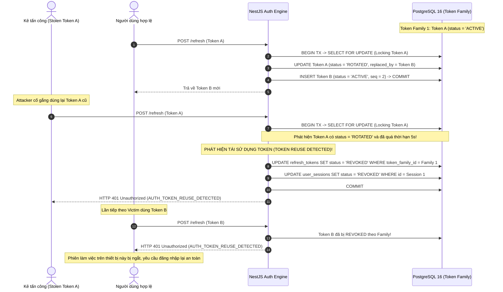

# BIZPRO+ PHASE 1D — SECURITY THREAT MODEL & RISK ANALYSIS
**Tài liệu:** `docs/PHASE_1D_SECURITY_THREAT_MODEL.md`  
**Phiên bản:** 2.0.0 (Comprehensive Cross-Document Architecture Revision)  
**Tác giả:** Senior Security Architect & Backend Architect  
**Trạng thái tài liệu:** DRAFT SPECIFICATION FOR ARCHITECTURAL REVIEW (DESIGN ONLY)  
**Gate Status:** NOT APPROVED — Awaiting Independent Multi-Agent Review  
**Tiêu chuẩn đối chiếu:** OWASP Top 10 API Security (2023), OWASP ASVS v4.0.3, NIST SP 800-63B  

---

## 1. PHẠM VI BẢO MẬT & ĐỊNH DANH TÀI SẢN (ASSET TAXONOMY)

Hệ thống BizPro+ là nền tảng quản trị doanh nghiệp đa tổ chức (Multi-Tenant). Các tài sản số nhạy cảm cần được bảo vệ theo nguyên tắc Defense-in-Depth:
1. **Thông tin xác thực & Bí mật phiên (Credentials & Secrets):** Mật khẩu người dùng (Argon2id Hashes), Refresh Tokens (Token Family SHA-256 Chains), JWT Signing Keys.
2. **Ngữ cảnh Định danh Tổ chức (Tenant Context):** `organization_id` phân tách dữ liệu đa doanh nghiệp.
3. **Dữ liệu Nghiệp vụ Nhạy cảm:** Đơn hàng (`sales_orders`), Giao dịch tài chính (`payment_transactions`), Cơ hội kinh doanh (`deals`), Hồ sơ nhân sự và bảng lương (`employees`, `payroll`), Tồn kho thực tế (`inventory_balances`).
4. **Nhật ký Kiểm toán (Audit Trails):** Bằng chứng pháp lý về mọi thao tác thay đổi dữ liệu, đăng nhập, phân quyền và sự kiện an ninh.

---

## 2. MA TRẬN MỐI ĐE DỌA THEO PHƯƠNG PHÁP STRIDE

| STRIDE Category | Tên Mối Đe Dọa | Kịch bản Tấn công Thực tế | Cấp độ Rủi ro | Giải pháp Kiểm soát Kỹ thuật (Mitigation) |
| :--- | :--- | :--- | :---: | :--- |
| **Spoofing** (Mạo danh) | JWT Signature Forgery / Weak Secret | Kẻ tấn công tạo JWT giả với header `alg: none` hoặc lợi dụng khóa bí mật đối xứng yếu để giả mạo danh tính Admin. | **CRITICAL** | Khóa bí mật tối thiểu 256-bit tạo bởi CSPRNG; Cố định giải thuật `algorithms: ['HS256']`; Chặn tuyệt đối `alg: none`; Kiểm tra claim `iss` và `aud`. |
| **Spoofing** | Credential Stuffing / Brute-force | Kẻ tấn công dùng botnet dò mật khẩu liên tục qua endpoint `/login`. | **HIGH** | Throttling 5 req/min/IP; Khóa tài khoản tạm thời 15 phút sau 5 lần sai liên tiếp (`locked_until`); Băm mật khẩu Argon2id tiêu tốn bộ nhớ. |
| **Tampering** (Can thiệp) | Tenant Context Tampering | Người dùng Tenant A sửa tham số `organizationId` trong body/query để đọc hoặc tạo dữ liệu thuộc Tenant B. | **CRITICAL** | **Zero-Trust Input:** NestJS Guard & Interceptor trích xuất `organizationId` duy nhất từ JWT đã ký; Cấm ghi đè từ request payload; Sử dụng Composite FK `(sales_order_id, organization_id)`. |
| **Tampering** | Token Payload Tampering | Sửa đổi claims `roles` hoặc `permissions` trong JWT payload trên LocalStorage. | **CRITICAL** | Xác minh chữ ký số cryptographic ở mỗi request (`Passport-JWT`); Token có thời gian sống ngắn (15 phút). |
| **Repudiation** (Chối bỏ) | Hành động không thể truy vết | Quản trị viên xóa nhân sự hoặc sửa đơn hàng rồi chối bỏ hành vi. | **MEDIUM** | Ghi nhật ký tự động vào bảng `audit_logs` (lưu trữ `user_id`, `organization_id`, `ip_address`, `user_agent`, `action`, `old_values`, `new_values`). |
| **Information Disclosure** (Lộ lọt thông tin) | User Enumeration | Kẻ tấn công gọi `/forgot-password` với danh sách email để xem email nào đã đăng ký. | **MEDIUM** | API trả về phản hồi đồng nhất HTTP 200 OK bất kể email có tồn tại hay không; Thời gian phản hồi cân bằng (constant-time response). |
| **Information Disclosure** | Leakage in Logs / Headers | Token hoặc password hash bị ghi ra console log hoặc log server file. | **HIGH** | Winston/NestJS Logger có filter loại trừ các trường `password`, `refreshToken`, `token`, `authorization`; Sanitizer pipe. |
| **Denial of Service** (Từ chối dịch vụ) | Hash Algorithm Exhaustion | Kẻ tấn công gửi hàng ngàn request đăng nhập với password dài 100,000 ký tự để làm CPU máy chủ quá tải tính toán Argon2id. | **HIGH** | DTO chặn độ dài mật khẩu tối đa 128 ký tự (`@MaxLength(128)`); Rate limiting ở cấp độ IP và WAF/Nginx. |
| **Elevation of Privilege** (Leo thang đặc quyền) | BFLA / Broken Access Control | Nhân viên bán hàng (Sales) gửi HTTP PUT tới endpoint `/api/v1/hrm/employees` để nâng lương cho chính mình. | **CRITICAL** | **Deny by default:** Mọi endpoint đều phải khai báo `@RequirePermissions()`; `PermissionsGuard` kiểm tra quyền theo cấu trúc module `<module>.<resource>.<action>`. |
| **Elevation of Privilege** | Data Scope Bypass (IDOR) | Nhân viên kinh doanh có Scope `OWN` truy cập đơn hàng của đồng nghiệp bằng cách đổi `orderId` trên URL. | **HIGH** | `DataScopeInterceptor` và Application Query inject điều kiện `WHERE created_by_id = :userId` hoặc `department_id = :deptId` bắt buộc. |

---

## 3. PHÂN TÍCH CHUYÊN SÂU CÁC KỊCH BẢN TẤN CÔNG & ĐỐI SÁCH MỚI

### 3.1. Kịch bản 1: Refresh Token Replay & Targeted Token Family Invalidation
- **Nguy cơ:** Kẻ tấn công đánh cắp Refresh Token của nạn nhân và cố gắng sử dụng để duy trì phiên trái phép.
- **Quy trình phát hiện và phản ứng an ninh:**

### 3.2. Kịch bản 2: Đột nhập Dữ liệu Chéo Tenant (Cross-Tenant Data Leakage)
- **Vấn đề cốt lõi:** Người dùng thuộc Tổ chức A cố tình truy cập hoặc sửa đổi dữ liệu của Tổ chức B bằng cách can thiệp `organizationId` trong request payload hoặc lợi dụng các lỗ hổng của Prisma Extension.
- **Các kịch bản rò rỉ và cơ chế phòng vệ:**
  1. **Lỗ hổng Nested Writes (`connect`):** Kẻ tấn công gửi `createSalesOrder` với `customerId` thuộc Tenant B.
     - *Phòng vệ:* Service Layer xác thực tính hợp lệ của quan hệ trước khi ghi: `customerRepository.findByIdAndOrg(customerId, user.organizationId)`. Nếu không thuộc tổ chức, từ chối ngay lập tức.
  2. **Lỗ hổng Raw SQL (`$queryRaw`):** Developer viết query tổng hợp không có điều kiện lọc tổ chức.
     - *Phòng vệ:* Cấm tuyệt đối Raw SQL không qua kiểm duyệt. Bắt buộc truyền tham số ràng buộc `:orgId` từ context đã chứng thực.
  3. **Lỗ hổng Composite Foreign Key:** Kẻ tấn công cố tình gắn thanh toán với đơn hàng của tổ chức khác.
     - *Phòng vệ tại tầng lưu trữ vật lý:* PostgreSQL 16 chặn đứng bằng ràng buộc `payment_transactions(sales_order_id, organization_id) REFERENCES sales_orders(id, organization_id)`.

### 3.3. Kịch bản 3: Broken Object Level Authorization (BOLA / IDOR)
- **Nguy cơ:** Nhân viên kinh doanh chỉ có quyền hạn trên Deal của chính mình (`created_by_id = user.id`), cố ý đổi ID trên URL `GET /api/v1/crm/deals/deal_999` để xem thông tin của đồng nghiệp.
- **Cơ chế phòng vệ Contextual Policy:**
  - `ResourceScopePolicyEngine` đánh giá động:
    - Kiểm tra `user.roles`: Nếu không có vai trò Quản lý hoặc Admin, bắt buộc ép điều kiện:
      `WHERE organization_id = :orgId AND (created_by_id = :userId OR assigned_to_id = :employeeId)`.
    - Nếu bản ghi tồn tại trong tổ chức nhưng không thuộc quyền sở hữu của user, hệ thống trả về `404 Not Found` (để tránh rò rỉ sự tồn tại của ID đối với kẻ tấn công).

---

## 4. CÁC KỊCH BẢN ĐE DỌA MỚI ĐƯỢC BỔ SUNG (EXTENDED THREAT SCENARIOS)

### 4.1. Kịch bản 4: Tổ chức bị tạm đình chỉ (Organization Suspension)
- **Mối đe dọa:** Tổ chức A bị phát hiện gian lận hoặc chưa thanh toán cước phí, Admin hệ thống chuyển trạng thái tổ chức sang `SUSPENDED`. Tuy nhiên, nhân viên của Tổ chức A vẫn còn Access Token 15m còn hạn.
- **Đối sách:** `TenantContextResolver` tra cứu cờ trạng thái của Organization (lưu trong In-Memory Cache với TTL 30s). Nếu `status == 'SUSPENDED'`, lập tức từ chối toàn bộ request với mã lỗi `403 Forbidden` (`AUTH_ORGANIZATION_SUSPENDED`), vô hiệu hóa mọi thao tác ghi/đọc dữ liệu.

### 4.2. Kịch bản 5: Thu hồi Quyền giữa chừng (User/Role/Employee Revocation)
- **Mối đe dọa:** Nhân viên bị sa thải hoặc bị tước vai trò Admin, nhưng Access Token cũ vẫn còn thời hạn hiệu lực.
- **Đối sách:**
  - Cập nhật `users.auth_version = users.auth_version + 1`.
  - Mọi request mutation hoặc request tiếp theo qua `AuthVersionInterceptor` sẽ so sánh `token.ver < user.auth_version` và lập tức từ chối bằng mã `401 Unauthorized` (`AUTH_TOKEN_REVOKED`).

### 4.3. Kịch bản 6: Lộ Khóa Ký JWT (JWT Signing Key Compromise)
- **Mối đe dọa:** Khóa bí mật `JWT_SECRET` bị rò rỉ ra môi trường bên ngoài (qua git commit nhầm hoặc server bị xâm nhập).
- **Đối sách ứng phó sự cố (Incident Response Runbook):**
  1. Cập nhật `JWT_SECRET` mới trong biến môi trường và triển khai lại ứng dụng.
  2. Toàn bộ Access Token cũ lập tức bị vô hiệu hóa vì chữ ký không khớp.
  3. Tăng `auth_version` toàn bộ người dùng trong cơ sở dữ liệu (`UPDATE users SET auth_version = auth_version + 1`).
  4. Người dùng đăng nhập lại an toàn bằng mật khẩu/Argon2id để nhận token mới.

### 4.4. Kịch bản 7: Can thiệp Nhật ký Kiểm toán (Audit Log Tampering)
- **Mối đe dọa:** Kẻ tấn công chiếm được quyền quản trị viên cố gắng xóa hoặc sửa các bản ghi trong `audit_logs` để xóa dấu vết hành vi phá hoại.
- **Đối sách:**
  - Bảng `audit_logs` áp dụng nguyên tắc **Append-Only**.
  - Không cung cấp bất kỳ API nào cho phép `UPDATE` hoặc `DELETE` trên bảng `audit_logs`.
  - Phân quyền PostgreSQL: User ứng dụng chỉ được cấp quyền `INSERT, SELECT` trên `audit_logs`, thu hồi quyền `UPDATE, DELETE, TRUNCATE`.

### 4.5. Kịch bản 8: Lạm dụng Khôi phục Tài khoản (Account Recovery Abuse & Session Fixation)
- **Mối đe dọa:** Kẻ tấn công gửi hàng ngàn yêu cầu forgot-password để làm nghẽn dịch vụ gửi email hoặc cố tình đoán mã token đặt lại mật khẩu.
- **Đối sách:**
  - Áp dụng Throttling nghiêm ngặt: Tối đa 3 yêu cầu trong 15 phút trên mỗi IP.
  - Phản hồi đồng nhất 200 OK (Generic Response) để chống User Enumeration.
  - Token đặt lại mật khẩu sinh bằng CSPRNG 256-bit, lưu mã băm SHA-256 trong `users.password_reset_token_hash`, thời hạn sống ngắn (30 phút).
  - Khi đặt lại mật khẩu thành công: Tự động vô hiệu hóa token đặt lại mật khẩu và thu hồi toàn bộ các phiên `user_sessions` đang hoạt động.

---

## 5. ĐÁNH GIÁ CHUẨN XÁC VỀ AN NINH TRÌNH DUYỆT (BROWSER SECURITY REALITY)

> [!WARNING]
> **Tuyên bố ranh giới bảo mật thực tế:** Hệ thống **KHÔNG tuyên bố** rằng việc sử dụng HttpOnly Cookie có thể "triệt tiêu 100% rủi ro XSS".
> - **Thực tế:** Cờ `HttpOnly` ngăn chặn hiệu quả việc JavaScript độc hại đọc trực tiếp chuỗi token (Token Exfiltration).
> - **Tuy nhiên:** Nếu trang web bị nhiễm XSS mức độ cao, kẻ tấn công vẫn có thể thực hiện tấn công **XSS-driven HTTP Requests** (sử dụng chính trình duyệt của nạn nhân để gửi request có kèm HttpOnly cookie tự động).
> - **Giải pháp bổ trợ đa tầng:**
>   1. Triển khai Content Security Policy (CSP) nghiêm ngặt qua Helmet.
>   2. Vô hiệu hóa `inline scripts` không có nonce.
>   3. Làm sạch dữ liệu đầu vào và mã hóa đầu ra (Output Encoding) trên React/Next.js.
>   4. Cấu hình Cookie: `HttpOnly; Secure; SameSite=Strict; Path=/api/v1/auth/refresh`.

---

## 6. ĐỐI CHIẾU TIÊU CHUẨN OWASP API SECURITY TOP 10 (2023)

| Mã OWASP | Tên Lỗ hổng | Cơ chế Kiểm soát Cụ thể tại BizPro+ |
| :--- | :--- | :--- |
| **API1:2023** | Broken Object Level Authorization (BOLA) | `ResourceScopePolicyEngine` kiểm tra quyền sở hữu bản ghi theo từng phân hệ (CRM, Sales, Inventory, HRM); Từ chối 404/403 khi ID không thuộc quyền. |
| **API2:2023** | Broken Authentication | Băm mật khẩu Argon2id, JWT ngắn hạn (15m), Token Family Rotation có khóa bi quan, Reuse Detection, HttpOnly SameSite=Strict Cookies. |
| **API3:2023** | Broken Object Property Level Authorization | DTO Dùng `class-transformer` và `class-validator` với `whitelist: true, forbidNonWhitelisted: true`. Chặn tuyệt đối việc client tự cập nhật các trường an ninh (`organizationId`, `role`, `status`, `authVersion`). |
| **API4:2023** | Unrestricted Resource Consumption | Áp dụng Throttling toàn diện (`@nestjs/throttler`), giới hạn độ dài mật khẩu tối đa 128 ký tự để chống DoS CPU, giới hạn payload kích thước tối đa 1MB. |
| **API5:2023** | Broken Function Level Authorization (BFLA) | Mô hình RBAC Deny-by-default; Mọi endpoint yêu cầu `@RequirePermissions()` và kiểm tra chữ ký quyền tường minh. |
| **API6:2023** | Unrestricted Access to Sensitive Business Flows | Rate limit riêng cho luồng login/reset-password; Tạm khóa tài khoản sau 5 lần sai liên tiếp (`locked_until`). |
| **API7:2023** | Server-Side Request Forgery (SSRF) | Hạn chế gọi webhook ra bên ngoài; Whitelist các domain được phép; Không nhận URL trực tiếp từ client. |
| **API8:2023** | Security Misconfiguration | Tắt toàn bộ stack trace chi tiết ở môi trường production; Header bảo mật với Helmet (CSP, X-Content-Type-Options, HSTS). |
| **API9:2023** | Improper Inventory Management | Định tuyến API tường minh `/api/v1/*`; Tự động sinh Swagger/OpenAPI documentation có phân quyền. |
| **API10:2023**| Unsafe Consumption of APIs | Xác minh chữ ký HMAC Webhook các đối tác thanh toán/vận chuyển; Timeout chặt chẽ cho external HTTP calls. |
