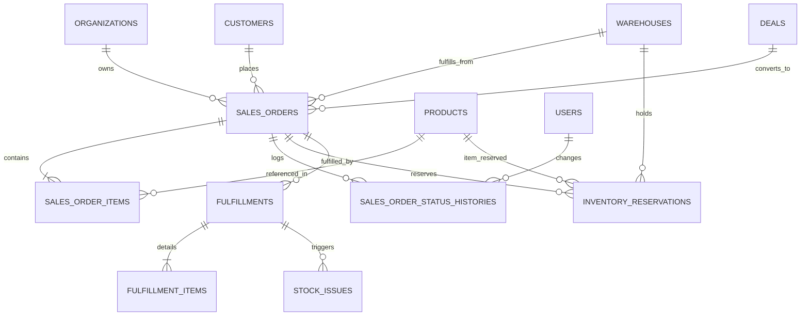

# THIẾT KẾ CƠ SỞ DỮ LIỆU: PHASE 2E SALES ORDERS & FULFILLMENT
**(PHASE 2E DATABASE DESIGN)**

**Dự án**: BizPro+ Modular Enterprise ERP & Business Management System  
**Mã tài liệu**: `docs/PHASE_2E_DATABASE_DESIGN.md`  
**Ngày ban hành**: 06/11/2026  
**Chuyên gia thực hiện**: Database Engineer & Principal Architect  
**Kính gửi**: Senior Technical Lead & Code Auditor (ChatGPT)  
**Trạng thái**: **DESIGN SPECIFICATION — SẴN SÀNG CHỜ PHÊ DUYỆT (STEP 1)**

---

## 1. SƠ ĐỒ THỰC THỂ QUAN HỆ (ENTITY RELATIONSHIP DIAGRAM)



---

## 2. CHI TIẾT CẤU TRÚC BẢNG (TABLE SPECIFICATIONS)

### 2.1. Bảng `sales_orders` (Đơn Bán Hàng)
Lưu thông tin tổng quan của chứng từ đơn hàng, thông tin khách hàng, kho xuất, tiền tệ và địa chỉ giao hàng snapshot.

```prisma
model SalesOrder {
  id                      String                    @id @default(dbgenerated("gen_random_uuid()")) @db.Uuid
  organizationId          String                    @map("organization_id") @db.Uuid
  orderCode               String                    @map("order_code") @db.VarChar(50)
  customerId              String                    @map("customer_id") @db.Uuid
  dealId                  String?                   @map("deal_id") @db.Uuid
  warehouseId             String                    @map("warehouse_id") @db.Uuid
  orderDate               DateTime                  @default(now()) @map("order_date") @db.Timestamptz
  expectedDeliveryDate    DateTime?                 @map("expected_delivery_date") @db.Date
  status                  SalesOrderStatus          @default(DRAFT)
  paymentStatus           PaymentStatus             @default(UNPAID) @map("payment_status")
  
  // Financial fields - Strict Decimal(15, 2)
  subtotal                Decimal                   @default(0.00) @db.Decimal(15, 2)
  discountAmount          Decimal                   @default(0.00) @map("discount_amount") @db.Decimal(15, 2)
  taxAmount               Decimal                   @default(0.00) @map("tax_amount") @db.Decimal(15, 2)
  totalAmount             Decimal                   @default(0.00) @map("total_amount") @db.Decimal(15, 2)
  paidAmount              Decimal                   @default(0.00) @map("paid_amount") @db.Decimal(15, 2)
  remainingBalance        Decimal                   @default(0.00) @map("remaining_balance") @db.Decimal(15, 2)
  overpaidAmount          Decimal                   @default(0.00) @map("overpaid_amount") @db.Decimal(15, 2)
  
  // Shipping Snapshots
  shippingAddressSnapshot Json                      @default("{}") @map("shipping_address_snapshot")
  shippingRecipientName   String?                   @map("shipping_recipient_name") @db.VarChar(255)
  shippingPhone           String?                   @map("shipping_phone") @db.VarChar(50)
  shippingProvinceCode    String?                   @map("shipping_province_code") @db.VarChar(20)
  shippingDistrictCode    String?                   @map("shipping_district_code") @db.VarChar(20)
  shippingWardCode        String?                   @map("shipping_ward_code") @db.VarChar(20)
  shippingFullAddress     String?                   @map("shipping_full_address") @db.Text
  note                    String?                   @db.Text
  
  // Audit stamps
  createdBy               String                    @map("created_by") @db.Uuid
  confirmedBy             String?                   @map("confirmed_by") @db.Uuid
  confirmedAt             DateTime?                 @map("confirmed_at") @db.Timestamptz
  createdAt               DateTime                  @default(now()) @map("created_at") @db.Timestamptz
  updatedAt               DateTime                  @default(now()) @updatedAt @map("updated_at") @db.Timestamptz

  // Relations
  organization        Organization              @relation(fields: [organizationId], references: [id], onDelete: Cascade)
  customer            Customer                  @relation(fields: [customerId], references: [id], onDelete: Restrict)
  deal                Deal?                     @relation(fields: [dealId], references: [id], onDelete: SetNull)
  warehouse           Warehouse                 @relation(fields: [warehouseId], references: [id], onDelete: Restrict)
  creator             User                      @relation("UserCreatedOrders", fields: [createdBy], references: [id], onDelete: Restrict)
  confirmer           User?                     @relation("UserConfirmedOrders", fields: [confirmedBy], references: [id], onDelete: Restrict)
  items               SalesOrderItem[]
  reservations        InventoryReservation[]
  statusHistories     SalesOrderStatusHistory[]
  fulfillments        Fulfillment[]

  @@unique([organizationId, orderCode])
  @@unique([id, organizationId], name: "uq_sales_orders_id_org")
  @@index([organizationId, status])
  @@index([organizationId, customerId])
  @@index([organizationId, warehouseId])
  @@index([organizationId, createdAt(sort: Desc)])
  @@map("sales_orders")
}
```

---

### 2.2. Bảng `sales_order_items` (Chi Tiết Dòng Hàng)
Lưu trữ danh sách hàng hóa trong đơn, lưu snapshot SKU, tên hàng và đơn vị tính tại thời điểm đặt để ngăn chặn thay đổi dữ liệu danh mục làm biến dạng lịch sử.

```prisma
model SalesOrderItem {
  id                  String   @id @default(dbgenerated("gen_random_uuid()")) @db.Uuid
  salesOrderId        String   @map("sales_order_id") @db.Uuid
  productId           String   @map("product_id") @db.Uuid
  
  // Immutable Snapshots
  skuSnapshot         String   @map("sku_snapshot") @db.VarChar(100)
  productNameSnapshot String   @map("product_name_snapshot") @db.VarChar(255)
  uomSnapshot         String   @map("uom_snapshot") @db.VarChar(50)
  
  // Quantities - Decimal(12, 3)
  quantity            Decimal  @db.Decimal(12, 3)
  fulfilledQuantity   Decimal  @default(0.000) @map("fulfilled_quantity") @db.Decimal(12, 3)
  
  // Financials - Decimal(15, 2)
  unitPrice           Decimal  @default(0.00) @map("unit_price") @db.Decimal(15, 2)
  discountAmount      Decimal  @default(0.00) @map("discount_amount") @db.Decimal(15, 2)
  taxRate             Decimal  @default(0.00) @map("tax_rate") @db.Decimal(5, 2)
  lineTotal           Decimal  @default(0.00) @map("line_total") @db.Decimal(15, 2)
  
  createdAt           DateTime @default(now()) @map("created_at") @db.Timestamptz
  updatedAt           DateTime @default(now()) @updatedAt @map("updated_at") @db.Timestamptz

  salesOrder SalesOrder @relation(fields: [salesOrderId], references: [id], onDelete: Cascade)
  product    Product    @relation(fields: [productId], references: [id], onDelete: Restrict)

  @@index([salesOrderId])
  @@index([productId])
  @@map("sales_order_items")
}
```

---

### 2.3. Bảng `sales_order_status_histories` (Nhật Ký Trạng Thái Đơn Hàng)
Lưu vết chuyển trạng thái tuần tự của đơn hàng (Append-Only), phục vụ kiểm toán và theo dõi SLA xử lý.

```prisma
model SalesOrderStatusHistory {
  id           String            @id @default(dbgenerated("gen_random_uuid()")) @db.Uuid
  salesOrderId String            @map("sales_order_id") @db.Uuid
  fromStatus   SalesOrderStatus? @map("from_status")
  toStatus     SalesOrderStatus  @map("to_status")
  changedBy    String?           @map("changed_by") @db.Uuid
  changedAt    DateTime          @default(now()) @map("changed_at") @db.Timestamptz
  note         String?           @db.Text

  salesOrder SalesOrder @relation(fields: [salesOrderId], references: [id], onDelete: Cascade)
  changer    User?      @relation("UserChangedOrderStatuses", fields: [changedBy], references: [id], onDelete: SetNull)

  @@index([salesOrderId, changedAt])
  @@map("sales_order_status_histories")
}
```

---

### 2.4. Bảng `inventory_reservations` (Khóa Giữ Hàng Trong Kho)
Quản lý số lượng tồn kho được cam kết giữ cho đơn hàng, ngăn ngừa bán âm kho.

```prisma
model InventoryReservation {
  id             String            @id @default(dbgenerated("gen_random_uuid()")) @db.Uuid
  organizationId String            @map("organization_id") @db.Uuid
  warehouseId    String            @map("warehouse_id") @db.Uuid
  productId      String            @map("product_id") @db.Uuid
  salesOrderId   String            @map("sales_order_id") @db.Uuid
  quantity       Decimal           @db.Decimal(12, 3)
  status         ReservationStatus @default(ACTIVE) // ACTIVE, RELEASED, FULFILLED
  reservedAt     DateTime          @default(now()) @map("reserved_at") @db.Timestamptz
  releasedAt     DateTime?         @map("released_at") @db.Timestamptz
  createdAt      DateTime          @default(now()) @map("created_at") @db.Timestamptz
  updatedAt      DateTime          @default(now()) @updatedAt @map("updated_at") @db.Timestamptz

  organization Organization @relation(fields: [organizationId], references: [id], onDelete: Cascade)
  warehouse    Warehouse    @relation(fields: [warehouseId], references: [id], onDelete: Restrict)
  product      Product      @relation(fields: [productId], references: [id], onDelete: Restrict)
  salesOrder   SalesOrder   @relation(fields: [salesOrderId], references: [id], onDelete: Cascade)

  @@index([organizationId, warehouseId, productId, status])
  @@index([organizationId, salesOrderId, status])
  @@map("inventory_reservations")
}
```

---

### 2.5. Bảng `fulfillments` & `fulfillment_items` (Giao Vận & Xuất Kho)
Ghi nhận các đợt xuất kho giao hàng (hỗ trợ giao một phần nhiều lần) và gắn trực tiếp với `StockIssue` của Phase 2C.

```prisma
model Fulfillment {
  id              String            @id @default(dbgenerated("gen_random_uuid()")) @db.Uuid
  organizationId  String            @map("organization_id") @db.Uuid
  fulfillmentCode String            @map("fulfillment_code") @db.VarChar(50)
  salesOrderId    String            @map("sales_order_id") @db.Uuid
  warehouseId     String            @map("warehouse_id") @db.Uuid
  stockIssueId    String?           @unique @map("stock_issue_id") @db.Uuid
  status          FulfillmentStatus @default(COMPLETED) // DRAFT, COMPLETED, CANCELLED
  trackingNumber  String?           @map("tracking_number") @db.VarChar(100)
  carrierName     String?           @map("carrier_name") @db.VarChar(100)
  deliveredAt     DateTime?         @map("delivered_at") @db.Timestamptz
  note            String?           @db.Text
  fulfilledBy     String            @map("fulfilled_by") @db.Uuid
  createdAt       DateTime          @default(now()) @map("created_at") @db.Timestamptz
  updatedAt       DateTime          @default(now()) @updatedAt @map("updated_at") @db.Timestamptz

  organization Organization      @relation(fields: [organizationId], references: [id], onDelete: Cascade)
  salesOrder   SalesOrder        @relation(fields: [salesOrderId], references: [id], onDelete: Cascade)
  warehouse    Warehouse         @relation(fields: [warehouseId], references: [id], onDelete: Restrict)
  stockIssue   StockIssue?       @relation(fields: [stockIssueId], references: [id], onDelete: SetNull)
  executor     User              @relation("UserExecutedFulfillments", fields: [fulfilledBy], references: [id], onDelete: Restrict)
  items        FulfillmentItem[]

  @@unique([organizationId, fulfillmentCode])
  @@index([organizationId, salesOrderId])
  @@map("fulfillments")
}

model FulfillmentItem {
  id            String   @id @default(dbgenerated("gen_random_uuid()")) @db.Uuid
  fulfillmentId String   @map("fulfillment_id") @db.Uuid
  productId     String   @map("product_id") @db.Uuid
  quantity      Decimal  @db.Decimal(12, 3)

  fulfillment Fulfillment @relation(fields: [fulfillmentId], references: [id], onDelete: Cascade)
  product     Product     @relation(fields: [productId], references: [id], onDelete: Restrict)

  @@index([fulfillmentId])
  @@index([productId])
  @@map("fulfillment_items")
}
```

---

## 3. RÀNG BUỘC TOÀN VẸN & CHÍNH SÁCH BẢO MẬT DDL (RLS & CONSTRAINTS)

### 3.1. Bật Row-Level Security & Force RLS
Mọi bảng mới thuộc phạm vi phân hệ Sales đều bắt buộc kích hoạt chính sách RLS ngăn ngừa rò rỉ dữ liệu chéo công ty:

```sql
-- 1. sales_orders
ALTER TABLE sales_orders ENABLE ROW LEVEL SECURITY;
ALTER TABLE sales_orders FORCE ROW LEVEL SECURITY;
CREATE POLICY tenant_isolation_policy ON sales_orders
    FOR ALL
    USING (is_system_context = 'true' OR organization_id = current_setting('app.current_organization_id', true)::uuid)
    WITH CHECK (is_system_context = 'true' OR organization_id = current_setting('app.current_organization_id', true)::uuid);

-- 2. sales_order_items (Child table isolation)
ALTER TABLE sales_order_items ENABLE ROW LEVEL SECURITY;
ALTER TABLE sales_order_items FORCE ROW LEVEL SECURITY;
CREATE POLICY tenant_child_isolation_policy ON sales_order_items
    FOR ALL
    USING (is_system_context = 'true' OR EXISTS (
        SELECT 1 FROM sales_orders p WHERE p.id = sales_order_id 
        AND p.organization_id = current_setting('app.current_organization_id', true)::uuid
    ))
    WITH CHECK (is_system_context = 'true' OR EXISTS (
        SELECT 1 FROM sales_orders p WHERE p.id = sales_order_id 
        AND p.organization_id = current_setting('app.current_organization_id', true)::uuid
    ));

-- 3. sales_order_status_histories (Child table isolation)
ALTER TABLE sales_order_status_histories ENABLE ROW LEVEL SECURITY;
ALTER TABLE sales_order_status_histories FORCE ROW LEVEL SECURITY;
CREATE POLICY tenant_child_isolation_policy ON sales_order_status_histories
    FOR ALL
    USING (is_system_context = 'true' OR EXISTS (
        SELECT 1 FROM sales_orders p WHERE p.id = sales_order_id 
        AND p.organization_id = current_setting('app.current_organization_id', true)::uuid
    ))
    WITH CHECK (is_system_context = 'true' OR EXISTS (
        SELECT 1 FROM sales_orders p WHERE p.id = sales_order_id 
        AND p.organization_id = current_setting('app.current_organization_id', true)::uuid
    ));

-- 4. inventory_reservations
ALTER TABLE inventory_reservations ENABLE ROW LEVEL SECURITY;
ALTER TABLE inventory_reservations FORCE ROW LEVEL SECURITY;
CREATE POLICY tenant_isolation_policy ON inventory_reservations
    FOR ALL
    USING (is_system_context = 'true' OR organization_id = current_setting('app.current_organization_id', true)::uuid)
    WITH CHECK (is_system_context = 'true' OR organization_id = current_setting('app.current_organization_id', true)::uuid);

-- 5. fulfillments
ALTER TABLE fulfillments ENABLE ROW LEVEL SECURITY;
ALTER TABLE fulfillments FORCE ROW LEVEL SECURITY;
CREATE POLICY tenant_isolation_policy ON fulfillments
    FOR ALL
    USING (is_system_context = 'true' OR organization_id = current_setting('app.current_organization_id', true)::uuid)
    WITH CHECK (is_system_context = 'true' OR organization_id = current_setting('app.current_organization_id', true)::uuid);
```

### 3.2. Ràng buộc Check Constraints
- `quantity > 0`: Số lượng đặt và số lượng xuất bắt buộc phải là số dương.
- `unit_price >= 0`: Đơn giá không được âm.
- `discount_amount >= 0` và `discount_amount <= subtotal`: Chiết khấu không vượt quá tổng tiền hàng.
- `fulfilled_quantity <= quantity`: Không cho phép giao hàng vượt quá số lượng đặt trên từng dòng hàng.
