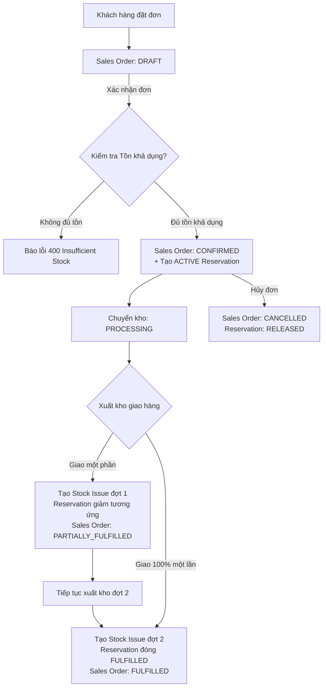

# TÀI LIỆU ĐẶC TẢ KỸ THUẬT: PHASE 2E SALES ORDERS & FULFILLMENT
**(PHASE 2E TECHNICAL SPECIFICATION)**

**Dự án**: BizPro+ Modular Enterprise ERP & Business Management System  
**Mã tài liệu**: `docs/PHASE_2E_TECHNICAL_SPECIFICATION.md`  
**Ngày ban hành**: 06/11/2026  
**Chuyên gia thực hiện**: Orchestrator Agent, Principal Architect & Backend Engineer  
**Kính gửi**: Senior Technical Lead & Code Auditor (ChatGPT)  
**Trạng thái**: **DESIGN SPECIFICATION — SẴN SÀNG CHỜ PHÊ DUYỆT (STEP 1)**

---

## 1. TỔNG QUAN HỆ THỐNG & MỤC TIÊU (EXECUTIVE SUMMARY)

Phase 2E chịu trách nhiệm hiện thực hóa phân hệ **Quản lý Đơn bán hàng & Xuất kho hoàn tất (Sales Orders & Fulfillment)**. Đây là module liên thông trung tâm của hệ thống BizPro+, kết nối trực tiếp dữ liệu Đối tác/Cơ hội từ Phase 2D (CRM), Quản lý Tồn kho & Thẻ kho từ Phase 2C (Inventory), và hệ thống Phân quyền Động từ Phase 2B (RBAC) trên nền tảng Bảo mật Dual-Token Phase 2A.

### Nguyên tắc bất biến (Core Invariants):
1. **Zero-Mock Policy**: 100% dữ liệu đơn hàng và giao vận được lưu trữ bền vững trong PostgreSQL 16 qua Prisma ORM, kiểm soát chặt chẽ bởi RLS và Force RLS.
2. **Single Source of Truth cho Tồn kho**: Không tạo bất kỳ hệ thống số dư tồn kho thứ hai nào trong phân hệ Sales. Mọi biến động hàng hóa đều giao tiếp trực tiếp với phân hệ Inventory Core thông qua hai cơ chế chuẩn:
   - **Stock Reservation (Khóa giữ hàng)**: Thực thi tại thời điểm Xác nhận Đơn hàng (`CONFIRMED`).
   - **Stock Issue (Phiếu xuất kho)**: Thực thi tại thời điểm Thực hiện Giao hàng (`FULFILLED` / `PARTIALLY_FULFILLED`).
3. **Upfront Function-Level RBAC**: Tuyệt đối không lặp lại hạn chế của Phase 2D. 100% các route API trong `SalesController` được bảo vệ ngay từ đầu bằng `PermissionsGuard` và `@RequirePermissions(...)`.
4. **Tính toán Số học Tuyệt đối Chính xác (Decimal Precision)**: Mọi phép tính tiền tệ (Subtotal, Discount, Tax, Total) và số lượng xuất nhập đều sử dụng định dạng `Decimal(15, 2)` và `Decimal(12, 3)`, cấm tuyệt đối việc sử dụng số thực JavaScript IEEE 754 float gây sai lệch làm tròn.
5. **Idempotency & Concurrency Control**: Mọi thao tác chuyển trạng thái trọng yếu (Xác nhận đơn, Hủy đơn, Xuất kho giao hàng) đều được bảo vệ bởi Khóa dòng bi quan (`SELECT ... FOR UPDATE`), Idempotency Key và Database Constraints để ngăn chặn hoàn toàn Race Condition và Overselling.

---

## 2. PHÂN TÍCH HIỆN TRẠNG INVENTORY CORE & KHOẢNG TRỐNG TÍCH HỢP

### 2.1. Đánh giá hạ tầng Inventory Phase 2C hiện có
Hệ thống Inventory Core (đã nghiệm thu chính thức) cung cấp:
- **Product Catalog & UOM**: Danh mục sản phẩm, đơn vị tính cơ sở và quy đổi đơn vị.
- **Stock Balance**: Bảng `stock_balances` lưu trữ `quantity` (tồn thực tế) theo `(organizationId, warehouseId, productId)`.
- **Stock Ledger (Hai chiều)**: Bảng `stock_ledger` ghi nhận lịch sử biến động bất biến (Append-Only) cho mọi giao dịch.
- **Stock Issue Service**: Hàm `createStockIssue` và `postStockIssue` đã có cơ chế trừ tồn kho thực tế và ghi thẻ kho với khóa bi quan `SELECT FOR UPDATE`.

### 2.2. Khoảng trống kỹ thuật & Thiết kế Reservation
* **Hiện trạng**: Bảng `inventory_reservations` đã có sẵn trong `schema.prisma` (dòng 1344–1364) nhưng `InventoryService` chưa công khai phương thức nghiệp vụ chuyên dụng để tạo/giải phóng reservation từ bên ngoài module.
* **Giải pháp tích hợp**:
  - Không sửa đổi mã nguồn nghiệp vụ cốt lõi cũ của Phase 2C.
  - Xây dựng phương thức mở rộng trong `SalesService` (hoặc adapter nội bộ) thao tác trên `tx.inventoryReservation` bên trong cùng Database Transaction:
    $$\text{Available Stock} = \text{On-Hand Stock} - \sum \text{Active Reservations}$$
  - Khi xác nhận đơn hàng, hệ thống khóa dòng `stock_balances` bằng `SELECT FOR UPDATE`, tính toán tồn khả dụng; nếu $\text{Available} \ge \text{Order Quantity}$, tạo bản ghi `inventory_reservations` trạng thái `ACTIVE`.
  - Khi đơn hàng bị hủy, cập nhật reservation thành `RELEASED`.
  - Khi đơn hàng xuất kho, cập nhật reservation thành `FULFILLED` đồng thời gọi tạo `StockIssue` của Phase 2C.

---

## 3. STATE MACHINE: VÒNG ĐỜI ĐƠN HÀNG (SALES ORDER LIFECYCLE)

### 3.1. Các trạng thái Đơn hàng
- **DRAFT (Bản thảo)**: Đơn hàng mới khởi tạo. Cho phép thêm, sửa, xóa các dòng sản phẩm, chỉnh sửa địa chỉ giao hàng và chiết khấu. Chưa có tác động đến tồn kho.
- **CONFIRMED (Đã xác nhận)**: Đơn hàng đã được duyệt kinh doanh. Khóa cứng danh mục hàng hóa và đơn giá. Hệ thống tự động tạo **Stock Reservation** khóa giữ số lượng trong kho chỉ định.
- **PROCESSING (Đang xử lý/Đóng gói)**: Kho nhận lệnh, tiến hành nhặt hàng và đóng gói. Không thể hủy đơn tùy tiện trừ khi có quyền quản lý kho.
- **PARTIALLY_FULFILLED (Giao một phần)**: Đã xuất kho giao một phần số lượng đơn hàng. Phần còn lại tiếp tục được giữ hàng trong reservation.
- **FULFILLED (Hoàn tất giao hàng)**: 100% số lượng các mặt hàng trong đơn đã được xuất kho và giao cho khách hàng.
- **CANCELLED (Đã hủy)**: Đơn hàng bị hủy bỏ. Toàn bộ reservation đang hoạt động (`ACTIVE`) lập tức được giải phóng (`RELEASED`) trở lại tồn khả dụng.

### 3.2. Ma trận Chuyển trạng thái (State Transition Matrix)

| Trạng thái hiện tại | Thao tác kích hoạt | Trạng thái đích | Tác động Tồn kho | Quyền yêu cầu (RBAC) | Điều kiện tiên quyết |
| :--- | :--- | :--- | :--- | :--- | :--- |
| *(None)* | Tạo đơn hàng | `DRAFT` | Không | `sales.orders.write` | Khách hàng hợp lệ, sản phẩm tồn tại |
| `DRAFT` | Xác nhận đơn (`confirm`) | `CONFIRMED` | **Tạo ACTIVE Reservation** | `sales.orders.confirm` | Tồn khả dụng $\ge$ Số lượng đặt |
| `DRAFT` | Hủy đơn (`cancel`) | `CANCELLED` | Không | `sales.orders.cancel` | Chưa có reservation |
| `CONFIRMED` | Bắt đầu xử lý (`process`) | `PROCESSING` | Giữ nguyên Reservation | `sales.fulfillment.manage` | Đơn đã xác nhận |
| `CONFIRMED` | Hủy đơn (`cancel`) | `CANCELLED` | **Giải phóng Reservation (`RELEASED`)** | `sales.orders.cancel` | Chưa xuất kho kiện hàng nào |
| `PROCESSING` | Giao 1 phần (`fulfill`) | `PARTIALLY_FULFILLED`| **Trừ Tồn thực tế + Giảm Reservation** | `sales.fulfillment.manage` | Số lượng xuất $\le$ Số lượng còn lại |
| `PROCESSING` | Giao toàn bộ (`fulfill`) | `FULFILLED` | **Trừ Tồn thực tế + Hoàn tất Reservation** | `sales.fulfillment.manage` | Xuất đủ 100% số lượng |
| `PARTIALLY_FULFILLED`| Giao phần còn lại | `FULFILLED` | **Trừ Tồn thực tế + Hoàn tất Reservation** | `sales.fulfillment.manage` | Tổng xuất đạt 100% |
| `PARTIALLY_FULFILLED`| Đóng đơn/Hủy phần thừa | `CANCELLED` | **Giải phóng phần Reservation còn dư** | `sales.orders.cancel` | Chỉ giải phóng số lượng chưa giao |
| `FULFILLED` | *(Trạng thái kết thúc)* | *(Khóa)* | Không được phép thay đổi | — | Bất biến |
| `CANCELLED` | *(Trạng thái kết thúc)* | *(Khóa)* | Không được phép thay đổi | — | Bất biến |

---

## 4. QUY TRÌNH THỰC HIỆN GIAO VẬN (FULFILLMENT WORKFLOW)



### Chi tiết các bước giao vận:
1. **Fulfillment Record**: Mỗi đợt xuất giao hàng tạo một chứng từ Fulfillment tham chiếu đến `SalesOrder` và `Warehouse`.
2. **Fulfillment Items**: Xác định chính xác số lượng từng sản phẩm được xuất trong đợt này. Ràng buộc:
   $$\text{fulfilledQuantity}_{\text{đợt này}} \le \text{quantity}_{\text{đặt}} - \text{fulfilledQuantity}_{\text{đã giao trước}}$$
3. **Tạo Stock Issue**: Tự động sinh `StockIssue` (Phiếu xuất kho) loại `SALES_ISSUE`, liên kết trực tiếp với mã đơn hàng.
4. **Cập nhật lũy kế**: Tăng trường `fulfilledQuantity` trên từng dòng `sales_order_items`. Khi 100% các dòng đạt `fulfilledQuantity == quantity`, đơn hàng tự động chuyển sang `FULFILLED`.

---

## 5. RANH GIỚI GIAO DỊCH NGUYÊN TỬ (TRANSACTION BOUNDARIES)

Mọi thao tác thay đổi nghiệp vụ đều bắt buộc thực thi trong một Database Transaction duy nhất (`prisma.$transaction`) với cấp độ cô lập chống Race Condition:

### 5.1. Transaction 1: Confirm Sales Order
```sql
BEGIN;
-- 1. Khóa dòng SalesOrder ngăn chặn xác nhận đồng thời
SELECT id, status FROM sales_orders WHERE id = $orderId AND organization_id = $orgId FOR UPDATE;

-- 2. Kiểm tra trạng thái phải là DRAFT
-- Nếu != DRAFT -> ROLLBACK & ném lỗi 400 Conflict/Invalid State

-- 3. Khóa các dòng stock_balances liên quan
SELECT product_id, quantity FROM stock_balances 
WHERE warehouse_id = $warehouseId AND product_id IN ($productIds) FOR UPDATE;

-- 4. Tính toán tồn khả dụng = OnHand - Sum(Active Reservations)
-- Nếu bất kỳ sản phẩm nào thiếu -> ROLLBACK & ném lỗi 400 Insufficient Stock

-- 5. Tạo các bản ghi inventory_reservations (status = 'ACTIVE')
INSERT INTO inventory_reservations (...) VALUES (...);

-- 6. Cập nhật SalesOrder: status = 'CONFIRMED', confirmed_at = NOW(), confirmed_by = $userId
UPDATE sales_orders SET status = 'CONFIRMED', ... WHERE id = $orderId;

-- 7. Ghi nhận SalesOrderStatusHistory
INSERT INTO sales_order_status_histories (sales_order_id, from_status, to_status, changed_by, ...) VALUES (...);
COMMIT;
```

### 5.2. Transaction 2: Cancel Sales Order
```sql
BEGIN;
-- 1. Khóa dòng SalesOrder
SELECT id, status FROM sales_orders WHERE id = $orderId AND organization_id = $orgId FOR UPDATE;

-- 2. Kiểm tra trạng thái: Không được hủy nếu đã FULFILLED
-- 3. Cập nhật các reservation đang ACTIVE thành RELEASED
UPDATE inventory_reservations SET status = 'RELEASED', released_at = NOW() 
WHERE sales_order_id = $orderId AND status = 'ACTIVE';

-- 4. Cập nhật SalesOrder: status = 'CANCELLED'
UPDATE sales_orders SET status = 'CANCELLED' WHERE id = $orderId;

-- 5. Ghi nhận SalesOrderStatusHistory
INSERT INTO sales_order_status_histories (...) VALUES (...);
COMMIT;
```

### 5.3. Transaction 3: Execute Fulfillment
```sql
BEGIN;
-- 1. Khóa SalesOrder và các dòng SalesOrderItem
SELECT * FROM sales_orders WHERE id = $orderId FOR UPDATE;
SELECT * FROM sales_order_items WHERE sales_order_id = $orderId FOR UPDATE;

-- 2. Validate số lượng giao: Không vượt số lượng còn lại (quantity - fulfilled_quantity)
-- 3. Tạo StockIssue và StockIssueItems trong phân hệ Inventory
INSERT INTO stock_issues (...) VALUES (...);
INSERT INTO stock_issue_items (...) VALUES (...);

-- 4. Cập nhật stock_balances (trừ tồn thực tế) và ghi stock_ledger
UPDATE stock_balances SET quantity = quantity - $qty WHERE ...;
INSERT INTO stock_ledger (...) VALUES (...);

-- 5. Cập nhật inventory_reservations: Giảm số lượng reserved hoặc đánh dấu FULFILLED
-- 6. Cập nhật fulfilled_quantity trên sales_order_items
UPDATE sales_order_items SET fulfilled_quantity = fulfilled_quantity + $qty WHERE ...;

-- 7. Cập nhật trạng thái SalesOrder: PARTIALLY_FULFILLED hoặc FULFILLED
-- 8. Ghi nhận SalesOrderStatusHistory
COMMIT;
```

---

## 6. SỔ ĐĂNG KÝ RỦI RO TÍCH HỢP (INTEGRATION RISK REGISTER)

| Mã Rủi ro | Mô tả Rủi ro Kỹ thuật | Khả năng xảy ra | Mức độ tác động | Biện pháp Phòng ngừa & Xử lý (Mitigation) |
| :--- | :--- | :---: | :---: | :--- |
| **IR-01** | Bán âm kho (Overselling) khi nhiều đơn cùng đặt mặt hàng cuối cùng | Trung bình | **Nghiêm trọng (Critical)** | Sử dụng `SELECT ... FOR UPDATE` trên bảng `stock_balances` trong transaction xác nhận đơn. Kiểm tra tồn khả dụng nghiêm ngặt trước khi tạo Reservation. |
| **IR-02** | Treo giữ hàng vĩnh viễn (Orphaned Reservation) khi đơn hủy bất thường | Thấp | **Cao (High)** | Transaction hủy đơn bắt buộc chạy câu lệnh `UPDATE inventory_reservations SET status = 'RELEASED'` trong cùng khối commit. |
| **IR-03** | Xuất kho trùng lặp (Duplicate Stock Issue) do người dùng click nhiều lần | Trung bình | **Cao (High)** | Áp dụng `Idempotency-Key` trên endpoint Fulfillment và kiểm tra điều kiện dòng `fulfilled_quantity + qty <= quantity`. |
| **IR-04** | Sai lệch làm tròn số tiền chiết khấu và thuế VAT | Cao | **Trung bình (Medium)** | Sử dụng thư viện `decimal.js` (hoặc Prisma Decimal) với scale 2 cho tiền và scale 3 cho số lượng. Không dùng toán tử `+`, `*` trên số nguyên thủy JavaScript float. |
| **IR-05** | Thay đổi giá sản phẩm ở CRM/Catalog làm sai lệch doanh thu lịch sử | Trung bình | **Cao (High)** | Bắt buộc lưu trữ Snapshot toàn bộ thông tin tại thời điểm đặt hàng: `skuSnapshot`, `productNameSnapshot`, `uomSnapshot`, `unitPrice` cố định trên từng `SalesOrderItem`. |
| **IR-06** | Xung đột RLS khi thực hiện liên thông Cross-Module giữa Sales và Inventory | Thấp | **Nghiêm trọng (Critical)** | Đảm bảo cả hai phân hệ đều chạy trên cùng Tenant Context `app.current_organization_id`, hoặc gọi nội bộ trong `runInSystemContext` với điều kiện kiểm soát `organizationId` chặt chẽ ở cấp độ ứng dụng. |

---

## 7. DANH SÁCH CÁC QUYẾT ĐỊNH CẦN TECHNICAL LEAD PHÊ DUYỆT

1. **Quyết định 1**: Phê duyệt cấu trúc State Machine 6 trạng thái: `DRAFT`, `CONFIRMED`, `PROCESSING`, `PARTIALLY_FULFILLED`, `FULFILLED`, `CANCELLED`.
2. **Quyết định 2**: Phê duyệt cơ chế Tồn khả dụng (Available Stock) tính toán động: $\text{OnHand} - \text{Active Reservations}$ thay vì lưu trường dư thừa trong DB.
3. **Quyết định 3**: Phê duyệt mô hình Snapshot dữ liệu sản phẩm và địa chỉ nhận hàng nhằm đảm bảo tính bất biến của đơn hàng lịch sử.
4. **Quyết định 4**: Phê duyệt danh mục 5 Permission chuẩn Sales (`sales.orders.read`, `sales.orders.write`, `sales.orders.confirm`, `sales.orders.cancel`, `sales.fulfillment.manage`) áp dụng Guard chức năng ngay từ đầu.
