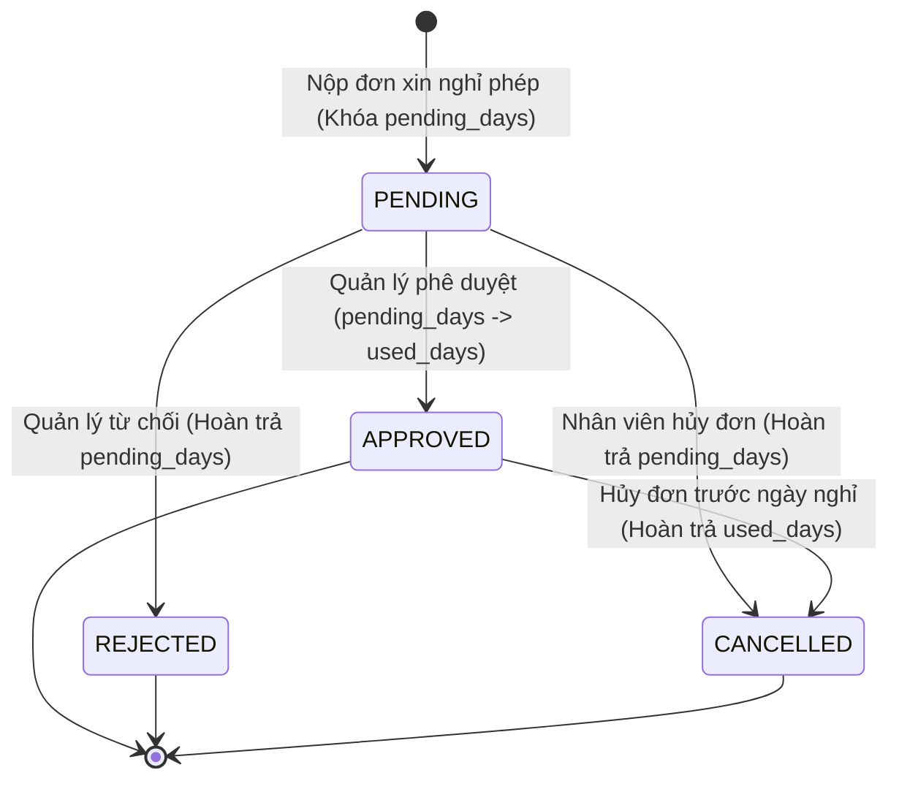

# YÊU CẦU NGHIỆP VỤ: PHASE 2F — HRM & WORKFORCE MANAGEMENT
**(PHASE 2F BUSINESS REQUIREMENTS SPECIFICATION)**

**Mã tài liệu:** `docs/PHASE_2F_BUSINESS_REQUIREMENTS.md`  
**Dự án:** BizPro+ Modular Enterprise ERP & Business Management System  
**Ngày ban hành:** 06/11/2026  
**Chuyên gia thực hiện:** Principal Software Architect & Senior Business Analyst  
**Kính gửi:** Senior Technical Lead & System Architecture Board (ChatGPT)  
**Trạng thái tài liệu:** **DESIGN ONLY — READY FOR REVIEW**  

---

## 1. TỔNG QUAN & MỤC TIÊU NGHIỆP VỤ (BUSINESS OVERVIEW & GOALS)

Module Quản trị Nhân sự & Lực lượng Lao động (HRM & Workforce Management) của BizPro+ đóng vai trò cốt lõi trong việc quản lý tài sản con người, số hóa toàn bộ vòng đời nhân viên từ khi gia nhập, ký hợp đồng, phân bổ phòng ban, chấm công hàng ngày, quản lý quỹ nghỉ phép và lịch sử biến động nhân sự.

### Mục tiêu chiến lược:
1. **Số hóa 100% Hồ sơ Nhân sự:** Xóa bỏ quản lý hồ sơ giấy/Excel phân tán; xây dựng Single Source of Truth (SSOT) cho toàn bộ thông tin nhân sự trong doanh nghiệp.
2. **Tuân thủ Tuyệt đối Pháp luật Lao động Việt Nam:** Thực thi các quy định của **Bộ luật Lao động 2019 (Luật số 45/2019/QH14)** về hợp đồng lao động, ca làm việc chuẩn (8 giờ/ngày, 48 giờ/tuần), và chế độ nghỉ phép năm (tối thiểu 12 ngày phép có hưởng lương).
3. **Minh bạch Chấm công & Phê duyệt Nghỉ phép:** Quy trình Check-in / Check-out tự động, cơ chế đối soát ca làm việc, quy trình duyệt phép 2 cấp (Quản lý trực tiếp -> HR Manager) với cơ chế trừ quỹ phép thời gian thực.
4. **Tích hợp Liền mạch Đa phân hệ:** Liên kết nhân viên với tài khoản hệ thống (`users`), phòng ban (`departments`), thủ kho (`warehouses.manager_employee_id`), và người phụ trách kinh doanh (`deals.owner_employee_id`).

---

## 2. ĐỐI TƯỢNG SỬ DỤNG & VAI TRÒ HỆ THỐNG (STAKEHOLDERS & PERSONAS)

1. **HR Manager (Trưởng phòng Nhân sự):**
   - Quản trị toàn bộ hồ sơ nhân viên, cơ cấu tổ chức, phòng ban, chức vụ.
   - Thiết lập hợp đồng lao động, loại nghỉ phép, ca làm việc.
   - Chốt dữ liệu chấm công tháng, điều chỉnh chấm công khi có sự cố.
   - Phê duyệt cấp cao cho các đơn nghỉ phép đặc biệt.
2. **Department Manager (Trưởng bộ phận / Quản lý trực tiếp):**
   - Quản lý danh sách nhân sự cấp dưới trực tiếp (Direct Reports).
   - Duyệt đơn nghỉ phép của nhân viên trong bộ phận.
   - Giám sát tình hình đi làm / vắng mặt hàng ngày của nhân viên.
3. **Employee (Nhân viên thông thường):**
   - Tự chấm công vào/ra (Web Check-in / Check-out).
   - Xem số dư ngày phép cá nhân (Leave Balance).
   - Nộp đơn xin nghỉ phép và theo dõi tiến độ duyệt.
   - Xem lịch sử chấm công và hợp đồng cá nhân.
4. **System Administrator (Quản trị viên Hệ thống):**
   - Khởi tạo tài khoản người dùng gắn với hồ sơ nhân viên, gán quyền RBAC.

---

## 3. PHẠM VI DỰ ÁN (SCOPE MANAGEMENT)

### 3.1. Phạm vi MVP (Phase 2F In-Scope)
- **Quản lý Cơ cấu Tổ chức (Organization Structure):**
  - Phòng ban (`departments`): Cấu trúc hình cây đa cấp (Parent - Child), gắn trưởng phòng (`manager_employee_id`).
  - Chức vụ / Vị trí (`positions`): Danh mục chức danh, cấp bậc công việc.
- **Quản lý Hồ sơ Nhân sự (Employee Master Data):**
  - Mã nhân viên (duy nhất theo tenant, định dạng chuẩn `EMP-XXXXXX`), họ tên, email, CCCD/CMND, ngày sinh, giới tính, địa chỉ.
  - Phân bổ phòng ban, chức danh, quản lý trực tiếp (`manager_employee_id`).
  - Trạng thái lao động: Thử việc (`PROBATION`), Chính thức (`OFFICIAL`), Tạm hoãn (`SUSPENDED`), Đã nghỉ việc (`TERMINATED`).
  - Lịch sử biến động nhân sự (`employee_histories`): Ghi nhận thăng chức, chuyển phòng ban, thay đổi trạng thái.
- **Quản lý Hợp đồng Lao động (Employee Contracts):**
  - Số hợp đồng, loại hợp đồng: Thử việc (`PROBATION`), Xác định thời hạn (`FIXED_TERM`), Không xác định thời hạn (`INDEFINITE`), Thời vụ (`SEASONAL`).
  - Ngày hiệu lực, ngày hết hạn, mức lương cơ bản (`salary_amount`).
- **Quản lý Chấm công (Time & Attendance Core):**
  - Ca làm việc chuẩn (`work_shifts`): Giờ bắt đầu, giờ kết thúc, thời gian nghỉ giữa ca.
  - Chấm công ngày (`attendance_records`): Check-in, Check-out, tính toán đi muộn/về sớm, trạng thái (`PRESENT`, `LATE`, `EARLY_LEAVE`, `ABSENT`).
  - Điều chỉnh chấm công (`adjustment`): Có lý do và lưu vết người điều chỉnh (`adjusted_by`).
- **Quản lý Nghỉ phép (Leave Management & Balance Ledger):**
  - Danh mục loại phép (`leave_types`): Phép năm (Annual Leave), Phép ốm (Sick Leave), Nghỉ không lương (Unpaid Leave), Nghỉ chế độ thai sản (Maternity Leave).
  - Quỹ ngày phép (`leave_balances`): Quản lý theo năm cho từng nhân viên: Số ngày tiêu chuẩn (`entitled_days`), đã dùng (`used_days`), đang chờ duyệt (`pending_days`).
  - Đơn xin nghỉ phép (`leave_requests`): Nộp đơn, State Machine: `PENDING` -> `APPROVED` hoặc `REJECTED`, `CANCELLED`.
  - Tự động khóa giữ/trừ quỹ phép nguyên tử (Atomic Balance Deduction) trong transaction.

### 3.2. Ngoài phạm vi MVP (Out of Scope — Chuyển sang Phase tiếp theo)
- Máy quét vân tay / FaceID nhận diện phần cứng trực tiếp (Hệ thống cung cấp API ingestion để import log chấm công).
- Bảng lương chi tiết, tính thuế TNCN bậc thang lũy tiến và trích nộp BHXH/BHYT/BHTN (Sẽ triển khai trong Module Payroll chuyên sâu).
- Đánh giá hiệu suất KPI/OKR và tuyển dụng ATS.

---

## 4. QUY TRÌNH NGHIỆP VỤ & QUY TẮC PHÁP LÝ (BUSINESS RULES & REGULATIONS)

### 4.1. Quy tắc Pháp lý Việt Nam (BLLĐ 2019)
1. **Quy định về Phép năm (Điều 113 & 114 BLLĐ 2019):**
   - Người lao động làm việc đủ 12 tháng được nghỉ 12 ngày phép hưởng nguyên lương.
   - Người làm việc chưa đủ 12 tháng thì số ngày nghỉ hàng năm theo tỷ lệ tương ứng với số tháng làm việc.
   - Cứ đủ 05 năm làm việc cho một người sử dụng lao động thì số ngày nghỉ hàng năm được tăng thêm tương ứng 01 ngày.
2. **Quy định về Hợp đồng Lao động (Điều 20 BLLĐ 2019):**
   - Hợp đồng lao động không xác định thời hạn.
   - Hợp đồng lao động xác định thời hạn (thời hạn không quá 36 tháng, chỉ được ký tối đa 2 lần trước khi chuyển sang không xác định thời hạn).

### 4.2. State Machine: Vòng đời Nghỉ phép (Leave Request State Machine)

### 4.3. Quy tắc Ràng buộc Toàn vẹn Dữ liệu (Invariants)
1. **Chống âm quỹ phép (No Negative Leave Balance):** Một nhân viên không thể nộp đơn nghỉ phép có hưởng lương nếu `(entitled_days - used_days - pending_days) < requested_days`.
2. **Chấm công duy nhất mỗi ngày (Unique Daily Attendance):** Một nhân viên trong một ngày làm việc (`work_date`) chỉ có tối đa 1 bản ghi `attendance_records` cho ca làm việc quy định.
3. **Mã số duy nhất theo tổ chức (Multi-Tenant Unique Codes):** Mã nhân viên (`employee_code`), mã phòng ban (`department_code`), số hợp đồng (`contract_number`) là DUY NHẤT trong cùng một `organization_id`.
