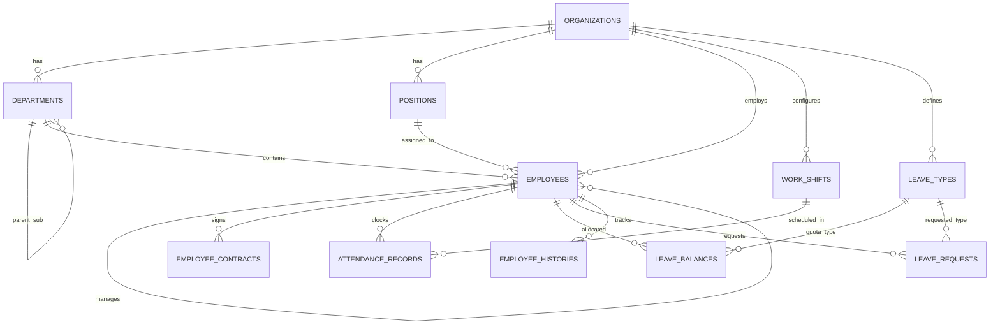

# THIẾT KẾ CƠ SỞ DỮ LIỆU: PHASE 2F — HRM & WORKFORCE MANAGEMENT
**(PHASE 2F DATABASE SCHEMA & ERD SPECIFICATION)**

**Mã tài liệu:** `docs/PHASE_2F_DATABASE_DESIGN.md`  
**Dự án:** BizPro+ Modular Enterprise ERP & Business Management System  
**Ngày ban hành:** 06/11/2026  
**Chuyên gia thực hiện:** Principal Database Architect & Data Modeling Specialist  
**Kính gửi:** Senior Technical Lead & System Architecture Board (ChatGPT)  
**Trạng thái tài liệu:** **DESIGN ONLY — READY FOR REVIEW**  

---

## 1. SƠ ĐỒ THỰC THỂ LIÊN KẾT (ENTITY-RELATIONSHIP DIAGRAM — ERD)

---

## 2. CHI TIẾT CÁC THỰC THỂ & RÀNG BUỘC CƠ SỞ DỮ LIỆU

### 2.1. Bảng `departments` (Phòng ban & Cơ cấu tổ chức)
| Cột | Kiểu dữ liệu | Ràng buộc | Mô tả |
|:---|:---|:---|:---|
| `id` | `uuid` | PK, default `gen_random_uuid()` | Khóa chính |
| `organization_id` | `uuid` | FK -> `organizations.id` ON DELETE CASCADE | Mã định danh tenant |
| `name` | `varchar(255)` | NOT NULL | Tên phòng ban (Phòng Kinh doanh, Nhân sự...) |
| `code` | `varchar(50)` | NOT NULL | Mã phòng ban (`DEPT-SALES`, `DEPT-HR`...) |
| `parent_department_id` | `uuid` | FK -> `departments.id` ON DELETE SET NULL | Phòng ban cấp trên (cấu trúc phân cấp) |
| `manager_employee_id` | `uuid` | Nullable, FK -> `employees.id` | Trưởng bộ phận |
| `status` | `CommonStatus` | Default `ACTIVE` | Trạng thái hoạt động |
- **Ràng buộc duy nhất:** `UNIQUE (organization_id, code)`

### 2.2. Bảng `positions` (Chức vụ & Vị trí công việc)
| Cột | Kiểu dữ liệu | Ràng buộc | Mô tả |
|:---|:---|:---|:---|
| `id` | `uuid` | PK, default `gen_random_uuid()` | Khóa chính |
| `organization_id` | `uuid` | FK -> `organizations.id` ON DELETE CASCADE | Mã định danh tenant |
| `name` | `varchar(255)` | NOT NULL | Tên chức vụ (Giám đốc, Trưởng nhóm, Chuyên viên...) |
| `code` | `varchar(50)` | NOT NULL | Mã chức vụ (`POS-DIR`, `POS-LEAD`, `POS-STAFF`) |
| `status` | `CommonStatus` | Default `ACTIVE` | Trạng thái hoạt động |
- **Ràng buộc duy nhất:** `UNIQUE (organization_id, code)`

### 2.3. Bảng `employees` (Hồ sơ Nhân viên)
| Cột | Kiểu dữ liệu | Ràng buộc | Mô tả |
|:---|:---|:---|:---|
| `id` | `uuid` | PK, default `gen_random_uuid()` | Khóa chính |
| `organization_id` | `uuid` | FK -> `organizations.id` ON DELETE CASCADE | Mã định danh tenant |
| `employee_code` | `varchar(50)` | NOT NULL | Mã nhân viên (`EMP-000001`) |
| `full_name` | `varchar(255)` | NOT NULL | Họ và tên đầy đủ |
| `email` | `varchar(255)` | NOT NULL | Email công việc |
| `phone` | `varchar(50)` | Nullable | Số điện thoại di động |
| `date_of_birth` | `date` | Nullable | Ngày tháng năm sinh |
| `gender` | `varchar(20)` | Nullable | Giới tính (`MALE`, `FEMALE`, `OTHER`) |
| `address` | `text` | Nullable | Địa chỉ thường trú |
| `department_id` | `uuid` | Nullable, FK -> `departments.id` | Phòng ban công tác |
| `position_id` | `uuid` | Nullable, FK -> `positions.id` | Chức vụ bổ nhiệm |
| `manager_employee_id` | `uuid` | Nullable, FK -> `employees.id` | Người quản lý trực tiếp |
| `hire_date` | `date` | NOT NULL | Ngày bắt đầu làm việc |
| `employment_status` | `EmploymentStatus` | Default `OFFICIAL` | `PROBATION`, `OFFICIAL`, `SUSPENDED`, `TERMINATED` |
- **Ràng buộc duy nhất:** `UNIQUE (organization_id, employee_code)`
- **Chỉ mục tìm kiếm:** `INDEX (organization_id, department_id)`, `INDEX (organization_id, email)`

### 2.4. Bảng `employee_contracts` (Hợp đồng lao động)
| Cột | Kiểu dữ liệu | Ràng buộc | Mô tả |
|:---|:---|:---|:---|
| `id` | `uuid` | PK, default `gen_random_uuid()` | Khóa chính |
| `organization_id` | `uuid` | FK -> `organizations.id` | Mã định danh tenant |
| `employee_id` | `uuid` | FK -> `employees.id` ON DELETE CASCADE | Nhân viên ký hợp đồng |
| `contract_number` | `varchar(100)` | NOT NULL | Số hợp đồng (`HĐLĐ-2026/001`) |
| `contract_type` | `ContractType` | NOT NULL | `PROBATION`, `FIXED_TERM`, `INDEFINITE`, `SEASONAL` |
| `start_date` | `date` | NOT NULL | Ngày có hiệu lực |
| `end_date` | `date` | Nullable | Ngày hết hạn |
| `salary_amount` | `decimal(15,2)` | Nullable | Lương thỏa thuận |
- **Ràng buộc duy nhất:** `UNIQUE (organization_id, contract_number)`

### 2.5. Bảng `work_shifts` (Ca làm việc)
| Cột | Kiểu dữ liệu | Ràng buộc | Mô tả |
|:---|:---|:---|:---|
| `id` | `uuid` | PK, default `gen_random_uuid()` | Khóa chính |
| `organization_id` | `uuid` | FK -> `organizations.id` | Mã định danh tenant |
| `name` | `varchar(100)` | NOT NULL | Tên ca (`Ca Hành chính`, `Ca Sáng`, `Ca Tối`) |
| `code` | `varchar(50)` | NOT NULL | Mã ca (`SHIFT-HC-01`) |
| `start_time` | `time` | NOT NULL | Giờ vào ca (`08:30:00`) |
| `end_time` | `time` | NOT NULL | Giờ tan ca (`17:30:00`) |
| `break_duration_minutes` | `integer` | Default `60` | Thời gian nghỉ trưa (phút) |
- **Ràng buộc duy nhất:** `UNIQUE (organization_id, code)`

### 2.6. Bảng `attendance_records` (Bản ghi Chấm công hàng ngày)
| Cột | Kiểu dữ liệu | Ràng buộc | Mô tả |
|:---|:---|:---|:---|
| `id` | `uuid` | PK, default `gen_random_uuid()` | Khóa chính |
| `organization_id` | `uuid` | FK -> `organizations.id` | Mã định danh tenant |
| `employee_id` | `uuid` | FK -> `employees.id` | Nhân viên chấm công |
| `shift_id` | `uuid` | Nullable, FK -> `work_shifts.id` | Ca làm việc áp dụng |
| `work_date` | `date` | NOT NULL | Ngày làm việc (`YYYY-MM-DD`) |
| `check_in_at` | `timestamptz` | Nullable | Thời điểm chấm công vào |
| `check_out_at` | `timestamptz` | Nullable | Thời điểm chấm công ra |
| `source` | `AttendanceSource` | Default `WEB_UI` | `WEB_UI`, `MOBILE_APP`, `BIOMETRIC_SYNC` |
| `status` | `AttendanceStatus` | Default `PRESENT` | `PRESENT`, `LATE`, `EARLY_LEAVE`, `ABSENT` |
| `adjusted_by` | `uuid` | Nullable, FK -> `users.id` | Người duyệt sửa công |
| `adjustment_reason`| `text` | Nullable | Lý do điều chỉnh công |
- **Ràng buộc duy nhất:** `UNIQUE (organization_id, employee_id, work_date)`
- **Chỉ mục hiệu năng:** `INDEX (organization_id, work_date)`

### 2.7. Bảng `leave_types` & `leave_balances` & `leave_requests`
- `leave_types`: Danh mục loại phép (`ANNUAL`, `SICK`, `UNPAID`, `MATERNITY`).
  - `annual_quota`: Định mức ngày phép/năm (Mặc định 12.0 theo BLLĐ 2019).
- `leave_balances`: Số dư ngày phép theo năm.
  - `entitled_days`: Số ngày được hưởng.
  - `used_days`: Số ngày đã nghỉ xong (`APPROVED`).
  - `pending_days`: Số ngày đang xin nghỉ chờ duyệt (`PENDING`).
  - **Ràng buộc duy nhất:** `UNIQUE (organization_id, employee_id, leave_type_id, year)`
- `leave_requests`: Đơn xin nghỉ phép.
  - `start_date`, `end_date`, `total_days`.
  - `status`: `PENDING`, `APPROVED`, `REJECTED`, `CANCELLED`.
  - `approver_employee_id`: Người duyệt đơn.

---

## 3. KHẢO SÁT TÍCH HỢP LIÊN PHÂN HỆ (CROSS-MODULE INTEGRATIONS)

1. **User - Employee Mapping:**
   Mỗi người dùng trong hệ thống (`users`) có thể liên kết 1-1 với một hồ sơ nhân viên (`employees`) qua `users.employee_id`. Khi đăng nhập, hệ thống tự động suy ra `employeeId` của người dùng để thực hiện chấm công và xem quỹ phép cá nhân mà không cần truyền param.
2. **Kho hàng (Inventory Integration):**
   Thủ kho phụ trách quản lý kho (`warehouses.manager_employee_id`) liên kết trực tiếp với bảng `employees`.
3. **Kinh doanh (CRM & Sales Integration):**
   Người phụ trách cơ hội bán hàng (`deals.owner_employee_id`) và người tạo đơn bán hàng (`sales_orders.created_by`) liên kết chặt chẽ với hồ sơ nhân viên.
