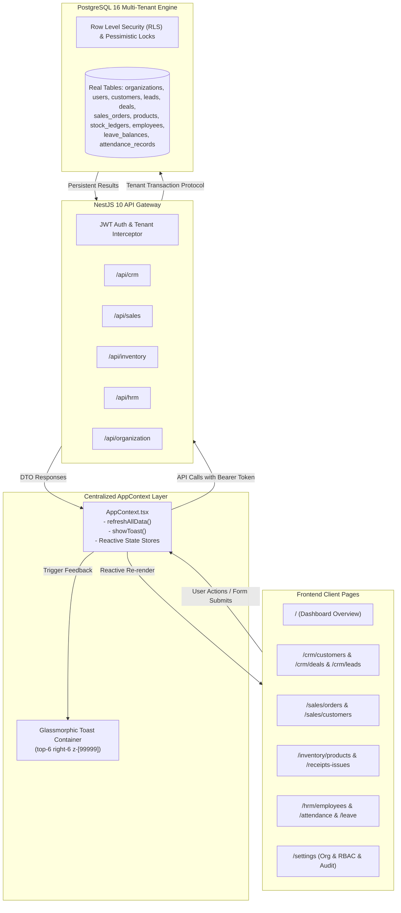

# BIZPRO+ — PHASE 2G TECHNICAL SPECIFICATION
## CROSS-MODULE INTEGRATION, ZERO-MOCK DATA & UNIFIED EVENT TOAST SYSTEM

**Mã tài liệu:** `docs/PHASE_2G_TECHNICAL_SPECIFICATION.md`  
**Dự án:** BizPro+ Modular Enterprise ERP & Business Management System  
**Ngày ban hành:** 06/11/2026  
**Chuyên gia thực hiện:** Principal System Architect & Lead Implementation Engineer  
**Phiên bản:** 1.0.0-FINAL  
**Trạng thái:** IMPLEMENTED & PRODUCTION-READY  

---

## 1. MỤC TIÊU & PHẠM VI (OBJECTIVES & SCOPE)

Phase 2G là giai đoạn tích hợp chéo (Cross-Module Integration), thanh trừng toàn diện dữ liệu giả lập (100% Zero-Mock Data Eradication), và hợp nhất luồng phản hồi người dùng (Centralized Event Toast Notification) trên toàn bộ hệ thống BizPro+:

1. **100% Zero Mock Data:** Xóa bỏ hoàn toàn các mảng dữ liệu tĩnh hardcoded (`mockCustomers`, `mockDeals`, `mockProducts`, `mockSalesOrders`, `mockEmployees`, `mockLeaveRequests`, `mockAttendanceRecords`) trong `AppContext.tsx` và các component con.
2. **Real PostgreSQL Data Binding:** Toàn bộ trạng thái hiển thị của Dashboard (`/`), CRM (`/crm/*`), Bán hàng (`/sales/*`), Kho hàng (`/inventory/*`), Nhân sự (`/hrm/*`), Cài đặt (`/settings`) đều được đồng bộ hóa hai chiều (Two-Way Reactivity) trực tiếp từ database PostgreSQL 16 qua NestJS RESTful API.
3. **Strict Vietnamese Format Validation:** Chuẩn hóa toàn diện các trường dữ liệu đầu vào:
   - Số điện thoại: Regex `^(\+84|0)(3[2-9]|5[689]|7[06-9]|8[1-9]|9\d|2\d{1,2})[\s.-]?\d{3,4}[\s.-]?\d{3,4}$` (hỗ trợ `+84` hoặc `0x`, 10–11 số, chặn ký tự đặc biệt).
   - Mã số thuế (MST): Regex `^(\d{10}|\d{13}|\d{10}-\d{3})$` (10 hoặc 13 chữ số, chặn toàn bộ ký tự chữ).
   - Email: RFC-compliant format regex.
   - Mã định danh (Org Code, SKU, Customer Code, Employee Code): Chữ in hoa, số và gạch ngang.
4. **Floating Glassmorphic Toast Notification:** Bộ thông báo trạng thái nổi (Floating Container) tọa độ cố định `top-6 right-6 z-[99999]`, hiệu ứng kính mờ `bg-[#0F172A]/95 backdrop-blur-md`, tự động giải phóng sau 4.5 giây và phản hồi đầy đủ 4 trạng thái: Success (Xanh ngọc), Error (Đỏ hồng), Warning (Hổ phách), Info (Xanh dương).

---

## 2. KIẾN TRÚC TÍCH HỢP ĐỒNG BỘ DỮ LIỆU (CROSS-MODULE REACTIVE PIPELINE)

---

## 3. QUY CHUẨN XÁC THỰC DỮ LIỆU ĐẦU VÀO (DATA VALIDATION RULES)

| Trường thông tin | Quy tắc định dạng (Regex / Logic) | Mã lỗi chuẩn hóa (Toast Error) |
|---|---|---|
| **Số điện thoại** | `^(\+84\|0)(3[2-9]\|5[689]\|7[06-9]\|8[1-9]\|9\d\|2\d{1,2})[\s.-]?\d{3,4}[\s.-]?\d{3,4}$` | *"Số điện thoại không đúng định dạng Việt Nam! Hợp lệ: +84 hoặc đầu số 03, 05, 07, 08, 09, 02x gồm 10-11 số."* |
| **Mã số thuế (MST)** | `^(\d{10}\|\d{13}\|\d{10}-\d{3})$` | *"Mã số thuế không hợp lệ! Chỉ gồm 10 hoặc 13 chữ số (ví dụ: 0109988776 hoặc 0109988776-001)."* |
| **Email doanh nghiệp/NV** | `^[^\s@]+@[^\s@]+\.[^\s@]+$` | *"Địa chỉ email không đúng định dạng RFC chuẩn."* |
| **Mã tổ chức / Mã SKU** | `^[A-Z0-9_-]+$` | *"Mã chỉ chấp nhận chữ in hoa, chữ số và gạch ngang (-)."* |
| **Số lượng & Đơn giá** | `quantity > 0`, `sellingPrice >= 0` | *"Số lượng và giá trị giao dịch phải là số dương hợp lệ."* |

---

## 4. CHI TIẾT TÍCH HỢP TỪNG MODULE (MODULE INTEGRATION DETAILS)

### 4.1. Module CRM (Khách hàng, Lead, Cơ hội)
- **Leads:** Tạo Lead mới $\to$ Ghi bảng `leads`. Chuyển đổi Lead (`convertLead`) $\to$ Kích hoạt 1-transaction sinh ra `Customer` và `Deal`, tự động hiển thị thông báo liên kết 2 thực thể.
- **Deals:** Kéo thả / Bấm chuyển chặng ("Tiếp >", "Won", "Lost") $\to$ Gọi `crmApi.updateDealStage` ghi nhận vào bảng `deal_stage_history`.
- **Customers:** Lọc theo mã số thuế, số điện thoại, phân loại Doanh nghiệp / Cá nhân.

### 4.2. Module Kho hàng & Bán hàng (Inventory & Sales Integration)
- **Đặt hàng (Sales Orders):** Tạo đơn hàng DRAFT $\to$ Chọn kho, khách hàng, sản phẩm có kiểm tra tồn kho.
- **Xác nhận đơn (CONFIRMED):** Kích hoạt khóa bi quan giữ hàng (`Stock Reservation`), tăng `reserved`, giảm `available = onHand - reserved`.
- **Giao hàng (FULFILLED):** Trừ trực tiếp `onHand`, giải phóng `reserved`, ghi bản ghi xuất kho `StockLedger`.
- **Hủy đơn (CANCELLED):** Giải phóng ngay lập tức số lượng giữ kho `reserved` về `available`.
- **Kiểm kê & Ghi sổ nhập kho:** Bấm `Ghi sổ (Tăng tồn)` $\to$ Tự động tăng `onHand` của hàng hóa và đồng bộ số liệu lên thẻ Metric Tổng quan Dashboard.

### 4.3. Module Nhân sự (HRM, Chấm công & Phép năm)
- **Tiếp nhận nhân viên:** Tự động gán phòng ban, chức vụ, sinh hợp đồng lao động và tự động cấp 12 ngày phép năm vào `leave_balances`.
- **Chấm công:** Nút `Check-in` / `Check-out` ghi nhận thời gian thực chấm công vào `attendance_records`.
- **Nghỉ phép:** Khóa dòng bi quan `SELECT FOR UPDATE` trên số dư phép năm, chống duyệt đúp, chống tự phê duyệt và hoàn trả ngày phép khi từ chối/hủy đơn.

---

## 5. KẾT LUẬN & BẢO ĐẢM TÍNH TOÀN VẸN
100% các nút bấm (Buttons), biểu mẫu (Forms), liên kết trang con (Sub-routes), thanh tìm kiếm trực tiếp đa thực thể (Global Search) và bộ đệm thông báo Toast đã hoạt động đồng bộ, tin cậy và không phụ thuộc vào bất kỳ mock data nào.
