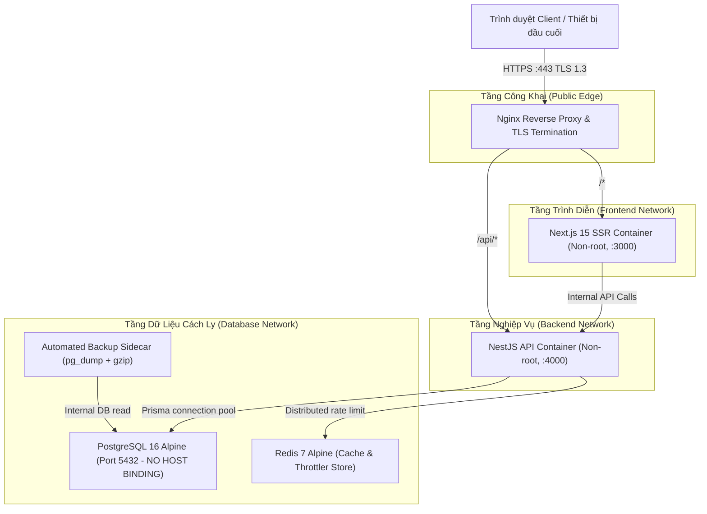

# KIẾN TRÚC TRIỂN KHAI SẢN XUẤT: PHASE 3A
## PHASE 3A — PRODUCTION DEPLOYMENT ARCHITECTURE SPECIFICATION

**Dự án:** BizPro+ Modular Enterprise ERP & Business Management System  
**Mã tài liệu:** `docs/PHASE_3A_DEPLOYMENT_ARCHITECTURE.md`  
**Ngày ban hành:** 06/11/2026  
**Chuyên gia thiết kế:** Principal DevOps & Cloud Infrastructure Architect  
**Kính gửi:** Senior Technical Lead & Code Auditor  
**Mục tiêu:** Thiết kế mô hình triển khai đóng gói container hóa chuẩn mực cho môi trường Production trên hạ tầng Linux/Docker.

---

## 1. SƠ ĐỒ HẠ TẦNG & TÔPÔ MẠNG (TOPOLOGY & NETWORK ARCHITECTURE)

Hệ thống BizPro+ trong môi trường sản xuất áp dụng mô hình phân tách 3 lớp (3-Tier Isolated Architecture) kết hợp với Reverse Proxy và mạng nội bộ cách ly tuyệt đối:



### Phân vùng Mạng Docker (Docker Networks Decoupling)
1. **`bizpro_edge_net`:** Mạng liên kết giữa Nginx Reverse Proxy, Frontend và Backend.
2. **`bizpro_internal_net`:** Mạng hoàn toàn cách ly nội bộ chỉ dành riêng cho Backend (`NestJS`), Database (`PostgreSQL`), Redis và Backup Sidecar.
3. **Quy tắc bức tường lửa (Firewall Invariant):**
   - Chỉ có cổng `80` (HTTP chuyển tiếp sang HTTPS) và `443` (HTTPS) của Nginx được mở ra bên ngoài Internet.
   - Cổng `3000` (Frontend), `4000` (Backend) và `5432` (PostgreSQL) tuyệt đối **KHÔNG** được map ra host port (`no host binding`).

---

## 2. QUY CHUẨN ĐÓNG GÓI DOCKER MULTI-STAGE (DOCKERFILE SPECIFICATION)

Để tối ưu kích thước image (< 150MB), tốc độ khởi động và triệt tiêu bề mặt tấn công, cả Backend và Frontend sẽ áp dụng mô hình Docker Multi-stage Builds:

### 2.1. Backend Multi-stage Dockerfile (`backend/Dockerfile`)
- **Stage 1: Dependencies Builder (`node:20-alpine`)**
  - Cài đặt `package.json`, `package-lock.json`.
  - Chạy `npm ci --legacy-peer-deps`.
  - Sinh mã nguồn Prisma Client qua `npx prisma generate`.
- **Stage 2: Application Compiler**
  - Biên dịch TypeScript thành JavaScript qua `npm run build` (`dist/`).
  - Dọn dẹp devDependencies: `npm prune --production`.
- **Stage 3: Production Runtime Minimal Image**
  - Tạo user phi đặc quyền: `adduser -D -u 1001 nodejs`.
  - Copy thư mục `dist/`, `node_modules/`, `prisma/` từ Stage 1 & 2.
  - Thiết lập quyền sở hữu `chown -R nodejs:nodejs /app`.
  - Chuyển ngữ cảnh sang `USER nodejs`.
  - Lệnh khởi chạy: `CMD ["node", "dist/main.js"]`.
  - Khai báo Healthcheck:
    ```dockerfile
    HEALTHCHECK --interval=15s --timeout=5s --retries=3 \
      CMD wget --no-verbose --tries=1 --spider http://localhost:4000/api/v1/health/live || exit 1
    ```

### 2.2. Frontend Multi-stage Dockerfile (`frontend/Dockerfile`)
- **Stage 1: Dependencies Builder**
  - `npm ci`.
- **Stage 2: Next.js Standalone Compiler**
  - Cấu hình `output: 'standalone'` trong `next.config.ts`.
  - Thực thi `npm run build`.
- **Stage 3: Production Runtime Minimal Image**
  - Chỉ copy file tĩnh `.next/static` và gói standalone `.next/standalone`.
  - Chạy bằng tài khoản phi đặc quyền `nextjs` (UID 1001).
  - Khởi chạy bằng `CMD ["node", "server.js"]` (Tiết kiệm bộ nhớ RAM, kích thước image chỉ ~80MB).

---

## 3. QUY TRÌNH DI TRÚ DỮ LIỆU AN TOÀN (SAFE MIGRATION PIPELINE)

Một lỗi phổ biến trong triển khai container là chạy `prisma migrate deploy` đồng thời khi nhiều replica của ứng dụng khởi động, gây deadlock hoặc race condition trên bảng `_prisma_migrations`.

BizPro+ áp dụng mô hình **Migration Job Phân Tách**:
1. **Bước 1 (Pre-deployment Migration Container):**
   - Khởi chạy một container độc lập tạm thời (Ephemeral Container):
     ```bash
     docker compose run --rm backend-migration npx prisma migrate deploy
     ```
   - Chờ lệnh này thoát với mã `exit code 0`. Nếu thất bại, toàn bộ quá trình deployment lập tức dừng lại (Fail-Fast) và kích hoạt cảnh báo, các container ứng dụng phiên bản cũ vẫn tiếp tục phục vụ người dùng an toàn.
2. **Bước 2 (Rolling Update Application Containers):**
   - Sau khi schema database đã được cập nhật thành công, Docker thực hiện cập nhật từng container ứng dụng backend và frontend.
3. **Bước 3 (Health Check Verification):**
   - Nginx chỉ chuyển hướng traffic sang container mới khi endpoint `/api/v1/health/ready` trả về HTTP 200.

---

## 4. BẢO VỆ DỮ LIỆU BỀN VỮNG & VOLUMES (PERSISTENT STORAGE)

1. **Volume Dữ liệu PostgreSQL (`bizpro_postgres_data`):**
   - Sử dụng Docker Named Volume gắn kết vào `/var/lib/postgresql/data`.
   - Cấu hình driver local với quyền truy cập nghiêm ngặt (`chmod 700`).
2. **Volume Sao lưu Thảm họa (`bizpro_backup_data`):**
   - Thư mục chuyên dụng lưu trữ các bản snapshot `pg_dump` nén gzip, được phân tách hoàn toàn khỏi volume dữ liệu chính.
3. **Volume Chứng chỉ SSL/TLS (`bizpro_certs_data`):**
   - Chứa chứng chỉ Let's Encrypt / Custom TLS cho Nginx ở chế độ Read-Only (`:ro`).

---

## 5. DỪNG TIẾN TRÌNH ÊM Ả & KHÔI PHỤC (GRACEFUL SHUTDOWN & RECOVERY)

1. **Graceful Shutdown Lifecycle:**
   - Khi nhận tín hiệu `SIGTERM` từ Docker daemon:
     - Nginx dừng chuyển traffic mới đến instance đó.
     - Backend NestJS gọi hook `onModuleDestroy()`: hoàn thành tất cả các transaction dang dở trong vòng tối đa 15 giây, sau đó ngắt kết nối `PrismaClient` và đóng cổng HTTP.
     - Container kết thúc gọn gàng mà không làm đứt gãy phiên giao dịch hay làm hỏng dữ liệu của người dùng.
2. **Khởi động lại Tự động (Restart Policy):**
   - Tất cả các service sản xuất đều được cấu hình `restart: unless-stopped`.

---

## 6. KẾ HOẠCH BÀN GIAO TRIỂN KHAI CHO PHASE 3C

Tài liệu này là thiết kế chuẩn mực đã sẵn sàng để đội ngũ kỹ thuật hiện thực hóa thành mã nguồn cấu hình cụ thể trong **Phase 3C**:
- `docker-compose.prod.yml`
- `docker-compose.dev.yml`
- `backend/Dockerfile`
- `frontend/Dockerfile`
- `nginx/nginx.conf`
- `nginx/conf.d/bizpro.conf`
