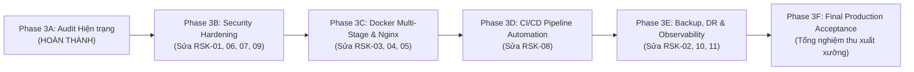

# SỔ ĐĂNG KÝ RỦI RO HỆ THỐNG: PHASE 3A
## PHASE 3A — CONSOLIDATED RISK REGISTER

**Dự án:** BizPro+ Modular Enterprise ERP & Business Management System  
**Mã tài liệu:** `docs/PHASE_3A_RISK_REGISTER.md`  
**Ngày ban hành:** 06/11/2026  
**Chuyên gia quản trị rủi ro:** Principal System Architect & Quality Assurance Lead  
**Kính gửi:** Senior Technical Lead & Code Auditor  
**Tiêu chuẩn đánh giá:** ISO 31000 Risk Management Framework & OWASP Risk Rating Methodology

---

## 1. PHƯƠNG PHÁP ĐÁNH GIÁ MA TRẬN RỦI RO (RISK MATRIX)

Mức độ rủi ro tổng thể ($R$) được tính toán dựa trên tích số giữa Khả năng xảy ra ($L$ - Likelihood: 1 đến 5) và Mức độ tác động ($I$ - Impact: 1 đến 5):
$$R = L \times I$$

| Điểm rủi ro ($R$) | Phân loại rủi ro (Risk Level) | Hành động quản trị bắt buộc |
|---|---|---|
| **15 – 25** | **CRITICAL (Khẩn cấp)** | **PRODUCTION BLOCKER** — Cấm đưa hệ thống vào sản xuất. Phải xử lý ngay trong Phase 3B/3C. |
| **10 – 14** | **HIGH (Cao)** | **PRODUCTION BLOCKER** — Phải khắc phục triệt để và có bằng chứng kiểm thử trước khi nghiệm thu. |
| **5 – 9** | **MEDIUM (Trung bình)** | Lên kế hoạch khắc phục có kiểm soát trong Phase 3B–3E; không làm gián đoạn tiến độ. |
| **1 – 4** | **LOW (Thấp)** | Nợ kỹ thuật (Technical Debt) theo dõi định kỳ, cải tiến dần trong các phiên bản sau. |

---

## 2. BẢNG TỔNG HỢP SỔ ĐĂNG KÝ RỦI RO (RISK REGISTER TABLE)

| Mã Rủi ro | Tên Rủi ro & Thành phần liên quan | Khả năng ($L$) | Tác động ($I$) | Điểm ($R$) | Phân loại | Biện pháp Giảm thiểu (Mitigation Strategy) | Phase Xử lý | Trạng thái Chặn |
|---|---|---|---|---|---|---|---|---|
| **RSK-01** | **Khóa bí mật mặc định trong cấu hình ENV** (`env.validation.ts`) | 4 | 5 | **20** | **CRITICAL** | Bắt buộc biến môi trường không được rỗng, tối thiểu 32 ký tự ngẫu nhiên trong môi trường sản xuất; fail-fast lúc khởi động | **Phase 3B** | **BLOCKER** |
| **RSK-02** | **Mất dữ liệu do không có sao lưu tự động** (PostgreSQL Database) | 3 | 5 | **15** | **CRITICAL** | Thiết lập cron container tự động chạy `pg_dump` nén gzip hằng ngày, lưu volume riêng và kiểm thử khôi phục | **Phase 3E** | **BLOCKER** |
| **RSK-03** | **Không có container hóa Frontend & Backend** (Thiếu Dockerfiles) | 5 | 3 | **15** | **CRITICAL** | Xây dựng Multi-stage Dockerfile cho cả NestJS và Next.js với tài khoản non-root `nodejs` / `nextjs` | **Phase 3C** | **BLOCKER** |
| **RSK-04** | **Lộ cổng 5432 và Superuser ra môi trường ngoài** (`docker-compose.yml`) | 4 | 3 | **12** | **HIGH** | Hủy bỏ mapping cổng 5432 ra host, cô lập database trong mạng `internal_net`, đổi mật khẩu phức tạp | **Phase 3C** | **BLOCKER** |
| **RSK-05** | **Thiếu Reverse Proxy Nginx & Bảo mật TLS** (Hạ tầng mạng) | 4 | 3 | **12** | **HIGH** | Đóng gói Nginx Reverse Proxy, cấu hình SSL/TLS 1.3, nén Gzip và phân luồng `/api` sang Backend | **Phase 3C** | **BLOCKER** |
| **RSK-06** | **Thiếu bảo vệ HTTP Security Headers** (Thiếu thư viện `helmet`) | 4 | 3 | **12** | **HIGH** | Cài đặt và kích hoạt `helmet` toàn cục trong `backend/src/main.ts` với CSP, X-Frame-Options | **Phase 3B** | **BLOCKER** |
| **RSK-07** | **Lỗ hổng bảo mật chuỗi cung ứng npm** (`tar`, `next`, `body-parser`) | 3 | 4 | **12** | **HIGH** | Chạy `npm audit fix` hoặc cấu hình `overrides` cập nhật phiên bản thư viện an toàn | **Phase 3B** | **BLOCKER** |
| **RSK-08** | **Thiếu pipeline kiểm thử & build CI/CD** (GitHub Actions) | 4 | 3 | **12** | **HIGH** | Tạo workflow GitHub Actions tự động chạy `test:e2e`, `type-check`, `lint` và đóng gói Docker image | **Phase 3D** | **BLOCKER** |
| **RSK-09** | **Phơi bày Swagger API công khai trên Production** (`main.ts`) | 3 | 2 | **6** | **MEDIUM** | Thêm điều kiện tắt Swagger trong `NODE_ENV === 'production'` hoặc thêm HTTP Basic Auth | **Phase 3B** | Technical Debt |
| **RSK-10** | **Thiếu ghi log tập trung có cấu trúc** (Logging Interceptor) | 3 | 2 | **6** | **MEDIUM** | Chuyển đổi sang định dạng Structured JSON Logging qua Winston kèm `X-Correlation-ID` | **Phase 3E** | Technical Debt |
| **RSK-11** | **Chưa có chỉ số giám sát phân tán Prometheus** (Metrics endpoint) | 2 | 2 | **4** | **LOW** | Tích hợp `@willsoto/nestjs-prometheus` để xuất metric thời gian thực cho Grafana | **Phase 3E** | Technical Debt |

---

## 3. PHÂN ĐỊNH NỢ KỸ THUẬT VÀ BLOCKER XUẤT XƯỞNG

### 3.1. Danh mục 8 Blocker Xuất Xưởng (Bắt buộc phải xử lý)
1. **RSK-01:** Khóa bí mật mặc định trong `env.validation.ts`.
2. **RSK-02:** Thiếu cơ chế sao lưu và khôi phục cơ sở dữ liệu tự động.
3. **RSK-03:** Thiếu Multi-stage Dockerfile cho Backend và Frontend.
4. **RSK-04:** Lộ cổng 5432 và mật khẩu superuser mặc định.
5. **RSK-05:** Thiếu Reverse Proxy Nginx & cấu hình TLS Termination.
6. **RSK-06:** Thiếu HTTP Security Headers (`helmet`).
7. **RSK-07:** Lỗ hổng phụ thuộc npm dependencies (`tar`, `next`, `body-parser`).
8. **RSK-08:** Thiếu quy trình kiểm thử và tích hợp liên tục CI/CD.

### 3.2. Danh mục Nợ Kỹ thuật Được phép Tồn tại Có Kế hoạch (Non-blocking Technical Debt)
- **RSK-09:** Swagger UI (chỉ cần gắn cờ tắt hoặc bảo vệ mật khẩu đơn giản).
- **RSK-10:** Ghi log dạng văn bản (đã có timestamp, delay ms và URL, đủ cho việc vận hành ban đầu).
- **RSK-11:** Prometheus Metrics (hệ thống đã có endpoint `/health/live` và `/health/ready` phục vụ giám sát container liveness/readiness).

---

## 4. MA TRẬN PHỤ THUỘC & THỨ TỰ THỰC THI (DEPENDENCY & EXECUTION ROADMAP)

Để tối ưu hóa quá trình khắc phục mà không gây xung đột mã nguồn hoặc phá vỡ các phase trước, quy trình khắc phục được xếp thứ tự nghiêm ngặt theo luồng:

1. **Phase 3B (Gia cố Mã nguồn & Phụ thuộc):**
   - Phải xử lý trước vì Docker image ở Phase 3C cần đóng gói mã nguồn và phụ thuộc đã được làm sạch và vá lỗi.
2. **Phase 3C (Đóng gói Container & Mạng cách ly):**
   - Đóng gói Backend, Frontend, Nginx và Docker Compose production.
3. **Phase 3D (Tự động hóa CI/CD):**
   - Tự động hóa kiểm thử và build dựa trên Dockerfile đã tạo ở Phase 3C.
4. **Phase 3E (Sao lưu & Vận hành):**
   - Thiết lập cron sao lưu dữ liệu cho database container đã ổn định.
5. **Phase 3F (Nghiệm thu Tổng thể):**
   - Chạy toàn bộ regression test và kiểm tra an ninh trước khi bàn giao.
