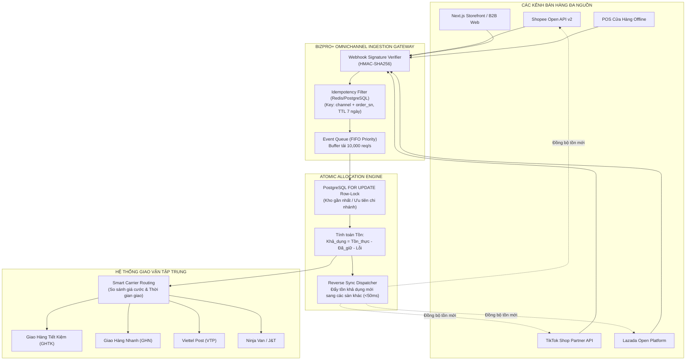

# BIZPRO+ PHASE 4B: ĐẶC TẢ KIẾN TRÚC & NGHIỆP VỤ ĐIỀU PHỐI ĐƠN HÀNG ĐA KÊNH & GIAO VẬN (OMNICHANNEL ORCHESTRATION & LOGISTICS HUB)

**Mã tài liệu:** `docs/PHASE_4B_OMNICHANNEL_ORDER_AND_LOGISTICS_SPECIFICATION.md`  
**Phiên bản:** Revision 1.0 (Enterprise Specification)  
**Tác giả:** Antigravity Multi-Agent Architecture Team  
**Trạng thái thẩm định:** `SPEC-ONLY / ARCHITECTURAL DISCOVERY`  
**Phạm vi áp dụng:** Toàn bộ hệ thống BizPro+ ERP SaaS  
**Quy chế bảo vệ hệ thống:** 
- **100% SPEC-ONLY:** Tuyệt đối không thay đổi mã nguồn backend, frontend runtime hoặc can thiệp database đã đóng băng (Phase 1A–3F FROZEN).
- **Zero Database Mutation:** Không chạy migration hoặc sửa đổi `backend/prisma/schema.prisma`.

---

## 1. TỔNG QUAN NGHIỆP VỤ & MỤC TIÊU CHIẾN LƯỢC

### 1.1. Bối cảnh Thị trường Thương mại Đa kênh Việt Nam
Doanh nghiệp bán lẻ và phân phối tại Việt Nam hiện vận hành trung bình trên 3 đến 5 kênh bán hàng đồng thời:
1. Sàn Thương mại Điện tử (Shopee, TikTok Shop, Lazada, Tiki).
2. Mạng xã hội & Livestream (Facebook Live, TikTok Live, Instagram Shopping).
3. Website & Ứng dụng B2B/B2C (Next.js Storefront).
4. Chuỗi cửa hàng bán lẻ Offline (POS).
5. Kênh đại lý phân phối B2B bán buôn.

### 1.2. Các Thách Thức Cốt Lõi Cần Giải Quyết
- **Thách thức Bán âm (Overselling / Out of Stock):** Khi tồn kho chỉ còn 1 sản phẩm nhưng đơn hàng nổ đồng thời trên Shopee và TikTok Shop trong phiên Flash Sale / Mega Live, dẫn đến phạt sao quả tạ (Penalty Points) và hủy đơn hàng loạt.
- **Phân mảnh Tồn kho Thực tế vs Khả dụng:** Nhân viên không nắm được số lượng hàng đã được giữ (Reserved) cho các đơn chưa xuất kho.
- **Thủ công trong Điều phối Giao vận:** Nhân viên phải đăng nhập 4 cổng đối tác (GHTK, GHN, Viettel Post, Ninja Van) để tạo đơn, copy mã vận đơn và in tem nhiệt.
- **Thất thoát Dòng tiền Thu hộ (COD Reconciliation):** Chênh lệch tiền thu hộ COD thực tế bưu tá giao vs tiền chuyển khoản từ hãng, cước vượt cân và phụ phí vùng xa không được đối soát tự động.

---

## 2. KIẾN TRÚC ĐIỀU PHỐI TỒN KHO THỜI GIAN THỰC (REALTIME INVENTORY ORCHESTRATION)



### 2.1. Quy tắc Bảo toàn Tồn kho (Atomic Stock Invariant)
Mọi biến động đơn hàng trên bất kỳ kênh nào đều phải tuân thủ công thức toán học bất biến:
$$\text{Tồn\_Thực\_Tế} = \text{Tồn\_Khả\_Dụng} + \text{Tồn\_Đang\_Giữ\_Hàng (Reserved)} + \text{Tồn\_Chờ\_Xử\_Lý\_Lỗi}$$

- **Khi có đơn hàng mới (Order Created):**
  $$\text{Tồn\_Đang\_Giữ\_Hàng} \gets \text{Tồn\_Đang\_Giữ\_Hàng} + Q$$
  $$\text{Tồn\_Khả\_Dụng} \gets \text{Tồn\_Khả\_Dụng} - Q$$
  *Tồn thực tế trong kho chưa thay đổi vì hàng vẫn còn trên kệ.*

- **Khi xuất kho bàn giao bưu tá (Dispatch / Handover):**
  $$\text{Tồn\_Thực\_Tế} \gets \text{Tồn\_Thực\_Tế} - Q$$
  $$\text{Tồn\_Đang\_Giữ\_Hàng} \gets \text{Tồn\_Đang\_Giữ\_Hàng} - Q$$

- **Khi đơn hàng bị hủy trước khi xuất kho (Order Cancelled):**
  $$\text{Tồn\_Đang\_Giữ\_Hàng} \gets \text{Tồn\_Đang\_Giữ\_Hàng} - Q$$
  $$\text{Tồn\_Khả\_Dụng} \gets \text{Tồn\_Khả\_Dụng} + Q$$
  *Giải phóng số lượng giữ hàng lập tức, đẩy lại sàn trong vòng dưới 50ms.*

---

## 3. THIẾT KẾ DATA SCHEMA ĐẶC TẢ (SPEC-ONLY)

> [!IMPORTANT]
> Toàn bộ DDL dưới đây là đặc tả kỹ thuật độc lập phục vụ thiết kế Phase 4B. Không áp dụng trực tiếp vào database hiện tại để bảo toàn tính toàn vẹn của Phase 1A–3F.

### 3.1. Bảng Kênh Bán Hàng & Kết Nối API (`channel_integrations`)
```sql
-- ĐẶC TẢ BẢNG KẾT NỐI KÊNH BÁN HÀNG
CREATE TABLE channel_integrations (
    id UUID PRIMARY KEY DEFAULT gen_random_uuid(),
    tenant_id UUID NOT NULL,
    channel_type VARCHAR(50) NOT NULL, -- 'SHOPEE', 'TIKTOK_SHOP', 'LAZADA', 'TIKI', 'WEBSITE', 'POS'
    shop_id VARCHAR(100) NOT NULL,
    shop_name VARCHAR(255) NOT NULL,
    app_key VARCHAR(255) NOT NULL,
    app_secret_encrypted BYTEA NOT NULL, -- AES-256-GCM
    access_token_encrypted BYTEA,
    refresh_token_encrypted BYTEA,
    token_expires_at TIMESTAMPTZ,
    webhook_secret VARCHAR(255),
    is_active BOOLEAN DEFAULT TRUE,
    sync_inventory_enabled BOOLEAN DEFAULT TRUE,
    sync_price_enabled BOOLEAN DEFAULT FALSE,
    auto_create_order BOOLEAN DEFAULT TRUE,
    default_warehouse_id UUID,
    created_at TIMESTAMPTZ DEFAULT CURRENT_TIMESTAMP,
    updated_at TIMESTAMPTZ DEFAULT CURRENT_TIMESTAMP,
    CONSTRAINT uq_channel_tenant_shop UNIQUE (tenant_id, channel_type, shop_id)
);
```

### 3.2. Bảng Ánh Xạ Sản Phẩm Đa Kênh (`channel_product_mappings`)
```sql
CREATE TABLE channel_product_mappings (
    id UUID PRIMARY KEY DEFAULT gen_random_uuid(),
    tenant_id UUID NOT NULL,
    internal_product_id UUID NOT NULL,
    channel_integration_id UUID NOT NULL REFERENCES channel_integrations(id) ON DELETE CASCADE,
    channel_item_id VARCHAR(100) NOT NULL,
    channel_sku_id VARCHAR(100) NOT NULL,
    channel_sku_code VARCHAR(150),
    channel_price NUMERIC(15, 2) NOT NULL,
    sync_stock_ratio NUMERIC(5, 2) DEFAULT 1.00, -- Tỷ lệ chia sẻ kho (ví dụ 1.00 = 100% kho)
    last_synced_stock INT DEFAULT 0,
    last_synced_at TIMESTAMPTZ,
    sync_status VARCHAR(50) DEFAULT 'SYNCED', -- 'SYNCED', 'PENDING', 'ERROR'
    sync_error_message TEXT,
    CONSTRAINT uq_channel_sku UNIQUE (channel_integration_id, channel_sku_id)
);
```

### 3.3. Bảng Vận Đơn & Đối Soát COD (`shipping_fulfillments`)
```sql
CREATE TABLE shipping_fulfillments (
    id UUID PRIMARY KEY DEFAULT gen_random_uuid(),
    tenant_id UUID NOT NULL,
    order_id UUID NOT NULL,
    carrier_code VARCHAR(50) NOT NULL, -- 'GHTK', 'GHN', 'VIETTEL_POST', 'NINJA_VAN'
    tracking_number VARCHAR(100) NOT NULL,
    order_shipping_status VARCHAR(50) NOT NULL DEFAULT 'READY_TO_PICK', 
    -- 'READY_TO_PICK', 'PICKED_UP', 'IN_TRANSIT', 'OUT_FOR_DELIVERY', 'DELIVERED', 'RETURNED', 'LOST'
    sender_warehouse_id UUID NOT NULL,
    shipping_fee NUMERIC(15, 2) NOT NULL DEFAULT 0,
    cod_amount NUMERIC(15, 2) NOT NULL DEFAULT 0,
    cod_collected_amount NUMERIC(15, 2) DEFAULT 0,
    cod_status VARCHAR(50) DEFAULT 'PENDING_RECONCILIATION', -- 'PENDING_RECONCILIATION', 'RECONCILED', 'DISCREPANCY'
    reconciliation_batch_id VARCHAR(100),
    pickup_deadline TIMESTAMPTZ,
    actual_delivered_at TIMESTAMPTZ,
    return_reason TEXT,
    label_pdf_url TEXT,
    created_at TIMESTAMPTZ DEFAULT CURRENT_TIMESTAMP,
    updated_at TIMESTAMPTZ DEFAULT CURRENT_TIMESTAMP,
    CONSTRAINT uq_fulfillment_tracking UNIQUE (tenant_id, carrier_code, tracking_number)
);
```

---

## 4. QUY TRÌNH WEBHOOK & BẢO MẬT GIAO DIỆN API

### 4.1. Xác thực Chữ ký Webhook (HMAC-SHA256)
Mọi webhook từ đối tác TMĐT đều phải trải qua bước xác thực chữ ký trước khi xử lý payload:
```typescript
// Đặc tả thuật toán xác thực chữ ký TikTok Shop & Shopee
export function verifyChannelWebhookSignature(
  rawBody: Buffer,
  receivedSignature: string,
  secretKey: string
): boolean {
  const hmac = crypto.createHmac('sha256', secretKey);
  hmac.update(rawBody);
  const calculatedSignature = hmac.digest('hex');
  return crypto.timingSafeEqual(
    Buffer.from(receivedSignature, 'utf8'),
    Buffer.from(calculatedSignature, 'utf8')
  );
}
```

### 4.2. Khóa Idempotency Chống Nhận Đơn Trùng Lặp
- Khóa định danh: `tenant_id:channel_type:order_sn`.
- TTL: 7 ngày (lưu trữ trong bảng `channel_webhook_idempotency` hoặc Redis Cache).
- Nếu phát hiện đơn hàng đã được tiếp nhận: Trả về HTTP 200 OK ngay lập tức (Ack for channel webhook), không thực hiện lại luồng khóa tồn kho.

---

## 5. MA TRẬN ĐỐI SOÁT COD & PHÍ VẬN CHUYỂN (COD RECONCILIATION)

### 5.1. Bảng phân loại trạng thái đối soát:
| Mã trạng thái | Diễn giải nghiệp vụ | Hành động hệ thống | Bút toán kế toán liên kết |
| :--- | :--- | :--- | :--- |
| **MATCHED** | Tiền COD hãng thanh toán khớp 100% với đơn hàng | Tự động đóng trạng thái thu nợ đơn hàng | Nợ 1121 (Ngân hàng) / Có 131 (Hãng vận chuyển) |
| **UNDER_COLLECTED** | Hãng thu thiếu tiền hoặc áp thêm phí cước vượt cân | Treo cảnh báo chênh lệch trên màn hình đối soát | Nợ 1121 (Số thực nhận), Nợ 642 (Chi phí phát sinh) / Có 131 |
| **RETURN_CONFIRMED** | Kiện hàng giao thất bại, bưu tá đã hoàn trả kho | Kích hoạt quy trình nhập lại kho (Return Stock) | Nhập lại kho: Nợ 156 / Có 632; Cước hoàn: Nợ 642 / Có 331 |
| **LOST_IN_TRANSIT** | Kiện hàng bị bưu tá làm mất hoặc hư hại | Lập hồ sơ khiếu nại bồi thường tự động | Nợ 1388 (Phải thu bồi thường) / Có 156 (Giá trị hàng mất) |

---

## 6. KẾ HOẠCH BÀN GIAO & TÍCH HỢP HỆ THỐNG
1. **Giai đoạn Thiết kế & Khảo sát (Phase 4B Spec):** Đã hoàn thành và đệ trình đặc tả kỹ thuật chi tiết.
2. **Giai đoạn Thử nghiệm Mock API Sandbox:** Tiến hành kiểm thử giả lập trên môi trường Shopee Open Platform Test Shop & TikTok Shop Partner Test Center.
3. **Kích hoạt Triển khai:** Chỉ thực hiện sau khi có chỉ thị chính thức từ Project Owner và hoàn thành toàn bộ Đợt 4 Verification.
