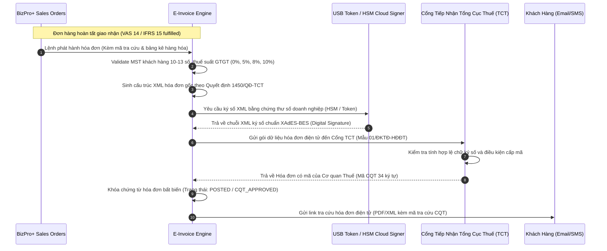

# BIZPRO+ PHASE 4C: ĐẶC TẢ KIẾN TRÚC HÓA ĐƠN ĐIỆN TỬ, THUẾ & BÁO CÁO TÀI CHÍNH (E-INVOICING, TAX & FINANCIAL REPORTING)

**Mã tài liệu:** `docs/PHASE_4C_EINVOICE_TAX_AND_FINANCIAL_REPORTING_SPECIFICATION.md`  
**Phiên bản:** Revision 1.0 (Enterprise Financial Specification)  
**Tác giả:** Antigravity Multi-Agent Architecture Team  
**Trạng thái thẩm định:** `SPEC-ONLY / ARCHITECTURAL DISCOVERY`  
**Cơ sở pháp lý:** 
- Nghị định số 123/2020/NĐ-CP của Chính phủ quy định về hóa đơn, chứng từ.
- Thông tư số 78/2021/TT-BTC của Bộ Tài chính hướng dẫn thực hiện một số điều của Luật Quản lý thuế.
- Nghị định số 72/2024/NĐ-CP quy định chính sách giảm thuế giá trị gia tăng (GTGT 8%).
- Chuẩn mực Kế toán Việt Nam số 14 (VAS 14 - Doanh thu và thu nhập khác) và Chuẩn mực Báo cáo Tài chính Quốc tế (IFRS 15).
**Quy chế bảo vệ hệ thống:** 
- **100% SPEC-ONLY:** Tuyệt đối không thay đổi mã nguồn backend, frontend runtime hoặc can thiệp database đã đóng băng (Phase 1A–3F FROZEN).
- **Zero Database Mutation:** Không chạy migration hoặc sửa đổi `backend/prisma/schema.prisma`.

---

## 1. MÔ HÌNH HÓA ĐƠN ĐIỆN TỬ THEO NGHỊ ĐỊNH 123 & THÔNG TƯ 78



---

## 2. QUY TẮC PHÂN LOẠI THUẾ SUẤT GTGT (VAT RATE TAXONOMY)

Theo quy định hiện hành của Luật Thuế GTGT và các Nghị định giảm thuế, hệ thống BizPro+ định nghĩa cấu trúc phân loại thuế suất:

| Mã loại thuế | Thuế suất | Căn cứ pháp lý | Phạm vi áp dụng |
| :--- | :---: | :--- | :--- |
| **VAT_0** | 0% | Thông tư 219/2013/TT-BTC | Hàng hóa, dịch vụ xuất khẩu ra nước ngoài hoặc khu phi thuế quan |
| **VAT_5** | 5% | Thông tư 219/2013/TT-BTC | Nước sạch, thuốc y tế, thiết bị trường học, nông sản sơ chế |
| **VAT_8** | 8% | Nghị định 72/2024/NĐ-CP | Nhóm hàng hóa, dịch vụ đang áp dụng 10% được giảm 2% theo Nghị quyết Quốc hội |
| **VAT_10** | 10% | Thuế suất phổ thông | Các nhóm hàng hóa, dịch vụ không thuộc diện miễn, 0%, 5% hoặc giảm 8% |
| **VAT_EXEMPT** | Không chịu thuế | Điều 4 Thông tư 219/2013/TT-BTC | Sản phẩm trồng trọt, chăn nuôi chưa chế biến, phần mềm máy tính, chuyển quyền sử dụng đất |
| **VAT_NOT_DECLARED** | Không phải kê khai | Điều 5 Thông tư 219/2013/TT-BTC | Khoản bồi thường, tiền thưởng, tiền hỗ trợ, chuyển nhượng dự án đầu tư |

---

## 3. THIẾT KẾ DATA SCHEMA ĐẶC TẢ (SPEC-ONLY)

### 3.1. Bảng Cấu Hình Hóa Đơn Điện Tử (`e_invoice_providers`)
```sql
CREATE TABLE e_invoice_providers (
    id UUID PRIMARY KEY DEFAULT gen_random_uuid(),
    tenant_id UUID NOT NULL,
    provider_code VARCHAR(50) NOT NULL, -- 'VNPT_EINVOICE', 'VIETTEL_SINVOICE', 'MISA_MEINVOICE', 'BKAV_EHOADON'
    api_endpoint VARCHAR(255) NOT NULL,
    account_username VARCHAR(100) NOT NULL,
    account_password_encrypted BYTEA NOT NULL,
    template_code VARCHAR(50) NOT NULL, -- Ví dụ: 1/001 (Hóa đơn GTGT)
    invoice_series VARCHAR(20) NOT NULL, -- Ví dụ: C26TBP (C: Có mã CQT, 26: Năm 2026, T: Điện tử, BP: Ký hiệu riêng)
    signing_type VARCHAR(50) NOT NULL DEFAULT 'HSM_CLOUD', -- 'HSM_CLOUD', 'USB_TOKEN'
    is_active BOOLEAN DEFAULT TRUE,
    created_at TIMESTAMPTZ DEFAULT CURRENT_TIMESTAMP,
    updated_at TIMESTAMPTZ DEFAULT CURRENT_TIMESTAMP,
    CONSTRAINT uq_tenant_provider UNIQUE (tenant_id, provider_code, invoice_series)
);
```

### 3.2. Bảng Hóa Đơn Điện Tử Phát Hành (`e_invoices`)
```sql
CREATE TABLE e_invoices (
    id UUID PRIMARY KEY DEFAULT gen_random_uuid(),
    tenant_id UUID NOT NULL,
    order_id UUID,
    invoice_series VARCHAR(20) NOT NULL,
    invoice_number INT NOT NULL,
    invoice_lookup_code VARCHAR(100) NOT NULL, -- Mã tra cứu hóa đơn
    cqt_verification_code VARCHAR(100), -- Mã 34 ký tự của Tổng cục Thuế
    invoice_date DATE NOT NULL,
    buyer_legal_name VARCHAR(255) NOT NULL,
    buyer_tax_code VARCHAR(20),
    buyer_address TEXT,
    buyer_email VARCHAR(150),
    subtotal_amount NUMERIC(15, 2) NOT NULL,
    vat_amount NUMERIC(15, 2) NOT NULL,
    total_amount NUMERIC(15, 2) NOT NULL,
    invoice_status VARCHAR(50) NOT NULL DEFAULT 'DRAFT', 
    -- 'DRAFT', 'SIGNED', 'CQT_SENT', 'CQT_APPROVED', 'CANCELLED', 'REPLACED', 'ADJUSTED'
    signed_xml_data TEXT,
    original_invoice_id UUID REFERENCES e_invoices(id), -- Cho hóa đơn thay thế / điều chỉnh
    adjustment_type VARCHAR(50), -- 'REPLACE', 'ADJUST_INCREASE', 'ADJUST_DECREASE', 'ADJUST_INFO'
    created_at TIMESTAMPTZ DEFAULT CURRENT_TIMESTAMP,
    updated_at TIMESTAMPTZ DEFAULT CURRENT_TIMESTAMP,
    CONSTRAINT uq_tenant_series_number UNIQUE (tenant_id, invoice_series, invoice_number)
);
```

---

## 4. MA TRẬN BÁO CÁO TÀI CHÍNH (FINANCIAL STATEMENTS ARCHITECTURE)

BizPro+ đặc tả 3 báo cáo tài chính cốt lõi theo Thông tư 200/2014/TT-BTC:

### 4.1. Bảng Cân Đối Kế Toán (Mẫu B01-DN)
Phương trình cân đối vĩnh viễn:
$$\text{TỔNG TÀI SẢN (Mã 100 + 200)} \equiv \text{TỔNG NGUỒN VỐN (Mã 300 + 400)}$$
- **Tài sản ngắn hạn (Mã 100):** Tiền & tương đương tiền (111, 112), Phải thu ngắn hạn (131), Hàng tồn kho (156 trừ dự phòng 229).
- **Tài sản dài hạn (Mã 200):** Tài sản cố định (211 trừ hao mòn lũy kế 214).
- **Nợ phải trả (Mã 300):** Phải trả người bán ngắn hạn (331), Thuế và các khoản phải nộp nhà nước (333), Phải trả người lao động (334).
- **Vốn chủ sở hữu (Mã 400):** Vốn góp chủ sở hữu (411), Lợi nhuận sau thuế chưa phân phối (421).

### 4.2. Báo Cáo Kết Quả Hoạt Động Kinh Doanh (Mẫu B02-DN)
$$\text{Lợi nhuận gộp (Mã 20)} = \text{Doanh thu thuần (Mã 10)} - \text{Giá vốn hàng bán (Mã 11)}$$
$$\text{Lợi nhuận thuần từ HĐKD (Mã 30)} = \text{Lợi nhuận gộp} + \text{Doanh thu TC} - \text{Chi phí TC} - \text{Chi phí bán hàng} - \text{Chi phí QLDN}$$
$$\text{Lợi nhuận trước thuế (Mã 50)} = \text{Lợi nhuận thuần} + \text{Lợi nhuận khác (Mã 40)}$$
$$\text{Lợi nhuận sau thuế (Mã 60)} = \text{Lợi nhuận trước thuế} - \text{Chi phí thuế TNDN (Mã 51, 52)}$$

### 4.3. Báo Cáo Lưu Chuyển Tiền Tệ (Mẫu B03-DN - Phương pháp trực tiếp)
- Lưu chuyển tiền từ hoạt động kinh doanh (Tiền thu bán hàng, tiền chi trả NCC, tiền chi trả NLĐ, nộp thuế TNDN).
- Lưu chuyển tiền từ hoạt động đầu tư (Mua sắm TSCĐ, tiền thu thanh lý TSCĐ).
- Lưu chuyển tiền từ hoạt động tài chính (Tiền thu góp vốn, tiền chi trả nợ gốc vay).

---

## 5. TÍNH TOÀN VẸN VÀ BẢO TOÀN GOVERNANCE
- **Bảo toàn trạng thái FROZEN của Phase 1A–3F:** Toàn bộ đặc tả trên là tài liệu thiết kế nghiệp vụ kiến trúc cao cấp, không ảnh hưởng đến bất kỳ API, table, routine hay migration nào đã nghiệm thu.
- **Tuân thủ nguyên tắc Kế toán độc lập:** Mọi bút toán tài chính phát sinh đều yêu cầu bằng chứng chứng từ (Biên bản bàn giao, phiếu xuất kho, hóa đơn điện tử) theo đúng khuyến nghị của Senior Technical Lead & Auditor.
