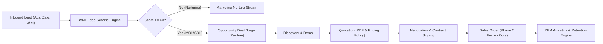
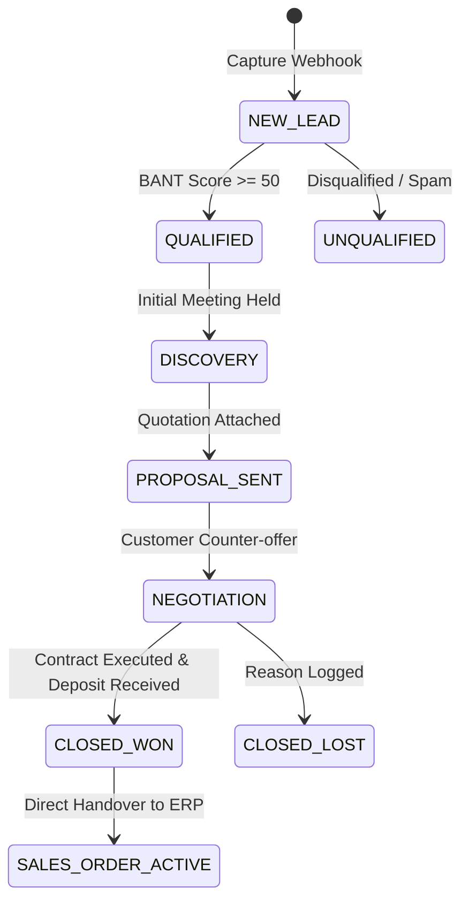

# BIZPRO+ ENTERPRISE SPECIFICATION
## Phase 4H: Enterprise CRM, Lead-to-Cash Pipeline & RFM Customer Analytics

**Document Version:** 1.0.0  
**Status:** SPECIFICATION-ONLY (Phase 4 Spec Series - Strict Zero Mutation Guardrail)  
**Target Release:** Post-v1.0.0 Enterprise Scope  
**Author:** BizPro+ Architecture & Revenue Operations Guild  
**Audit Context:** Independent Senior Technical Auditor Roadmap (Revision 16 Closed, Full Acceptance)  

---

### GOVERNANCE & ARCHITECTURAL CONSTRAINTS
> [!IMPORTANT]
> **Strict Governance Rules**:
> 1. **Core Frozen (Phases 1A–3F & OPS-01/02/03)**: All existing core services, controllers, guards, and database schemas remain strictly immutable.
> 2. **Spec-Only Scope**: This document specifies target architectures, event workflows, and schema blueprints. **NO** database migrations, table modifications, or backend entity mutations are executed in the current repository state.
> 3. **Demo Transparency**: Any frontend UI components illustrating CRM and RFM features are explicitly labeled as `Demo Simulation` / `Mô phỏng quy trình`, with qualified targets (e.g., "Mục tiêu thiết kế" / "Minh họa kịch bản") to prevent operational misrepresentation.

---

## 1. Executive Summary & Business Context

In an integrated Vietnamese enterprise ERP ecosystem, Customer Relationship Management (CRM) is not a standalone contact book; it is the **growth engine** that connects marketing outreach with sales execution, contractual fulfillment, and revenue recognition.

Phase 4H establishes the technical and architectural blueprint for:
1. **End-to-End B2B Lead-to-Cash Pipeline**: Bridging inbound marketing channels (Facebook Ads, Google Forms, Zalo ZNS, Trade Shows) through BANT qualification scoring into structured sales opportunities, quotations, contracts, and direct conversion into Phase 2 sales orders (`SalesOrder`).
2. **RFM (Recency, Frequency, Monetary) Customer Segmentation Matrix**: Quantitative analytics partitioning accounts into actionable cohorts (Champions, Loyalists, At Risk, Churned) to maximize Customer Lifetime Value (CLV).
3. **Unit Economics & SaaS/B2B Financial Metrics**: Mathematical models tracking Customer Acquisition Cost (CAC), CAC Payback Period ($< 12$ months), Net Revenue Retention (NRR $\ge 110\%$), and Gross Margin contribution.
4. **Automated Lead Routing & SLA Escalation**: Weighted round-robin and territory routing with a 15-minute SLA for high-intent MQL/SQL leads.



---

## 2. B2B Lead-to-Cash Pipeline Architecture

### 2.1 Lead Qualification Engine: Weighted BANT Framework
Every inbound lead is evaluated against a normalized 0–100 BANT scoring algorithm:

$$\text{Lead Score} = (w_B \cdot S_B) + (w_A \cdot S_A) + (w_N \cdot S_N) + (w_T \cdot S_T)$$

Where weights are calibrated for Vietnamese enterprise B2B sales:
- **Budget ($w_B = 0.30$)**:
  * Score 100: Confirmed enterprise budget allocated ($> 200\text{M VNĐ}$).
  * Score 70: Estimated budget within range ($50\text{M} - 200\text{M VNĐ}$).
  * Score 30: Budget pending approval / discretionary ($< 50\text{M VNĐ}$).
  * Score 0: No budget or exploratory inquiry.
- **Authority ($w_A = 0.25$)**:
  * Score 100: C-Level / Owner / General Director (Người quyết định tối cao).
  * Score 75: Head of Department / Purchasing Manager (Trưởng bộ phận / Trưởng ban mua hàng).
  * Score 40: Project Team Member / Specialist (Chuyên viên thẩm định).
  * Score 10: General staff / student / unidentified.
- **Need ($w_N = 0.25$)**:
  * Score 100: Active pain point with operational cost / regulatory deadline (e.g., VAT TT78 compliance, inventory desync).
  * Score 70: Desire to upgrade existing legacy software.
  * Score 30: General feature inquiry.
  * Score 0: Academic curiosity.
- **Timeline ($w_T = 0.20$)**:
  * Score 100: Implementation required within 30 days.
  * Score 75: Implementation planned within 1–3 months.
  * Score 40: Implementation planned in 3–6 months.
  * Score 10: $> 6$ months or unspecified.

#### Classification Thresholds
- **Score $\ge 75$**: Sales Qualified Lead (SQL) $\to$ Instant assignment to Senior Account Executive (AE); SLA: 15-minute first touch.
- **Score $50 - 74$**: Marketing Qualified Lead (MQL) $\to$ Assigned to Business Development Rep (BDR); SLA: 2-hour first touch.
- **Score $< 50$**: Information Lead $\to$ Enrolled in automated email/Zalo nurturing drip campaign.

### 2.2 Deal Pipeline Lifecycle & State Machine
The sales pipeline enforces strict stage-gate requirements before moving across Kanban columns:



#### Transition Gate Requirements
1. `NEW_LEAD` $\to$ `QUALIFIED`: Verified phone number (VN format 10 digits), corporate email domain, tax code (Mã số thuế) validated against National Business Registry API.
2. `QUALIFIED` $\to$ `DISCOVERY`: Meeting minutes logged, decision-maker identified.
3. `DISCOVERY` $\to$ `PROPOSAL_SENT`: Quotation generated using enterprise discount policy and approved by Sales Director if discount exceeds 10%.
4. `PROPOSAL_SENT` $\to$ `NEGOTIATION`: Customer feedback documented, legal review initiated for custom SLAs.
5. `NEGOTIATION` $\to$ `CLOSED_WON`:
   - Digital contract signed via VNPT-CA / Viettel-CA / DocuSign.
   - Advance deposit verified (Bank transfer / Napas / Cashier receipt).
   - Automated creation of ERP `SalesOrder` in status `CONFIRMED` with locked inventory allocation.
6. `CLOSED_LOST`: Mandatory loss category (Price, Feature Gap, Competitor, Budget Cut, Timing) and competitor identification for market intelligence.

---

## 3. RFM Customer Segmentation Matrix

### 3.1 Mathematical Quintile Scoring
RFM analytics categorizes existing customers into behavioral segments based on historical ERP transactions over a 365-day rolling window:
- **Recency ($R$)**: Days since the last completed order (`DATEDIFF(NOW(), MAX(OrderDate))`).
  * $R=5$: $\le 30$ days
  * $R=4$: $31 - 90$ days
  * $R=3$: $91 - 180$ days
  * $R=2$: $181 - 270$ days
  * $R=1$: $> 270$ days
- **Frequency ($F$)**: Total completed orders in 365 days.
  * $F=5$: $\ge 24$ orders
  * $F=4$: $12 - 23$ orders
  * $F=3$: $6 - 11$ orders
  * $F=2$: $2 - 5$ orders
  * $F=1$: $1$ order
- **Monetary ($M$)**: Cumulative revenue generated in 365 days.
  * $M=5$: $> 500\text{M VNĐ}$
  * $M=4$: $200\text{M} - 500\text{M VNĐ}$
  * $M=3$: $50\text{M} - 200\text{M VNĐ}$
  * $M=2$: $15\text{M} - 50\text{M VNĐ}$
  * $M=1$: $< 15\text{M VNĐ}$

### 3.2 Actionable Customer Segments & Automated Playbooks

| Segment Name | RFM Criteria | % Customer Base | Business Health Impact | Automated CRM Playbook |
| :--- | :--- | :--- | :--- | :--- |
| **Champions (Khách Hàng Kim Cương)** | $R \in [4,5]$, $F \in [4,5]$, $M \in [4,5]$ | 8% | 52% of total revenue | Dedicated Key Account Manager, annual VIP gifts, beta access to new ERP features, invitation to Advisory Board. |
| **Loyal Customers (Khách Hàng Thân Thiết)** | $R \in [3,5]$, $F \in [3,4]$, $M \in [3,4]$ | 18% | 26% of total revenue | Upsell complementary modules (e.g. Omnichannel, E-Invoice), volume rebates, priority logistics SLA. |
| **Potential Loyalists (Khách Tiềm Năng)** | $R \in [4,5]$, $F \in [1,2]$, $M \in [2,4]$ | 24% | 12% of total revenue | Onboarding health check, training webinars, promotional vouchers for second and third order completion. |
| **At Risk / Hibernating (Nguy Cơ Rời Bỏ)** | $R \in [1,2]$, $F \in [2,5]$, $M \in [2,5]$ | 12% | 8% of total revenue | Automated retention trigger: Alert assigned sales rep, discount revival campaign, executive check-in call. |
| **Lost / Churned (Đã Rời Bỏ)** | $R = 1$, $F = 1$, $M \in [1,2]$ | 38% | 2% of total revenue | Exit survey, automated re-engagement drip after 6 months with major product release notes. |

---

## 4. Unit Economics & Financial Retention Framework

For enterprise sustainability, BizPro+ models B2B unit economics aligned with SaaS and software distribution best practices:

### 4.1 Key Performance Formulas
1. **Customer Acquisition Cost (CAC)**:
   $$\text{CAC} = \frac{\sum (\text{Marketing Spend} + \text{Sales Salaries} + \text{Commissions} + \text{Tools})}{\text{New Customers Acquired}}$$
2. **Customer Lifetime Value (CLV)**:
   $$\text{CLV} = \frac{\text{Average Order Value (AOV)} \times \text{Purchase Frequency} \times \text{Gross Margin \%}}{\text{Churn Rate}}$$
3. **CAC Payback Period**:
   $$\text{Payback Months} = \frac{\text{CAC}}{\text{Average Monthly Gross Profit per Customer}} \quad (\text{Target: } < 12 \text{ months})$$
4. **Net Revenue Retention (NRR)**:
   $$\text{NRR} = \frac{(\text{Beginning MRR} + \text{Expansion} - \text{Contraction} - \text{Churn})}{\text{Beginning MRR}} \times 100\% \quad (\text{Target: } \ge 110\%)$$

---

## 5. Automated Lead Routing & SLA Escalation Engine

### 5.1 Assignment Algorithms
- **Round-Robin with Capacity Weighting**: Distributes leads evenly across sales reps based on active deal capacity (max 20 concurrent active deals per rep).
- **Geographic Territory Routing**:
  * North (Miền Bắc: Hà Nội, Hải Phòng, Bắc Ninh...): Routed to Hanoi Commercial Hub.
  * Central (Miền Trung: Đà Nẵng, Quảng Nam, Huế...): Routed to Da Nang Branch.
  * South (Miền Nam: TP.HCM, Bình Dương, Đồng Nai...): Routed to Saigon Commercial Hub.
- **Enterprise High-Value Bypass**: Leads with estimated deal value $> 500\text{M VNĐ}$ or employee count $> 200$ bypass tier-1 reps and route directly to Enterprise Key Account Directors.

### 5.2 SLA Management & Auto-Escalation
- **SLA Breach Threshold**: If an SQL lead is not acknowledged and contacted within 15 minutes during business hours (8:00–17:30 VN Time):
  1. Instant notification sent via Zalo ZNS / SMS to Sales Supervisor.
  2. If unacknowledged at 30 minutes, automatically re-routed to the next available AE.
  3. SLA compliance metric recorded on rep performance scorecard.

---

## 6. Target Database Schema Extensions (SPEC-ONLY)

> [!NOTE]
> The following schema is a **target specification blueprint** for future Phase 4 integration. In adherence to strict frozen core governance, **NO migrations or schema alterations** are applied to the active production database.

```prisma
// =========================================================================
// PHASE 4H: CRM & REVENUE OPERATIONS EXTENSIONS (SPECIFICATION-ONLY)
// =========================================================================

enum LeadStatus {
  NEW
  CONTACTED
  QUALIFIED_MQL
  QUALIFIED_SQL
  UNQUALIFIED
  CONVERTED
}

enum DealStage {
  PROSPECTING
  DISCOVERY
  PROPOSAL_SENT
  NEGOTIATION
  CLOSED_WON
  CLOSED_LOST
}

enum RfmSegmentType {
  CHAMPION
  LOYAL_CUSTOMER
  POTENTIAL_LOYALIST
  NEW_CUSTOMER
  NEED_ATTENTION
  AT_RISK
  ABOUT_TO_SLEEP
  HIBERNATING
  LOST
}

model CrmLead {
  id              String      @id @default(uuid())
  organizationId  String
  code            String      @unique // e.g. "LEAD-2026-0001"
  fullName        String
  companyName     String?
  taxCode         String?     // Mã số thuế doanh nghiệp
  phone           String
  email           String?
  source          String      // "FACEBOOK_ADS", "GOOGLE_SEARCH", "ZALO", "WEBSITE", "REFERRAL"
  
  // BANT Qualification Scores (0-100)
  budgetScore     Int         @default(0)
  authorityScore  Int         @default(0)
  needScore       Int         @default(0)
  timelineScore   Int         @default(0)
  totalBantScore  Int         @default(0) // Weighted composite score
  
  status          LeadStatus  @default(NEW)
  assignedToUserId String?    // Sales Rep ID
  firstTouchAt    DateTime?   // Timestamp of initial contact (SLA tracking)
  slaBreached     Boolean     @default(false)
  
  dealId          String?     // Converted Deal reference
  createdAt       DateTime    @default(now())
  updatedAt       DateTime    @updatedAt

  @@index([organizationId, status])
  @@index([organizationId, assignedToUserId])
  @@index([organizationId, totalBantScore])
}

model CrmDeal {
  id              String      @id @default(uuid())
  organizationId  String
  code            String      @unique // e.g. "DEAL-2026-0891"
  title           String
  customerId      String      // Foreign key to Customer (Phase 2 core)
  stage           DealStage   @default(PROSPECTING)
  expectedAmount  Decimal     @db.Decimal(18, 2)
  probabilityPct  Int         @default(20) // 10% to 100%
  expectedCloseAt DateTime
  closedAt        DateTime?
  lossReason      String?     // "PRICE", "FEATURE_GAP", "COMPETITOR", "BUDGET", "TIMING"
  salesOrderId    String?     // Linked to SalesOrder when CLOSED_WON
  
  ownerId         String      // Sales Account Executive
  createdAt       DateTime    @default(now())
  updatedAt       DateTime    @updatedAt

  @@index([organizationId, stage])
  @@index([organizationId, customerId])
}

model CrmCustomerRfmSnapshot {
  id              String          @id @default(uuid())
  organizationId  String
  customerId      String
  periodDate      DateTime        @db.Date
  recencyDays     Int             // Days since last purchase
  frequencyCount  Int             // Completed order count in 365 days
  monetaryTotal   Decimal         @db.Decimal(18, 2) // Cumulative spend in 365 days
  
  rScore          Int             // 1 to 5
  fScore          Int             // 1 to 5
  mScore          Int             // 1 to 5
  segment         RfmSegmentType
  
  createdAt       DateTime        @default(now())

  @@unique([organizationId, customerId, periodDate])
  @@index([organizationId, segment])
}
```

---

## 7. Governance, Transparency & Conclusion

1. **Frozen Core Preservation**: This document and its accompanying frontend simulations do not alter any Phase 1A–3F controller, schema, or test suite.
2. **Demo Transparency Standard**: In the user interface, all mock metrics, deal pipelines, and RFM visualizations carry explicit simulation notices and design targets.
3. **Audit Readiness**: All formulas adhere to Vietnamese business conventions, tax validation APIs, and standard SaaS unit economics.

---
*End of Phase 4H Architecture Specification.*
