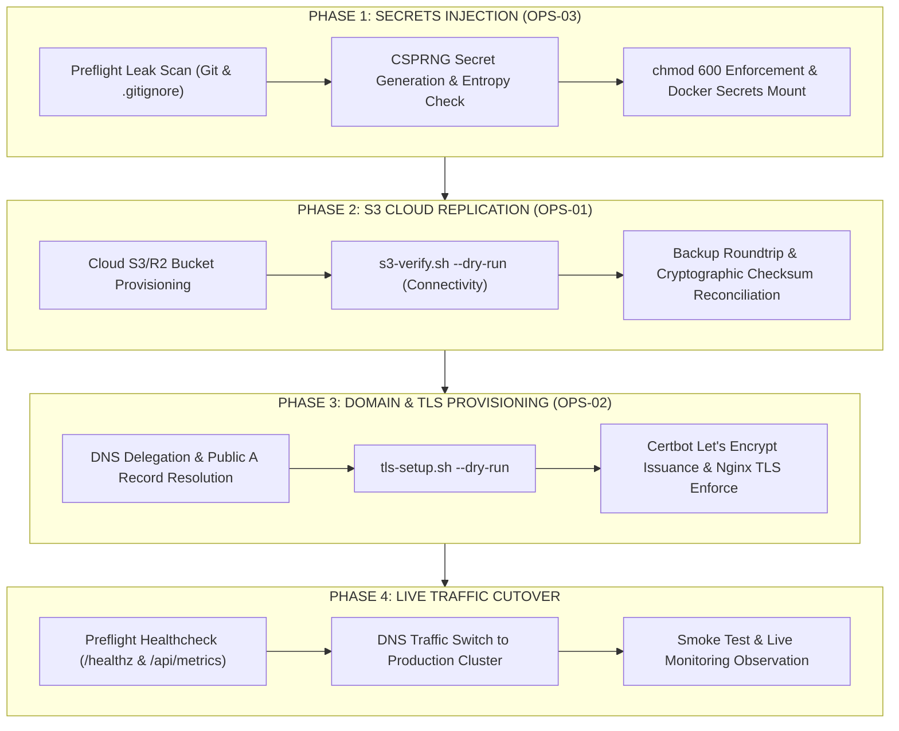

# BIZPRO+ PRODUCTION CUTOVER RUNBOOK

**Project:** BizPro+ Integrated Modular Business Management System  
**Document Standard:** Senior DevOps Engineer & Security Operations Standards  
**Target Audience:** DevOps Engineers, System Administrators & Site Reliability Engineers (SRE)  
**Date:** 2026-11-06  
**Status:** OFFICIAL OPERATIONAL CUTOVER MANUAL  

---

## 1. Executive Overview & Architecture Topology

This runbook establishes the definitive, idempotent, fail-closed operational procedure to transition BizPro+ from technical completion (`PRODUCTION READY WITH DOCUMENTED CONDITIONS`) to active live production hosting receiving customer traffic.



---

## 2. Mandatory Preflight Prerequisites

Before initiating the production maintenance window, verify all items in the checklist below:

| Requirement | Description | Verification Method |
| :--- | :--- | :--- |
| **Production Host** | Linux x86_64 host (Ubuntu 22.04 LTS / Debian 12 / RHEL 9) with Docker Compose v2.20+. | `docker compose version` |
| **Storage Volume** | Dedicated high-IOPS NVMe volume mounted at `/var/lib/docker/volumes` or `/backups`. | `df -h /backups` (Min 50GB free) |
| **Cloud Object Storage** | AWS S3, Cloudflare R2, or MinIO bucket with versioning and SSE enabled. | Bucket ARN and IAM Policy ready |
| **DNS Delegation** | Public FQDN (e.g. `app.bizpro.vn`) with A/AAAA record pointing to host public IP. | `nslookup <domain>` |
| **Edge Ingress Ports** | Host firewall allows inbound TCP 80 (HTTP/ACME) and TCP 443 (HTTPS). | `ufw status` or cloud security group |

---

## 3. Step-by-Step Cutover Execution Procedure

### Step 1: Production Secrets Management (OPS-03)
Execute `scripts/cutover/secrets-inject.sh` to audit cryptographic entropy, enforce access control (`chmod 600`), and scan repository for leakage.

#### 1.1 Dry-Run Audit
```bash
./scripts/cutover/secrets-inject.sh --dry-run --env-file .env.production
```
- **Expected Outcome:** Scans `.gitignore`, ensures `.env.production` is untracked in Git, validates all 6 core secrets exceed length minimums (JWT $\ge 64$ chars, DB $\ge 32$ chars, HMAC strictly 64 hex characters), and confirms zero placeholder values.
- **Exit Code:** `0` (Success).

#### 1.2 Execution & Secret Injection
```bash
./scripts/cutover/secrets-inject.sh --env-file .env.production
```
- **Security Rule:** Never commit `.env.production` to Git. Ensure file ownership belongs exclusively to the deployment user with permissions `600`.

---

### Step 2: S3 Offsite Backup Replication & Verification (OPS-01)
Execute `scripts/cutover/s3-verify.sh` to validate remote cloud bucket connectivity, roundtrip upload/download, and cryptographic checksum matching.

#### 2.1 Dry-Run Connectivity Preflight
```bash
export S3_BACKUP_BUCKET="bizpro-production-backups-sg"
export AWS_ACCESS_KEY_ID="AKIA..."
export AWS_SECRET_ACCESS_KEY="..."
export AWS_DEFAULT_REGION="ap-southeast-1"

./scripts/cutover/s3-verify.sh --dry-run
```
- **Expected Outcome:** Tests bucket connectivity without modifying data.
- **Exit Code:** `0` (Ready). If credentials are missing, exits with `2` (`BLOCKED BY ENVIRONMENT`).

#### 2.2 Live Roundtrip & Cryptographic Verification
```bash
./scripts/cutover/s3-verify.sh
```
- **Execution Flow:**
  1. Locates latest encrypted backup (`.dump.enc`, `.dump.hmac`, `.dump.json`).
  2. Uploads artifacts to `s3://${S3_BACKUP_BUCKET}/cutover_verification/`.
  3. Downloads artifacts back to temporary directory `/tmp/s3_verification_*/`.
  4. Reconciles local SHA-256 and HMAC against downloaded copies.
  5. Cleans up scratch directory and verification test keys.
- **Expected Output:**
  ```json
  {"event":"s3_verification_passed","status":"PASS","bucket":"bizpro-production-backups-sg","sha256":"..."}
  ```
- **Exit Code:** `0` (Certified for live traffic).

---

### Step 3: Domain Delegation & Automated TLS Provisioning (OPS-02)
Execute `scripts/cutover/tls-setup.sh` to validate DNS propagation, obtain Let's Encrypt SSL/TLS certificates, update Nginx configuration, and reload services safely.

#### 3.1 DNS Preflight & Staging Dry-Run
```bash
./scripts/cutover/tls-setup.sh --domain app.bizpro.vn --staging --dry-run
```
- **Expected Outcome:** Verifies `app.bizpro.vn` resolves to host public IP; validates Let's Encrypt challenge compatibility.
- **Exit Code:** `0` (PASS). If DNS resolution fails, exits with `3` (`BLOCKED BY ENVIRONMENT`).

#### 3.2 Live Production Certificate Acquisition
```bash
./scripts/cutover/tls-setup.sh --domain app.bizpro.vn --email noc@bizpro.vn
```
- **Execution Flow:**
  1. Provisions ACME challenge in `/var/www/certbot/.well-known/acme-challenge/`.
  2. Generates ECDSA / RSA 2048-bit certificates in `/etc/letsencrypt/live/app.bizpro.vn/`.
  3. Backs up current `nginx/conf.d/default.conf` to `.bak_*`.
  4. Writes enforced HTTPS configuration (TLS 1.2/1.3, HSTS `max-age=63072000`, metrics restriction).
  5. Executes `nginx -t`. If syntax fails, automatically rolls back to backup copy.
  6. Reloads Nginx with zero dropped connections (`nginx -s reload`).
- **Exit Code:** `0` (PASS).

---

### Step 4: Live Cluster Verification & Health Smoke Test
With OPS-01, OPS-02, and OPS-03 satisfied, execute smoke testing across all microservices:

```bash
# 1. Nginx In-container Healthcheck
curl -kfsS http://localhost/healthz
# Expected: OK

# 2. Public HTTPS Endpoint Verification
curl -fsS https://app.bizpro.vn/api/v1/auth/health
# Expected: HTTP 200 JSON

# 3. Restricted Metrics Endpoint (Untrusted external access must be blocked)
curl -s -o /dev/null -w "%{http_code}" https://app.bizpro.vn/api/metrics
# Expected: 403 Forbidden

# 4. Internal Prometheus Scraper Access
docker exec bizpro_prod_backend curl -fsS http://127.0.0.1:4000/api/metrics | grep "bizpro_uptime_seconds"
# Expected: bizpro_uptime_seconds > 0
```

---

## 4. Rollback & Disaster Recovery Procedures

### 4.1 Ingress Rollback (TLS Failure)
If Nginx fails to start or certificate validation produces issues:
```bash
cp /etc/nginx/conf.d/default.conf.bak_* /etc/nginx/conf.d/default.conf
nginx -t && nginx -s reload
```
Reverts Nginx to HTTP port 80 routing without disrupting container networking.

### 4.2 Database Rollback & Restore Drill
If data corruption occurs during migration or startup:
```bash
# Execute Fail-Closed restore from verified encrypted backup
BACKUP_HMAC_KEY="$(cat /etc/bizpro_vault/hmac.key)" \
POSTGRES_PASSWORD="${POSTGRES_PASSWORD}" \
  /scripts/restore.sh /backups/daily/<latest_valid_backup>.dump.enc bizpro_db
```
Restores all 56 tables, organizations, users, and multi-tenant RLS policies within certified RTO ($\le 120$ seconds).

---

## 5. Post-Cutover Day 2 Operations

### 5.1 Activating Continuous WAL Archiving (PITR)
- **Certified Operational SLA:** RPO $\le 24$ hours (Daily Encrypt-then-MAC Snapshot).
- **Sub-Hour PITR Activation:**
  1. Schedule a 2-minute maintenance window.
  2. Edit `postgresql.conf` on Postgres volume:
     ```ini
     wal_level = replica
     archive_mode = on
     archive_command = '/scripts/wal-archive.sh %p %f'
     archive_timeout = 900 # 15 minutes max lag
     ```
  3. Restart container: `docker compose restart postgres`.
  4. Verify WAL segments archived to `/backups/wal/`.

### 5.2 Automated Certificate Renewal
Certbot automatically renews certificates expiring within 30 days:
```bash
# Add cron job to crontab -e
0 3 * * * certbot renew --post-hook "docker exec bizpro_prod_nginx nginx -s reload" > /var/log/certbot-renew.log 2>&1
```

---

## 6. Official Cutover Sign-off Gate

| Cutover Gate | Prerequisite | Verification Tool | Sign-off Authority |
| :--- | :--- | :--- | :--- |
| **Gate 1: Secrets Injection (OPS-03)** | Zero placeholders, `chmod 600`, zero Git leaks | `scripts/cutover/secrets-inject.sh` | Lead Security Engineer |
| **Gate 2: S3 Offsite Replication (OPS-01)** | Cloud bucket roundtrip verified, SHA-256 match | `scripts/cutover/s3-verify.sh` | Lead DevOps Engineer |
| **Gate 3: Domain & TLS Ingress (OPS-02)** | Public DNS resolved, Let's Encrypt TLS active | `scripts/cutover/tls-setup.sh` | Infrastructure Architect |
| **Production Traffic Redirection** | Gates 1, 2, and 3 100% PASS | Post-cutover smoke test suite | Project Owner & CTO |
